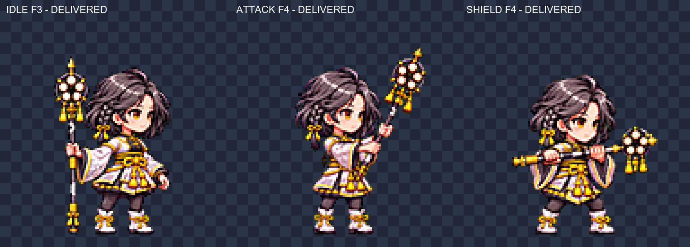

# ART-100A · Jupi 천둥 북잡이 기본 동작

**완료:** 대기·공격·방어 3행, 18프레임을 후보로 납품했다. **현재 상태:** 승리·패배는 두 번씩 생성했으나 아래 기준을 충족하지 못해 미납품이다. 게임 연결과 Godot 실행은 하지 않았다. commit.ps1은 작성만 했고 실행하지 않았다.

| 행 | 프레임 | fps | 공통 factor | 머리 배율 / 유효 프레임 | 디테일 평균 / 앵커 | 상태 |
|---|---:|---:|---:|---|---:|---|
| idle | 6 | 6.3 | 0.240 | 1.00 (6/6) | 102.49% | 후보 납품 |
| attack | 6 | 35.25 | 0.275 | 1.02 (6/6) | 99.87% | 후보 납품 |
| shield | 6 | 12 | 0.275 | 1.02 (6/6) | 100.58% | 후보 납품 |
| victory | 6 | 8 | 0.265 | 1.01 (6/6) | 104.60% | 미납품 |
| defeat | 6 | 10 | 0.310 | 수동 비교 (자동 유효 1/6) | 101.29% | 미납품 |

미납품 행의 수치는 보고서 검토본 값이다(승리 2차, 패배 1차). 자동 점수 0.6 이상이 두 프레임 미만인 패배는 자동 중앙값 1.00을 합격값으로 쓰지 않았다.

왼쪽부터 실제 납품 대기 F3, 공격 F4, 방어 F4의 최근접 4배 확대다. 각 행의 전체 판은 idle.png, attack.png, shield.png, victory.png, defeat.png에 있다. 192칸은 개별 4배 프레임도 직접 확인했다.

## 측정한 것

- normalize.py: LANCZOS, sharpen 60, despill auto, palette none, 초록 배경 제거, ground-all. 행마다 공통 배율 하나와 가로 기준점 하나만 썼다. 공용 도구 수정이나 몸 부위 붙이기는 없다.
- 대기 F1은 카드 지시대로 앵커 **전체 프레임 그대로**다. 원본 앵커 해시와 F1 RGBA 배열 일치를 확인했다.
- 납품 세 행 모두 이진 알파, 경계 침범 0, 초록 번짐 0, 최소 여백 7px. 모든 프레임 디테일은 앵커의 90% 이상이다. 디테일은 내부 명암 변화량이며 미술 완성도 점수가 아니다.
- 두 부츠 하단 띠의 중점을 순서대로 대응했다. 대기는 왼쪽 스태프 접촉점을 제외하고 루프도 포함했다. 최대 발 이동: 대기 1.5px, 공격 1.0px, 방어 1.0px.
- 고정 가로 기준점(원본 칸 x): 대기 194.5, 공격 182.0, 방어 176.5. 방어는 원본 두 부츠 중점의 중앙값 하나를 썼다. 프레임별 위치 보정은 없다.
- 승리 1차 발 이동 최대 7.5px, 2차 9.0px. 공통 기준점으로 정리해도 원본 이동이 남는다.
- 패배 1차 F5/F6 몸의 오른쪽 부츠 영역을 직접 지정해 잰 바닥 간격은 5/4px다. defeat-floor.png의 파란 선은 발선 바로 아래, 주황 상자는 스태프를 제외한 측정 영역이다.
- head-boxes.json은 검토용 크롭 좌표이며 해부학적 머리 분할 결과가 아니다. 패배의 기울어진 머리는 전체 4배 판과 크롭을 육안 비교했다.

## 직접 본 것

- 납품 세 행에서 검은 단발·옆 땋은 머리, 흰 의식복, 노란 매듭·술, 짙은 타이츠·흰 부츠, 다섯 북이 달린 스태프가 유지된다. 얼굴은 하나이며 손과 스태프가 얼굴을 가리지 않는다. 이펙트는 없다. 모든 손가락 수를 확정할 해상도는 아니다.
- 대기는 상체·매듭이 작게 호흡한다. F1 원본과 새 프레임 사이에 스태프 끝 최대 3px 높이 차이와 옷 주름·끈 세부 변화가 남는다. 완벽히 고정된 소품 또는 깜빡임 없는 재생이라고 주장하지 않는다.
- 공격은 F4에서 가장 뚜렷하게 뻗고 회수한다. 짧은 대각 찌르기여서 동작 폭은 작다. 기본 시트 예비 공격 후보로 제출한다.
- 방어는 스태프를 허리에서 턱 아래로 올리고 몸을 낮춘 뒤 유지한다.
- 승리는 회전·미소가 읽히지만 발이 미끄러져 미납품이다. 2차는 마지막 스태프를 손으로 잡지만 발 이동이 해결되지 않았다.
- 패배 1차는 여섯 단계가 읽히지만 몸이 바닥에 닿지 않는다. 2차는 스태프가 공중에 떠 보인다. 어느 것도 bakeoff 완성 후보로 복사하지 않았다.

## 제작 이력과 확인

내장 ImageGen만 사용했다. 대기 2회, 공격 2회, 방어 1회, 승리 2회, 패배 2회, 총 9회다. 원본과 앵커는 art/raw/jupi-100a/, 모든 프롬프트는 prompts.txt에 있다. 지정 Python과 Pillow/numpy만 사용했고 패키지를 설치하지 않았다.

대기 1차는 발 사이 검은 잔여 픽셀로 제외했다. 공격 1차는 F4 스태프가 원본 균등 칸의 오른쪽 경계에 닿아 도구가 거부했다. 칸을 임의 간격으로 다시 자르거나 조각을 지우지 않았다. 실패 원본도 확대 검토 자료로 남겼다.

PNG/JSON 규격, fps·반복 정보, 복사본 해시, 앵커 F1, 머리·디테일·여백·번짐·발 이동을 확인했다(validation.json). 실시간 애니메이션이나 Godot 재생은 검증하지 않았다. rebuild.ps1은 같은 정규화 재현용으로 작성했으며, 전체를 재실행했다고 주장하지 않는다.

로컬 저장 도구 두 차례 실패와 명령 응답 지연이 있었다. 실패한 프롬프트 저장은 PowerShell의 명시적 UTF-8 쓰기로 완료했다. 파일 존재와 해시를 확인했다.

## 남은 작업 / 다음 권장 단계

리드가 납품 3행을 검수하고 설치 여부를 결정한다. 승리는 고정된 발을 유지하는 원본, 패배는 몸과 떨어진 스태프가 함께 바닥에 놓이는 원본을 다시 그려야 한다. 카드의 2회 한도를 소진해 추가 생성하지 않았다. 다른 클론의 걷기·점프·낙하·피격·착지는 범위 밖이다. 새 할 일 위젯 항목은 만들지 않았다.

전체 클론 C:\Users\TH\Documents\AI\GameProject\SmashNine-units\art-a\SmashNine: **3.994GiB**, 이번 report+raw 약 **23.8MiB**. 크기 검사 오류 0건. 큰 영상 중간 파일은 만들지 않았다.
