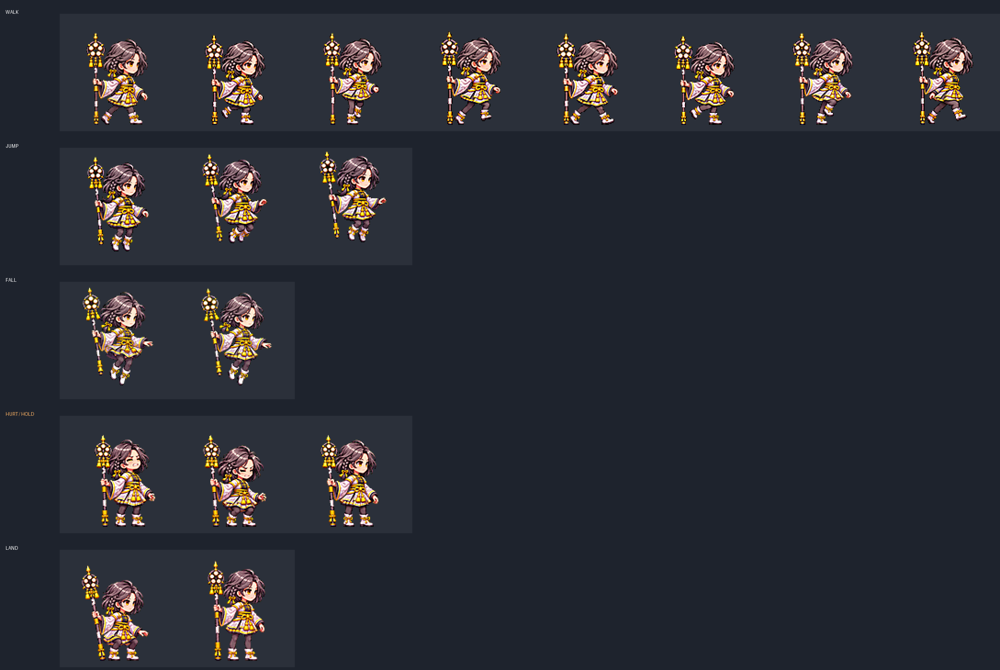

# ART-100B — 유피 2안 기본 동작 후보

완료: 걷기·점프·낙하·착지 **4개 행, 15프레임**을 `art/bakeoff/jupi/`에 PNG/JSON으로 납품했다. 피격은 공통 가로 기준점에서 발이 7px 움직여 미납품이다. 제품 소스·게임 시트·재생 속도 설정은 변경하지 않았고, 게임 적용과 커밋은 하지 않았다.

## 행별 결과

| 순서 | 행 | 프레임 | fps | 정규화 factor | 머리 배율 중앙값 | detail 최소 / 평균 | 결과 |
|---|---|---:|---:|---|---:|---:|---|
| 1 | walk | 8 | 13.3 | F1 0.114, F2–8 0.100 | 1.010 | 104.18 / 117.02% | 후보 납품 |
| 2 | jump | 3 | 10 | 0.190 | 0.960 | 102.41 / 103.75% | 후보 납품 |
| 3 | fall | 2 | 8 | 0.160 | 1.000 | 95.19 / 97.28% | 후보 납품 |
| 4 | hurt | 3 | 12 | 0.160 | 0.980¹ | 99.67 / 101.44% | **미납품**, 보고서에만 보관 |
| 5 | land | 2 | 12 | 0.160 | 1.000 | 96.43 / 98.22% | 후보 납품 |

detail은 `normalize.interior_detail`의 앵커 대비 수치이며 그림의 품질 점수가 아니다. 최소값도 모든 행에서 90% 이상이다. ¹피격은 3프레임 중 신뢰도 0.6 이상인 F2·F3만 중앙값에 사용했다. F1은 얼굴이 기울고 눈이 감겨 점수 0.4473이며, 4배 확대해서 별도 확인했다.

## 실제 그림과 육안 판단

위 그림은 실제 최종 픽셀을 2배로 배치한 요약판이다. `HURT / HOLD`는 게임 후보에 넣지 않은 피격이다. 각 행의 원본 4배 검토판은 [걷기](walk.png), [점프](jump.png), [낙하](fall.png), [피격](hurt.png), [착지](land.png)이며, 화면에서 축소될 경우 `*-pair-*.png`를 열면 앵커와 두 프레임을 4배로 비교할 수 있다.

- 생성된 모든 시도와 최종 18프레임을 직접 4배로 확인했다. 검은 단발과 옆 땋은 머리, 흰 의복과 노란 매듭·술, 어두운 타이츠, 흰 부츠, 다섯 북이 달린 긴 지팡이를 비교했다. 회색 마네킹 색이 의상으로 옮겨온 부분은 보이지 않았다.
- 얼굴은 한 개이며 지팡이가 얼굴을 가리지 않는다. 손과 지팡이의 접점, 북 다섯 개, 부츠 실루엣을 확인했다. 번개·광원·구름·속도선은 넣지 않았다.
- 걷기 F1/F5의 선행 다리가 바뀌고 F3/F7에서는 각각 가까운 다리/먼 다리가 지지한다. F8은 자유로운 팔이 다른 프레임보다 크게 뒤로 가며 몸의 가로 흔들림도 조금 보인다. 완전히 흔들림 없는 루프라고 평가하지 않는다.
- 점프는 이륙·상승·정점, 낙하는 의복과 장식이 들린 두 자세로 읽힌다. 낙하의 두 프레임 차이는 작다.
- 착지 F2는 앵커보다 다리가 곧고 길어 보여 서 있는 전체 키가 커 보인다. 머리 배율은 통과하지만 이 비례 차이는 후속 육안 검토 사항이다.
- `*-4x.gif`는 미리보기 파일로 만들었다. 실시간 재생을 관찰하거나 Godot에서 실행한 것은 아니다. 비반복 행도 GIF에서는 비교용으로 반복되며, 납품 JSON은 카드의 `loop` 값을 따른다.

## 측정 결과

| 행 | 최소 여백 | 경계 픽셀 | 초록 잔색 | 신뢰도 ≥ 0.6 머리 측정 |
|---|---:|---:|---:|---:|
| walk | 7px | 0 | 0 | 8 / 8 |
| jump | 4px | 0 | 0 | 3 / 3 |
| fall | 6px | 0 | 0 | 2 / 2 |
| hurt (미납품) | 7px | 0 | 0 | 2 / 3 |
| land | 7px | 0 | 0 | 2 / 2 |

모든 프레임의 알파는 0/255다. 점프 여백 4px와 머리 배율 0.96은 허용 범위의 하한이다. `metrics.json`에는 프레임별 원자료를 남겼다. 그 파일의 높이는 **지팡이를 포함한 외곽 높이**이므로 카드의 몸 높이 89px와 직접 비교하면 안 된다.

### 걷기 발과 보브

- 지팡이 끝도 지면에 닿으므로 `walk_feet.py`의 원시 결과에는 지팡이를 포함한 run이 나온다. 이를 발이라고 세지 않았다. `feet-with-staff.json`은 원자료, `feet.json`은 지팡이를 제외한 부츠 영역 측정이다.
- 부츠 영역과 가까운/먼 다리의 이름은 4배 그림에서 사람이 지정했고, 그 안의 불투명 픽셀 하단 5줄로 중심을 계산했다. 일부 가려진 부츠는 보이는 부분의 위치다. `feet-roi-1.png`부터 `feet-roi-4.png`에 측정 범위를 남겼다.
- 루프 연결까지 같은 다리의 2차원 발 이동 최대 **19.235px** (기준 ≤25px). F3/F7은 지팡이를 제외하면 지지 발이 각각 하나다.
- F3 지지 발 중심 62.5px, 이웃 발의 중간 63.25px → 오차 **−0.75px**. F7은 61.5px / 63px → **−1.5px** (기준 ±6px).
- 들린 발끝은 y=113 / 111, 발선 y=120에서 **7 / 9px** 위다 (목표 6–12px).
- 최종 원본 8장을 조립한 후 `walk_bob.py`를 **한 번** 적용했다. 보정 `[3, 3, −3, 0, 2, 3, 0, 0]`px로 모두 ±3px 이내다. y≥115의 발 픽셀은 적용 전후 동일하다. `bob.json`, `bob.png`, `onion.png` 참조.

### 피격 미납품과 착지 수정

피격 1차는 발 이동 최대 4px이고 허리 술의 형태도 과했다. 2차에서 장식은 개선됐지만 한 행의 공통 기준점 x=344.0으로 처리하자 F1→F2 양발이 각각 **7px** 이동했다. 3px 기준을 넘으므로 `jupi-hurt-v1.*`는 만들지 않았다. 프레임별 위치를 따로 보정해 통과시키지 않았다. 행당 생성 2회를 소진했으므로 추가 생성을 하지 않는다.

착지 1차는 오른발 이동 5px였다. 2차 생성에서 첫 자세 전체의 가로 위치를 수정하도록 요청했고, 후처리는 여전히 공통 기준점 x=421.75 한 개를 사용했다. 최종 좌우 부츠 이동은 **1.5 / 1.0px**다. Python으로 몸의 일부를 옮기거나 프레임별 가로 위치를 맞추지 않았다.

## 제작 방법과 재현 자료

- 기준 그림: `art/bakeoff/newchar-2026-11-26/jupi/2/jupi-idle-2.png`. 모든 생성에서 첫 번째 참조다.
- 걷기는 ART-57의 회색 마네킹 코드를 유피의 약 2.5등신과 지팡이 자세에 맞춰 사용했다. F1 먼저, F2/4/5/6/8은 고정된 F1 참조, F3/7은 통과 자세 순서다. 이 신캐릭터에는 기존 게임 걷기가 없어 F1의 세 번째 참조는 앵커를 반복했다. 통과 자세의 네 번째 참조는 `walk_feet.py`로 지지 발 하나를 확인한 채택본 Luna walk-v5 F3이며, 포즈만 참조하고 의상은 유피 앵커만 따르도록 명시했다.
- 걷기 F3/F7은 각 3회, 나머지 프레임은 각 1회 생성했다. 모션은 점프/낙하 각 1회, 피격/착지 각 2회로 **총 18회**다. 모든 호출 후 UTC 시계를 확인했으며 기록은 `provenance.json`에 있다.
- 정규화: `--cell 128 --resample lanczos --sharpen 60 --despill auto --palette none --bg #00ff00`. 걷기와 지상 동작은 `--ground-all`, 공중 동작은 공통 `--lift-all 8`. 머리 배율로 factor를 정했고 웅크린 몸 높이로 맞추지 않았다.
- 각 생성은 완전한 한 그림이며 몸 부위를 다른 프레임에서 붙이지 않았다. 걷기에만 카드가 지정한 보브 도구를 사용했다. 모션 행은 한 factor, 피격/착지는 한 가로 기준점을 사용했다.
- `prepare.py`: 앵커와 포즈 참조. `process.py`: 공통 정규화. `assemble_walk.py`: 선택된 걷기 원본 조립. `finalize.py`: 검토판·수치·최종 후보 작성. `verify.py`: 자산·허용 경로 상태 검증. Python은 지정된 런타임과 기존 numpy/Pillow만 사용했다.
- 원본 18장 및 실제 참조 파일은 `art/raw/jupi-100b/`에 보관했다. `provenance.json`, `prompts.txt`에 원본 경로·정확한 프롬프트·생성 후 시각을 남겼다. `validation.json`은 복사본과 도구 원본의 SHA-256 일치를 검증한다. 원본은 Git에 포함하지 않는다.
- 재현하려면 `PYTHONDONTWRITEBYTECODE=1`과 지정 Python의 `-B`를 사용한다. `process.py <raw stem> <count> <factor>`에 공중은 `--air`, 피격/착지는 `--shared`를 붙인다. 최종 걷기 선택은 `walk-precheck.json`에 있다. 보브 입력은 `walk-before-bob.png`이며 `--face 69,44,88,61 --zone 89,115`로 한 번만 처리한다. 보브 적용본에 재적용하지 않는다.

## 현재 상태와 남은 작업

파일/알파/치수/메타데이터/머리/디테일/여백/발/보브 및 원본 복사 검증은 `validation.json`에 기록한다. 게임 실행·임포트·실제 게임 속도 검사는 하지 않았다. 시작 상태와 비교한 허용 경로 밖 Git 상태 변화는 없어야 한다. `commit.ps1`는 명시적 파일 배열로 작성만 하고 실행하지 않는다.

남은 필수 작업은 **피격 재작화**다. 추가 생성은 이 카드의 허용 횟수를 소진했으므로 진행하지 않았다. 총괄은 걷기 F8의 팔과 착지 F2의 비례를 검토하고, 사용자의 웹 예산 결정 이후 채택한 행만 게임에 설치할 수 있다.
