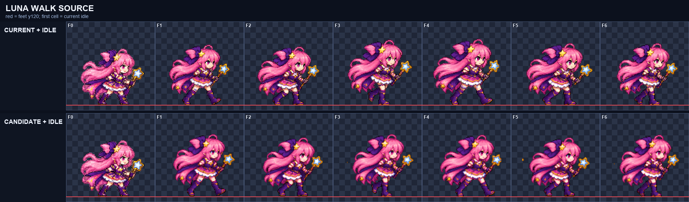
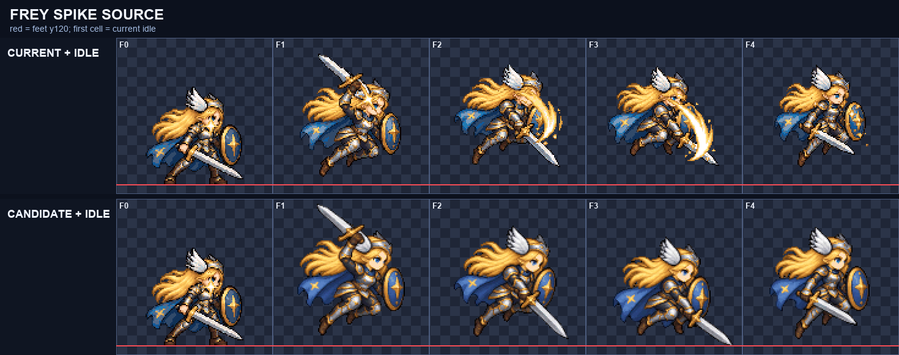
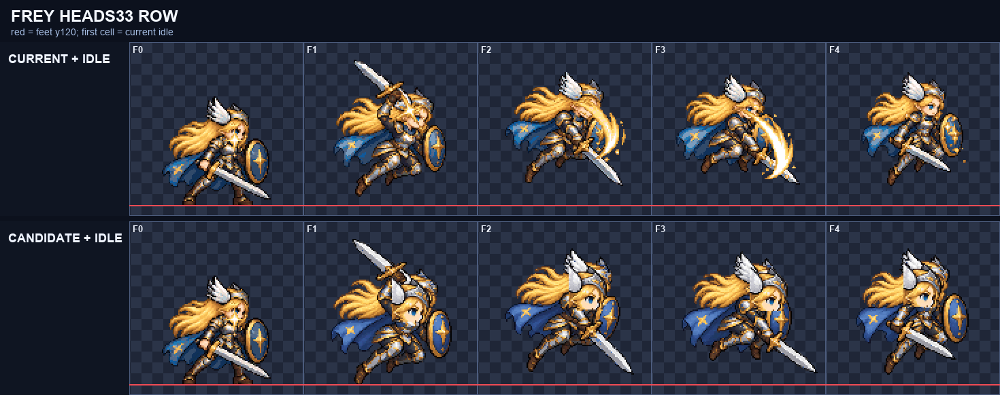

# CODEX-ART-35 결과 — 공통 스프라이트 파이프라인과 모션 겨루기

## 완료

Smash Nine의 128×128 셀 계약을 한 곳에서 적용하는 `tools/sprite_pipeline/`을 만들었다. 한 동작 전체에 배율 하나만 적용하며, 발 y=120, 공중 높이, 캐릭터별 192색 팔레트, 이진 알파, 빈 1px 테두리를 검사한다. 프레임 하나가 공통 배율에서 셀에 들어오지 않으면 그 프레임만 줄이지 않고 명시적으로 실패한다.

모션 뷰어에는 `art/bakeoff/` 후보 검색과 현재/후보 동기 비교를 추가했다. 후보가 있는 행은 `후보 N` 배지가 보이고, 선택하면 현재 행과 모든 후보가 같은 프레임 번호·배율·발선·셀선·4px 여백 가이드로 나란히 재생된다. 어두운/밝은 테마 변수를 그대로 사용하고 좁은 화면은 비교 패널을 가로 스크롤한다.

제품 코드, 게임 시트, 전투 규칙, 수치, 입력, 봇은 바꾸지 않았다.

## 도구 사용

```powershell
$py = 'C:/Users/TH/.cache/codex-runtimes/codex-primary-runtime/dependencies/python/python.exe'

& $py tools/sprite_pipeline/make_palette.py `
  smash-nine-prototype/assets/art/frey/frey_sheet.png --id frey

& $py tools/sprite_pipeline/prepare_raw.py raw.png prepared.png --grid 6x1

& $py tools/sprite_pipeline/normalize.py `
  --sheet prepared.png --grid 6x1 --bg '#00ff00' `
  --scale-by height:100 --palette tools/sprite_pipeline/palettes/frey.json `
  --reference smash-nine-prototype/assets/art/frey/frey_sheet.png:1:6 `
  --title 'FREY WALK' --out-dir reports/example --name frey-walk-v1 `
  --candidate-out art/bakeoff/frey/frey-walk-v1.png
```

출력은 6열 PNG, 프레임별 PNG, 2배 확대 `closeup.png`, 현재 게임 행과 후보를 나란히 놓은 `compare.png`, `metrics.json`이다. 정확한 옵션과 제한은 `tools/sprite_pipeline/README.md`에 있다.

## 8개 체형 팔레트

현재 게임 시트에서 사용 빈도가 높은 192색을 추출했다.

- `frey.json`, `luna.json`, `luna_brave.json`
- `nova_male.json`, `nova_female.json`
- `rio_male.json`, `rio_female.json`, `yuki.json`

원본 시트의 고유 RGB 수는 6,215~89,279색이었다. 이는 반투명 가장자리와 생성 원본의 미세 색 편차까지 센 값이며, 정규화 팔레트는 캐릭터별 상위 192색으로 제한했다.

## 실제 원본 검증

아래 수치는 `metrics.json`의 측정값이다. 세 결과 모두 출력 팔레트 위반 0, 알파 0/255, 셀 1px 테두리 비움, 최소 4px 여백을 통과했다.

| 입력 | 프레임 | 공통 배율 | 높이 px | 너비 px | 면적 px / 편차 | 바닥 y | 공중 높이 px | 출력 색 수 |
| --- | ---: | ---: | ---: | ---: | ---: | ---: | ---: | ---: |
| Luna `walk_34` 원본 | 6 | 0.31088083 | 85–91 | 86–97 | 4,232–4,438 / 4.64% | 119–120 | 0–1 | 188–190 |
| Frey `spike_followup_body_source` | 4 | 0.22388060 | 90–108 | 82–99 | 4,267–4,937 / 13.57% | 111–120 | 0–9 | 186–188 |
| Frey `frey_heads_33` 정리 행 | 4 | 1.00000000 | 90–108 | 83–100 | 4,301–4,966 / 13.39% | 111–120 | 0–9 | 190–192 |

### 시각적 확인



위 그림은 현재 Luna 대기+걷기 행과 파이프라인 후보를 모두 2배로 놓은 비교다. 후보 6프레임의 몸 크기와 발선은 안정적이지만, F4/F5의 캐릭터 왼쪽에 작은 주황색 생성 잔여 픽셀이 직접 보인다. 자동 규격 통과가 그림 채택을 뜻하지 않는 사례다.



위 그림에서 후보는 body source만 정리했으므로 현재 게임 F2/F3에 합쳐진 금빛 공격 이펙트가 없다. 네 전신과 검·방패는 셀 안에 있고 공중 높이 0–9px가 보존됐다.



위 그림은 이미 128px로 정리된 같은 Frey 행을 고정 배율 1.0으로 다시 통과시킨 결과다. 자세와 공중 높이는 유지됐고, 192색 팔레트 매핑 때문에 세부 색 수는 제한됐다.

세 `closeup.png`와 세 `compare.png`를 원본 해상도로 열어 Luna 6프레임, Frey 4+4프레임을 모두 확인했다.

## 모션 뷰어 검증

- 예시 후보: `art/bakeoff/luna/luna-walk-v1.png`
- 설명: `art/bakeoff/luna/luna-walk-v1.json`
- `node tools/motion_viewer/build.mjs`: 캐릭터 6, 몬스터 18, 시트 34, 기술 행 63, 후보 1 감지
- 생성 manifest에서 Luna `walk` 행에 `v1`, note, 10fps가 연결되고 `dist/bakeoff/luna/luna-walk-v1.png`가 게시 목록에 들어간 것을 확인했다.
- 생성 HTML의 클라이언트 스크립트를 `new Function`으로 컴파일해 문법 오류가 없음을 확인했다.

카드의 브라우저·서버 금지 조건 때문에 실제 브라우저 렌더링과 클릭 동작은 실행하지 않았다.

## 테스트

`python -m unittest tools/sprite_pipeline/test_normalize.py -v`: 3/3 통과.

- 연결된 녹색 배경 제거
- 모든 프레임 공통 배율
- 접촉 발 y=120과 공중 높이 보존
- 팔레트 전용 출력과 이진 알파
- 6열 768×128 출력
- `fixed:` 배율
- 경계 초과 시 실패하며 개별 프레임 축소 금지

네 Python 파일은 `py_compile`을 통과했고, 모션 뷰어 빌드도 종료 코드 0이었다.

## 커밋 상태

`reports/codex-art-35/commit.ps1`로 허용 경로만 커밋하려 했으나, 샌드박스가 `.git/index.lock` 생성을 거부해 `git add` 단계에서 중단됐다. 스크립트는 다른 선행 스테이징 경로가 있으면 거부하고, 이 카드의 writable 경로만 추가한 뒤 `Co-Authored-By: Codex <noreply@openai.com>`가 포함된 메시지로 커밋한다.

## 사람이 판단할 부분

- Luna 예시 후보의 동작 자체가 현재 걷기보다 자연스러운지
- Luna F4/F5 왼쪽의 작은 주황 잔여 픽셀 때문에 후보를 재생성할지
- Frey body 후보를 효과 없이 캐릭터 층으로 채택할 가치가 있는지
- 192색 양자화가 얼굴, 머리카락, 갑옷의 도트 인상을 충분히 보존하는지
- 실제 브라우저에서 여러 후보가 있는 행의 가로 비교와 휴대폰 스크롤이 사용하기 편한지

## 제한과 남은 작업

- 공중 높이는 모든 입력 칸이 같은 원본 좌표계를 공유할 때만 보존된다. 개별 타이트 크롭은 외부 등록 정보 없이는 높이를 복구할 수 없다.
- 정규화는 색·크기·바닥·투명·여백을 맞추지만 잘못 그린 얼굴·팔다리·장비·동작을 고치지 않는다. 그런 프레임은 전신을 다시 생성해야 한다.
- `--outline auto`는 기존 어두운 외곽선 사이의 1px 구멍만 연결하며 큰 끊김이나 실루엣 외부를 그리지 않는다.
- 예시 Luna 후보는 파이프라인과 뷰어 연결 검증용이다. 사용자 채택 전에는 게임 시트를 바꾸지 않는다.
- 다음 권장 단계는 리드가 생성된 모션 뷰어를 실제 브라우저에서 열어 동기 재생·테마·휴대폰 폭을 확인하고, 후보 채택 여부를 사용자에게 묻는 것이다.
