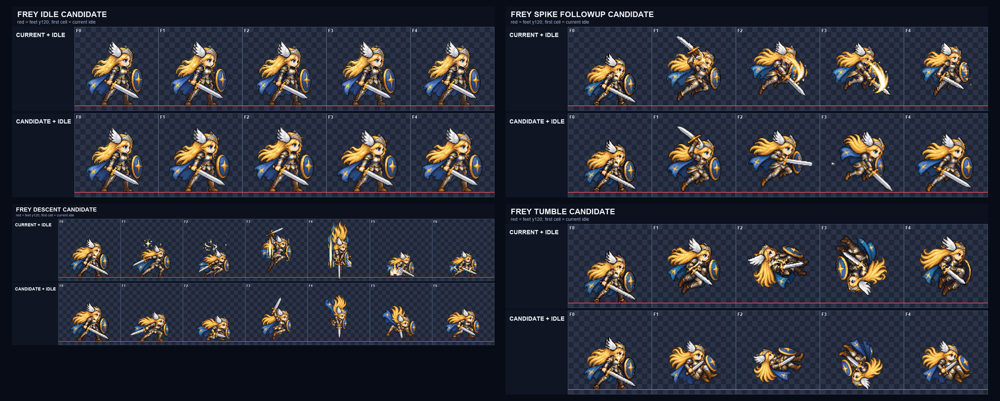
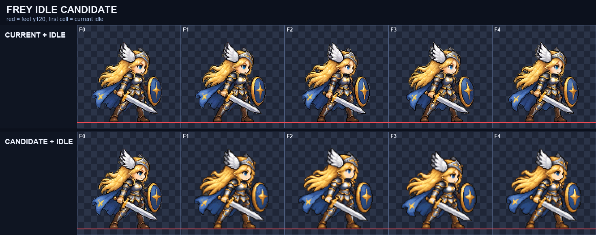
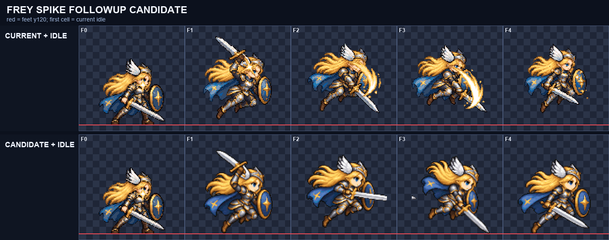
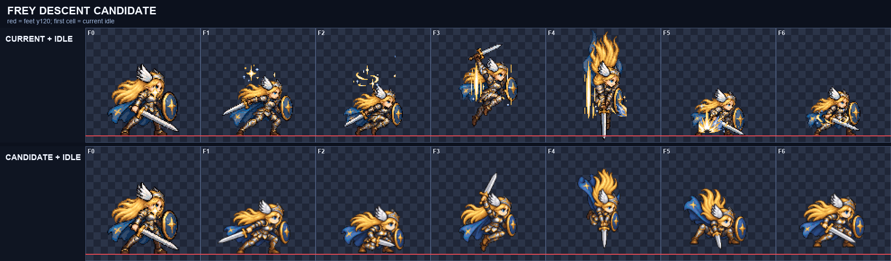
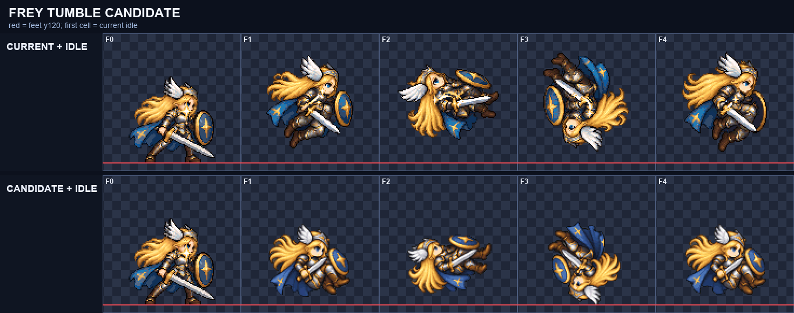

# CODEX-ART-36A 결과 — Frey 한 시트 재작화 후보

## 완료 범위

필수 범위인 Frey `idle`, `spike_followup`, `descent`, `tumble` 후보를 동작별 한 장의 생성 시트로 새로 그린 뒤 `tools/sprite_pipeline`으로 128×128, 6열 후보 시트로 정규화했다. 게임 시트와 제품 코드는 바꾸지 않았다. 시간 여유 시 대상이던 `walk`, `attack`은 진행하지 않았다.

생성에는 Codex 기본 이미지 생성을 사용했다. 생성 횟수는 `idle` 1회, `spike_followup` 2회, `descent` 2회, `tumble` 2회다. 잘못된 프레임의 머리·얼굴·팔다리를 붙이거나 옮기거나 지우지 않았고, 문제가 있으면 동작 전체를 다시 생성했다.



위 그림은 각 칸에서 현재 idle+현재 행(위)과 새 idle 앵커+후보 행(아래)을 같은 2배 배율로 나란히 놓은 검수판이다.

## 최종 후보

| 동작 | 후보 | FPS | 생성 선택 |
| --- | --- | ---: | --- |
| idle | `art/bakeoff/frey/frey-idle-v1.png` | 7 | 1차 |
| spike_followup | `art/bakeoff/frey/frey-spike_followup-v1.png` | 14 | 2차 |
| descent | `art/bakeoff/frey/frey-descent-v1.png` | 14 | 1차(2차보다 최종 크기가 큼) |
| tumble | `art/bakeoff/frey/frey-tumble-v1.png` | 14 | 1차(2차의 1px 고립 성분 때문에 되돌림) |

각 후보 옆의 같은 이름 `.json`에 메모와 FPS를 기록했다. 원시 생성물, 최종 프롬프트, 2배 비교, 프레임 PNG, 수치는 `reports/codex-art-36a/<motion>/`에 있다.

## 읽고 본 자료

- `design/DECISIONS.md` D32, `reports/sprite-method-analysis-2026-10-13.md`, 카드와 `tools/sprite_pipeline/README.md`
- CuSurvive `sprite-motion-guide.md` 3절과 지정된 두 프롬프트 예시
- Frey 설계 문서, `Frey.gd`의 8개 이동 행, 공통 시트의 `idle/walk/attack` 행 정의
- 현재 `frey_sheet.png`, `frey_moves_sheet.png`, `frey_illustration.png`
- 현재 idle·spike_followup·descent·tumble 전 프레임을 추출해 2배로 직접 확인
- `reports/codex-qa-18/README.md`는 이 클론에 존재하지 않아 카드 본문의 우선 포즈를 기준으로 했다.

현재 idle 4프레임의 알파 경계 높이는 모두 실측 100px였다. 새 idle을 `height:100`으로 맞춘 결과 공통 배율은 `0.18761726`이며, 이 값을 나머지 세 동작에 `fixed:`로 그대로 적용했다.

## 수치 검사

아래 높이·너비는 머리만의 측정이 아니라 무기·머리카락을 포함한 최종 불투명 실루엣 경계다.

| 동작 | 프레임 | 최종 높이 범위 | 최종 너비 범위 | 면적 편차 | lift | 연결 성분 |
| --- | ---: | ---: | ---: | ---: | ---: | --- |
| idle | 4 | 97–101px | 92–93px | 3.76% | 0 | 전 프레임 1개 |
| spike_followup | 4 | 88–101px | 83–97px | 12.39% | 0–8px | F0·F1 1개, F2는 본체+20px, F3은 본체+1px |
| descent | 6 | 53–89px | 48–81px | 20.54% | 0–8px | 전 프레임 1개 |
| tumble | 4 | 55–78px | 68–78px | 13.60% | 0–11px | 전 프레임 1개 |

모든 최종 후보는 이진 알파, 팔레트 위반 0, 1px 테두리 비움, 4px 여백, 공통 배율, 공중 높이 보존 검사를 통과했다. `normalize.py`는 각 실행에서 `invalid value encountered in sqrt` RuntimeWarning을 출력했지만 후보와 `metrics.json`을 끝까지 만들었고 단위 테스트는 통과했다. 이 경고는 파이프라인 담당자가 별도로 볼 항목이다.

## 2배 눈검사

### idle



- F0–F3 모두 얼굴 1개, 머리 1개, 연결된 두 팔·두 다리, 검 1개, 방패 1개를 확인했다.
- 같은 대기 자세 안에서 무릎과 상체가 작게 호흡하고 머리카락·망토가 늦게 움직인다.
- 눈으로 볼 때 네 프레임의 머리 크기는 서로 같고, 현재 idle과 비슷한 등신으로 읽힌다.
- F3에서 F0으로 돌아갈 때 발 위치와 장비 위치가 크게 튀지 않는다.

### spike_followup



- F0 공중 재장전, F1 전방 수평 쓸기, F2 아래 베기 active, F3 낮은 고정 후속 자세로 읽힌다.
- 네 프레임 모두 얼굴 1개를 직접 확인했고 검·방패·다리도 읽힌다. 머리 크기는 눈으로 볼 때 idle 앵커에 가깝다.
- F3은 검을 낮게 둔 채 낙하하는 자세라 착지 뒤 idle로 돌아가는 의미는 읽히지만, 직접 이어 붙였을 때의 손맛은 모션 뷰어에서 판단해야 한다.
- 남은 결함: 2회 전체 재생성 후에도 F2 왼쪽에 20px짜리 불투명 고립 성분, F3에 1px 고립 성분이 남았다. 부분 삭제는 카드 규칙상 하지 않았다.

### descent



- F0 charge, F1 검·방패를 모은 깊은 crouch, F2 공중 준비, F3 수직 낙하, F4 착지 squash, F5 회복이 각각 구분된다.
- 여섯 프레임 모두 얼굴 1개, 단일 연결 실루엣, 검·방패를 확인했다. 별도 효과는 없다.
- 2차 전체 생성은 같은 고정 배율에서 높이 47–83px로 더 작아져, 53–89px인 1차안을 유지했다.
- 눈으로 볼 때 F0·F1·F4·F5의 머리와 몸은 idle 앵커보다 작다. 실루엣 높이는 자세 때문에 직접 머리 크기 수치가 아니므로, 실제 머리 크기 허용 여부는 사람이 판단해야 한다.
- F5는 검을 아래로 돌리고 방패를 세워 idle로 연결되는 자세지만, 크기 차이 때문에 바로 붙이면 축소감이 날 수 있다.

### tumble



- F0 recline, F1 수평 회전, F2 역상, F3 복귀 방향의 4단 회전으로 읽히며 F3→F0이 반복 가능하다.
- 얼굴은 네 프레임 모두 확인 가능해 최소 2프레임 조건을 넘고, 최종 선택안은 네 프레임 모두 단일 연결 성분이다.
- 검과 방패는 몸과 함께 회전하며 별도 효과가 없다.
- 눈으로 볼 때 머리는 idle 앵커보다 작아 보인다. 몸을 말아 넣은 자세라 실루엣 높이 55–78px 자체만으로 머리 불일치를 단정할 수 없으며, 모션 뷰어에서 크기 연속성을 사람이 판단해야 한다.
- 이 행은 회전 루프이므로 idle에 직접 이어지는 회복 프레임은 없다.

## 검증

실행:

```text
C:/Users/TH/.cache/codex-runtimes/codex-primary-runtime/dependencies/python/python.exe -m unittest tools/sprite_pipeline/test_normalize.py -v
```

결과: 3개 테스트 모두 `OK`.

- 배경 제거·공통 배율·바닥/공중 높이·팔레트·이진 알파·6열 출력 확인: 통과
- 한 프레임만 축소하지 않고 경계 초과를 실패시키는 검사: 통과
- 고정 배율 검사: 통과

Godot 프로젝트 안 파일을 바꾸지 않았으므로 Godot 실행은 하지 않았다.

커밋은 `.git/index.lock` 생성 권한이 없어 실행되지 않았다(`Permission denied`). 허용 경로만 추가하고 요구된 공동 작성자 꼬리말로 커밋하는 `reports/codex-art-36a/commit.ps1`을 만들었고 PowerShell 구문 검사는 통과했다.

## 사람이 판단할 것

1. `descent`와 `tumble`의 머리·몸이 idle 앵커보다 작아 보이는 후보를 탈락시킬지.
2. `spike_followup` F2의 20px 고립 성분과 F3의 1px 성분 때문에 후보 전체를 재생성할지.
3. 모션 뷰어에서 `spike_followup`의 F1→F2 타격 방향, `descent` F3→F4 착지, `tumble` F3→F0 루프가 실제 속도에서 자연스러운지.

## 남은 작업

- 필수 후보에 남은 위 결함을 사용자/리드가 판정해야 한다.
- 선택되지 않은 추가 범위 `walk` 6프레임과 지상 J `attack` 4프레임은 만들지 않았다.
- 어떤 후보도 아직 게임 시트에 반영하지 않았다.
