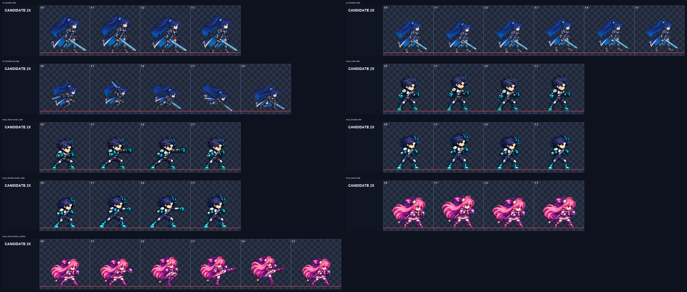

# CODEX-ART-36B 결과 보고

## 완료

Rio female, Nova male, Nova female, Brave Luna의 필수 우선순위를 한 모션 한 장 방식으로 다시 그렸다. 게임 시트나 제품 코드는 바꾸지 않았으며, `art/bakeoff/`에 9개 후보(총 41프레임)와 각 후보의 FPS/주의점 JSON을 만들었다.

완료 후보:

- Rio female: `idle` 4, `walk` 6, `plunge` 5
- Nova male: `idle` 4, `vector_side` 4
- Nova female: `idle` 4, `vector_side` 4
- Brave Luna: `idle` 4, `brave_combo` 6

Rio female `air_slash`는 두 번 생성했지만 고정 배율 정규화에서 각각 `x=33, width=102`와 `x=30, width=102`로 128px 셀의 오른쪽 경계를 넘었다. 프레임별 축소나 신체 부분 이동을 하지 않는 D32 규칙에 따라 후보에서 제외했다.

## 측정 결과

모든 완료 후보는 128px 셀, 6열 출력이며 알파가 0/255만 사용되고, 1px 테두리와 4px 여백을 모두 통과했다. 팔레트 위반은 모두 0이다.

| 후보 | 프레임 | 고정 배율 | 몸 높이(px) | 몸 너비(px) | 면적 편차 | 바닥/들림(px) |
|---|---:|---:|---:|---:|---:|---:|
| Rio female idle | 4 | 0.18849206 | 93–97 | 92–95 | 0.70% | 120 / 0 |
| Rio female walk | 6 | 0.18849206 | 81–84 | 79–82 | 5.57% | 117–120 / 0–3 |
| Rio female plunge | 5 | 0.18849206 | 63–73 | 62–80 | 14.19% | 115–120 / 0–5 |
| Nova male idle | 4 | 0.17951220 | 90–96 | 60–61 | 1.94% | 120 / 0 |
| Nova male vector_side | 4 | 0.17951220 | 81–85 | 59–92 | 10.95% | 120 / 0 |
| Nova female idle | 4 | 0.16853933 | 88–95 | 61–62 | 2.93% | 120 / 0 |
| Nova female vector_side | 4 | 0.16853933 | 81–85 | 64–91 | 13.22% | 120 / 0 |
| Brave Luna idle | 4 | 0.18242492 | 80–86 | 84–85 | 4.89% | 120 / 0 |
| Brave Luna brave_combo | 6 | 0.18242492 | 72–77 | 70–90 | 8.14% | 118–120 / 0–2 |

측정값은 `metrics.json`의 결과이며, 아래 평가는 2배 확대 이미지를 직접 본 결과다.

## 2배 육안 검수

위 그림은 완료 후보 41프레임을 파이프라인의 2배 확대 출력 그대로 모은 것이다. 빨간 선은 발 기준선 y=120이다.

- Rio idle: 전 프레임에 얼굴 1개, 온전한 몸 1개, 검 1개, 양다리가 있다. 머리/몸 크기와 루프 변화가 안정적이다.
- Rio walk: 전 프레임 신체와 장비가 온전하고 좌우 발 교대가 읽힌다. 다만 몸 높이 81–84px로 idle의 93–97px보다 작다.
- Rio plunge: 몸 회전 → 무릎/검 준비 → 대각 하강 → 신전 → 착지 흐름이 읽힌다. F3은 검 끝이 먼저 바닥에 닿고 F4는 발이 기준선보다 5px 높다.
- Nova male idle/vector_side: 모든 프레임에 얼굴 1개, 온전한 팔다리와 양 주먹이 있다. 웅크림 → 발사 → 수평 펀치 → 제동이 읽히며 얼굴을 주먹이 가리지 않고 효과 잔상도 없다.
- Nova female idle/vector_side: 얼굴, 허리 실루엣, 팔다리와 양 주먹은 유지되고 네 동작 단계도 읽힌다. 다만 vector_side F0, F1, F3 발 아래에 매우 작은 검은 분리 픽셀이 남았다.
- Brave Luna idle: 얼굴 1개, 양 건틀릿, 양다리와 의상 층이 전 프레임 유지된다.
- Brave Luna brave_combo: 가드 → 짧은 잽 → 킥 준비 → 몸통 높이 킥 → 넓은 킥 → 낮은 가드가 읽히고 F5가 idle로 연결된다. 얼굴과 신체는 온전하고 효과는 없다. 몸 높이는 idle보다 8–14px 작지만 머리 크기는 육안상 비슷하다.

## Brave Luna 팔레트 특이사항

공용 `tools/sprite_pipeline/palettes/luna_brave.json`은 현재 시트의 불투명 색 89,279개 중 단순 빈도 상위 192개를 사용한다. 실제 확인 결과 청록 계열은 0개이고, 보라 계열도 사실상 검정에 가까운 7개뿐이라 첫 정규화에서 의상과 건틀릿이 분홍/검정으로 무너졌다.

공용 파일은 수정하지 않았다. 현재 Brave Luna 시트의 불투명 픽셀을 Pillow MEDIANCUT 96색으로 양자화한 `luna_brave_palette_quantized.json`을 이 보고서 폴더에 두고 두 후보에만 사용했다. 공용 팔레트 결과도 `luna_brave-idle/*-common-palette.*`로 보존했다.

## 확인 및 테스트

- `tools.sprite_pipeline.test_normalize`: 3/3 통과
- 후보 PNG/JSON 무결성: 9/9 쌍 파싱 성공
- 후보 PNG 크기: 9/9 모두 768×128
- 완료 행의 `metrics.json`: 9/9에서 이진 알파, 테두리, 4px 여백, 팔레트 위반 0 확인
- Godot 실행은 하지 않았다. 이 작업은 제품 파일을 바꾸지 않는 bake-off 후보 생성이다.
- 정규화 중 `remove_connected_background`의 `int16` 제곱에서 `RuntimeWarning: invalid value encountered in sqrt`가 모든 실행에 출력되었다. 단위 테스트와 출력 검사는 통과했지만 공용 도구의 별도 수정 대상이다.

## 사람이 판단할 항목

1. Rio walk의 idle 대비 작은 크기를 수용할지
2. Rio plunge F3 검 끝 접지와 F4 5px 들림을 의도된 하강/착지로 볼지
3. Nova female vector_side의 작은 검은 분리 픽셀을 이유로 탈락시킬지
4. Brave Luna combo의 idle 대비 8–14px 낮은 전체 높이가 포즈 차이로 허용되는지
5. 작업 전용 Brave Luna 양자화 팔레트를 채택할지, 공용 팔레트를 먼저 다시 만들지

## 남은 작업

- Rio female `air_slash`: 2회 제한을 모두 사용해 완료하지 못했다.
- 시간 여유 항목인 Luna `attack`과 Yuki `talisman_side` 및 각 anchor는 시작하지 않았다.
- 후보 채택과 게임 시트 반영은 리드/사람 검수 이후 단계다.

