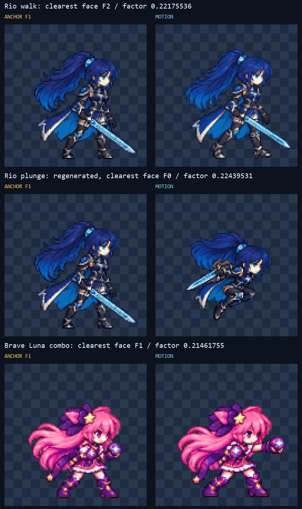
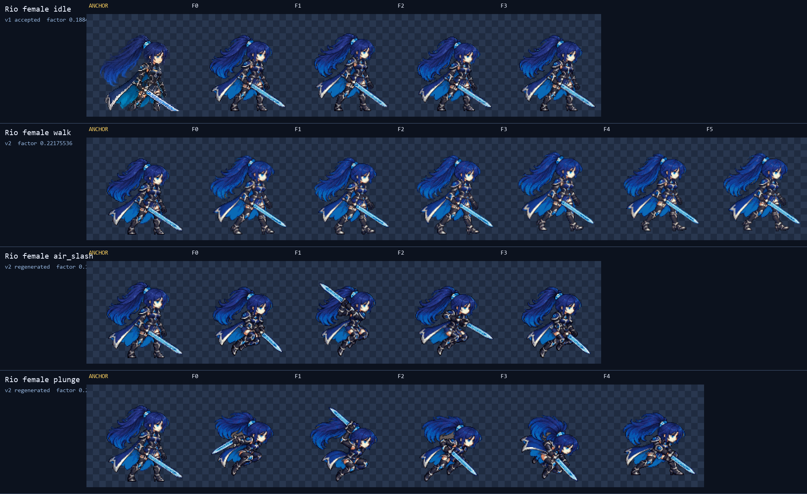
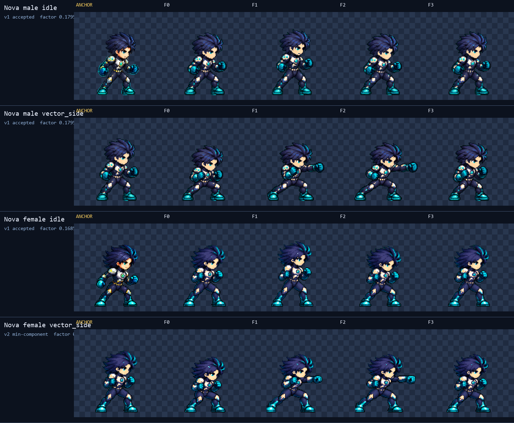
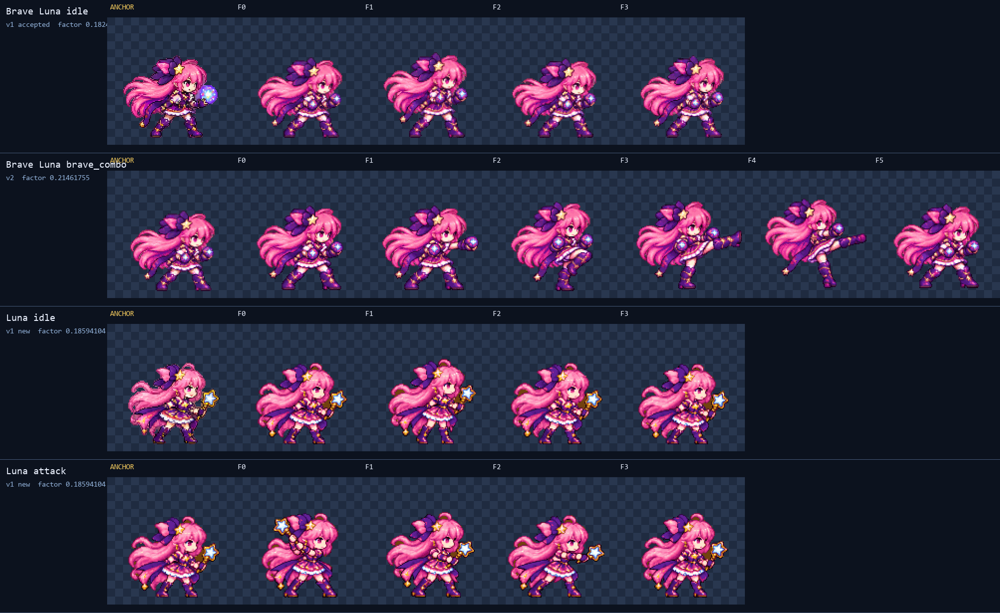

# CODEX-ART-36B 라운드 2 결과 보고

## 완료

리드가 승인한 라운드 1 후보 5개는 그대로 유지했고, 크기·분리 픽셀 문제가 있던 4개 시트를 `-v2`로 다시 정규화했습니다. Rio `air_slash`는 조밀한 자세로 한 번 새로 생성했고, 남은 시간에 기본 Luna `idle` 앵커와 `attack`도 한 시트 방식으로 추가했습니다. 제품 코드와 `smash-nine-prototype/` 파일은 변경하지 않았습니다.

이번 라운드의 새 후보는 7개입니다.

- Rio female: `walk-v2` 6프레임, `air_slash-v2` 4프레임, `plunge-v2` 5프레임
- Nova female: `vector_side-v2` 4프레임
- Brave Luna: `brave_combo-v2` 6프레임
- Luna: `idle-v1` 4프레임, `attack-v1` 4프레임

리드 승인 상태로 유지한 라운드 1 후보는 Rio female `idle-v1`, Nova male `idle-v1`/`vector_side-v1`, Nova female `idle-v1`, Brave Luna `idle-v1`입니다.

## 단일 배율과 3x 머리 크기 확인

위 그림은 각 동작의 가장 선명한 얼굴 프레임을 승인된 idle 앵커 F1과 3x nearest-neighbor로 나란히 놓은 것입니다. 프레임별 확대·축소는 하지 않았습니다.

| 시트 | 비교 프레임 | 최종 단일 배율 | 결과 |
|---|---:|---:|---|
| Rio female `walk-v2` | F2 | 0.22175536 | 앵커 머리 크기와 눈대중으로 일치 |
| Rio female `plunge-v2` | F0 | 0.22439531 | 기존 raw는 목표 배율에서 셀을 넘겨 전체 동작을 조밀하게 재생성한 뒤 일치 |
| Brave Luna `brave_combo-v2` | F1 | 0.21461755 | 앵커 머리 크기와 눈대중으로 일치 |

Rio `air_slash-v2`는 승인된 idle 배율 0.18849206, Nova female `vector_side-v2`는 기존 승인 배율 0.16853933을 그대로 사용했습니다. 새 기본 Luna idle은 현재 게임 idle 행의 중앙 몸 높이 82px에 맞춰 0.18594104가 나왔고, `attack-v1`에 같은 값을 고정 적용했습니다.

## 2x 전 프레임 시각 검수

위 그림은 Rio의 승인 idle과 세 v2 행을 각 idle 앵커 옆에 2x로 표시합니다.

- `idle-v1` F0–F3: 프레임마다 얼굴 1개, 연결된 팔다리, 검 1개가 보이고 머리·몸 폭이 안정적입니다.
- `walk-v2` F0–F5: 얼굴 1개와 양팔·양다리·검이 모두 유지됩니다. 접지발과 통과발이 교대되고, F3–F5에서 반대쪽 보폭으로 넘어가며 idle 자세로 연결됩니다.
- `air_slash-v2` F0–F3: 얼굴 1개, 한 몸, 포니테일 1개, 검 1개가 모두 셀 안에 있습니다. F0 웅크림, F1 뒤로 든 검, F2 짧은 전방 활성, F3 가드 회수가 읽히며 분리 조각이 없습니다.
- `plunge-v2` F0–F4: 모든 프레임에 얼굴 1개와 연결된 팔다리·검이 있습니다. F0 몸 돌림, F1 준비, F2–F3 대각 낙하, F4 양발 착지 고정이 읽힙니다. F0–F3의 웅크린 자세 때문에 전체 높이는 달라지지만 3x에서 머리 크기는 앵커와 맞습니다.

위 그림은 승인된 Nova 남녀 후보와 수정된 여성 `vector_side-v2`를 각 idle 앵커 옆에 2x로 표시합니다.

- Nova male `idle-v1` F0–F3와 `vector_side-v1` F0–F3: 각 프레임에 얼굴 1개, 양팔·양다리와 건틀릿이 유지됩니다. 코일→전진→수평 펀치→브레이크가 읽히고 주먹이 얼굴을 가리지 않습니다.
- Nova female `idle-v1` F0–F3: 프레임마다 얼굴 1개와 연결된 팔다리가 보이고 머리·허리 실루엣이 안정적입니다.
- Nova female `vector_side-v2` F0–F3: `--min-component 21`이 F0과 F1 아래의 분리 성분 2개, 합계 35px를 제거했습니다. 2x에서 발 아래 점은 사라졌고 몸·발·건틀릿은 손실 없이 코일→발사→펀치→브레이크로 읽힙니다.

위 그림은 Brave Luna와 기본 Luna의 모든 후보 행을 각 idle 앵커 옆에 2x로 표시합니다.

- Brave Luna `idle-v1` F0–F3: 얼굴 1개, 양팔·양다리·두 건틀릿이 유지되고 idle 루프가 안정적입니다.
- Brave Luna `brave_combo-v2` F0–F5: 얼굴 1개, 두 건틀릿, 두 부츠가 전 프레임에 남습니다. 가드→짧은 잽→차기 준비→몸높이 차기→넓은 회전 차기→낮은 가드 복귀가 읽힙니다. F3 오른쪽 여백이 3px라 4px 권장 여백에는 1px 못 미칩니다.
- Luna `idle-v1` F0–F3: 얼굴 1개, 연결된 팔다리와 별 지팡이 1개가 유지됩니다. 호흡에 따른 상하 변화가 작고 F3에서 F0로 자연스럽게 돌아갑니다.
- Luna `attack-v1` F0–F3: F0 지팡이 준비, F1 짧은 이동, F2 전방 활성, F3 idle 복귀가 읽힙니다. 모든 프레임에 얼굴과 온전한 별 지팡이가 있으며 초승달·별가루·궤적은 그려지지 않았습니다.

## 측정 결과

| 후보 | 프레임 | 배율 | 몸 높이(px) | 몸 폭(px) | 면적 편차 | 4px 여백 |
|---|---:|---:|---:|---:|---:|---|
| Rio walk v2 | 6 | 0.22175536 | 96–99 | 93–96 | 4.66% | 통과 |
| Rio air_slash v2 | 4 | 0.18849206 | 86–92 | 75–97 | 6.19% | 통과 |
| Rio plunge v2 | 5 | 0.22439531 | 78–93 | 74–91 | 13.11% | 통과 |
| Nova female vector_side v2 | 4 | 0.16853933 | 81–85 | 60–88 | 13.96% | 통과 |
| Brave Luna brave_combo v2 | 6 | 0.21461755 | 85–90 | 83–106 | 7.72% | F3만 3px |
| Luna idle v1 | 4 | 0.18594104 | 81–86 | 89–92 | 2.20% | 통과 |
| Luna attack v1 | 4 | 0.18594104 | 83–86 | 77–97 | 1.68% | 통과 |

모든 새 후보는 768×128 PNG이고, 이진 알파·팔레트 위반 0·셀 경계 통과를 확인했습니다. Nova 여성 v2의 제거 기록은 `metrics.json`에 프레임별 성분 위치와 픽셀 수로 남아 있습니다.

## 생성 방식과 원본

이미지는 기본 제공 `imagegen` 도구로 생성했습니다. 최종 프롬프트와 새 원본은 다음 폴더에 있습니다.

- `reports/codex-art-36b/rio_female-air_slash/` (`prompt-v2.txt`, `raw-v2.png`)
- `reports/codex-art-36b/rio_female-plunge/` (`prompt-v2.txt`, `raw-v2.png`)
- `reports/codex-art-36b/luna-idle/` (`prompt.txt`, `raw.png`)
- `reports/codex-art-36b/luna-attack/` (`prompt.txt`, `raw.png`)

Rio walk, Brave Luna combo, Nova 여성 vector-side는 라운드 1 원본을 다시 생성하지 않고 각각 시트 전체 단일 배율 또는 `--min-component`로만 재정규화했습니다.

## 사람이 판단할 부분

1. Brave Luna `brave_combo-v2` F3의 오른쪽 3px 여백을 후보 단계에서 허용할지.
2. Rio `plunge-v2`의 조밀한 F2–F3가 실제 모션 뷰어 속도 10fps에서 충분히 강한 낙하로 읽히는지.
3. 새 기본 Luna `attack-v1` F1→F2가 효과 그림 없이도 짧은 지팡이 공격으로 충분히 읽히는지.

## 남은 작업

후보 채택과 게임 시트 반영은 리드/사용자 판단 이후 단계입니다. 이번 작업에서는 게임 시트나 제품 코드를 변경하지 않았습니다.
