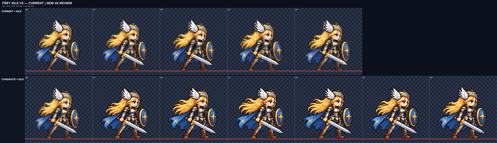
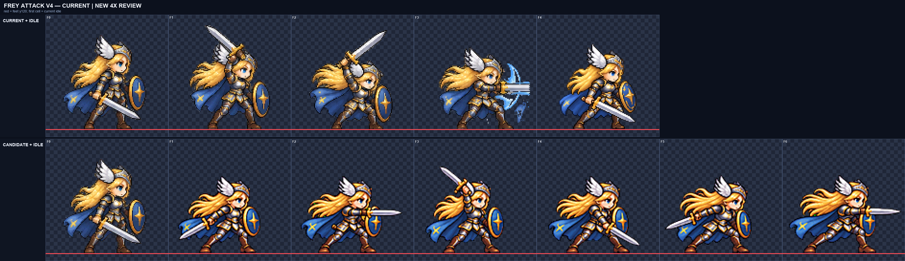

# CODEX-ART-37 · Frey phase 1 결과

Frey만 대상으로 디테일 보존 파이프라인을 갱신하고, 6프레임 `idle-v2`와 6프레임 3타 J 체인 `attack-v4` 후보를 만들었다. 두 후보는 게임 시트에 넣지 않은 bake-off 파일이다. 생성에는 Codex 내장 이미지 도구를 사용했으며, 사용한 최종 프롬프트는 각 행의 `prompt.txt`에 그대로 남겼다.

## 디테일: 이전 → 이후

| 비교 대상 | 색 수 | 내부 디테일 | 기준 대비 |
| --- | ---: | ---: | ---: |
| 현재 게임 idle F0 | 1,405 | 102.05 | 100% |
| ART-36 idle F0: BOX + 192색 | 180 | 65.32 | 64.0% |
| 동일 raw: LANCZOS + 선명화, 팔레트 없음 | 4,928 | 99.49 | 97.5% |
| 새 `idle-v2` 6프레임 | 4,732–5,098 | 93.94–97.57, 평균 96.24 | 현재 idle 행 평균의 93.52% |
| 새 `attack-v4` 6프레임 | 3,655–4,208 | 100.60–114.18, 평균 107.49 | 현재 attack 행 평균의 104.18% |

`detail-baseline.md`에서 카드의 기준표를 동일 raw·동일 배율로 재현했다. 수치는 RGB 평균 밝기의 4방향 라플라시안 절댓값을, 자신과 상하좌우가 모두 불투명한 픽셀에서 평균한 값이다.

## 사용 설정

공통 설정은 `--resample lanczos --sharpen 60 --despill auto --palette none --compare-scale 4`다. 선명화는 알파 절단 전에 RGB에 radius 1, threshold 2로 적용한다. 초록 크로마 섬을 투명화한 뒤 알파 경계 2px의 G를 `min(G, max(R, B))`로 제한한다.

| 행 | 배율 | 배치 | 바닥 | FPS |
| --- | ---: | --- | --- | ---: |
| idle | `height:100` → `0.24183797` | 기본 torso anchor | 원본 위치 보존, 전부 y=120 | 10.5 |
| attack | `fixed:0.235` | 전 행 공통 `offset-x -9` | 명시적 지상 행 `--ground-all`, 전부 y=120 | 21 |

attack의 x 이동은 여섯 프레임 전체에 같은 값만 적용했다. 프레임별 배율, 머리·팔다리·무기 붙여넣기, 개별 수평 이동은 하지 않았다. 생성 원본의 셀별 바닥 위치가 0–8px 흔들려 `--ground-all`로 완성 프레임 전체를 세로 이동해 공통 바닥선에 놓았다.

## idle-v2 · 6프레임

파일: `art/bakeoff/frey/frey-idle-v2.png`, `frey-idle-v2.json`

위 판의 윗줄은 현재 idle, 아랫줄은 현재 idle F0 앵커 뒤에 새 여섯 프레임을 붙인 것이다. 빨간 선은 발 y=120이다.

### 측정

- 크기: 높이 99–101px, 너비 90–94px, 면적 편차 7.16%
- 내부 디테일: 프레임별 `97.57 / 94.83 / 96.43 / 93.94 / 97.47 / 97.20`; 모두 카드 하한 92 이상
- 색 수: `4,732 / 4,990 / 5,098 / 5,092 / 4,846 / 4,850`
- 남은 초록 번짐: 여섯 프레임 모두 0px
- 경계: 1px 비움 통과, 최소 여백 7px로 4px 권장치도 전부 통과
- 배율: `height:100`으로 측정한 공통 계수 `0.24183797`

### 4배 육안 판정

- F1: 중립 가드. 한 얼굴, 같은 큰 머리, 검과 방패가 연결되어 있고 두 발이 고정되어 있다.
- F2: 어깨와 가슴이 조금 올라가고 머리카락 끝이 들린 inhale로 읽힌다.
- F3: 호흡 최고점이며 망토와 머리카락이 뒤로 가장 많이 움직인다.
- F4: 어깨는 내려오지만 머리카락이 한 박자 늦게 남아 exhale 시작으로 읽힌다.
- F5: 무릎과 몸통이 가장 낮고 머리카락·망토가 가라앉는다.
- F6: F5와 F1 사이 자세로, F6→F1에서 발·머리·장비 위치가 튀지 않는다.
- 여섯 칸 모두 얼굴 하나, 머리 하나, 연결된 양팔·양다리, 검 한 자루, 방패 하나를 직접 확인했다. 머리 크기는 현재 idle 앵커와 같다고 눈으로 판정했다.

## attack-v4 · 6프레임 / 3타

파일: `art/bakeoff/frey/frey-attack-v4.png`, `frey-attack-v4.json`

위 판의 아랫줄은 현재 idle F0 앵커와 새 여섯 프레임이다. 두 칸씩 `[0,1]`, `[2,3]`, `[4,5]`가 한 타를 이룬다.

### 측정

- 크기: 높이 82–92px, 너비 82–117px, 면적 편차 13.01%
- 내부 디테일: `114.18 / 107.03 / 105.25 / 108.61 / 109.29 / 100.60`; 모두 카드 하한 92 이상
- 색 수: `3,655 / 3,825 / 3,720 / 3,761 / 3,886 / 4,208`
- 남은 초록 번짐: 여섯 프레임 모두 0px
- 경계: 1px 비움 통과, 4px 권장 여백도 전부 통과. F6 오른쪽이 정확히 최소 4px다.
- 배율: idle 앵커의 가장 선명한 얼굴과 4배로 나란히 본 뒤 시트 전체에 `fixed:0.235` 하나만 사용했다.

### 4배 육안 판정

- F1: 검을 허리 뒤로 낮게 당기고 방패를 앞에 둔 1타 준비다.
- F2: 가슴 높이 수평 전진 베기다. F1→F2만 봐도 첫 타의 준비/활성이 구분된다.
- F3: 검을 어깨 위로 올리고 몸통을 뒤로 튼 2타 준비다.
- F4: 검 끝이 전방 아래로 내려가는 대각 베기 활성이다. F3→F4의 방향 변화가 명확하다.
- F5: 검을 낮게 멀리 뒤로 당기고 앞무릎을 굽힌 피니셔의 깊은 준비다.
- F6: 검팔을 전방으로 뻗고 보폭을 가장 크게 벌린 수평 쓸기 피니셔다. 머리카락과 망토가 왼쪽으로 후행한다.
- 여섯 칸 모두 한 얼굴, 앵커와 같은 크기의 머리, 연결된 팔다리, 온전한 검·방패를 확인했다. 별도 슬래시·빛·먼지 효과는 없다.

첫 생성은 F2 검이 원본 셀 오른쪽 경계에 닿아 파이프라인이 거부했다. `raw-attempt1.png`와 `prompt-attempt1.txt`로 보존했으며, 두 번째 전체 생성에서 검 리치와 점유 폭을 줄였다. 부분 수정이나 프레임 조립은 하지 않았다.

## 현재 상태와 남은 문제

- 완료: 파이프라인 옵션·메트릭·회귀 테스트, 기준표 재현, Frey idle 6프레임, Frey J 체인 6프레임, 4배 비교판과 후보 JSON.
- 현재 상태: 두 파일 모두 사용자 선택 전의 bake-off 후보이며 `smash-nine-prototype/`은 변경하지 않았다.
- 남은 문제: attack F6의 오른쪽 여백은 정확히 4px라 추가 여유가 없다. 피니셔 활성에서 바로 idle로 돌아가므로 실제 21fps 재생에서 복귀가 다소 빠르게 느껴질 수 있다. idle의 호흡량과 attack 세 타의 박자는 정지 비교가 아니라 모션 뷰어에서 사람이 최종 판정해야 한다.
- 다음 권장 단계: 리드가 모션 뷰어에 두 후보를 게시해 사용자 채택 여부를 받은 뒤에만 게임 시트에 반영한다. Phase 2의 나머지 Frey 행은 이번 설정과 idle 앵커를 그대로 사용한다.

## 확인 및 테스트

- `tools/sprite_pipeline/test_normalize.py`: 9/9 통과.
- 최종 두 PNG: 768×128, 6프레임, 이진 알파, 1px 경계와 4px 권장 여백 통과.
- 두 metrics JSON과 후보 JSON 파싱 성공.
- 두 `compare.png`를 원본 크기로 열어 현재 프레임과 후보의 모든 12프레임을 4배로 직접 확인했다.
- 제품 파일을 바꾸지 않은 후보 작업이므로 Godot 실행 테스트는 하지 않았다.
