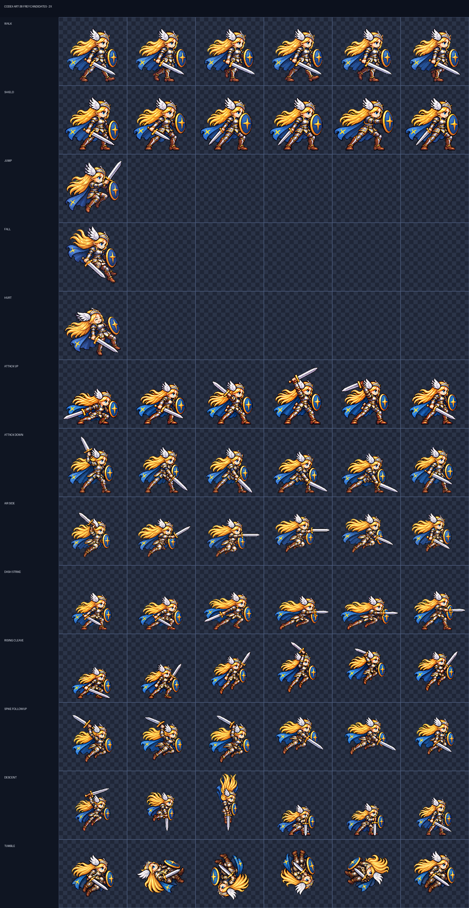
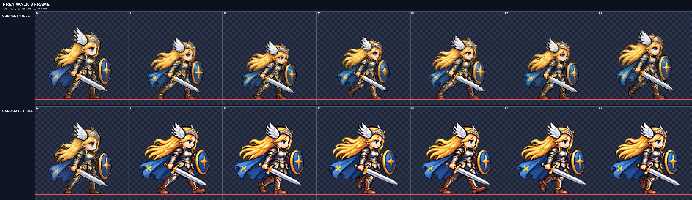
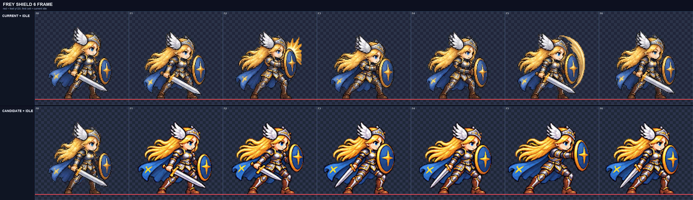
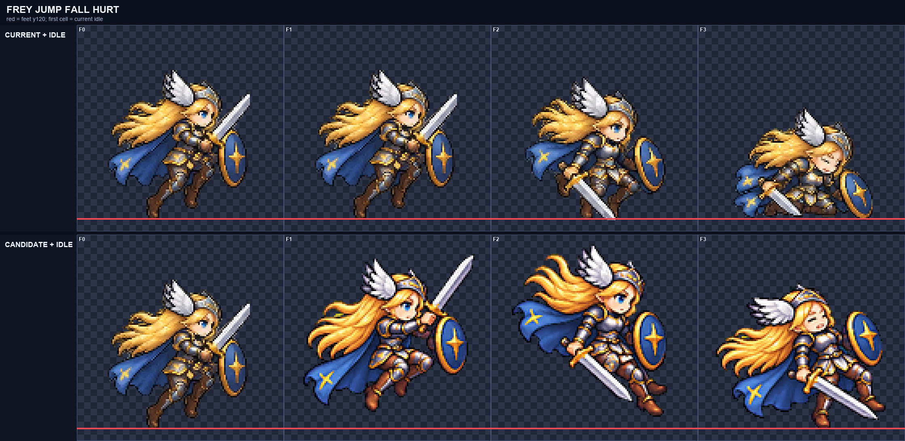

# CODEX-ART-38 · Frey phase 2 결과

Frey의 나머지 동작을 ART-37의 디테일 보존 설정으로 다시 만들었다. 모든 결과는 `smash-nine-prototype/`에 넣지 않은 bake-off 후보이며, 생성에는 Codex 내장 이미지 도구를 사용했다. 행마다 한 동작만 생성했고, `attack_up`, `dash_strike`, `rising_cleave`만 1차 실패 뒤 허용된 2차 전체 생성을 사용했다.

위 판은 이번 카드에서 만든 13개 후보 행을 실제 정규화 픽셀로 2배 확대해 한 장에 모은 것이다. 빈 칸은 jump/fall/hurt가 각각 단일 포즈이기 때문이다.

## Task 0 · 닫힌 초록 포켓

- 수정 전 전역 녹색 우세 픽셀: `frey-idle-v2` **13px**, `frey-attack-v4` **22px**.
- 수정 후: 두 행 모두 프레임별 `0 / 0 / 0 / 0 / 0 / 0`, 합계 **0px**.
- 원본 512px 셀에서 크로마키에 가까운 픽셀을 경계 연결 여부와 무관하게 먼저 투명화하고, 축소 뒤에는 모든 불투명 픽셀에서 `G > max(R, B) + 20`을 검사한다.
- 닫힌 포켓과 내부의 어두운 녹색을 포함한 회귀 테스트를 추가했다. 전체 `test_normalize.py`는 13/13 통과했다.
- 같은 raw와 같은 배율로 `frey-idle-v2`, `frey-attack-v4`, 두 4배 비교판과 두 metrics를 제자리 재생성했다.

## 공통 설정과 측정 결과

모든 행은 `--resample lanczos --sharpen 60 --despill auto --palette none --bg #00ff00 --compare-scale 4`를 사용했다. 표의 디테일은 모든 프레임의 실제 `interior_detail` 범위이며, 녹색은 경계가 아니라 **모든 보이는 픽셀**의 잔여 수다.

| 행 | 후보 파일 | 공통 배율 | 내부 디테일 | 녹색 | 4px 여백 | 바닥/상승 |
| --- | --- | ---: | ---: | ---: | --- | --- |
| walk | `frey-walk-v2.png` | 0.27972028 | 97.93–100.52 | 0 | 통과 | 전부 y=120 |
| shield | `frey-shield-v1.png` | 0.27624309 | 93.29–102.52 | 0 | 통과 | 전부 y=120 |
| jump | `frey-jump-v1.png` | 0.205 | 95.82 | 0 | 통과 | 11px 상승 |
| fall | `frey-fall-v1.png` | 0.205 | 96.13 | 0 | 통과 | 8px 상승 |
| hurt | `frey-hurt-v1.png` | 0.205 | 98.63 | 0 | 통과 | y=120 |
| attack_up | `frey-attack_up-v1.png` | 0.27 | 106.88–111.46 | 0 | 통과 | 전부 y=120 |
| attack_down | `frey-attack_down-v1.png` | 0.255 | 106.27–110.28 | 0 | 통과 | 전부 y=120, x -3 |
| attack_air_side | `frey-attack_air_side-v1.png` | 0.245 | 101.75–109.40 | 0 | 통과 | 8–18px 상승, x -5 |
| dash_strike | `frey-dash_strike-v1.png` | 0.245 | 99.68–114.69 | 0 | 통과 | 전부 y=120, x -1 |
| rising_cleave | `frey-rising_cleave-v2.png` | 0.25 | 107.98–126.39 | 0 | 통과 | F3–F6 8/11/26/14px 상승 |
| spike_followup | `frey-spike_followup-v3.png` | 0.24 | 108.07–113.92 | 0 | 통과 | 8–24px 상승 |
| descent | `frey-descent-v3.png` | 0.24 | 123.96–128.56 | 0 | 통과 | F1–F3 8px, F4–F6 접지 |
| tumble | `frey-tumble-v3.png` | 0.27 | 97.98–104.63 | 0 | 통과 | 8–23px 상승 |

모든 프레임이 카드의 디테일 하한 90을 넘었고, 알파는 이진이며, 1px 경계와 권장 4px 여백을 모두 통과했다.

## 4배 육안 판정

### walk

오른발 접지 → 체중 하강 → 왼발 통과 → 왼발 접지 → 체중 하강 → 오른발 통과가 구분된다. 기존처럼 다리가 거의 고정된 미끄러짐이 아니며 검은 낮게, 방패는 전방 팔에 유지된다. 여섯 칸 모두 얼굴 하나, 두 팔·두 다리, 검·방패 연결을 확인했다.

### shield

방패가 낮은 위치에서 전면으로 올라가고, F4에서 버틴 뒤 F5에서 짧게 밀고 F6에서 유지한다. 기존의 금색 원호·버블·광원은 없다. 얼굴과 검이 방패 뒤에서 사라지지 않는다.

### jump / fall / hurt

jump는 무릎을 접고 상승하며 머리카락이 아래로 후행한다. fall은 다리를 아래로 뻗고 머리카락과 망토가 위로 들린다. hurt는 눈을 감고 뒤로 젖혀지지만 검과 방패를 놓치지 않는다. 한 장에서 생성한 세 포즈를 픽셀 변경 없이 개별 후보로 분리했다.

### 공격과 특수기

- `attack_up`: 낮은 준비 → 어깨 높이 → 대각 상단 활성 → 회복이 읽힌다. 1차는 공통 배율에서 머리가 작아져 폐기했고 2차 전체 생성만 후보로 남겼다.
- `attack_down`: 상단 준비 → 전하방 절단 → 바닥 가까운 유지 → 회복이 이어진다.
- `attack_air_side`: 전 프레임 공중이며, 장전 → 수평 전진 베기 → 공중 회복이 구분된다.
- `dash_strike`: F1–F2 조준, F3 발사, F4–F5 수평 찌르기, F6 세우기다. 1차는 F5 검끝이 셀 경계를 넘어 폐기했다.
- `rising_cleave`: F1–F2 접지, F3부터 상승한다. 1차는 F4의 긴 수직 검 때문에 띄운 상태로 들어가지 않아 폐기했다.
- `spike_followup`: 여섯 프레임 모두 공중이며 상단 장전 → 전하방 베기 → 압축된 낙하 후속 자세다.
- `descent`: F1–F3 공중 준비·수직 낙하, F4 착지 압축, F5 버팀, F6 회복이다. 추가 날개·충격파·먼지는 없다.
- `tumble`: 장비를 안으로 모은 채 한 바퀴 후방 회전한다. 얼굴은 F1, F2, F3, F4, F5, F6에서 모두 식별 가능하며 F6→F1의 대각 방향이 가깝다.

각 행의 `compare.png`에서 현재 행, idle 앵커, 후보의 모든 프레임을 4배로 직접 확인했다. 별도 슬래시·광원·먼지·충격파를 그리지 않았고, 모든 칸에서 한 얼굴, 한 머리, 연결된 양팔·양다리, 검 한 자루, 방패 하나를 확인했다.

## 아직 잘못되었거나 최종 검토가 필요한 부분

- 이 파일들은 게임 반영 전 후보다. 실제 모션 뷰어에서 재생 속도와 인접 idle 연결을 리드가 최종 선택해야 한다.
- 공중·압축 포즈는 전신 높이가 idle보다 작아 보인다. 공통 배율에서 머리 크기는 앵커와 비슷하다고 육안 판정했지만, 특히 `attack_air_side`, `rising_cleave`, `descent`는 모션 재생 중 체급이 작아 보이지 않는지 확인이 필요하다.
- `descent` F3의 위로 솟은 머리카락 덩어리가 강하다. 날개나 별도 이펙트는 아니지만 빠른 재생에서 불꽃처럼 보이는지 확인이 필요하다.
- `tumble`은 정지 비교에서 한 바퀴가 명확하지만, F6→F1 루프 이음은 21fps 재생으로 최종 판정해야 한다.
- jump/fall/hurt의 JSON `fps: 1`은 단일 포즈 후보를 뷰어에 표시하기 위한 메타데이터이며 런타임 타이밍 결정이 아니다.

## 도달하지 못한 행

없음. 카드에 적힌 Frey 행을 순서대로 모두 완료했다.

## 파일 상태

- 후보 PNG/JSON: `art/bakeoff/frey/`
- 생성 원본: `art/raw/frey-38/<row>/`
- 최종 프롬프트·4배 비교판·측정값: `reports/codex-art-38/<row>/`
- `smash-nine-prototype/` 변경 없음.
