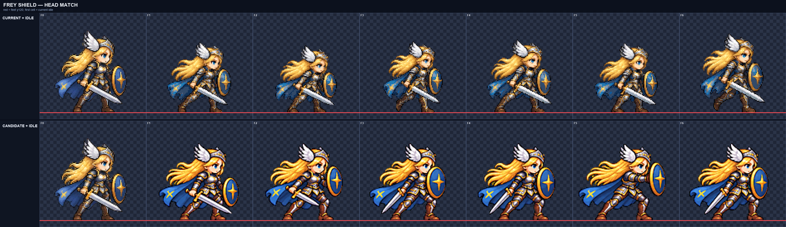
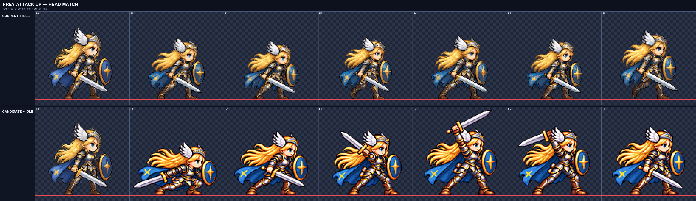
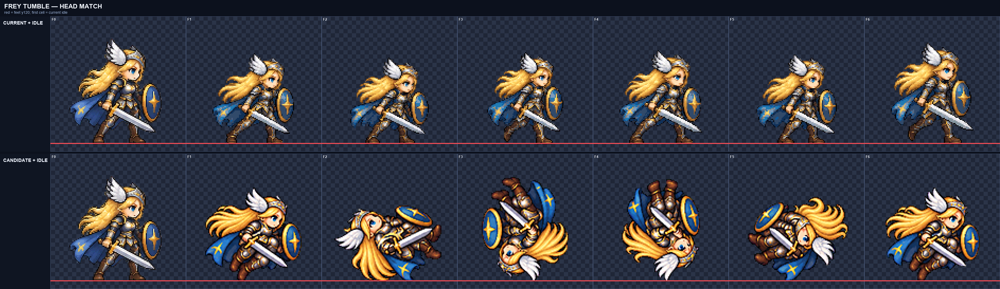

# CODEX-ART-39 · Frey 머리 크기 통일 재검토

## 결과

`head_scale.py`의 앵커 자체 시험은 0.7–1.3 배율을 모두 정확히 복원했다. 모든 Frey 행을 다시 측정하고 4배 비교판에서 앵커와 나란히 확인했다.

이번 라운드에서 `shield`, `attack_up`, `tumble` 세 행을 허용 범위(중앙값 0.96–1.04)로 고쳤다. `walk`, `jump`, `fall`, `hurt`는 ART-38에서 이미 통과한 상태를 유지한다. 나머지 7개 공격 행은 머리를 맞춘 배율에서 검이나 전체 자세가 4px 안전 여백을 넘었고, 카드가 허용한 1회 재생성도 앵커보다 작은 머리로 나와 기존 후보를 덮어쓰지 않았다.

## 행별 측정과 처리

`머리 전→후`는 자동 측정 중앙값이다. `low`는 점수가 0.6 미만이라 수치 판정에서 제외하고 4배 비교로 판단했다. `재생성`은 ART-39에서 실제로 새 원본을 만든 경우이며, 괄호 안은 그 원본을 최종 후보에 썼는지 여부다.

| 행 | 머리 전 → 후 | 최종 factor | lift scale | ART-39 재생성 | 결과 |
| --- | ---: | ---: | ---: | --- | --- |
| idle | 1.00 → 1.00 | 0.24183797 | 1.0 | 아니오 | 앵커 |
| walk | 1.00 → 1.00 | 0.27972028 | 1.0 | 아니오 | 유지, 통과 |
| jump | 1.02 → 1.02 | 0.205 | 1.0 | 아니오 | 유지, 통과 |
| fall | low → low | 0.205 | 1.0 | 아니오 | 같은 생성/배율인 jump와 4배 육안 비교로 유지 |
| hurt | low → low | 0.205 | 1.0 | 아니오 | 눈 감고 기울어진 얼굴이라 자동 점수 낮음; 4배 육안 비교로 유지 |
| shield | 1.06 → **1.01** | 0.27624309 → **0.261** | 1.0 | 아니오 | **통과** |
| attack | 0.92 → 0.92 | 0.235 | 1.0 | 예(미채택) | 남음 |
| attack_up | 0.90 → **0.96** | 0.27 → **0.295** | 1.0 | 예(미채택) | **통과**; ART-38 원본 재정규화, 공통 x +2 |
| attack_down | 0.82 → 0.82 | 0.255 | 1.0 | 예(미채택) | 남음 |
| attack_air_side | 0.80 → 0.80 | 0.245 | 1.0 | 예(미채택) | 남음 |
| dash_strike | 0.76 → 0.76 | 0.245 | 1.0 | 예(미채택) | 남음 |
| rising_cleave | 0.70 → 0.70 | 0.25 | 1.0 | 예(미채택) | 남음 |
| spike_followup | 0.74 → 0.74 | 0.24 | 1.0 | 예(미채택) | 남음 |
| descent | 0.68 → 0.68 | 0.24 | 1.0 | 예(미채택) | 남음 |
| tumble | 0.88 → **0.98** | 0.27 → **0.307** | **0.0** | 아니오 | **통과**; 회전 프레임은 4배 육안 판정 |

## 통과 행의 4배 비교

### shield

앵커와 후보의 머리 크기가 일치하고 여섯 프레임 모두 방패, 검, 얼굴과 연결된 팔다리가 남아 있다.

### attack_up

중앙값은 허용 범위 하한인 0.96이다. 공통 x 이동 +2로 F1의 왼쪽 검 끝을 포함해 전 프레임 4px 여백을 확보했다.

### tumble

정면에 가까운 F1/F6 자동 중앙값은 0.98이다. 나머지 회전 프레임은 머리·날개 장식·얼굴의 연속 크기를 4배로 확인했다. 셀 내부 상승은 0px이며 실제 공중 위치는 게임 물리에 맡긴다.

## 아직 잘못된 부분

- `attack`, `attack_down`, `attack_air_side`, `dash_strike`, `rising_cleave`, `spike_followup`, `descent`는 머리 중앙값이 0.96 미만이다.
- 이 7개 행을 머리 맞춤 배율로 키우면 검 끝, 머리 장식 또는 세로 낙하 자세가 128px 셀의 4px 여백을 넘는다. 공통 x 이동과 `--lift-scale`만으로는 해결되지 않았다.
- 1회 재생성 원본은 `art/raw/frey-39/<row>/raw.png`에 보존했다. 재생성본도 머리가 작거나 실루엣이 길었다. 0.27 시험 배율에서 측정 가능한 재생성본은 `attack_down` 0.82, `dash_strike` 0.80, `rising_cleave` 0.74, `spike_followup` 0.81, `descent` 0.80이었다. `attack`, `attack_up`, `attack_air_side`는 그 배율에서도 공통 배치로 셀에 들어가지 않았다.
- `fall`과 `hurt`는 자동 도구의 신뢰 점수 기준을 넘지 못한다. 현재 후보는 4배 육안으로만 유지했으므로, 수치 통과가 반드시 필요하면 얼굴이 더 드러나는 별도 원본이 필요하다.
- `tumble`은 회전 중 얼굴이 가려지는 F2–F5를 자동 수치로 확정할 수 없다. 21fps 모션 뷰어에서 루프 연결을 최종 확인해야 한다.

## 파이프라인 변경과 검증

- `normalize.py`에 `--lift-scale K`(0–1, 기본 1)를 추가했다. 자연 상승량과 `--lift-all`의 합에 한 번만 적용해 행 전체의 공중 호를 같은 비율로 낮춘다.
- `README.md`에 `head_scale.py` 사용 예와 `--lift-scale` 설명을 추가했다.
- `head_scale.py --selftest`: 0.7, 0.8, 0.9, 1.1, 1.2, 1.3 모두 정확히 복원, 종료 코드 0.
- `python -m unittest tools/sprite_pipeline/test_normalize.py -v`: 15개 테스트 통과.
- 통과한 세 행은 border clear, 4px margin, spill 0, 모든 프레임 interior detail 90 이상이다.

`smash-nine-prototype/` 아래 파일은 변경하지 않았다.
