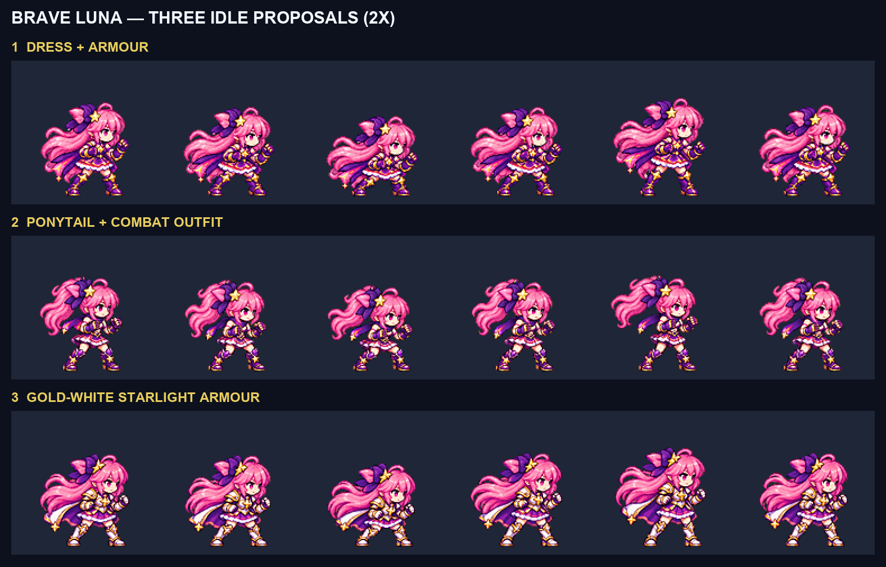
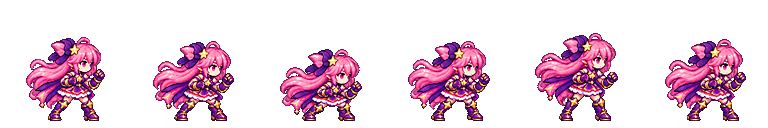
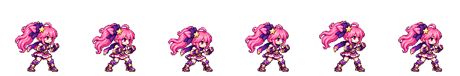
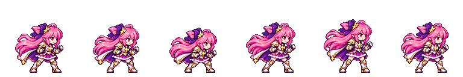

# CODEX-ART-44 결과 — Brave Luna 디자인 시안 3종

## 완료

Brave Luna의 새 디자인을 고르기 위한 6프레임 idle 후보 세 종을 만들었다. 세 후보 모두 built-in ImageGen으로 한 번씩 생성했고, D35 방식(행 전체 공통 배율, LANCZOS 축소, 선명화 60, 초록 제거, 팔레트 제한 없음)으로 128px 셀에 정리했다. 게임 파일은 변경하지 않았다.

위 비교판은 동일한 128px 셀 후보를 2배 최근접 확대해 위에서부터 시안 ①, ②, ③ 순서로 놓은 것이다.

| 시안 ① 기존 의상+갑주 | 시안 ② 머리 묶음·짧은 전투복 | 시안 ③ 금백색 별빛 갑주 |
| --- | --- | --- |
|  |  |  |
| 기존 보라·흰색 드레스를 유지하고 보라·금색 전완 건틀릿과 별 무릎 갑주를 더했다. | 높은 포니테일, 민소매 상의, 치마 위 쇼츠, 짧은 스카프로 가장 가볍고 기동적인 실루엣을 만들었다. | 별 흉갑, 한쪽 견갑, 백금 건틀릿·각반, 짧은 망토와 금색 머리 장식으로 변신 차이를 가장 크게 냈다. |

세 이미지의 각 칸은 왼쪽부터 guard → dip → lowest → rising → top → loop bridge 순서이며 10.5fps로 재생한다.

## 수치로 확인한 결과

머리 크기는 `head_scale.py --anchor smash-nine-prototype/assets/art/luna/luna_sheet.png:0`로 정상 Luna의 현재 idle 1프레임을 기준으로 측정했다. 내부 디테일, 초록 번짐, 여백은 `normalize.py`가 만든 `metrics.json` 값이다.

| 후보 | 공통 배율 | 머리 크기 중앙값 | 프레임별 머리 크기 | 내부 디테일 | 초록 번짐 | 최소 여백 |
| --- | ---: | ---: | --- | ---: | ---: | ---: |
| v3 / 시안 ① | 0.209091 | 1.00 | 0.96, 1.00, 0.96, 1.00, 1.02, 1.00 | 95.37–98.32 | 0 | 7px |
| v4 / 시안 ② | 0.205357 | 1.00 | 1.00, 1.00, 0.96, 1.00, 1.00, 1.00 | 103.64–107.04 | 0 | 7px |
| v5 / 시안 ③ | 0.207207 | 1.01 | 1.02, 1.00, 1.00, 1.02, 1.02, 1.00 | 108.11–111.85 | 0 | 7px |

세 후보 모두 머리 크기 0.96–1.04, 내부 디테일 90 이상, 초록 번짐 0, 테두리 비움, 4px 여백 조건을 통과했다. 각 후보의 `head_scale.json`에는 프레임별 탐지 점수까지 따로 보존했다.

## 4배 육안 확인

- **시안 ①:** 여섯 프레임 모두 얼굴 하나, 연결된 두 팔·다리, 양쪽 전완 건틀릿과 양쪽 갑주 부츠가 유지된다. 손의 별 오브가 아니라 손가락과 커프가 있는 착용 장갑으로 읽힌다. 기존 드레스와 장발을 그대로 보존해 같은 Luna라는 인식이 가장 빠르다.
- **시안 ②:** 여섯 프레임 모두 얼굴과 사지가 온전하며 높은 포니테일, 큰 보라 리본, 짧은 스카프가 바운스를 따라 움직인다. 양쪽 건틀릿과 부츠는 붙어 있고 별은 작은 장비 문양이다. 정상형 및 다른 두 시안과 실루엣 차이가 가장 크다.
- **시안 ③:** 여섯 프레임 모두 얼굴과 사지가 온전하며 별 흉갑, 보이는 한쪽 견갑, 백금 건틀릿·각반, 짧은 망토가 유지된다. 흰색 주먹은 건틀릿 안의 손으로 읽히고 별은 흉갑·망토 끝의 고정 장식이다.
- 세 후보 모두 광륜, 오라, 반짝임, 궤적, 그림자 같은 게임 이펙트가 없고, 모든 프레임을 `compare.png`에서 4배로 확인했다.

## 아직 잘못되었거나 선택 뒤 다듬을 점

- **시안 ①:** 정상 Luna와 의상 골격이 같아서 세 안 중 변신 대비가 가장 약하다. 건틀릿과 부츠만으로 6초 변신의 특별함이 충분한지는 사용자 선택이 필요하다.
- **시안 ②:** 포니테일이 큰 리본과 함께 머리 뒤 면적을 많이 차지한다. 128px에서는 쇼츠와 짧은 치마의 층이 가까워 일부 프레임에서 한 덩어리로 읽힐 수 있다.
- **시안 ③:** 변신 대비와 디테일은 가장 크지만 백금 갑주와 망토 때문에 Luna의 경쾌한 마법소녀 인상이 무거워질 수 있다. 금색 머리 장식도 축소 후 일부 프레임에서는 티아라보다 기존 별핀에 가깝게 보인다.
- 세 후보 모두 생성 원본에서 발 간격과 머리카락 모양이 한두 픽셀씩 변한다. idle 바운스로는 읽히지만, 채택 뒤 다른 동작을 만들 때 선택한 장비 구조와 포즈 기준을 더 엄격히 고정해야 한다.

## 파일

- 후보: `art/bakeoff/luna/luna_brave-idle-v3.png`, `-v4.png`, `-v5.png`와 각 JSON
- 실제 생성 원본: `art/raw/luna-44/` (git 제외)
- 실제 프롬프트·4배 비교·수치: `reports/codex-art-44/<v3|v4|v5>/`
- 생성 방식: built-in ImageGen

## 현재 상태와 다음 단계

세 후보 생성과 정규화, 자동 측정, 4배 육안 검수는 끝났다. 게임에는 반영하지 않았다. 사용자가 한 시안을 고르면 그 디자인을 Brave Luna의 나머지 동작과 별도 변신 모션의 기준 앵커로 사용할 수 있다.
