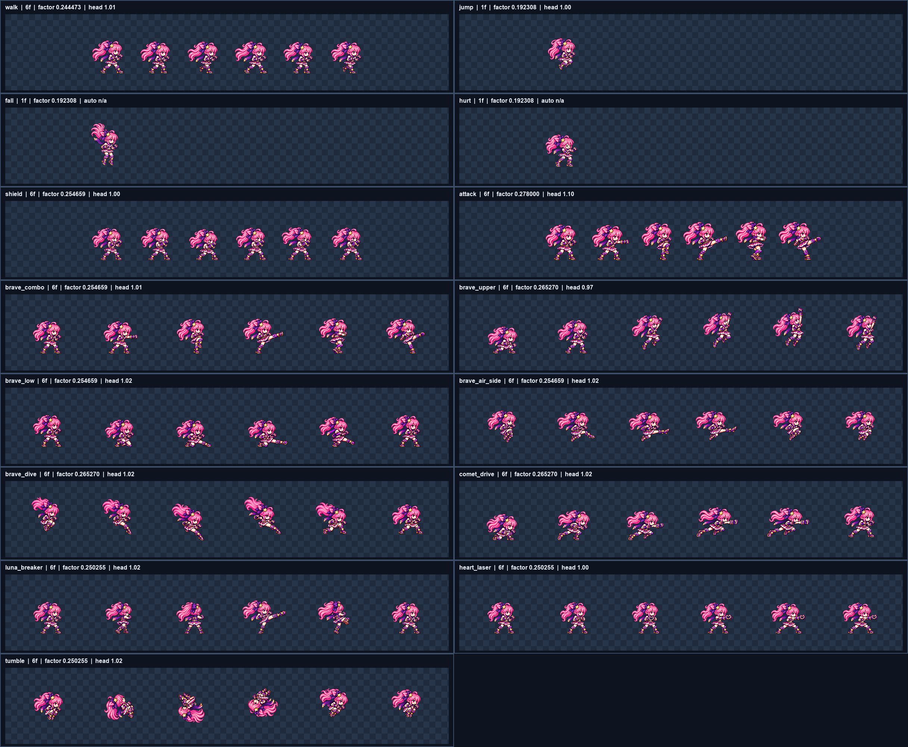

# CODEX-ART-45 — Brave Luna 동작 행 후보

선택된 `luna_brave-idle-v4` 디자인을 기준으로 카드에 지정된 15개 행을 모두 제작했다. 모든 결과는 후보 파일이며 `smash-nine-prototype/`에는 적용하지 않았다. 원본 생성물은 `art/raw/luna-45/`에 보관했고, 각 행 폴더에는 사용 프롬프트·4배 비교 이미지·정규화 측정값을 남겼다.

위 이미지는 각 후보를 4배로 확대한 전체 검수판이다. 개별 `compare.png`에서는 선택 기준 앵커, 현재 게임 행, 새 후보를 나란히 비교할 수 있다.

## 산출물

| 행 | 후보 파일 | 프레임 / FPS | 셀 / 발 기준 | 머리 배율 측정 | 정규화 factor | lift | 육안 판정 |
|---|---|---:|---:|---:|---:|---:|---|
| walk | `luna_brave-walk-v1.png` | 6 / 10 | 128 / 120 | 1.01 (4프레임) | 0.244473 | 0–0 | 좌우 contact/down/passing이 구분되고 포니테일·스카프 후행이 읽힘 |
| jump | `luna_brave-jump-v1.png` | 1 / 1 | 128 / 120 | 1.00 (1프레임) | 0.192308 | 10–10 | 무릎을 접은 상승 자세와 든 주먹이 명확함 |
| fall | `luna_brave-fall-v1.png` | 1 / 1 | 128 / 120 | 자동값 없음, 육안 약 1.00 | 0.192308 | 4–4 | 다리를 아래로 뻗고 포니테일이 위로 흐르는 하강 자세 |
| hurt | `luna_brave-hurt-v1.png` | 1 / 1 | 128 / 120 | 자동 1.04이나 신뢰도 미달, 육안 약 1.00 | 0.192308 | 0–0 | 눈을 감고 뒤로 튕기는 피격 반응이 읽힘 |
| shield | `luna_brave-shield-v1.png` | 6 / 12 | 128 / 120 | 1.00 (1프레임) | 0.254659 | 0–0 | 건틀릿 올리기→교차 방어→유지가 명확함 |
| attack | `luna_brave-attack-v1.png` | 6 / 16 | 128 / 120 | 1.10 (2프레임) | 0.278000 | 0–0 | `brave_combo` 원본을 128 셀에 들어가는 최대 0.001 단위 factor로 재정규화한 예비 행 |
| brave_combo | `luna_brave-brave_combo-v1.png` | 6 / 16 | 192 / 152 | 1.01 (2프레임) | 0.254659 | 0–0 | 가드/잽, 몸통 차기 준비/타격, 회전 준비/넓은 차기의 3타가 분리됨 |
| brave_upper | `luna_brave-brave_upper-v1.png` | 6 / 24 | 192 / 152 | 0.97 (2프레임) | 0.265270 | 0–19 | 웅크림→상승 추진→공중 정점→회복 흐름이 읽힘 |
| brave_low | `luna_brave-brave_low-v1.png` | 6 / 24 | 192 / 152 | 1.02 (3프레임) | 0.254659 | 0–0 | 낮아지는 준비와 지면을 훑는 다리, 후속 회복이 구분됨 |
| brave_air_side | `luna_brave-brave_air_side-v1.png` | 6 / 24 | 192 / 152 | 1.02 (3프레임) | 0.254659 | 12–18 | 전 프레임 공중 상태이며 접기→뻗기→유지→회수가 읽힘 |
| brave_dive | `luna_brave-brave_dive-v1.png` | 6 / 24 | 192 / 152 | 1.02 (1프레임) | 0.265270 | 0–24 | 높은 접기→하향 차기→급강하→착지→회복 순서가 명확함 |
| comet_drive | `luna_brave-comet_drive-v1.png` | 6 / 24 | 192 / 152 | 1.02 (5프레임) | 0.265270 | 0–9 | 웅크림→밀어내기→오른쪽 돌진 펀치→유지→회복이 읽힘 |
| luna_breaker | `luna_brave-luna_breaker-v1.png` | 6 / 16 | 192 / 152 | 1.02 (1프레임) | 0.250255 | 0–0 | 준비→회전→등 보이기→넓은 뒤꿈치 차기→회복이 구분됨 |
| heart_laser | `luna_brave-heart_laser-v1.png` | 6 / 12 | 192 / 152 | 1.00 (5프레임) | 0.250255 | 0–0 | 손 모으기→가슴의 하트 손동작→앞으로 밀기→발사 자세 유지가 읽힘 |
| tumble | `luna_brave-tumble-v1.png` | 6 / 21 | 192 / 152 | 1.02 (2프레임) | 0.250255 | 12–27 | 몸을 말아 한 바퀴 뒤로 회전하며 얼굴이 2프레임 이상 보임 |

`머리 배율 측정`의 괄호 안 숫자는 자동 측정에 채택된 프레임 수다. 회전·가림 때문에 자동 측정이 불안정한 프레임은 제외했으며, fall과 hurt는 자동 결과와 육안 판정을 명시적으로 분리했다.

## 기계 측정 결과

- 전 행: 테두리 접촉 없음, 최소 4px 여백 충족, 잔류 초록 spill 0.
- 전 행: 내부 디테일 최솟값 90 이상. 측정 범위는 99.03–121.57이다.
- 정규화 설정: LANCZOS, sharpen 60, despill auto, palette none, 배경 `#00ff00`.
- base 행은 128px 셀/feet 120, move 행은 192px 셀/feet 152를 사용했다.
- `attack`은 카드 지시대로 머리 배율 밴드보다 128px 셀의 최대 적합 factor를 우선했다. 0.279 이상에서는 3번 프레임의 오른쪽 여백이 3px로 줄었고, 0.278에서 4px 조건을 충족했다.

## 4배 육안 검수

- 모든 행을 앵커와 현재 게임 행 옆에서 4배로 확인했다.
- 모든 프레임에서 얼굴 하나, 건틀릿 둘, 부츠가 유지되며 별빛·혜성·하트 레이저·오라 효과는 넣지 않았다.
- 선택 디자인의 높은 포니테일, 보라색 리본과 금색 별, 민소매 상의, 치마와 반바지, 짧은 스카프, 보라·금색 건틀릿 및 별 무릎 보호대가 유지된다.
- 동작 의미는 현재 행을 참고하되 기존 복장·머리·빛 구체는 복사하지 않았다.

## 아직 남은 결함과 제한

- `attack` 머리 배율은 1.10으로 일반 허용 범위 0.96–1.04 밖이다. 128px 셀에서 4px 여백을 지키는 최대 크기라는 카드의 별도 조건을 따른 결과이며, 실제 주력 `brave_combo`는 1.01이다.
- fall은 회전된 머리와 머리카락 방향 때문에 자동 머리 검출이 실패했다. hurt는 자동값 1.04가 나왔지만 신뢰도 0.59로 채택 기준에 못 미쳤다. 둘 다 4배 비교에서 앵커와 약 1.00으로 판단했으나 이는 육안 판단이다.
- shield는 교차한 건틀릿이 얼굴 일부를 가리는 의도된 자세라 자동 머리 측정에 쓸 수 있는 프레임이 1개뿐이다.
- 행별 독립 생성이라 선 두께·장식 위치에는 프레임 간 미세한 흔들림이 남을 수 있다. 후보 단계에서는 동작 판독과 디자인 일관성을 우선했다.
- 실제 게임 적용과 인게임 재생 검증은 이 카드 범위 밖이며 수행하지 않았다.

## 생성 재시도와 도달 범위

- 1회 생성: walk, jump/fall/hurt 묶음, shield, brave_upper, brave_air_side, comet_drive, luna_breaker, heart_laser, tumble.
- 2회 생성: brave_combo(첫 결과의 셀 경계 침범), brave_low(오른쪽 경계 접촉), brave_dive(아래쪽 경계 접촉). 두 번째 결과를 채택했다.
- 도달하지 못한 행: 없음. 카드 순서의 15개 행을 모두 완료했다.

## 검증

`C:/Users/TH/.cache/codex-runtimes/codex-primary-runtime/dependencies/python/python.exe -m unittest tools/sprite_pipeline/test_normalize.py -v`

정규화 도구 테스트 18개가 모두 통과했다. 후보 채택 전에는 각 행의 `metrics.json`, `head_scale.json`, `compare.png`를 함께 확인해야 한다.
