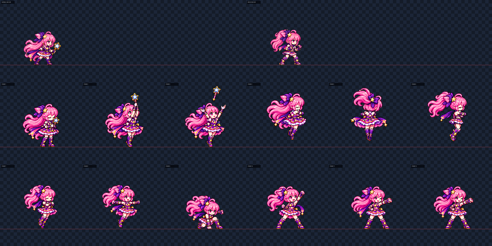

# CODEX-ART-46 결과 — Luna 특수 변신 12프레임

## 완료

일반 Luna가 Brave Luna 시안 ②로 변하는 12fps, 12프레임 쇼케이스 후보를 만들었다. 게임 파일은 바꾸지 않았고, 최종 후보는 `art/bakeoff/luna/luna-transform-v2.png`에 2304×192 한 줄로 정리했다. 사용한 두 생성 원본, 4배 앵커와 후반 배치 보정본은 `art/raw/luna-46/`에 보존했다.

위 비교판은 첫 줄에 일반형·Brave형 앵커를 같은 픽셀 배율로 놓고, 아래 두 줄에 12프레임을 모두 4배 최근접 확대해 놓은 것이다. 붉은 선은 y=152 발선이다.

## 프레임별 확인

| 프레임 | 화면에 보이는 내용 | 육안 판정 |
| ---: | --- | --- |
| 1 | 일반형, 눈을 감고 두 손으로 별 지팡이를 가슴에 모음 | 호출 시작이 분명함 |
| 2 | 일반형, 지팡이를 머리 위로 높이 들고 발끝으로 섬 | 상승 준비가 읽힘 |
| 3 | 일반형, 지팡이가 열린 손 위로 떠오르고 두 팔이 벌어짐 | 지팡이 이탈과 다음 회전 연결이 분명함 |
| 4 | 일반형, 조금 떠서 팔을 가슴에 교차하고 회전 시작 | 회전은 읽히나 3/4 후면보다 측면 얼굴이 조금 많이 보임 |
| 5 | 일반형 정후면, 머리와 리본이 위로 모이고 드레스가 크게 펼쳐짐 | 의상 교체를 가리는 프레임으로 기능함; 교차한 팔은 많이 가려짐 |
| 6 | Brave형 측면, 높은 포니테일·스카프·건틀릿·짧은 전투복 완성 | 두 의상의 경계가 처음 명확하게 나타남 |
| 7 | Brave형 전면 3/4, 눈을 감고 팔을 교차한 채 회전 계속 | 6→7 회전 방향이 이어짐 |
| 8 | Brave형 전면, 두 주먹을 양옆으로 펼쳐 회전 종료 | 포니테일과 스카프 후속 동작이 보임 |
| 9 | 한 주먹을 바닥에 짚은 깊은 착지 웅크림 | 게임의 버스트 프레임으로 강하게 읽히며 이펙트는 없음 |
| 10 | 착지에서 일어나 한 주먹을 위·앞으로 올림 | 상승 힘과 다음 영웅 포즈 연결이 보임 |
| 11 | 한 주먹을 앞으로 내민 윙크 영웅 포즈 | 자신감 있는 마무리가 분명함; 반대 손은 허리보다 복부에 가까움 |
| 12 | 같은 포즈에서 포니테일과 스카프가 가라앉음 | 11과 구분되는 작은 정착 동작이 있고 전투 준비로 끝남 |

## 머리 크기 측정값과 배율

측정값과 육안 판정을 섞지 않았다.

- **전반 1–6:** 초안 공통 배율 0.205에서 `head_scale.py` 저임계 중앙값은 0.68이었다. 이를 기준으로 공통 배율을 **0.301471**로 보정해 산출상 머리 비율 **1.00**을 맞췄다. 다만 눈 감은 정면과 후면 회전 때문에 여섯 프레임 모두 점수가 0.34–0.53으로, 도구의 신뢰 임계값 0.60을 넘지 못했다.
- **후반 7–12:** 초안 배율 0.205에서 고신뢰 4프레임 중앙값이 0.76이었고, 공통 배율을 **0.269737**로 보정해 산출상 중앙값 **1.00**을 맞췄다. 최종 직접 검출에서 신뢰 임계값을 넘긴 프레임은 7번 한 장이며 값은 **1.02**였다.
- 두 절반 모두 절반 안에서는 프레임별 확대를 하지 않고 공통 배율 하나만 사용했다.

4배 육안 비교에서는 1–6의 얼굴·머리 덩어리가 일반형 앵커와 같은 급으로 유지되고, 7–12는 Brave 앵커와 같은 급으로 유지된다. 웅크린 9번도 머리 자체가 줄어들지 않고 몸만 압축되어 보인다.

## 자동 검사

- 정리 방식: LANCZOS, sharpen 60, auto despill, palette none, 192px 셀, 발선 y=152.
- 테두리 침범 없음, 전 프레임 4px 이상 여백, 남은 초록 번짐 0px, 이진 알파를 확인했다.
- 내부 디테일은 전반 99.91–115.95, 후반 102.14–112.66으로 전 프레임 90 이상이다.
- 4–8은 발선에서 조금 떠 있고, 9는 정확히 착지한다. 생성기가 두 번째 행을 위로 놓은 오차 때문에 10–12만 원본 셀 안에서 60px 아래로 평행 이동했다. 크기·자세·픽셀 내용은 바꾸지 않았다.
- `preview.gif`는 12fps 루프로 만들었으며, 1→3 호출, 4→8 한 방향 회전, 9 착지, 10→12 영웅 포즈 순서가 끊기지 않는지 확인했다.

## 아직 잘못되거나 제한된 점

- 4번은 요구한 3/4 후면보다 측면 얼굴이 더 많이 보여 회전 초입의 각도가 약하다.
- 5번은 정후면 실루엣과 드레스 플레어는 좋지만 교차한 팔이 머리카락과 몸에 가려져 명확하지 않다.
- 11–12번의 반대 손은 완전히 허리에 얹힌 모양보다 복부 앞에 모은 모양에 가깝다.
- 두 형태의 색과 치마 계층이 비슷해 의상 차이는 높은 포니테일, 짧은 스카프, 전완 건틀릿에서 가장 잘 읽힌다. 쇼츠는 9–10번에서 더 분명하다.
- 전반 머리 크기는 자동 템플릿의 고신뢰 직접값이 없어서 공통 배율 산출과 4배 육안 비교에 의존한다.

## 현재 상태

후보 시트, 메타데이터, 프롬프트, 4배 비교판, 12fps 프리뷰와 수치 기록까지 완료했다. 게임 반영은 하지 않았으며, 리드가 모션 뷰어에서 채택한 뒤에만 `transform` 행을 교체할 수 있다.
