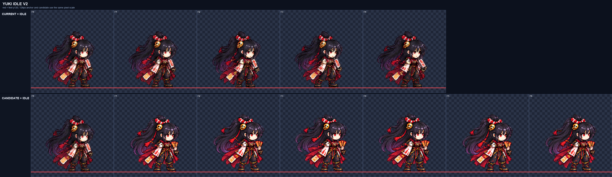

# CODEX-ART-48 · Yuki phase 1 결과

Yuki의 새 기준 대기 동작 `yuki-idle-v2`를 6프레임 후보로 만들었다. Codex 내장 이미지 도구로 두 번 생성했으며, 첫 생성은 같은 몸 높이에서 머리가 기준의 약 0.60–0.62로 작아 폐기했다. 두 번째 생성을 공통 배율 `0.218021`로 정규화했고 제품 경로인 `smash-nine-prototype/`은 바꾸지 않았다.

## 변경된 내용

- 후보: `art/bakeoff/yuki/yuki-idle-v2.png` (768×128)와 메타데이터 JSON
- 최종 생성 원본: `art/raw/yuki-48/idle/raw.png`
- 폐기한 첫 생성: `art/raw/yuki-48/idle/raw-attempt1.png`
- 검수 자료: `idle/prompt.txt`, `idle/compare.png`, `idle/metrics.json`
- 재현 설정: 3×2 원본, `--cell 128 --scale-by fixed:0.218021 --resample lanczos --sharpen 60 --despill auto --palette none --bg #00ff00`

후보 JSON은 6프레임과 6.3fps를 기록한다. 그림 안에는 광원·마법진·불꽃·떠다니는 부적 같은 별도 이펙트를 넣지 않았고, 손에 든 종이 부적 묶음만 남겼다.

## 측정 결과

| 항목 | 결과 | 카드 기준 | 판정 |
| --- | ---: | ---: | --- |
| 공통 배율 | 0.218021 | 동작 전체에 하나 | 통과 |
| 머리 배율 중앙값 | 1.02 | 0.96–1.04 | 수치상 통과, 저신뢰 |
| 몸 높이 | 89–91px | 85–91px | 통과 |
| 몸 너비 | 77–81px | 참고값 | 기록 |
| 내부 디테일 | 83.64–85.73, 평균 84.54 | 프레임마다 90 이상 | **실패** |
| 현재 idle 대비 디테일 | 94.55% | 참고값 | 기록 |
| 색 수 | 4,139–4,311 | 팔레트 제한 없음 | 기록 |
| 남은 초록 번짐 | 전 프레임 0px | 0 | 통과 |
| 경계·여백 | 1px 경계 통과, 최소 여백 7px | 4px 이상 | 통과 |
| 바닥선 | 전 프레임 y=120 | 지상 고정 | 통과 |
| 알파 | 이진 알파 | 이진 알파 | 통과 |

프레임별 몸 높이는 `89 / 90 / 90 / 91 / 90 / 90px`, 내부 디테일은 `85.73 / 85.13 / 84.25 / 83.64 / 84.15 / 84.36`이다.

`head_scale.py`의 기본 신뢰도 하한 0.6을 넘긴 것은 F3 한 장뿐이었다(F3 `1.02`, 점수 `0.831`). 나머지는 점수 `0.296–0.492`라 중앙값 계산에서 제외됐다. 따라서 도구 출력은 카드 범위 안이지만 여섯 프레임 전체의 머리 일관성을 강하게 증명하지 못한다.

## 4배 육안 확인

위 판의 윗줄은 현재 게임 idle, 아랫줄은 같은 현재 F0 앵커 뒤에 새 여섯 프레임을 붙인 것이다. 빨간 선은 발 y=120이다.

- F1은 두 발을 고정한 중립 자세다.
- F2–F3에서 어깨와 머리카락 끝이 들리고 F3에서 머리카락의 후방 흐름이 가장 크다.
- F4는 몸이 내려오기 시작하지만 머리카락이 뒤에 남아 있는 모습이다.
- F5는 가장 가라앉은 자세, F6은 F1로 돌아가는 중간 자세로 읽힌다.
- 여섯 프레임 모두 얼굴 하나, 긴 흑자색 머리, 붉은 눈, 붉은 장식·금색 방울, 흰 소매, 손에 든 붉은 부적 묶음과 양쪽 부츠를 확인했다. 부적을 들지 않은 손은 소매와 몸통에 대부분 가려져 있어 형태를 완전히 판정하기 어렵다.
- 생성 결과의 호흡 차이가 작아 정지 비교에서는 루프가 차분하게 이어지지만, 실제 6.3fps 재생에서 F5→F6→F1의 박자가 충분히 읽히는지는 모션 뷰어 확인이 필요하다.

## 현재 상태와 남은 문제

- 완료: 6프레임·6.3fps 후보, 최종 프롬프트, 공통 배율 정규화, 머리 측정, 4배 비교판, 후보 메타데이터.
- 현재 상태: 크기·경계·여백·초록 제거는 통과한 bake-off 후보이며 게임에는 반영하지 않았다.
- 남은 문제: 내부 디테일이 모든 프레임에서 카드 하한 90보다 낮다. 머리 배율 1.02도 F3 한 장만 신뢰도 하한을 넘어 저신뢰다. 육안으로는 현재 idle보다 얼굴과 머리 덩어리가 약간 작고, 반대손이 가려져 있다.
- 다음 권장 단계: 리드가 이 후보를 모션 뷰어에서 6.3fps로 확인하되, 채택 전에는 디테일 하한과 머리 측정 신뢰도 문제를 해결한 새 생성이 필요하다. 카드의 최대 두 번 생성과 40분 하드 스톱 때문에 이번 유닛에서는 추가 생성하지 않았다.

## 확인

- 최종 PNG 크기 768×128, 6셀 확인
- 후보 JSON과 측정 JSON 파싱 완료
- `compare.png`를 원본 크기(4배)로 열어 현재 idle과 후보의 모든 프레임 확인
- 제품 파일을 바꾸지 않은 후보 작업이므로 Godot 실행 테스트는 하지 않았다.
