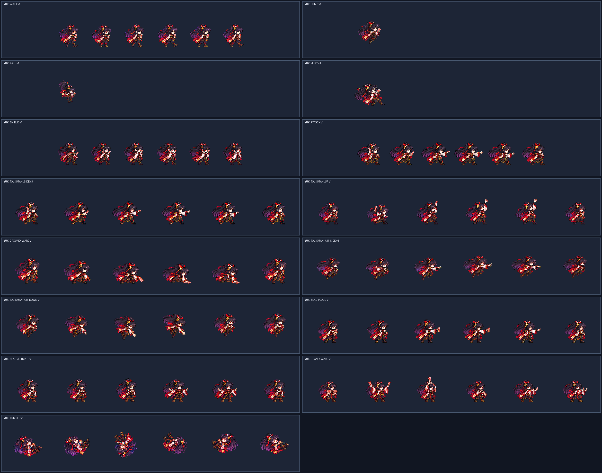

# CODEX-ART-49 · Yuki phase 2 결과

채택된 `yuki-idle-v2`를 기준으로 Yuki의 나머지 동작 15개 후보를 만들었다. 기본 시트 후보 6개(`walk`, `jump`, `fall`, `hurt`, `shield`, `attack`)와 192px 기술 시트 후보 9개를 모두 생성·정규화했으며, `smash-nine-prototype/`은 변경하지 않았다. 생성에는 Codex 내장 ImageGen을 사용했고 실제 선택한 원본과 폐기한 1차 원본은 `art/raw/yuki-49/`에 보관했다.

## 생성한 후보

- 기본 128px: `yuki-walk-v1`, `yuki-jump-v1`, `yuki-fall-v1`, `yuki-hurt-v1`, `yuki-shield-v1`, `yuki-attack-v1`
- 기술 192px: `yuki-talisman_side-v3`, `yuki-talisman_up-v1`, `yuki-ground_ward-v1`, `yuki-talisman_air_side-v1`, `yuki-talisman_air_down-v1`, `yuki-seal_place-v1`, `yuki-seal_activate-v1`, `yuki-grand_ward-v1`, `yuki-tumble-v1`
- `talisman_side`는 `retired/`에 v2가 이미 있어 다음 빈 번호인 v3를 사용했다.
- 기본 `attack`은 최종 `talisman_side` 원본과 같은 배율을 128px 칸에 적용하고 공통 x=-1만 사용했다.

## 측정 결과

모든 후보는 LANCZOS, 선명화 60, 자동 초록 번짐 제거, 팔레트 없음으로 정규화했다. 전 후보에서 테두리 비움, 최소 4px 여백, 초록 번짐 0px, 이진 알파를 확인했다.

| 후보 | 배율 | 키 범위(px) | 디테일 범위 | 들림(px) | 결과 |
| --- | ---: | ---: | ---: | ---: | --- |
| walk | 0.246464 | 89–91 | 87.93–91.97 | 0 | 통과 |
| jump | 0.222222 | 90 | 95.36 | 12 | 통과 |
| fall | 0.171103 | 90 | 92.81 | 12 | 통과 |
| hurt | 0.251282 | 88 | 97.69 | 0 | 통과, x=-5 |
| shield | 0.227273 | 90 | 92.64–96.98 | 0 | 통과 |
| attack | 0.248067 | 89–90 | 84.58–92.96 | 0 | 통과, x=-1 |
| talisman_side | 0.248067 | 89–90 | 84.58–92.96 | 0 | 통과 |
| talisman_up | 0.273535 | 81–99 | 88.61–92.21 | 0 | 통과 |
| ground_ward | 0.294349 | 79–101 | 78.70–86.24 | 0 | **F4·F5 디테일 실패** |
| talisman_air_side | 0.256443 | 88–92 | 77.67–83.68 | 12–22 | **F6 디테일 실패** |
| talisman_air_down | 0.263505 | 86–94 | 77.42–81.24 | 12–23 | **F3·F4 디테일 실패** |
| seal_place | 0.259000 | 89–91 | 86.98–91.16 | 0 | 통과 |
| seal_activate | 0.247137 | 89–91 | 81.62–87.47 | 0 | 통과 |
| grand_ward | 0.246548 | 83–97 | 96.89–109.44 | 0 | 통과 |
| tumble | 0.310859 | 77–102 | 88.11–95.08 | 12–30 | 통과 |

`head_scale.py`에서 점수 0.6 이상인 프레임이 두 장 이상 나온 행은 없었다. `grand_ward`만 한 장이 신뢰 점수를 넘었고 탐침 중앙값은 1.06이었으나, 카드 규칙에 따라 이 값은 채택하지 않았다. 나머지도 수치 머리 배율 통과를 주장하지 않고, 서 있는 프레임의 키 89–91px(자세가 큰 행은 준비·복귀 프레임)과 4배 앵커 비교로 배율을 골랐다. 각 행의 원시 측정값과 머리 탐침 결과는 해당 `metrics.json`에 있다.

## 4배 육안 확인

위 그림은 최종 후보 15개를 한 판에 모은 것이다. 실제 검수는 각 행의 `compare.png`를 원본 4배 크기로 열어 앵커와 나란히 확인했다.

- 걷기는 양쪽 접지·다운·패싱이 번갈아 읽히고, 머리카락과 소매가 후행한다.
- 점프·낙하·피격은 각각 상승, 하강, 눈을 감은 반동으로 구분된다. 피격은 부적을 유지한다.
- 방어는 교차 팔과 부적이 보이며 장벽이 없다.
- 지상 옆/위 던지기는 방출 뒤 손이 비고 분리 투사체가 없다.
- `ground_ward`는 웅크림 → 앞의 땅 접촉 → 유지 → 복귀로 읽히고 파동은 없다.
- `seal_place`, `seal_activate`, `grand_ward`는 손 모양과 단계가 구분되며 별도 결계·광원 이펙트가 없다.
- `tumble`은 한 바퀴 뒤회전을 완성하고 얼굴이 두 프레임 이상 보인다.

## 남아 있는 문제

- `ground_ward` F4·F5, `talisman_air_side` F6, `talisman_air_down` F3·F4는 카드의 디테일 하한 80에 못 미친다. 이 세 동작은 이미 허용된 2차 생성까지 사용했다.
- 공중 옆/아래 던지기의 1차 원본은 손에서 떨어진 투사체가 남아 폐기했다. 2차 원본은 불법 투사체는 없지만, 손에 든 부적이 작거나 가려져 던지기 준비가 지상 동작보다 약하게 읽힌다.
- `head_scale.py` 신뢰 프레임이 부족해 각 행의 0.96–1.04를 수치로 확정하지 못했다. 4배 육안과 키 기준으로 맞춘 후보이며 리드의 독립 검수가 필요하다.

## 확인

- 후보 PNG 15개와 메타데이터 JSON 15개 파싱 및 크기 확인
- 모든 행의 `compare.png`를 원본 4배로 직접 확인
- 모든 행: 테두리 통과, 4px 여백 통과, 초록 번짐 0px, 이진 알파
- `summary.json`에 행별 최종 수치 집계
- 제품 파일을 바꾸지 않은 bake-off 후보 작업이므로 Godot 실행 테스트는 하지 않았다.

