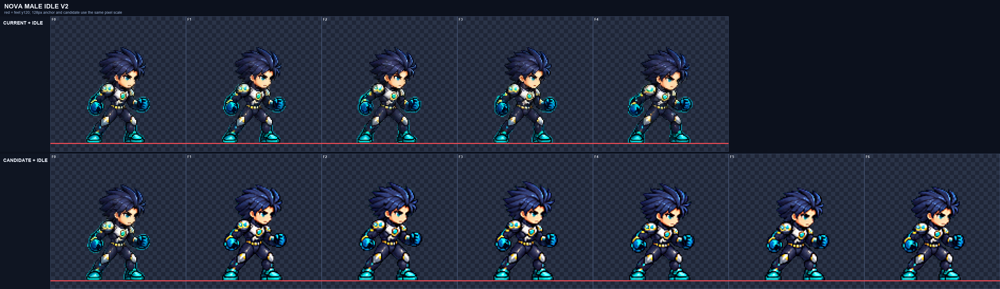
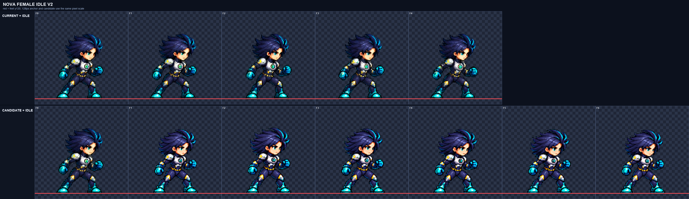

# CODEX-ART-51 · Nova phase 1 결과

Nova 남성·여성 각각의 새 기준 대기 동작을 6프레임 후보로 만들었다. 남성은 첫 생성이 머리·몸 높이 기준을 함께 만족했고, 여성은 첫 생성의 머리가 기준의 `0.92`로 작아 폐기한 뒤 몸통과 다리를 줄인 두 번째 생성을 채택했다. 두 후보 모두 게임 파일에는 넣지 않았다.

## 만든 파일

- `art/bakeoff/nova/nova_male-idle-v2.png` 및 JSON: 남성 6프레임, 768×128, 6.3fps
- `art/bakeoff/nova/nova_female-idle-v2.png` 및 JSON: 여성 6프레임, 768×128, 6.3fps
- `art/raw/nova-51/nova_male/raw.png`: 채택한 남성 원격 생성 원본
- `art/raw/nova-51/nova_female/raw.png`: 채택한 여성 2차 원격 생성 원본
- `nova_male/`, `nova_female/`: 최종 프롬프트, 4배 비교판, 프레임, 정규화·머리 측정 JSON
- `references/`: 현재 idle 첫 프레임을 4배 nearest로 확대한 생성 참조

정규화에는 각 동작 전체에 배율 하나만 적용했다. 설정은 `--cell 128 --resample lanczos --sharpen 60 --despill auto --palette none --bg #00ff00 --ground-all`이다.

## 측정 결과

| 항목 | 남성 | 여성 | 카드 기준 |
| --- | ---: | ---: | ---: |
| 공통 배율 | 0.217 | 0.20547945 | 프레임 전체에 하나 |
| 머리 배율 중앙값 | 1.02 | 1.01 | 0.96–1.04 |
| 머리 측정 신뢰 프레임 | 6/6 | 6/6 | 점수 0.6 이상 2개 이상 |
| 몸 높이 범위 | 89–95px | 88–91px | 남 89–95 / 여 87–93px |
| 프레임별 몸 높이 | 92 / 94 / 95 / 93 / 89 / 90 | 89 / 91 / 90 / 89 / 89 / 88 | 기록 |
| 내부 디테일 범위 | 90.81–93.13 | 92.34–95.30 | 남 ≥84 / 여 ≥79 |
| 내부 디테일 평균 | 91.87 | 93.84 | 기록 |
| 현재 idle 대비 디테일 | 98.52% | 106.75% | ≥90% |
| 남은 초록 번짐 | 전 프레임 0px | 전 프레임 0px | 0px |
| 1px 경계 / 4px 여백 | 통과 / 최소 7px | 통과 / 최소 7px | 통과 / ≥4px |
| 바닥선 | 전 프레임 y=120 | 전 프레임 y=120 | 지상 고정 |

남성 머리 프레임별 결과는 `1.00 / 1.02 / 1.02 / 1.00 / 1.02 / 1.02`이고 점수는 `0.862–0.941`이다. 여성은 `1.02 / 1.02 / 1.00 / 1.00 / 1.02 / 1.00`, 점수 `0.870–0.922`라 두 몸 모두 자동 측정 중앙값을 그대로 신뢰했다.

## 4배 육안 확인

위 판의 윗줄은 현재 남성 idle, 아랫줄은 동일한 현재 F0 앵커 뒤에 새 여섯 프레임을 붙인 것이다. 한 얼굴, 양팔과 양손 건틀릿, 양다리와 양부츠가 모든 프레임에서 연결되어 있다. 청록 코어는 작은 단색 형태이고 외곽 광륜·중력 잔상은 없다. F2–F3에서 어깨와 머리가 올라가고, F4는 몸이 내려오기 시작해도 머리카락이 들린 상태를 유지하며, F5가 가장 낮다.

여성도 같은 방식으로 확인했다. 긴 남색 머리, 청록 눈, 좁은 허리, 은색 가슴·어깨 갑주, 청록 건틀릿·부츠와 금색 포인트가 여섯 프레임에 유지된다. 첫 생성보다 머리와 얼굴이 상대적으로 커졌고, 전체 높이는 오히려 카드 범위 안에 남았다. 이펙트·후광·잔상은 없다.

## 현재 상태와 아직 어색한 점

- 완료: 두 후보 생성, 공통 배율 정규화, 머리 크기 측정, 프레임별 수치 검사, 4배 육안 검사, 후보 메타데이터.
- 현재 상태: 두 후보 모두 카드의 머리·몸 높이·디테일·경계·여백·초록 번짐 기준을 통과했으며 `smash-nine-prototype/`은 변경하지 않았다.
- 남은 시각 문제: 호흡과 머리카락 변화가 의도적으로 작아서 정지 비교에서는 프레임 차이가 약하다. 특히 여성 F3→F4의 머리카락 지연은 읽히지만 폭이 작다. 남성 후보는 현재 idle보다 어깨·몸통 실루엣이 조금 가늘어 보인다.
- 검증 제한: 4배 정지 비교로는 F6→F1의 실제 6.3fps 박자까지 확정할 수 없다. 리드가 모션 뷰어에서 루프를 보고 채택 여부를 정해야 한다.

## 확인

- 최종 PNG 두 장 모두 768×128, RGBA, 6셀
- 후보 JSON 및 측정 JSON 파싱 완료
- 모든 프레임을 현재 idle 옆 4배 비교판 원본 크기로 확인
- 제품 파일을 바꾸지 않은 후보 작업이므로 Godot 실행 테스트는 하지 않음
