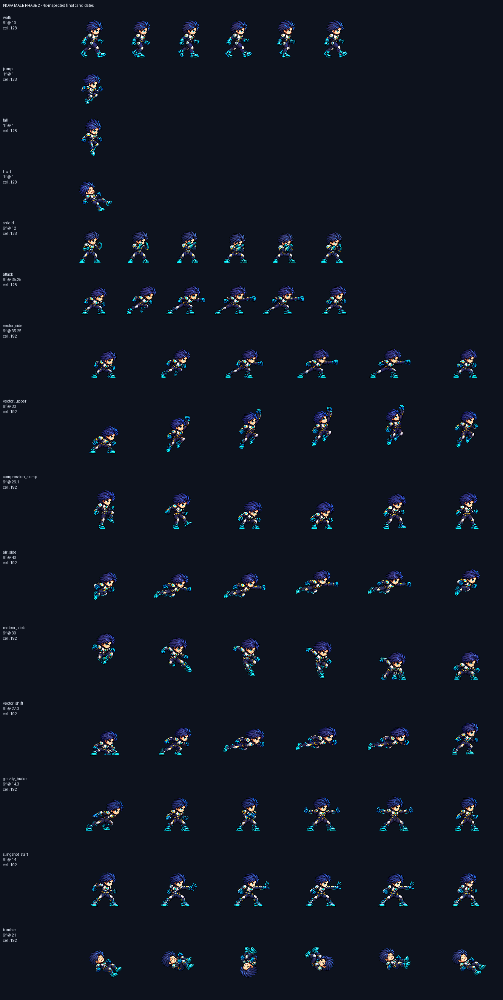

# CODEX-ART-52A · Nova 남성 phase 2 결과

채택된 `nova_male-idle-v2`를 기준으로 기본 시트 후보 6개와 192px 기술 시트 후보 9개를 카드 순서대로 완성했다. 모든 그림은 후보이며 `smash-nine-prototype/`은 변경하지 않았다. 생성은 Codex 내장 ImageGen을 사용했고, 실제 사용한 원본과 실패한 1차 원본은 `art/raw/nova-52a/`에 보관했다.

## 행별 결과

| 행 | 파일 | 프레임 / fps | 머리 검사 | 배율 | 들림(px) | 디테일 |
| --- | --- | ---: | --- | ---: | ---: | ---: |
| `walk` | `nova_male-walk-v1.png` | 6 / 10 | 1.00 (6f) | 0.267380 | 0–0 | 103.33–106.35 |
| `jump` | `nova_male-jump-v1.png` | 1 / 1 | 4× 크롭 | 0.192308 | 12–12 | 109.98–109.98 |
| `fall` | `nova_male-fall-v1.png` | 1 / 1 | 4× 크롭 | 0.197917 | 12–12 | 106.67–106.67 |
| `hurt` | `nova_male-hurt-v1.png` | 1 / 1 | 4× 크롭 | 0.192000 | 0–0 | 110.60–110.60 |
| `shield` | `nova_male-shield-v1.png` | 6 / 12 | 1.02 (3f) | 0.205744 | 0–0 | 105.76–109.57 |
| `attack` | `nova_male-attack-v1.png` | 6 / 35.25 | 1.02 (6f) | 0.260417 | 0–0 | 99.22–105.12 |
| `vector_side` | `nova_male-vector_side-v1.png` | 6 / 35.25 | 1.02 (6f) | 0.260417 | 0–0 | 99.22–105.12 |
| `vector_upper` | `nova_male-vector_upper-v1.png` | 6 / 33 | 0.96 (4f) | 0.312500 | 0–21 | 104.77–110.53 |
| `compression_stomp` | `nova_male-compression_stomp-v1.png` | 6 / 26.1 | 1.02 (6f) | 0.274725 | 0–0 | 102.87–105.10 |
| `air_side` | `nova_male-air_side-v1.png` | 6 / 40 | 1.01 (6f) | 0.284091 | 12–28 | 95.30–99.72 |
| `meteor_kick` | `nova_male-meteor_kick-v1.png` | 6 / 30 | 1.04 (6f) | 0.284091 | 0–41 | 97.23–101.55 |
| `vector_shift` | `nova_male-vector_shift-v1.png` | 6 / 27.3 | 1.00 (6f) | 0.268817 | 0–14 | 96.66–112.01 |
| `gravity_brake` | `nova_male-gravity_brake-v1.png` | 6 / 14.3 | 1.02 (6f) | 0.277778 | 0–0 | 100.47–108.44 |
| `slingshot_start` | `nova_male-slingshot_start-v1.png` | 6 / 14 | 0.98 (6f) | 0.260417 | 0–0 | 113.32–117.02 |
| `tumble` | `nova_male-tumble-v1.png` | 6 / 21 | 4× 크롭 | 0.220000 | 12–32 | 97.13–104.41 |

## 배율과 위치 판단

- `walk`, `shield`, `attack`, 기술 8개는 `head_scale.py`에서 점수 0.6 이상 프레임이 2개 이상 나와 중앙값을 사용했다. 최종 중앙값은 0.96–1.04이다.
- `jump`, `fall`, `hurt`는 한 장짜리 포즈이므로 자동 수치를 채택하지 않고 각 `head-crops.png`의 4배 크롭과 앵커의 머리 크기를 비교했다. `fall`의 101px 높이는 다리를 아래로 뻗은 자세 때문이며 크기 기준으로 쓰지 않았다.
- `tumble`은 회전 자세라 자동 신뢰 프레임이 0개였다. 높이로 배율을 정하지 않고 4배 머리 크롭에서 0.250000의 머리가 약 13% 크게 보여 `0.220000`으로 맞췄다.
- 기본 `attack`은 `vector_side`와 같은 `0.260417`을 유지했다. 128px 칸에서도 들어가므로 축소하지 않았고, 전 프레임 공통 x 이동 `+6px`만 사용했다.
- `meteor_kick`은 2차 원본의 완성된 전신 포즈를 셀 안에서만 위아래로 옮겨 하강 들림을 `41/21/9/4/0/0px`로 만들었다. 프레임 크기와 배율은 모두 동일하다.

## 검사

- 전 행: LANCZOS, 선명화 60, 자동 디스필, 팔레트 없음.
- 전 행: 테두리 비움, 최소 4px 여백, 초록 번짐 0px, 이진 알파 통과.
- 전 행: 내부 디테일 최솟값 95.30 이상으로 남성 기준 84를 통과.
- 모든 최종 프레임을 앵커 옆 4배 `compare.png`로 직접 확인했다.

위 판은 후보 15개를 원래 게임 픽셀 배율로 쌓은 요약이다. 각 행의 정확한 4배 비교는 해당 폴더의 `compare.png`에 있다.

## 남아 있는 시각 문제

- `compression_stomp` F2는 발이 바로 아래보다 앞쪽으로 내려와 스톰프보다 짧은 앞차기처럼 잠깐 보일 수 있다.
- `vector_shift`의 선두 주먹은 굽혀져 있지만 정지 화면에서는 공격 준비처럼 보일 수 있다. 이펙트 없이 몸의 수평 유선형으로 이동 동작을 구분했다.
- `hurt`는 얼굴을 정면에 가깝게 돌린 반동 자세라 앵커보다 얼굴 면적이 커 보이지만, 4배 크롭에서 머리 외곽 크기는 맞췄다.
- `tumble`은 피격 상태를 강조해 여섯 프레임 모두 눈을 감고 있다. 얼굴은 전 프레임 보이지만 표정 변화는 작다.
- 정지 4배 검수만 수행했으므로 실제 10/12/21fps 루프 박자는 리드가 모션 뷰어에서 확인해야 한다.

## 현재 상태

카드의 모든 행을 완료했다. 도달하지 못한 행은 없다. 제품 파일을 바꾸지 않은 후보 작업이므로 Godot 실행 테스트는 하지 않았다.
