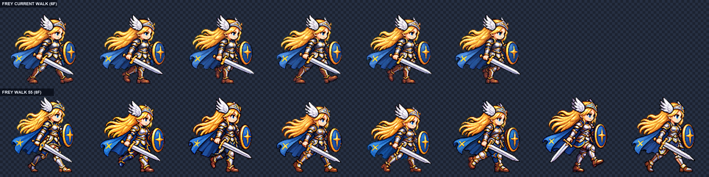
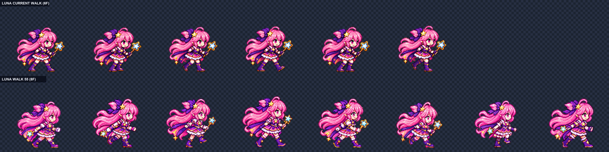

# CODEX-ART-55 결과 — 포즈 가이드 Frey / Luna 8프레임 걷기 후보

## 완료

- `art/bakeoff/frey/frey-walk-v4.png` / `.json`: Frey 1024×128, 8칸, 13.3fps 후보
- `art/bakeoff/luna/luna-walk-v3.png` / `.json`: Luna 1024×128, 8칸, 13.3fps 후보
- `reports/codex-art-55/walk_reference_frey.png`, `walk_reference_luna.png`: 가까운 팔다리 주황 / 먼 팔다리 파랑의 8자세 기준표
- `reports/codex-art-55/<frey|luna>/`: 최종 프롬프트, 4배 비교판, 포즈-발 비교판, 13.3fps GIF, 측정값
- `art/raw/walk-55/`: 실제 사용한 앵커·포즈 패널·생성 원본·정규화 중간 결과(커밋 제외)

게임 본체인 `smash-nine-prototype/`는 변경하지 않았다. 두 결과는 사용자 판정 전 후보이며 채택 표시도 하지 않았다.

## 작업 방식

먼저 Pillow 코드로 4×2 보행 마네킹을 만들었다. 1번은 주황 가까운 다리가 앞, 5번은 파랑 먼 다리가 앞이고, 3번 파랑·7번 주황 스윙 발은 지면에서 분리된다. 팔은 같은 색 다리와 반대로 움직인다.

Frey의 첫 4×2 생성은 들린 발은 보였지만 3·7번의 가까운/먼 다리 정체성이 확대 비교에서 반대로도 읽힐 수 있어 폐기했다. Luna의 첫 4×2 생성은 1·5번이 같은 다리 선행이고 3번 스윙 발이 뒤에 남아 실패했다. 카드 지시에 따라 두 캐릭터 모두 앵커 + 해당 단일 마네킹 패널로 8장을 따로 생성하고 프레임마다 앵커 머리에 맞는 배율로 정규화했다.

두 후보 모두 LANCZOS, 선명화 60, 자동 초록 제거, 팔레트 없음, 전 프레임 y=120 접지를 사용했다.

## 측정 결과

| 항목 | Frey | Luna | 기준 |
| --- | ---: | ---: | ---: |
| 최종 크기 | 1024×128 | 1024×128 | 8×(128×128) |
| 정규화 배율 | 0.159378–0.197660, 프레임별 | 0.121396–0.153752, 프레임별 | 생성 단위마다 한 배율 |
| 머리 크기 | 0.96–1.02, 자동 8/8 | 1.00–1.02, 자동 7/8 | 0.96–1.04 |
| 몸 높이 | 100–109 px | 78–87 px | 참고값 |
| 몸 너비 | 91–97 px | 71–85 px | 참고값 |
| 내부 디테일 | 107.86–121.31 | 100.55–109.45 | Frey ≥90, Luna ≥85 |
| 색 수 | 4,661–4,920 | 3,194–4,017 | 참고값 |
| 면적 흔들림 | 7.74% | 22.23% | 참고값 |
| 4px 여백 | 8/8 통과 | 8/8 통과 | 전 프레임 |
| 초록 번짐 | 전부 0 | 전부 0 | 0 |
| 1px 테두리 | 전부 비움 | 전부 비움 | 전 프레임 |
| 알파 | 이진 | 이진 | 이진 |
| 발선 | 전부 y=120 | 전부 y=120 | y=120 |

Luna 6번은 최종 자동 측정에서 노출된 팔다리 피부를 얼굴로 오인해 점수가 0.45였다. 이 값은 제외했다. 보정 전 얼굴만 남긴 진단 이미지에서는 1.02였고, 그 값을 적용해 축소한 뒤 4배 비교에서 머리 크기를 다시 확인했다. 따라서 자동 수치가 있는 것은 7/8이며, 6번은 이전 자동값 + 최종 육안 판정이다.

## 다리 하드 체크 — 4배 육안 판정

두 캐릭터 모두 통과했다.

- 1번: 가까운 다리 선행 접지
- 3번: 먼 다리가 앞으로 스윙하며 지면에서 분리
- 5번: 먼 다리 선행 접지 — 1번과 반대
- 7번: 가까운 다리가 앞으로 스윙하며 지면에서 분리
- 13.3fps GIF: 가까운 발 한 걸음 → 먼 발 한 걸음의 두 걸음 루프로 읽힘

`feet.png`의 위 행은 주황/파랑 마네킹, 아래 행은 최종 스프라이트다. 머리글의 `N`은 가까운 다리, `F`는 먼 다리이며 `SWING`은 들린 통과 발이다.

## 시각 자료

위 그림 아래 행이 Frey 새 후보이며, 3·7번의 들린 발과 1·5번의 반대 다리 접지를 확인할 수 있다.

위 그림 아래 행이 Luna 단일 포즈 생성 8장이다. 실패한 한 장 시트 대신 각 포즈를 따로 고정했다.

- `frey/feet.png`, `luna/feet.png`: 마네킹과 실제 발을 나란히 놓은 4배 하드 체크
- `frey/walk.gif`, `luna/walk.gif`: 13.3fps 반복 재생

## 남아 있는 문제

- Frey도 프레임별 생성이라 갑옷 조각·검/방패 각도와 전체 높이가 조금 흔들린다. 머리는 맞았지만 몸 높이는 100–109px로 9px 차이가 있어 재생 시 상하 움직임 일부가 의도한 down/up 외의 생성 편차와 섞인다.
- Luna는 프레임별 생성이라 실루엣·치마·완드 각도의 연결성이 한 장 생성보다 흔들린다. 면적 흔들림도 22.23%로 Frey보다 크다. 다리 교대와 머리 크기는 통과했지만, 모션 뷰어에서 연속성에 대한 사용자 판단이 필요하다.
- 실제 게임 적용과 로더 변경은 수행하지 않았다.

## 재현

1. `make_walk_reference.py`로 전체 기준표와 단일 포즈 패널을 만든다.
2. 내장 이미지 도구로 생성한 원본을 `art/raw/walk-55/`에 둔다.
3. 카드 지정 옵션으로 `normalize.py`를 실행하고 `head_scale.py`로 머리를 맞춘다.
4. `build_report.py`가 최종 스트립, JSON, 비교판, 발 판정판, GIF, 측정값을 조립한다.

`commit.ps1`은 이 카드의 후보와 보고서만 명시적으로 스테이징하며 `art/raw/`은 포함하지 않는다. 실행하지 않았다.
