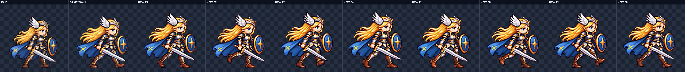
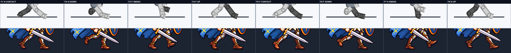
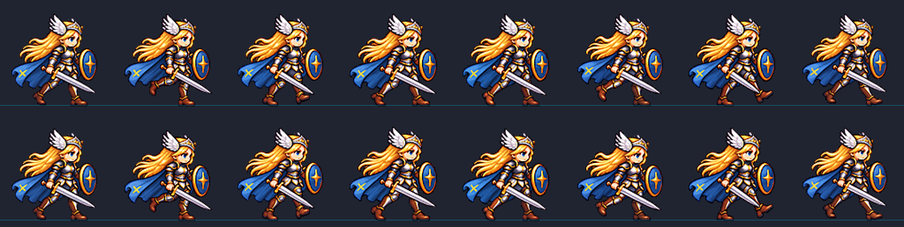

# CODEX-ART-57 Frey 결과 — 8프레임 걷기 4차

## 완료

`art/bakeoff/frey/frey-walk-v5.png`과 `.json`을 후보로 만들었다. 128×128 셀 8개, 전체 1024×128, 13.3fps이며 게임 본체 `smash-nine-prototype/`는 변경하지 않았다.

회색 마네킹은 자세만 전달하도록 만들었고, 1번 프레임에서 의상을 먼저 고정했다. 이후 2–8번은 이 1번만 걷기 의상 기준으로 재사용했다. 최종 선택 시도는 프레임별로 `2, 1, 1, 3, 2, 2, 1, 1`이다. 실제 사용한 생성 원본과 참조는 `art/raw/walk-57/frey/`에 복사했으며 커밋 대상이 아니다.

## 만든 파일

- 후보: `art/bakeoff/frey/frey-walk-v5.png`, `frey-walk-v5.json`
- 기준: `make_walk_reference.py`, `walk_reference_frey.png`
- 4배 검수판: `costume.png`, `feet.png`, `bob.png`, `compare.png`
- 재생/수치: `walk.gif`, `bob.json`, `metrics.json`
- 재현/인계: `build_report.py`, `prompts.txt`, `commit.ps1`

## 측정 결과

아래 항목은 도구 및 최종 PNG 픽셀 검사로 측정했다.

| 항목 | 결과 | 기준 |
| --- | ---: | ---: |
| 최종 크기 | 1024×128, 8칸 | 1024×128, 8칸 |
| 정규화 배율 | 0.10824742–0.11122881 | 생성마다 1개 |
| 머리 크기 | 각 프레임 1.00–1.02, 중앙값 1.02 | 0.96–1.04 |
| 보브 이동 | `0,+2,-1,-2,0,+2,-1,-1` | 각 이동 ±3px 이내 |
| 보브 후 머리 y | `0,+2,-1,-2,0,+2,-1,-2` | 목표 곡선과 일치 |
| 보브 후 몸 높이 | 103–107px | 참고 |
| 보브 후 몸 너비 | 96–99px | 참고 |
| 내부 디테일 | 104.96–108.61 | ≥90 |
| 면적 흔들림 | 8.08% | 참고 |
| 초록 번짐 | 8칸 모두 0 | 0 |
| 알파 / 테두리 / 4px 여백 | 전부 통과 | 전부 통과 |
| 최소 여백 | 7px | ≥4px |
| 보브 후 발 아래 행 | 변화 없음 | 변화 없음 |

정규화는 128px 셀, LANCZOS, 선명화 60, 자동 디스필, 팔레트 없음, `--ground-all`을 사용했다. `walk_bob.py`의 자체 검사도 통과했다.

## 4배 육안 판정

아래 항목은 `costume.png`, `feet.png`, `bob.png`와 13.3fps `walk.gif`를 직접 보고 판단했다.

- 의상 8/8 통과: 갈색 부츠, 짙은 레깅스, 은색 무릎·허벅지 판금, 은·금 갑옷이 대기 자세와 맞는다. 빨강·주황 부츠나 흰색·남색 다리는 없다.
- 장비 8/8 통과: 검은 전방-아래 약 15° 안에 있고, 둥근 파란 방패는 먼 팔 앞에 유지된다.
- 다리 교대 통과: 1번은 밝은 가까운 다리, 5번은 어두운 먼 다리가 선행한다. 3번의 먼 스윙 발과 7번의 가까운 스윙 발은 모두 지면에서 분리된다.
- 보브 봉합 자국은 다리에서 보이지 않는다.
- GIF는 가까운 발 한 걸음 뒤 먼 발 한 걸음의 두 교대 보행으로 읽힌다. 상하 튐과 의상 깜빡임은 보이지 않는다.

## 아직 남은 점

합격을 막는 문제는 찾지 못했다. 다만 독립 생성 프레임이라 무릎 판금과 부츠 하이라이트가 약 1–2px씩 달라지고, 1배에서는 먼 다리 정체성이 위치보다 명암 차이에 더 의존한다. 실제 게임 적용과 모션 뷰어 채택은 이 카드 범위가 아니다.

## 시각 자료

위 판에서 새 8프레임 모두 갈색 부츠와 짙은 레깅스를 유지한다.

위 행은 회색 포즈 가이드, 아래 행은 최종 스프라이트다. `N`은 가까운 다리, `F`는 먼 다리다.

위 행은 보정 전, 아래 행은 보정 후다. 발선 아래는 바뀌지 않았고 머리 곡선만 설정했다.
