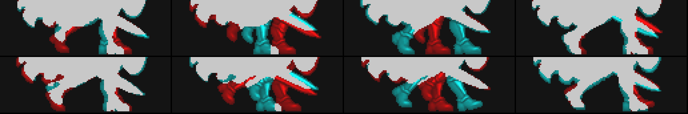
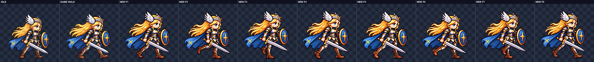
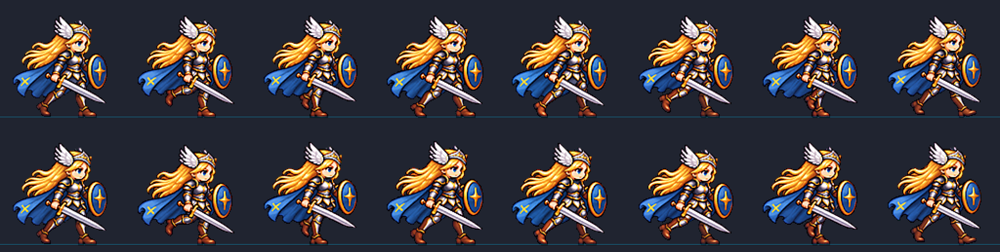

# CODEX-ART-58 Frey 결과 — 통과 자세 3·7번 재작업

## 완료

`art/bakeoff/frey/frey-walk-v6.png`과 `.json`을 후보로 만들었다. ART-57의 1·2·4·5·6·8번은 보브 전 정규화 프레임을 그대로 유지하고, 통과 자세인 3번과 7번만 다시 생성했다. 최종 후보는 128×128 셀 8개, 전체 1024×128, 13.3fps다. 게임 본체 `smash-nine-prototype/`는 변경하지 않았다.

3번은 세 번째 생성, 7번은 첫 번째 생성을 선택했다. 사용한 참조와 생성 원본은 `art/raw/walk-58/frey/`에 복사했으며 커밋 대상이 아니다.

## 만든 파일

- 후보: `art/bakeoff/frey/frey-walk-v6.png`, `frey-walk-v6.json`
- 4배 검수판: `reports/codex-art-58/frey/onion.png`, `costume.png`, `bob.png`
- 수치·재생: `feet.json`, `bob.json`, `measurements.json`, `walk.gif`
- 재현·인계: `build_report.py`, `prompts.txt`, `commit.ps1`

## 측정 결과

아래는 도구와 최종 PNG 픽셀 검사로 측정한 값이다.

| 항목 | 결과 | 기준 |
| --- | ---: | ---: |
| 최종 크기 | 1024×128, 8칸 | 1024×128, 8칸 |
| 재생 속도 | 13.3fps | 13.3fps |
| 선택 시도 | F3 3회차, F7 1회차 | 프레임당 최대 4회 |
| 정규화 배율 | F3 `0.10858325`, F7 `0.11205977` | 생성마다 1개 |
| 새 프레임 머리 크기 | F3 1.00, F7 1.00 | 0.96–1.04 |
| 전체 머리 크기 | 1.00–1.02, 중앙값 1.02 | 0.96–1.04 |
| F3 지지발 중심 | 70.0px | 64±6px |
| F7 지지발 중심 | 72.0px | 66±6px |
| 이웃 지지발 최근접 이동 | F2→F3 13px, F3→F4 22px, F6→F7 14.5px, F7→F8 22px | 모두 ≤25px |
| 보브 이동 | `0,+2,-1,-2,0,+2,-1,-1`px | 각 ±3px 이내 |
| 보브 뒤 머리 곡선 | `0,+2,-1,-2,0,+2,-1,-2` | 목표와 일치 |
| 내부 디테일 | 104.96–108.61 | ≥90 |
| 최소 여백 | 7px | ≥4px |
| 초록 번짐 | 8칸 모두 0 | 0 |
| 알파·테두리 | 이진 알파, 8칸 모두 테두리 비움 | 통과 |
| 보브 후 발 행 | 변화 없음 | 변화 없음 |

## 4배 육안 판정

아래는 `onion.png`, `costume.png`, `bob.png`, 13.3fps `walk.gif`를 4배로 직접 본 판정이다.

- 3번은 가까운 다리가 수직 지지축이고 먼 다리의 굽힌 발이 그 발목 바로 옆에서 들린다.
- 7번은 먼 다리가 수직 지지축이고 가까운 다리의 굽힌 발이 그 발목 바로 옆에서 들린다.
- 두 걸음 모두 스윙 다리가 지지 다리를 지나가는 동작으로 보인다. ART-57처럼 스윙 발이 이미 몸 앞에 나가 있지 않다.
- 1번과 5번은 서로 다른 다리가 선행하고, 3번과 7번은 서로 반대 다리를 든다.
- 갈색 부츠, 짙은 레깅스, 작은 은색 무릎·허벅지 판금, 은·금 갑옷, 파란 망토, 전방-아래 검, 앞쪽 방패가 유지된다.
- 보브 봉합 자국, 상하 튐, 의상 깜빡임은 보이지 않았다.

## 아직 남은 점

합격을 막는 문제는 찾지 못했다. 다만 F3과 F7의 지지발 중심은 각각 허용 범위의 오른쪽 끝값이며, 더 중앙으로 옮길 여유가 거의 없다. 독립 생성 프레임이라 무릎 판금과 부츠 하이라이트가 이웃 프레임과 약 1–2px 다르고, 1배에서는 가까운 다리와 먼 다리의 구분이 위치보다 명암 차이에 일부 의존한다.

## 확인 및 테스트

- `walk_feet.py`: F3·F7 각각 정확히 한 지지발, 네 전환 모두 25px 이하.
- `walk_bob.py --selftest`: 통과.
- `walk_bob.py`: 모든 이동 ±3px 이내, 발 행 불변.
- `build_report.py`: 후보·검수판·GIF·측정 파일 재생성 확인.

## 시각 자료

빨강은 현재 프레임, 청록은 다음 프레임이다. 2→3·3→4와 6→7·7→8에서 발이 25px 안쪽으로 이어진다.

새 3·7번도 대기 자세와 같은 갈색 부츠·짙은 레깅스·은금 갑옷·검·방패를 유지한다.

위 행은 보브 전, 아래 행은 보브 후다. 머리 곡선만 맞췄고 발 행은 바뀌지 않았다.
