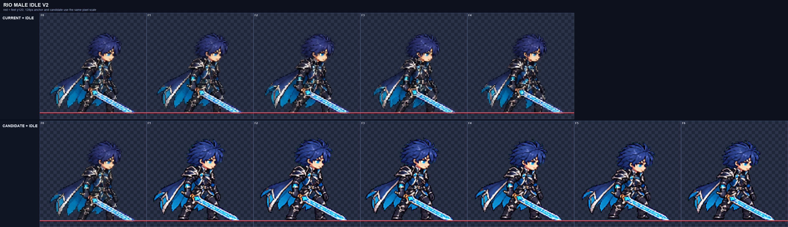
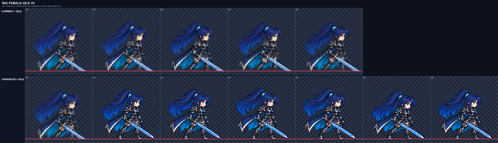

# CODEX-ART-60 · Rio 대기 앵커 결과

Rio 남성·여성의 6프레임 대기 후보를 D35 방식으로 만들었다. 두 몸 모두 생성 원본 한 장에 3×2로 그렸고, 행 전체에 단일 배율만 적용했다. 제품 파일은 바꾸지 않았다.

## 측정

| 항목 | 남성 | 여성 | 카드 기준 |
| --- | ---: | ---: | ---: |
| 공통 배율 | 0.24574209 | 0.23188406 | 프레임 전체에 하나 |
| 머리 배율 중앙값 | 1.04 (6/6) | **0.92 (6/6)** | 0.96–1.04 |
| 몸 높이 | 95–101px | 93–98px | 남 95–101 / 여 93–99px |
| 프레임별 높이 | 99/101/101/99/95/98 | 96/96/98/97/93/96 | 기록 |
| 내부 디테일 | 108.69–111.70 | 93.76–97.64 | 남 ≥79 / 여 ≥73 |
| 현재 idle 대비 평균 | 125.60% | 121.66% | ≥90% |
| 초록 번짐 | 0px | 0px | 0px |
| 경계 / 4px 여백 | 통과 / 통과 | 통과 / 통과 | 통과 |

남성은 세 번째 생성에서 머리 배율과 키를 함께 통과했다. 여성은 최초 생성과 두 번의 재생성을 모두 사용했지만 머리 배율이 0.92에 머물러 카드 기준을 통과하지 못했다. 여성 후보 JSON에도 재검토 필요를 표시했다.

## 4배 육안 확인

남성은 한 얼굴, 양손·양발, 검과 망토가 여섯 프레임에 유지된다. 검날·청록 장식에는 광륜과 파티클이 없다. 호흡과 망토 변화는 읽히지만 매우 작다.

여성도 해부·검·부츠·포니테일은 온전하고 이펙트가 없다. 포니테일의 F2–F4 지연은 보이지만, 현재 idle 옆에서 보면 얼굴과 머리 덩어리가 여전히 작다.

## 현재 상태

- 완료: 남성 후보, 남·여 생성 원본과 프롬프트, 4배 비교판, 수치 측정, 후보 메타데이터.
- 현재 상태: 남성은 카드 기준 통과. 여성은 높이·디테일·여백·번짐은 통과했으나 머리 배율 실패.
- 남은 작업: 여성은 리드가 실패 후보를 폐기하고 다음 카드에서 다시 생성해야 한다. 이번 카드의 재생성 상한 때문에 추가 생성하지 않았다.
- 검증 제한: 정지 4배 비교만 했으며 6.3fps 루프 재생은 확인하지 않았다.

생성은 내장 이미지 도구를 사용했고, 사용한 참조와 모든 생성 원본은 `art/raw/rio-60/`에 보존했다.
