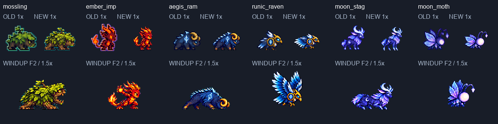

# CODEX-ART-71 — 몬스터 1차 6종 후보

36개 행·168프레임, 576×576 조립 시트 6장을 전달한다. **후보 전달이며 사용자 채택·게임 적용은 아니다.** `smash-nine-prototype/`은 변경하지 않았다. 생성은 내장 ImageGen만 사용했고 패키지 설치·다운로드·Godot 실행은 하지 않았다.

## 시각적 확인

각 열 위쪽은 기존/후보 대기를 같은 1배로 비교한다. 아래쪽은 새 준비 행 두 번째 그림을 1.5배로 보여준다. 전체 동작은 `<id>.png`(1배+4배), `<id>-1x.png`, `<id>-4x.png`에 있다. 각 행 폴더의 `anchor-4x.png`는 선택한 대기 첫 장과 그 행을 정확히 4배로 나란히 보여준다.

## 선택한 기준 대기 — 육안 판단

| 몬스터 | 선택 | 이유 |
|---|---|---|
| mossling | 첫 안 | 낮은 나무 몸·잎·새싹·눈과 차가운 테두리가 유지되고 나무결이 읽힘 |
| ember_imp | 첫 안 | 붉은 몸·뿔·꼬리·보라 음영이 유지됨. 원본보다 얼굴이 둥글고 어린 용 느낌은 남음 |
| asgard_aegis_ram | 첫 안 | 남색 털·금색 말린 뿔·어깨 룬이 선명함 |
| asgard_runic_raven | 첫 안 | 금색 부리·어깨 원판과 청색 깃털 층이 잘 분리됨 |
| alfheim_moon_stag | 첫 안 | 초승달 뿔·옆구리 달무늬·푸른 털 정체성을 유지함 |
| alfheim_moon_moth | 두 번째 안 | 첫 안은 날개에 비해 머리가 작았음. 두 번째 안의 큰 무표정 구형 머리와 짧은 날개 비율을 선택 |

## 작업 방법과 크기 판단

- 카드 순서대로 한 종의 대기를 고른 뒤 나머지 행을 생성했다. 대기 생성에는 현재 시트를 정체성 참조로, Frey 대기는 밀도 참조로 전달했다. 나머지 행에는 선택한 대기가 Image 1, 현재 시트가 Image 2다.
- 동작마다 한 장 생성, 행 전체 공통 배율, 기존 `normalize.py`의 LANCZOS·선명화 60·despill auto·팔레트 없음·초록 키를 사용했다. 몸 조각 붙이기·프레임별 확대/축소·팔레트 교체는 하지 않았다. 실제 원본 크기는 요청한 512칸에서 벗어나는 경우가 있어 각 `metrics.json`의 `source_dimensions`에 남겼다.
- 비행형은 발 대신 기존 몸통의 안정된 특징(까마귀 어깨 원판, 나방 구형 머리)을 기준으로 **프레임 전체만 평행 이동**했다. 원판 중심은 (49,50), 나방 머리 중심은 (62,50) 부근이다. 배율은 여전히 행당 하나다. 이동량은 `body_alignment`에 기록했다.
- 사슴 도약의 지상 접촉 그림 1·5·6번만 통째로 내려 발 y=72에 맞췄다. 공중 3·4번은 발끝 y=52·53을 유지한다. `ground_contacts`에 이동량을 기록했다.
- 머리/몸통 크기는 4배 비교판의 육안 판단으로 배율을 골랐다. 나방은 밝은 머리 영역도 직접 측정했다(`orb_measurement`: R>190, G>170, B>210의 가장 큰 연결 성분). 대기 밝은 머리 폭 16.56–17.28px, 이동 16.73–17.48px, 준비 중앙값 약 17.09px, 순간이동 정상 크기 첫/끝 17.01·17.20px다. 준비 두 번째는 15.47px로 조금 작다. 나머지 종에 자동 머리 비율 검사를 했다고 주장하지 않는다.
- 생성은 총 41회. Mossling 공격, 까마귀 이동/공격, 나방 대기/준비는 두 번 생성했고 그 밖은 한 번이다. 행당 최대 3회 상한 안이다. 제외한 첫 안도 `art/raw/monsters-71/`에 보존했다. 원본은 커밋 대상에서 제외한다.

## 측정 결과

최종 36행 전부: 테두리 비움, 최소 여백 3px 이상, 초록 번짐 0, 알파 0/255만 사용, 사용하지 않는 셀 투명, 중복 프레임 없음. 조립 시트 각 행은 납품 행과 픽셀 단위로 같다. 걸어 다니는 종의 지상 접촉 발선과 마지막 쓰러짐은 y=72다. 세부 근거는 `verification.json` 및 각 행 `metrics.json`의 **`final_summary`·`audit96`**다. 정규화 최초 `summary`는 평행 이동 전 수치일 수 있다.

디테일은 ART-61과 같은 내부 명암 라플라시안 지표다. 참조 Frey 대기 평균은 **96.31**이다. 수치는 형태에 따라 달라지며 보기 좋은지 자체를 증명하지 않는다. Imp와 숫양의 낮은 행은 그대로 공개한다.

### `mossling`

| 행 | 프레임 | fps | 공통 factor | 최소 여백 px | 디테일 범위 | 전달 |
|---|---:|---:|---:|---:|---:|---|
| idle | 6 | 6.000 | 0.21527778 | 4 | 87.81–92.18 | 후보 전달 |
| walk | 6 | 10.000 | 0.21 | 4 | 105.56–109.27 | 후보 전달 |
| windup | 4 | 12.500 | 0.16 | 4 | 94.11–96.32 | 후보 전달 |
| attack | 6 | 12.000 | 0.215 | 4 | 117.41–124.89 | 후보 전달 |
| hurt | 2 | 8.000 | 0.125 | 7 | 90.42–92.22 | 후보 전달 |
| defeat | 4 | 8.000 | 0.165 | 4 | 113.40–119.15 | 후보 전달 |

### `ember_imp`

| 행 | 프레임 | fps | 공통 factor | 최소 여백 px | 디테일 범위 | 전달 |
|---|---:|---:|---:|---:|---:|---|
| idle | 6 | 6.000 | 0.17 | 6 | 72.40–76.21 | 후보 전달 |
| walk | 6 | 10.000 | 0.17 | 10 | 86.26–89.07 | 후보 전달 |
| windup | 4 | 8.889 | 0.145 | 13 | 81.63–92.64 | 후보 전달 |
| attack | 6 | 12.000 | 0.185 | 12 | 78.51–86.03 | 후보 전달 |
| hurt | 2 | 8.000 | 0.102 | 8 | 74.58–81.42 | 후보 전달 |
| defeat | 4 | 8.000 | 0.17 | 5 | 82.97–93.30 | 후보 전달 |

### `asgard_aegis_ram`

| 행 | 프레임 | fps | 공통 factor | 최소 여백 px | 디테일 범위 | 전달 |
|---|---:|---:|---:|---:|---:|---|
| idle | 6 | 6.000 | 0.19 | 8 | 71.53–76.37 | 후보 전달 |
| walk | 6 | 10.000 | 0.22 | 8 | 78.00–82.06 | 후보 전달 |
| windup | 4 | 6.154 | 0.17 | 3 | 84.70–93.32 | 후보 전달 |
| attack | 6 | 12.000 | 0.21 | 4 | 86.24–90.59 | 후보 전달 |
| hurt | 2 | 8.000 | 0.11 | 14 | 91.72–95.50 | 후보 전달 |
| defeat | 4 | 8.000 | 0.17 | 4 | 83.35–90.25 | 후보 전달 |

### `asgard_runic_raven`

| 행 | 프레임 | fps | 공통 factor | 최소 여백 px | 디테일 범위 | 전달 |
|---|---:|---:|---:|---:|---:|---|
| idle | 6 | 6.000 | 0.175 | 5 | 125.88–131.56 | 후보 전달 |
| walk | 6 | 10.000 | 0.19 | 12 | 139.50–145.22 | 후보 전달 |
| windup | 4 | 6.154 | 0.16 | 4 | 129.81–136.82 | 후보 전달 |
| attack | 6 | 12.000 | 0.26 | 7 | 118.11–130.11 | 후보 전달 |
| hurt | 2 | 8.000 | 0.135 | 7 | 135.39–141.76 | 후보 전달 |
| defeat | 4 | 8.000 | 0.16 | 6 | 122.49–133.59 | 후보 전달 |

### `alfheim_moon_stag`

| 행 | 프레임 | fps | 공통 factor | 최소 여백 px | 디테일 범위 | 전달 |
|---|---:|---:|---:|---:|---:|---|
| idle | 6 | 6.000 | 0.16 | 6 | 107.41–113.14 | 후보 전달 |
| walk | 6 | 10.000 | 0.18 | 13 | 98.92–106.70 | 후보 전달 |
| windup | 4 | 7.273 | 0.16 | 9 | 120.44–125.10 | 후보 전달 |
| attack | 6 | 12.000 | 0.18 | 5 | 119.44–130.47 | 후보 전달 |
| hurt | 2 | 8.000 | 0.1 | 14 | 120.65–122.76 | 후보 전달 |
| defeat | 4 | 8.000 | 0.15 | 7 | 122.65–130.83 | 후보 전달 |

### `alfheim_moon_moth`

| 행 | 프레임 | fps | 공통 factor | 최소 여백 px | 디테일 범위 | 전달 |
|---|---:|---:|---:|---:|---:|---|
| idle | 6 | 6.000 | 0.18 | 13 | 92.52–94.86 | 후보 전달 |
| walk | 6 | 10.000 | 0.188 | 12 | 109.95–114.86 | 후보 전달 |
| windup | 4 | 5.714 | 0.17 | 13 | 104.52–113.48 | 후보 전달 |
| attack | 6 | 12.000 | 0.181 | 14 | 99.75–161.34 | 후보 전달 |
| hurt | 2 | 8.000 | 0.15 | 13 | 117.57–119.76 | 후보 전달 |
| defeat | 4 | 8.000 | 0.19 | 3 | 96.15–107.07 | 후보 전달 |

## 뷰어와 확인

`tools/motion_viewer/build.mjs`에 몬스터 행별 후보와 신규 `windup`·`defeat`를 추가했다. 표시 순서는 idle→walk→windup→attack→hurt→defeat이며 기존 시트의 실제 행 번호는 유지한다. 후보 메타데이터의 loop를 출력 뷰어에 전달해 숫양 돌진·까마귀 급강하 후보만 반복 재생할 수 있게 했다. 카드에서 쓰기 허용한 build.mjs만 수정했으며 index.html 템플릿은 수정하지 않았다.

- `verify.py`: 6종·36행·168프레임, failures=[].
- `node tools/motion_viewer/build.mjs`: 빌드 성공. 전체 기존 후보를 포함해 49개, 이번 몬스터 후보는 36개.
- `node reports/codex-art-71/verify_viewer.mjs`: 후보 36개, 새 행 12개, 기존 인덱스 유지, 반복 설정, 모든 복사 파일 존재 확인.
- `git diff --quiet -- smash-nine-prototype`: 제품 추적 파일 차이 없음.
- 실제 Godot 실행·브라우저 재생·외부 Artifact 재게시 검증은 하지 않았다. 로컬 dist는 git-ignored다.

첫 일괄 검사에서 나방 쓰러짐의 공통 x 이동 뒤 조립본이 예전 그림인 점을 검출했고 다시 조립했다. 최종 검사는 그 수정 후 통과한 결과다.

## 아직 잘못되거나 약한 점 — 육안 판단과 측정 구분

- **디테일:** Imp 대기 72.40–76.21, 숫양 대기 71.53–76.37은 Frey 평균 96.31보다 낮다(측정). 두 종은 넓은 색 면이 남아 다른 네 종보다 덜 촘촘하게 보인다(판단). 새 캐릭터와 완전히 같은 밀도에 도달했다고 보고하지 않는다.
- **보행:** 특히 Imp와 Mossling은 발을 드는 차이는 있으나 좌우 교대가 강하게 읽히지 않는다(판단). 기존 ART-59의 8장 사람 걷기 검사를 이 6장 몬스터 행에 통과했다고 주장하지 않는다.
- **물기:** Mossling은 턱 여닫기는 분명하지만 앞으로 뻗는 폭이 작다(판단).
- **숫양 돌진:** 뒤 세 장의 발끝이 y=63·66·65로 떠 있다(측정). 반복 접점에서 착지가 튀는지 뷰어 재생으로 확인할 부분이다(판단).
- **나방:** 대기·이동 일부 자세는 한쪽 촉수 끝 보석이 약하게 읽힌다(판단). 준비 두 번째 머리는 기준 대비 약 10% 작다(측정 기준은 밝은 영역 폭). 순간이동의 작은 몸과 반짝임은 카드가 요청한 의도적인 크기 변화다.

## 남은 작업과 인계

이 카드에서 미착수한 몬스터/행은 없다. 다만 위 시각 품질 보완, 사용자 후보 선택, 실제 모션 재생 판단이 남는다. 게임 행 추가·연결 및 Artifact 재게시는 후속 담당 범위다. `commit.ps1`은 작성만 했고 **실행·스테이징·커밋하지 않았다**. 이 스크립트는 `delivery-files.txt`의 이번 파일만 대상으로 하며 raw·제품 파일·기존 run.log·캐시를 포함하지 않는다. 정확한 생성 프롬프트 41개는 `prompts.txt`에 있다.
