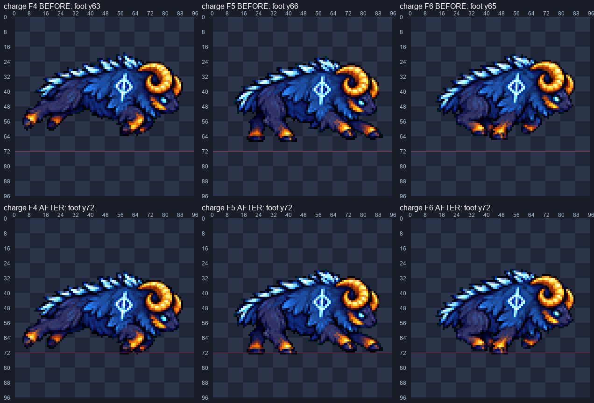
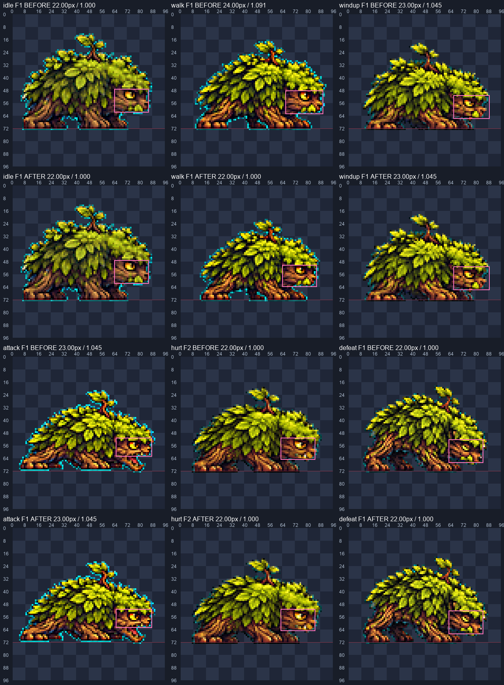
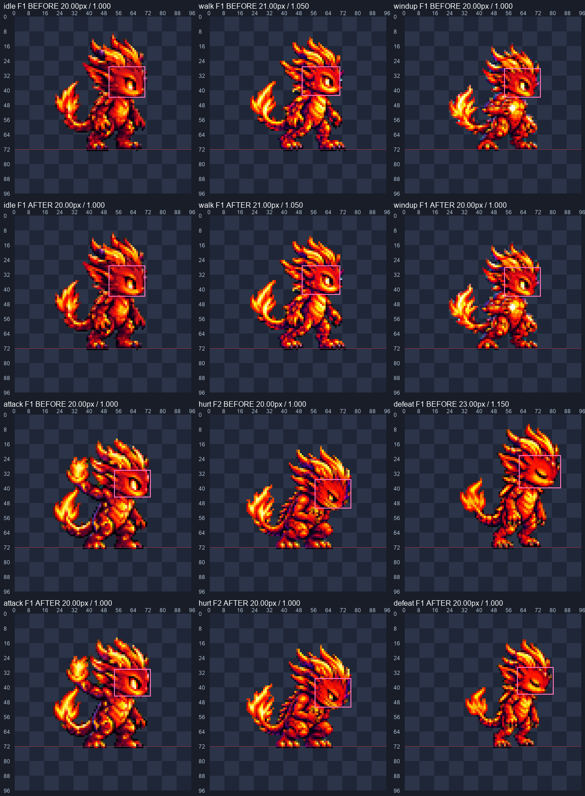
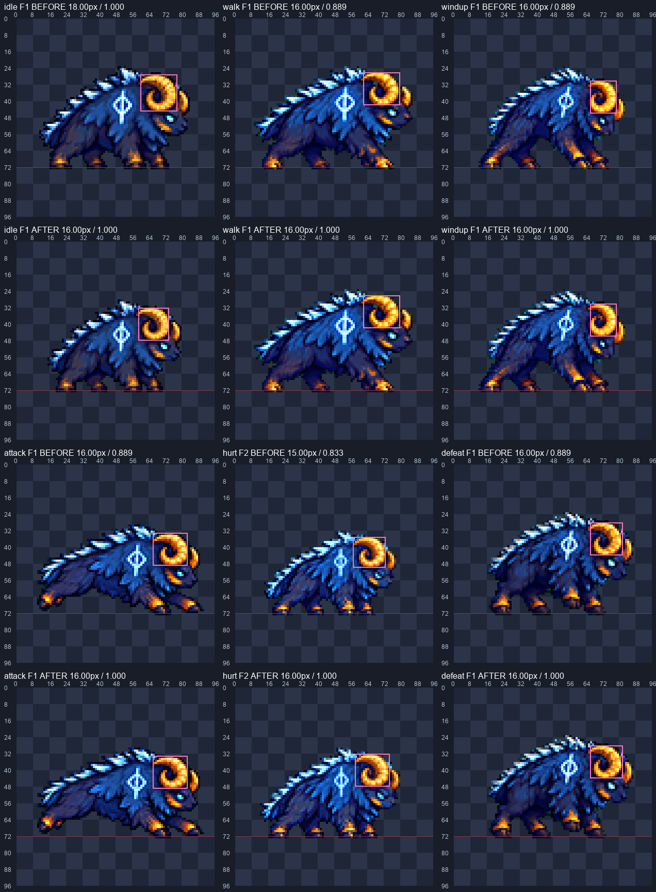
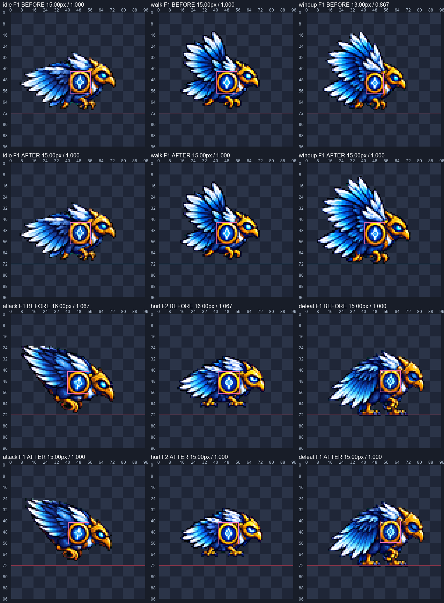
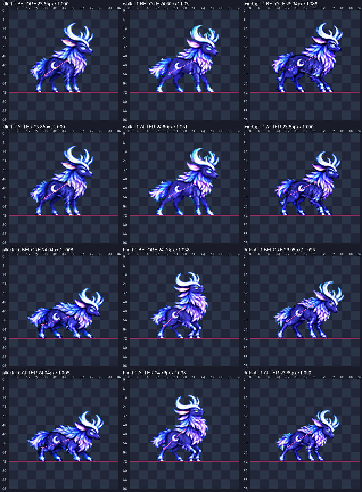
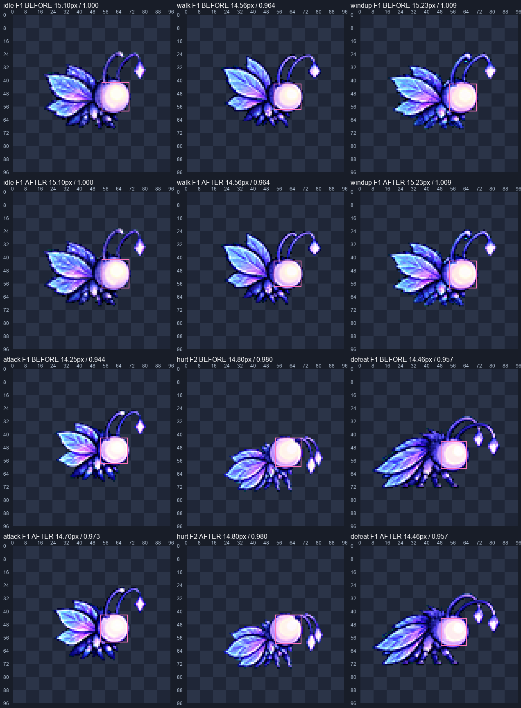

# CODEX-ART-71 fix-1 — 몬스터 1차 행 크기 맞춤

## 완료 / 현재 상태

6종 36행을 측정하고 **11행(배율 변경 10행 + 숫양 돌진 접지 1행)**과 조립 시트 6장을 갱신했다. 변경한 모든 행은 채택 당시 raw에서 다시 만들었다. 후보만 변경했으며 게임 적용·사용자 채택은 아니다. 원본 누락 0행.

표에 지정한 대표 프레임의 안정 부위는 최종 idle 대비 **0.957–1.050**이다. 나방 attack은 F1·F6만 측정했고 0.973·0.982다. **이 범위는 지정된 대표 부위의 명목 측정값이며, 모든 프레임의 해부학적 크기를 보장하지 않는다.** 행 내부 편차와 수동 경계의 한계는 아래에 공개한다.

## 방법 — 측정과 판단 구분

- ART-74의 `fix_pass.py`와 `review_evidence.py` 방식을 재사용했다. 한 행에 배율 하나, 기존 normalizer의 LANCZOS + 선명화 60 + despill auto + 팔레트 없음. 도구 파일은 읽기만 했다. 프레임별 배율·조각 붙이기·추가 생성·설치·다운로드 없음.
- Mossling 윗얼굴 폭, Imp 두개골 폭, 사슴 몸통의 엉덩이–어깨 중심 거리는 4배 눈금판에서 **수동 경계/기준점**을 지정했다. 수동 위치 불확실성은 약 ±1px이다. 후 값은 같은 경계/점을 원본의 행 배율과 실제 출력 bbox 이동으로 추적한 값이며 독립된 자동 해부학 측정이 아니다. 사슴은 자세에 따라 돌아가는 머리 대신 몸통 축을 썼다. 사슴 attack은 측면 몸통이 읽히는 F6, hurt는 F1을 썼고, 다른 두 종의 hurt는 F2다.
- 숫양은 금색 주뿔 연결 영역의 높이, 까마귀는 어깨 금색 원판 연결 영역의 폭을 출력 픽셀에서 전후 다시 측정했다. 금색 조건은 `R>110, G>65, R>1.6B, G>1.4B`다. 자세·조명·무늬 때문에 실제 해부학 경계와 차이가 있을 수 있다.
- 나방은 기존 밝은 머리 조건 `R>190, G>170, B>210`의 가장 큰 4-연결 성분을 사용했다. 16/17px 같은 1px 폭 계단을 피하려 ART-74의 후드 측정처럼 **√면적**을 등가 선형크기로 썼다. 실제 머리 지름이라는 뜻은 아니다. 순간이동의 F2–F5는 크기 판정에서 제외했다.
- 256px 작업 캔버스에서 raw를 줄이고 그림 전체만 96px 셀에 옮겼다. 불투명 픽셀 수 보존을 검사해 잘라 넣지 않았음을 확인했다. raw 해시, factor, 전체 이동량은 `baseline-hashes.json`·`sizes.json`에 있다.
- 숫양 돌진을 idle의 예전 뿔 높이 18px까지 키우면 후반 그림이 90px 가용 폭을 넘는다. 따라서 **idle factor 0.19 → 0.17, 주뿔 18 → 16px**로 기준을 낮췄고, 다른 행을 그 기준에 맞췄다. 변경하지 않은 walk/windup/defeat도 새 idle 대비 비율은 0.889 → 1.000이다.

## 측정표

전 비율은 예전 idle, 후 비율은 최종 idle에 각각 나눈 값이다. 전후 경계·기준점과 소수 원값은 [sizes.json](sizes.json)에 있다.

| 몬스터 | 행(F) | 측정 부위 | 전 px | 전/idle | 후 px | 후/idle | factor 전 → 후 |
|---|---|---|---:|---:|---:|---:|---|
| mossling | idle F1 | 잎·아래턱을 뺀 윗얼굴 가로폭 | 22.00 | 1.000 | 22.00 | 1.000 | 0.21527778 → 0.21527778 |
| mossling | walk F1 | 잎·아래턱을 뺀 윗얼굴 가로폭 | 24.00 | 1.091 | 22.00 | 1.000 | 0.21 → 0.1925 |
| mossling | windup F1 | 잎·아래턱을 뺀 윗얼굴 가로폭 | 23.00 | 1.045 | 23.00 | 1.045 | 0.16 → 0.16 |
| mossling | attack F1 | 잎·아래턱을 뺀 윗얼굴 가로폭 | 23.00 | 1.045 | 23.00 | 1.045 | 0.215 → 0.215 |
| mossling | hurt F2 | 잎·아래턱을 뺀 윗얼굴 가로폭 | 22.00 | 1.000 | 22.00 | 1.000 | 0.125 → 0.125 |
| mossling | defeat F1 | 잎·아래턱을 뺀 윗얼굴 가로폭 | 22.00 | 1.000 | 22.00 | 1.000 | 0.165 → 0.165 |
| ember_imp | idle F1 | 뿔·뒤쪽 가시를 뺀 두개골 가로폭 | 20.00 | 1.000 | 20.00 | 1.000 | 0.17 → 0.17 |
| ember_imp | walk F1 | 뿔·뒤쪽 가시를 뺀 두개골 가로폭 | 21.00 | 1.050 | 21.00 | 1.050 | 0.17 → 0.17 |
| ember_imp | windup F1 | 뿔·뒤쪽 가시를 뺀 두개골 가로폭 | 20.00 | 1.000 | 20.00 | 1.000 | 0.145 → 0.145 |
| ember_imp | attack F1 | 뿔·뒤쪽 가시를 뺀 두개골 가로폭 | 20.00 | 1.000 | 20.00 | 1.000 | 0.185 → 0.185 |
| ember_imp | hurt F2 | 뿔·뒤쪽 가시를 뺀 두개골 가로폭 | 20.00 | 1.000 | 20.00 | 1.000 | 0.102 → 0.102 |
| ember_imp | defeat F1 | 뿔·뒤쪽 가시를 뺀 두개골 가로폭 | 23.00 | 1.150 | 20.00 | 1.000 | 0.17 → 0.14782609 |
| asgard_aegis_ram | idle F1 | 금색 주뿔 연결 영역 세로높이 | 18.00 | 1.000 | 16.00 | 1.000 | 0.19 → 0.17 |
| asgard_aegis_ram | walk F1 | 금색 주뿔 연결 영역 세로높이 | 16.00 | 0.889 | 16.00 | 1.000 | 0.22 → 0.22 |
| asgard_aegis_ram | windup F1 | 금색 주뿔 연결 영역 세로높이 | 16.00 | 0.889 | 16.00 | 1.000 | 0.17 → 0.17 |
| asgard_aegis_ram | attack F1 | 금색 주뿔 연결 영역 세로높이 | 16.00 | 0.889 | 16.00 | 1.000 | 0.21 → 0.21 |
| asgard_aegis_ram | hurt F2 | 금색 주뿔 연결 영역 세로높이 | 15.00 | 0.833 | 16.00 | 1.000 | 0.11 → 0.11733333 |
| asgard_aegis_ram | defeat F1 | 금색 주뿔 연결 영역 세로높이 | 16.00 | 0.889 | 16.00 | 1.000 | 0.17 → 0.17 |
| asgard_runic_raven | idle F1 | 금색 어깨 원판 테두리 가로폭 | 15.00 | 1.000 | 15.00 | 1.000 | 0.175 → 0.175 |
| asgard_runic_raven | walk F1 | 금색 어깨 원판 테두리 가로폭 | 15.00 | 1.000 | 15.00 | 1.000 | 0.19 → 0.19 |
| asgard_runic_raven | windup F1 | 금색 어깨 원판 테두리 가로폭 | 13.00 | 0.867 | 15.00 | 1.000 | 0.16 → 0.177 |
| asgard_runic_raven | attack F1 | 금색 어깨 원판 테두리 가로폭 | 16.00 | 1.067 | 15.00 | 1.000 | 0.26 → 0.239 |
| asgard_runic_raven | hurt F2 | 금색 어깨 원판 테두리 가로폭 | 16.00 | 1.067 | 15.00 | 1.000 | 0.135 → 0.1265625 |
| asgard_runic_raven | defeat F1 | 금색 어깨 원판 테두리 가로폭 | 15.00 | 1.000 | 15.00 | 1.000 | 0.16 → 0.16 |
| alfheim_moon_stag | idle F1 | 몸통의 엉덩이–어깨 중심 거리(털끝·목 제외) | 23.85 | 1.000 | 23.85 | 1.000 | 0.16 → 0.16 |
| alfheim_moon_stag | walk F1 | 몸통의 엉덩이–어깨 중심 거리(털끝·목 제외) | 24.60 | 1.031 | 24.60 | 1.031 | 0.18 → 0.18 |
| alfheim_moon_stag | windup F1 | 몸통의 엉덩이–어깨 중심 거리(털끝·목 제외) | 25.94 | 1.088 | 23.85 | 1.000 | 0.16 → 0.1471 |
| alfheim_moon_stag | attack F6 | 몸통의 엉덩이–어깨 중심 거리(털끝·목 제외) | 24.04 | 1.008 | 24.04 | 1.008 | 0.18 → 0.18 |
| alfheim_moon_stag | hurt F1 | 몸통의 엉덩이–어깨 중심 거리(털끝·목 제외) | 24.76 | 1.038 | 24.76 | 1.038 | 0.1 → 0.1 |
| alfheim_moon_stag | defeat F1 | 몸통의 엉덩이–어깨 중심 거리(털끝·목 제외) | 26.08 | 1.093 | 23.85 | 1.000 | 0.15 → 0.1372 |
| alfheim_moon_moth | idle F1 | 밝은 구형 머리 연결 영역 √면적(등가 선형크기) | 15.10 | 1.000 | 15.10 | 1.000 | 0.18 → 0.18 |
| alfheim_moon_moth | walk F1 | 밝은 구형 머리 연결 영역 √면적(등가 선형크기) | 14.56 | 0.964 | 14.56 | 0.964 | 0.188 → 0.188 |
| alfheim_moon_moth | windup F1 | 밝은 구형 머리 연결 영역 √면적(등가 선형크기) | 15.23 | 1.009 | 15.23 | 1.009 | 0.17 → 0.17 |
| alfheim_moon_moth | attack F1 | 밝은 구형 머리 연결 영역 √면적(등가 선형크기) | 14.25 | 0.944 | 14.70 | 0.973 | 0.181 → 0.184 |
| alfheim_moon_moth | attack F6 | 밝은 구형 머리 연결 영역 √면적(등가 선형크기) | 14.59 | 0.967 | 14.83 | 0.982 | 동일 행 배율 |
| alfheim_moon_moth | hurt F2 | 밝은 구형 머리 연결 영역 √면적(등가 선형크기) | 14.80 | 0.980 | 14.80 | 0.980 | 0.15 → 0.15 |
| alfheim_moon_moth | defeat F1 | 밝은 구형 머리 연결 영역 √면적(등가 선형크기) | 14.46 | 0.957 | 14.46 | 0.957 | 0.19 → 0.19 |

## 숫양 발

돌진 발끝은 **[72,72,72,63,66,65] → [72,72,72,72,72,72]**다. 배율 0.21은 유지하고 행의 접지 옵션을 사용해 프레임 전체를 [0,0,0,+9,+6,+7]px 아래로 옮겼다. 발/몸의 조각 수정은 하지 않았다. 가장 낮은 발을 기준선에 놓은 것이며, 달리기에서 들어 올린 나머지 발은 그대로다.

위는 이전, 아래는 수정 후 F4–F6이다. 붉은 가로선은 y72이며, 후반 발끝이 이 선에 닿는다.

## 시각적 확인

변경 11행 **50프레임 전부**를 최근접 4배로 직접 확인했다. 각 행의 변경 전/후 모든 프레임은 `<id>-<row>-{before,after}-all-4x.png`에 있다. [visual-review.json](visual-review.json)은 행마다 확인한 내용과 남은 판단을 구분한다. 실제 모션 재생은 하지 않았다.

### mossling

각 세 열에서 위가 전, 아래가 후다. 분홍 상자/선은 같은 측정 부위이며, 캡션은 크기와 해당 idle 대비 비율이다.

### ember_imp

각 세 열에서 위가 전, 아래가 후다. 분홍 상자/선은 같은 측정 부위이며, 캡션은 크기와 해당 idle 대비 비율이다.

### asgard_aegis_ram

각 세 열에서 위가 전, 아래가 후다. 분홍 상자/선은 같은 측정 부위이며, 캡션은 크기와 해당 idle 대비 비율이다.

### asgard_runic_raven

각 세 열에서 위가 전, 아래가 후다. 분홍 상자/선은 같은 측정 부위이며, 캡션은 크기와 해당 idle 대비 비율이다.

### alfheim_moon_stag

각 세 열에서 위가 전, 아래가 후다. 분홍 상자/선은 같은 측정 부위이며, 캡션은 크기와 해당 idle 대비 비율이다.

### alfheim_moon_moth

각 세 열에서 위가 전, 아래가 후다. 분홍 상자/선은 같은 측정 부위이며, 캡션은 크기와 해당 idle 대비 비율이다.

## 확인 및 테스트 — 측정 결과

- `review.py verify`: **6종·36행·168프레임**, 규격 실패 0. 변경한 11행의 모든 프레임 4배 육안 검토 기록을 별도로 남겼다.
- 최종 행 576×96, 조립본 576×576, 최소 여백 3px 이상, alpha 0/255, 초록 번짐 0, 빈 셀 투명, 동일 행 중복 프레임 0, 조립본과 행 PNG 픽셀 일치.
- 지정 대표 크기 36행 + 나방 끝 프레임의 ±5% 검사 통과. 배율은 행마다 하나. fps·loop·프레임 수 등 재생 메타데이터 보존. 변경하지 않은 25행 PNG/JSON은 이전과 해시 일치.
- raw 36개 해시 보존. 제품/도구 추적 파일 변경 0, 스테이징 0. Python은 지정 런타임과 `-B`, `PYTHONDONTWRITEBYTECODE=1`을 썼다. Godot 실행, 뷰어 빌드/재게시, 커밋 스크립트 실행은 하지 않았다.

## 남은 작업 / 약한 점

**측정 한계:** 표의 수동 부위는 약 ±1px 경계 불확실성이 있다. 몸통 축·두개골·금색 무늬라는 부위별 지표가 같아졌다고 전체 체형까지 같아진 것은 아니다. 표의 36행 통과는 대표 프레임 기준이다.

**추가 측정:** 나방 windup F2의 밝은 머리 √면적 비율은 최종 idle F1 대비 **0.896**이다. 같은 행 F1은 1.009라서 행 공통 배율만으로 두 장을 모두 ±5% 안에 넣을 수 없다(필요 배율 구간이 겹치지 않음). 나방 defeat F2/F3/F4의 같은 밝은 면적 지표는 **0.948/0.891/0.915**이며, 쓰러지면서 밝은 면의 모양/가림도 변한다. 이들을 프레임별 확대하거나 새로 그리지 않았다. 이 편차까지 고치는 것은 후속 원본 재작화 대상이다.

**육안 판단:** Mossling·Imp 발 교대는 약하고 Mossling 물기의 전진 폭도 작다. Imp·숫양은 넓은 색 면이 남는다. 사슴은 같은 몸통 길이여도 머리/목의 비율 차이가 남는다. 나방 촉수 보석 가독성과 행 내부 머리 편차도 남는다. 까마귀 windup F2는 위쪽 날개 여백 때문에 전체를 4px 내려서 몸 중심 높이가 다른 장과 조금 다르다. 이 편차와 숫양의 실제 달리기 반복 접점은 재생 확인이 필요하다.

## 다음 권장 단계 / 인계

QA-22가 다른 클론에서 게임을 확인하고, 사용자가 모션 뷰어에서 행 전환·반복을 판단한다. 행 내부 체형 보완이 필요하면 해당 raw를 다시 그리는 별도 작업으로 진행한다. 이 카드에서 게임·tools 변경은 하지 않았다.

[commit.ps1](commit.ps1)은 **작성만 했으며 실행하지 않았다.** [delivery-files.txt](delivery-files.txt)의 이번 파일만 대상으로 하고, raw·기존 run.log·캐시·제품·tools는 제외한다. 작업 전부터 있던 빈 `run.log`는 손대지 않았다. 이미 다른 파일이 스테이징돼 있으면 스크립트가 멈추게 했다.

재현: 지정 Python에 `-B`를 붙여 `review.py rebuild`, `review.py evidence`, `review.py verify`, `report.py` 순서로 실행한다. `before/`는 수정 전 자료이며 덮어쓰지 않는다.
