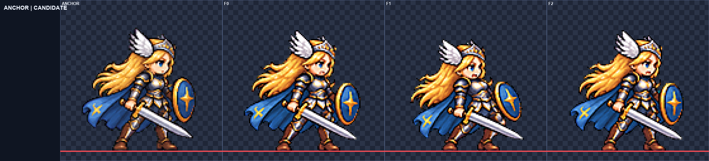
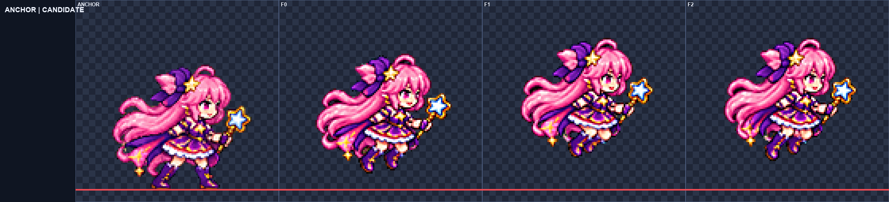
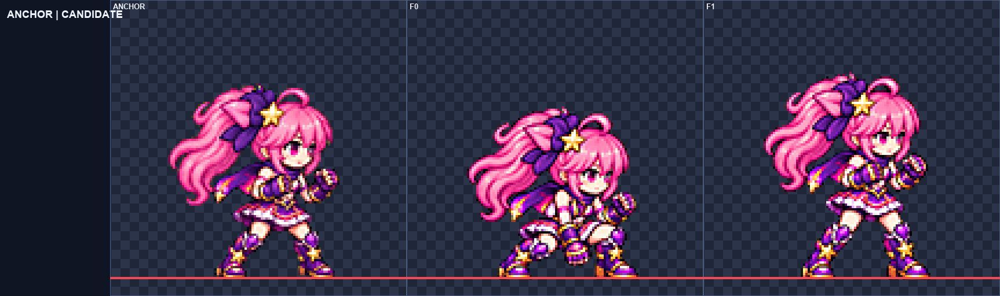

# ART-72 캐릭터 동작 1차 묶음

후보 전달 **8/15행, 19프레임**. Frey → Luna → Brave Luna 순서로 제작했다. 게임 폴더는 변경하지 않았다. 내장 ImageGen만 사용했고, 34회 생성의 원본과 사용한 참조는 `art/raw/motions-72/`에 보존했다. 미전달 7행은 각각 생성 3회를 모두 사용했다.

## 행별 결과

얼굴 칸은 **눈 사이 거리 / 눈높이 얼굴 폭**의 기준 대비 비율이다. F는 1부터 센다. 미전달 행의 자동 표식이 잘못 잡혔거나 감은 눈을 측정하지 못한 경우는 아래 이유에 적었으며, 그 수치를 통과로 취급하지 않았다.

### frey

| 행 | 프레임·fps | 공통 배율 | 얼굴 눈/폭 (측정 프레임) | 최소 여백 | 디테일 | 전달 |
|---|---:|---:|---|---:|---:|---|
| [jump](frey-jump.png) | 3 · 10 | 0.17 | 0.992–1.045 / 1.000 (F1–3) | 4px | 107.14–108.57 | 미전달 |
| [fall](frey-fall.png) | 2 · 8 | 0.142 | 0.994–1.020 / 1.000 (F1–2) | 6px | 111.92–112.43 | 완료 |
| [hurt](frey-hurt.png) | 3 · 12 | 0.1545 | 0.981–1.028 / 1.000 (F1–3) | 7px | 113.32–115.81 | 완료 |
| [land](frey-land.png) | 2 · 12 | 0.14 | 1.013–1.038 / 1.000 (F1–2) | 7px | 111.22–111.56 | 완료 |
| [victory](frey-victory.png) | 6 · 8 | 0.238 | 0.945–1.067 / 0.943–1.057 (F1–6) | 30px | 100.29–110.23 | 미전달 |

### luna

| 행 | 프레임·fps | 공통 배율 | 얼굴 눈/폭 (측정 프레임) | 최소 여백 | 디테일 | 전달 |
|---|---:|---:|---|---:|---:|---|
| [jump](luna-jump.png) | 3 · 10 | 0.15 | 0.982–1.023 / 1.000 (F1–3) | 18px | 109.73–111.72 | 완료 |
| [fall](luna-fall.png) | 2 · 8 | 0.1335 | 0.966–0.968 / 1.000 (F1–2) | 12px | 111.31–111.36 | 완료 |
| [hurt](luna-hurt.png) | 3 · 12 | 0.1407 | 0.969–1.015 / 1.000 (F1–3) | 7px | 118.03–118.58 | 완료 |
| [land](luna-land.png) | 2 · 12 | 0.13 | 0.992–1.016 / 1.000 (F1–2) | 7px | 106.95–108.09 | 완료 |
| [victory](luna-victory.png) | 6 · 8 | 0.2065 | 0.964–1.071 / 1.000–1.071 (F1,2,3,4,5) | 39px | 109.60–114.21 | 미전달 |

### luna_brave

| 행 | 프레임·fps | 공통 배율 | 얼굴 눈/폭 (측정 프레임) | 최소 여백 | 디테일 | 전달 |
|---|---:|---:|---|---:|---:|---|
| [jump](luna_brave-jump.png) | 3 · 10 | 0.165 | 0.960–0.988 / 1.000–1.071 (F1–3) | 15px | 122.28–126.55 | 미전달 |
| [fall](luna_brave-fall.png) | 2 · 8 | 0.13525 | 0.955–0.985 / 1.000 (F1–2) | 15px | 124.40–131.99 | 미전달 |
| [hurt](luna_brave-hurt.png) | 3 · 12 | 0.14 | 0.945–0.991 / 1.071 (F1,3) | 7px | 123.40–127.34 | 미전달 |
| [land](luna_brave-land.png) | 2 · 12 | 0.135 | 0.973–1.001 / 1.000 (F1–2) | 7px | 126.20–127.20 | 완료 |
| [victory](luna_brave-victory.png) | 6 · 8 | 0.198 | 0.947–1.030 / 1.071 (F1,2,5,6) | 39px | 119.67–128.16 | 미전달 |

## 측정과 육안 판단

- **측정:** 기존 정규화 도구의 LANCZOS·선명화 60·디스필 auto·팔레트 없음·초록 배경 설정을 사용했다. 프레임별 배율 조정이나 머리 붙이기는 하지 않았다. 메트릭과 자동 머리 값은 `best/<폼>/<행>/`에 있다.
- **얼굴 측정:** 기준 얼굴의 눈 중심과 머리카락을 제외한 눈높이 얼굴 경계 표식을 4배 최근접 확대에서 정합했다. 머리 전체 정합은 초기 위치만 잡는다. 눈과 얼굴 경계 표식은 별도로 측정한다. 소수 자릿수는 계산 출력 정밀도이며 실제 측정 오차가 그만큼 작다는 뜻은 아니다.
- **육안 판단:** 전 프레임의 얼굴·손·부츠·무기·의상과 동작 의미를 4배 판에서 확인했다. 실제 게임 실행이나 플레이어 체감 검사는 하지 않았다.
- **4배 자료:** `<폼>-<행>.png`는 기준과 전 프레임 판, `qa4x/`는 화면에서 축소되지 않도록 나눈 최대 2048px 폭의 4배 검토 페이지다.
- **전달 조건:** 여백·번짐·디테일뿐 아니라 전 프레임의 얼굴 두 지표가 모두 0.96–1.04이고 표식과 동작을 직접 확인한 행만 후보 폴더에 내보냈다.

## 아직 잘못된 점 / 남은 작업

- **frey jump (미전달, 최선 3차):** 3회 생성 종료. 최선 3차도 F2 눈 비율 1.045, F3 1.042로 상한 1.04를 넘는다. 도약 자세와 장비는 확인했으나 미전달.
- **frey fall (전달, 최선 1차):** 머리카락과 망토가 위로 후행하는 두 낙하 자세. 얼굴과 장비를 4배로 확인했다.
- **frey hurt (전달, 최선 3차):** 타격 순간, 반동, 회복의 3장. 자동 머리 검사의 F2 점수는 낮지만 실제 얼굴 표식과 장비를 4배로 확인했다.
- **frey land (전달, 최선 1차):** 착지 웅크림에서 대기 자세 쪽으로 일어선다. 양발 접지와 장비를 확인했다.
- **frey victory (미전달, 최선 2차):** 3회 생성 종료. 1·3차는 원본 셀 경계 침범. 최선 2차는 얼굴 눈·폭 비율이 기준 밖이다. F4에서 올린 검을 F5에서 내렸다가 F6에서 다시 드는 흐름도 남았다.
- **luna jump (전달, 최선 1차):** 도약·상승·정점 3장. 얼굴과 지팡이를 확인했다. F2·3 무릎 자세 차이는 작다.
- **luna fall (전달, 최선 1차):** 위로 들린 머리카락과 치맛자락의 낙하 반복. 자동 머리 중앙값 0.94와 달라 얼굴 측정을 우선했다.
- **luna hurt (전달, 최선 2차):** 타격 순간, 반동, 회복의 3장. 지팡이와 의상, 양발 접지를 확인했다.
- **luna land (전달, 최선 3차):** 착지 웅크림에서 대기 자세로 회복한다. 3차에서 얼굴 크기와 양발 접지, 지팡이를 확인했다.
- **luna victory (미전달, 최선 3차):** 3회 생성 종료. F1·3·4 눈 비율과 F3·4 얼굴 폭이 기준 밖이다. F6 윙크는 두 눈 거리 측정에서 제외했다. 지팡이 돌리기의 손 전환도 매끄럽지 않다.
- **luna_brave jump (미전달, 최선 2차):** 3회 생성 종료. 최선 2차의 F1·2 얼굴 비율은 맞지만 F3 얼굴 폭 1.071이 상한을 넘는다.
- **luna_brave fall (미전달, 최선 3차):** 3회 생성 종료. 최선 3차 공통 배율 0.13525에서 F1 눈 비율 0.955로 하한 0.96에 못 미친다. 장갑과 의상, 낙하 자세는 확인했다.
- **luna_brave hurt (미전달, 최선 3차):** 3회 생성 종료. F1 눈 비율 0.945와 F1·3 얼굴 폭 1.071이 기준 밖이다. F2 자동 머리 위치가 팔·다리 피부에 혼동되어 해당 얼굴 측정값은 제외했다.
- **luna_brave land (전달, 최선 1차):** 착지 웅크림에서 양주먹 가드로 회복한다. 장갑과 무릎 별 장식을 확인했다.
- **luna_brave victory (미전달, 최선 3차):** 3회 생성 종료. 2차는 원본 셀 경계 실패. 최선 3차도 F1·2·5·6 얼굴 폭 1.071로 기준 밖이다. F3·4는 들어 올린 팔 때문에 자동 표식이 빗나가 얼굴 측정에서 제외했다.

원본 경계 실패는 해당 행의 `source-check-*.txt` 또는 `process-*.log`에 남긴다. 생성 3회가 끝난 행은 추가 생성하지 않았다. 미전달 행은 후보 폴더에 넣지 않고 `best/`의 그림과 4배 판만 남겼다.

## 확인 및 커밋

`verify.py` 최종 파일 검증 **558개 통과**: 8개 후보의 PNG·JSON, 정규화 결과와의 바이트 일치, 프레임 수·fps·접지·공중 높이·이진 알파·4px 여백·spill 0·detail ≥79·얼굴 범위, 생성 횟수·원본 보존, 커밋 대상 범위를 확인했다. 기록은 [audit.json](audit.json)에 있다. 게임 실행 검증은 하지 않았다.

**육안 검토 범위:** 정규화된 31개 시트의 101프레임을 정확한 4배 확대에서 모두 확인했다. 원본 셀 경계 검사에서 탈락한 3개 시트의 18프레임도 원본 4배 확대에서 확인했다. 최종 배율을 다시 적용한 Brave Luna fall 3차는 최종 4배 판으로 재확인했다. 얼굴 수치와 별개로 손·무기·의상·동작 연결을 판단했다. 탈락 행의 불확실한 얼굴 표식은 수치 범위에서 제외했으며 제외한 프레임은 `best/`의 `face-measured.json`에 기록했다.

`commit.ps1`은 명시한 157개 파일만 추가하며 raw와 캐시를 포함하지 않는다. PowerShell 파서로 구문만 검사했고 **스크립트는 실행하지 않았다**. 기존의 다른 미추적 파일은 대상에 포함하지 않았다. 전달 후보는 사용자가 모션 뷰어에서 고른 뒤 별도 카드에서 게임에 연결해야 한다.

## 시각적 확인

왼쪽은 기준 idle이고 오른쪽은 타격 순간부터 회복까지의 전달 후보 3프레임이다.

도약·상승·정점의 얼굴과 지팡이를 기준 그림과 4배로 비교한 판이다.

착지 웅크림에서 양주먹 가드로 회복하며, 빨간 선은 접지 기준이다. 모든 15행의 보드는 같은 폴더의 `<폼>-<행>.png`, 화면에 맞게 나눈 4배 판은 `qa4x/`에 있다.
