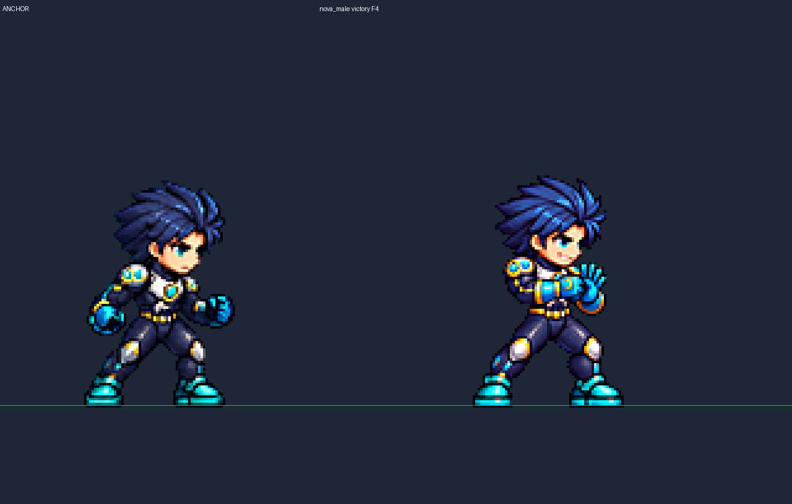
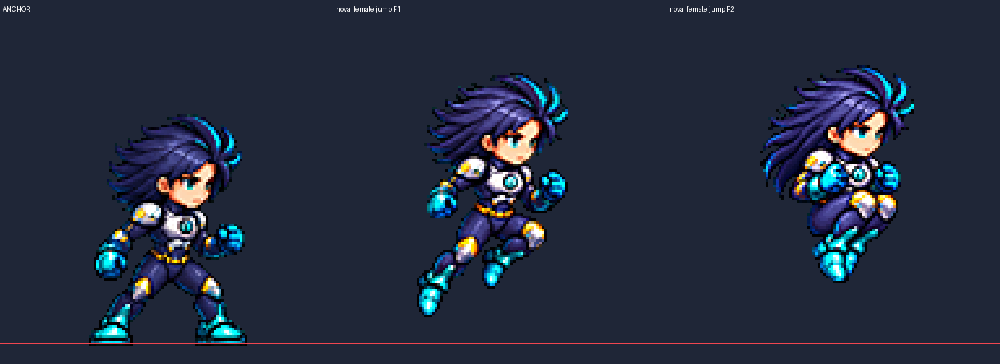

# ART-75 캐릭터 동작 2차 묶음

**완료: 후보 12/15행, 34프레임.** 유키 → 노바 남성 → 노바 여성 순서로 제작했다. 내장 ImageGen 30회, 각 행 최대 3회다. 최종 선택 15행 48프레임을 정확한 최근접 4배 판에서 직접 검수했다. 게임·도구 폴더는 수정하지 않았고 Godot은 실행하지 않았다.

## 행별 결과

얼굴은 **눈 사이 거리 / 눈높이 얼굴 폭**의 앵커 대비 비율이다. Nova 앵커는 반대 눈이 가려져 눈 간격을 측정할 수 없다. 피격 F1·2는 뒤로 기울어진 얼굴이므로 카드의 바로 선 얼굴 수치 판정에서 제외하고, 머리·표정·의상을 4배 육안 비교했다. **이 제외 프레임을 수치 통과로 취급하지 않았다.** 모든 피격의 정량 얼굴 비교는 복귀 F3에 한정된다.

### 유키

| 행 | 프레임 / fps | 공통 배율 | 얼굴 눈 / 폭 (측정 프레임) | 최소 여백 | 디테일 | 전달 |
|---|---:|---:|---|---:|---:|---|
| [jump](yuki-jump.png) | 3 / 10 | 0.16 | 0.995–1.008 / 1.000 (F1,2,3) | 11px | 102.34–110.60 | 완료 |
| [fall](yuki-fall.png) | 2 / 8 | 0.1415 | 0.995–0.997 / 0.917–1.000 (F1,2) | 7px | 104.13–106.62 | **미전달** |
| [hurt](yuki-hurt.png) | 3 / 12 | 0.143 | 1.024 / 1.000 (F3) | 7px | 100.22–104.36 | 완료 |
| [land](yuki-land.png) | 2 / 12 | 0.1245 | 0.995–1.007 / 1.000 (F1,2) | 7px | 95.10–100.12 | 완료 |
| [victory](yuki-victory.png) | 6 / 8 | 0.209 | 1.001–1.053 / 1.000–1.083 (F1,2,3,4,5,6) | 39px | 100.38–104.74 | **미전달** |

### 노바 남성

| 행 | 프레임 / fps | 공통 배율 | 얼굴 눈 / 폭 (측정 프레임) | 최소 여백 | 디테일 | 전달 |
|---|---:|---:|---|---:|---:|---|
| [jump](nova_male-jump.png) | 3 / 10 | 0.1625 | 측정 불가 / 1.000 (F1,2,3) | 9px | 105.09–112.10 | 완료 |
| [fall](nova_male-fall.png) | 2 / 8 | 0.172 | 측정 불가 / 1.000 (F1,2) | 5px | 100.85–105.36 | 완료 |
| [hurt](nova_male-hurt.png) | 3 / 12 | 0.151 | 측정 불가 / 1.000 (F3) | 7px | 105.89–115.01 | 완료 |
| [land](nova_male-land.png) | 2 / 12 | 0.134 | 측정 불가 / 1.000 (F1,2) | 7px | 109.58–112.84 | 완료 |
| [victory](nova_male-victory.png) | 6 / 8 | 0.184 | 측정 불가 / 0.966–1.000 (F1,2,3,4,5,6) | 39px | 100.49–106.85 | 완료 |

### 노바 여성

| 행 | 프레임 / fps | 공통 배율 | 얼굴 눈 / 폭 (측정 프레임) | 최소 여백 | 디테일 | 전달 |
|---|---:|---:|---|---:|---:|---|
| [jump](nova_female-jump.png) | 3 / 10 | 0.1615 | 측정 불가 / 1.000 (F1,2,3) | 9px | 101.00–109.04 | 완료 |
| [fall](nova_female-fall.png) | 2 / 8 | 0.1515 | 측정 불가 / 1.000 (F1,2) | 5px | 101.06–101.75 | 완료 |
| [hurt](nova_female-hurt.png) | 3 / 12 | 0.153 | 측정 불가 / 1.000 (F3) | 7px | 100.33–106.87 | 완료 |
| [land](nova_female-land.png) | 2 / 12 | 0.129 | 측정 불가 / 1.000 (F1,2) | 7px | 102.88–110.54 | 완료 |
| [victory](nova_female-victory.png) | 6 / 8 | 0.217 | 측정 불가 / 0.931–1.069 (F1,2,3,4,5,6) | 39px | 107.33–111.96 | **미전달** |

## 측정과 육안 판단

- **측정:** ART-72의 `process.py`, `face_check.py`, `verify.py`를 복사·수정했다. 기존 정규화기의 LANCZOS / 선명화 60 / despill auto / palette none / 초록 배경을 그대로 썼다. 행마다 배율 하나, 128px 기본 셀·발 y=120, 승리 192px·발 y=152다. 머리를 붙이거나 특징을 코드로 그리지 않았다.
- **자동 머리 검사:** 기존 `head_scale.py` 알고리즘을 호출했다. Yuki의 흰 소매와 밝은 얼굴 때문에 얼굴 찾기의 피부 임계값만 복사 스크립트에서 넓혔다. 도구 원본은 수정하지 않았다. 신뢰도 0.6 미만은 머리 크기 수치 판정에 쓰지 않았고, 얼굴이 최종 기준이다.
- **얼굴 표식:** `best/<폼>/<행>/face-proposed.json`은 자동 제안, `face-measured.json`은 검수한 유효 프레임과 제외 사유다. `face-measured-4x.png`에 최종 표식을 남겼다. 노바 남성 승리 F4는 자동 오른쪽 표식이 y88의 코 옆으로 벗어났다. 좌표판·실제 픽셀 경계를 보고 같은 눈 아래 선 y89의 x92.5–106.5로 교정했으며 폭 비율은 0.966이다. 다른 프레임이나 그림 픽셀은 바꾸지 않았다.
- **육안:** 선택 48프레임의 한 얼굴, 손·부츠·장비, 의상, 효과 없음, 도약/낙하/피격/착지/승리 의미를 직접 확인했다. 기울어진 피격 얼굴의 수치 비교에는 한계가 있으므로 최종 채택은 모션 뷰어에서 판단해야 한다.
- **재시도:** 한 프레임 재생성은 원본 정사각형 참조 캔버스의 해상도만 되돌린 후 해당 셀 하나를 넣었다. `composition-ledger.json`은 나머지 셀의 픽셀 불변을 확인한다. 프레임별 머리·몸 배율 맞춤은 하지 않았다. 행 전체 배율 시험은 `*-factor-probes.json`에 있으며 추가 이미지 생성 횟수와 구분한다.

## ART-72 교훈 확인

| 교훈 | 이번 확인 |
|---|---|
| 피격은 실제 타격으로 읽힐 것 | 세 폼 모두 F1 머리·어깨가 뒤로 밀리고 F2 몸이 더 젖혀진 뒤 F3에서 복귀한다. 표정만 바뀌는 대기가 아니다. 육안 판정이다. |
| 상승과 정점을 구분 | 세 폼 모두 F2의 깊은 무릎 접기와 F3의 다리 풀기·팔 벌리기가 다르다. |
| 승리는 연속 동작·소품 손 유지 | 남성 Nova는 어깨 풀기→열린 반대 손바닥에 주먹→주먹 앞으로 유지. Yuki는 3차에서 부적/부채 손 교환을 고쳤으나 얼굴 폭으로 미전달. 여성 Nova는 아래 결함으로 미전달. |
| 얼굴은 머리 전체보다 우선 | 잘못 잡힌 소매·머리카락·코 옆 표식은 그대로 통과시키지 않았다. 가림·기울어짐은 측정 불가/제외로 명시했다. |

## 아직 잘못된 점 / 남은 작업

- **Yuki fall:** 3차 F1 눈 비율 0.995는 맞지만 얼굴 폭 0.917이 하한 0.95 밖이다. 공통 배율 조정으로 F1 폭을 키우면 F2 눈 간격이 커진다. 3회 생성 종료, 최선 시도만 `best/yuki/fall/`에 보존했다.
- **Yuki victory:** 3차에서 소품 손 교환과 한 번만 여는 부채 동작은 고쳤다. 그러나 F2·4·6 얼굴 폭 1.083이 후보 상한 1.06을 넘는다. 미전달이다.
- **Nova female victory:** 1·3차는 올린 주먹의 셀 경계 침범으로 정규화가 실패했다. 정상 추출 가능한 2차는 두 잽이 같은 팔이며 얼굴 폭도 0.931–1.069다. 미전달이다. 경계 침범을 잘라서 숨기지 않았다.
- **전달 후보의 제한:** 피격 초반 F1·2는 기울어져 정량 얼굴 비율을 확정하지 못했다. 노바는 기준 반대 눈이 가려져 눈 간격을 정량 확인할 수 없다. 남성 Nova 승리의 어깨 풀기 폭은 작다. 모두 실제 재생 박자와 자연스러움은 모션 뷰어에서 확인해야 한다.

## 확인 및 다음 권장 단계

최종 파일 검증 **1,001항목 통과**. 전달 12행 34프레임, 최종 선택 15행 48프레임의 4배 육안 검수, 생성 원본 30개와 셀 교체 11건의 보존을 확인했다. 이는 실제 게임 플레이 검증이 아니다.

`verify.py`는 PNG/JSON, 한 공통 배율, 원본 정규화 결과와의 바이트 일치, 테두리·여백·번짐·디테일·발선·프레임 수·fps·유효 얼굴 범위, 생성 상한, 셀 교체 불변, 파일 경로와 커밋 스크립트를 검사한다. 결과는 `audit.json`에 남긴다. PowerShell은 구문만 검사하며 `commit.ps1`을 실행하지 않는다. 게임 플레이·Godot·모션 뷰어 재생 검증은 수행하지 않았다.

다음 권장 단계는 전달 12행의 모션 뷰어 채택 검수와 위 미전달 3행의 후속 재제작이다. `commit.ps1`은 이 작업의 명시 파일만 추가하며 raw·캐시·run.log를 포함하지 않는다. 다른 작업의 파일은 추가하지 않는다.

## 시각적 확인

왼쪽은 기준 대기, 오른쪽은 주먹을 반대 손바닥에 대는 승리 F4다. 그림 픽셀을 최근접 4배로 표시했다.

왼쪽 기준과 오른쪽 F1·2를 같은 4배 배율로 비교했다. 정점 F3까지의 전체 판은 `nova_female-jump.png`에 있다.
