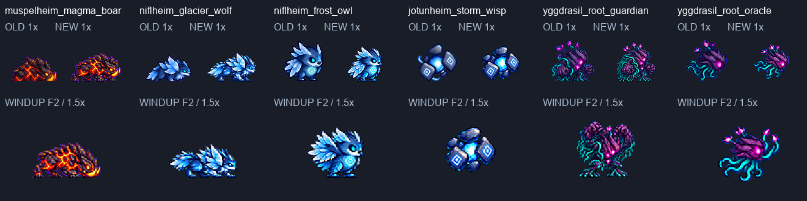

# CODEX-ART-76 — 몬스터 3차 6종 후보

**완료:** 6종·36행·168프레임과 576×576 조립 시트 6장. 전부 후보로 전달하며 사용자 채택·게임 적용은 아니다. 미착수 행은 없다. **현재 상태:** 규격 검사는 통과했지만 아래 시각 품질·동작 약점은 남아 있다. Godot은 실행하지 않았다.

## 시각적 확인

위쪽은 기존/후보를 같은 1배로, 아래쪽은 준비 두 번째 그림을 1.5배로 비교한다. 각 `<id>.png`는 기존/후보 1배+4배와 이동 발 위치판을 포함한다. `-1x.png`, `-4x.png`, `-walk-feet-4x.png`, `-size-4x.png`, `-action-review-4x.png`도 별도로 있다. 각 행의 `anchor-4x.png`는 기준 대기 첫 그림과 전 프레임을 정확히 4배로 비교한다.

## 방법·앵커 선택 — 관찰과 작업 사실

- `codex/art-76` 한 클론에서 카드 순서대로 한 종씩 진행했다. 내장 ImageGen 56회, 행당 최대 3회. 대기는 현재 시트(Image 1)와 Frey 밀도 참조(Image 2), 이후 행은 선택한 대기 원본(Image 1)과 현재 시트(Image 2)를 전달했다. 정확한 프롬프트 56개는 `prompts.txt`, 선택·제외 원본 목록은 `generation_manifest.json`이다. 원본 56장은 git-ignored `art/raw/monsters-76/`에 모두 보존했다.
- 멧돼지 대기는 바위 조각이 더 선명한 **2안**, 다른 다섯 종은 정체성과 세부 묘사가 유지되는 **1안**을 기준으로 골랐다. 이 선택은 제작 단위의 기준 선택이며 사용자의 채택이 아니다.
- ART-71 `process.py`·`verify.py`·`verify_viewer.mjs`를 이 폴더에 복사해 이번 ID·타이밍·부유 기준에 맞췄다. 기존 `tools/sprite_pipeline/normalize.py`는 읽고 호출만 했다. LANCZOS, sharpen 60, despill auto, palette none, 초록 키, **행 전체 factor 하나**를 사용했다. 몸 조각 붙이기·프레임별 크기 조정·팔레트 교체를 하지 않았다.
- 원본 실제 해상도는 요청과 다를 수 있다(예: 1254², 1774×887, 예언자 준비 1536×1024의 2×2 배치). 실제 셀을 등분해 자르고 한 factor로 축소했다. 원본 경계 접촉을 자르거나 숨기지 않고 재생성했다. `metrics.json`의 `source_dimensions`·`input`에 실제 입력이 남는다.
- 늑대 도약 1·5·6번, 위습/예언자 쓰러짐 3·4번은 프레임 전체를 내려 y72에 맞췄다. 위습은 청색/백색 핵의 연결 색 영역 중심을 (47,44), 예언자는 눈 위치를 (68,44)에 맞춰 **프레임 전체 평행 이동**했다. 위습 색 영역은 정량 색 지표이지 돌의 실제 크기가 아니다. 예언자 눈 좌표는 원본을 보고 수동 지정했다. 이동량은 `ground_contacts`·`body_alignment`에 있다.
- 수호자 준비 3안에는 주먹이 세 개 생겨 제외하고 2안을 유지했다. 공격 2안은 주먹 두 개를 유지하며 첫 안보다 머리 위 주먹이 커져 선택했다. 잘못된 원본도 별도 보존했으며 후보에 사용하지 않았다.

## 행별 최종 측정

디테일은 ART-61/71과 같은 내부 명암 라플라시안 지표다. Frey 기준 대기 평균은 **96.31**. 수치만으로 그림의 완성도를 증명하지 않는다. `하단 72`는 프레임의 최하단 불투명 픽셀이다. **모든 개별 발이 지지발이라는 뜻이나, 각 발 전부 접지 통과라는 뜻은 아니다.** 부유형의 하단은 발이 아니다.

크기 열은 각 행 **첫/마지막 그림**에서 동일 부위를 4배 격자로 수동 지정한 투영 길이를 기준 대기 두 그림 평균과 비교한 값이다. 끝점 오차 약 ±1px, 길이 약 ±2px. 회전·가림·원근의 영향을 받으며 전 프레임 해부학적 크기 자동 통과 판정이 아니다. 원본 좌표·정의·눈금은 `manual_landmarks.json`, `size_measurements.json`, `-size-4x.png`에 있다.

### 마그마 멧돼지 — `muspelheim_magma_boar`

크기 비교 부위: 가까운 뒤 넓적다리의 둥근 갑각판 가로폭.

| 행 | 프레임 | fps | factor | 최소 여백 px | 디테일 범위 | 발/하단 y | 기준 대비 크기 | 전달 |
|---|---:|---:|---:|---:|---:|---|---:|---|
| idle | 6 | 6.000 | 0.19 | 4 | 84.03–87.36 | 하단 72 | 1.00–1.00× | 완료·후보 |
| walk | 6 | 10.000 | 0.19 | 3 | 86.64–88.33 | 하단 72 | 1.00–1.07× | 완료·후보 |
| windup | 4 | 6.154 | 0.14 | 6 | 95.48–98.52 | 하단 72 | 0.87–0.93× | 완료·후보 |
| attack | 6 | 12.000 | 0.18 | 4 | 89.71–93.46 | 하단 72 | 0.93–0.93× | 완료·후보 |
| hurt | 2 | 8.000 | 0.11 | 7 | 86.15–91.04 | 하단 72 | 1.00–1.00× | 완료·후보 |
| defeat | 4 | 8.000 | 0.16 | 4 | 85.17–89.29 | 하단 72 | 0.87–1.00× | 완료·후보 |

[전체 비교](muspelheim_magma_boar.png) · [발 위치](muspelheim_magma_boar-walk-feet-4x.png) · [크기 눈금](muspelheim_magma_boar-size-4x.png) · [공격 리치](muspelheim_magma_boar-action-review-4x.png)

### 빙하 늑대 — `niflheim_glacier_wolf`

크기 비교 부위: 가까운 뒤 넓적다리의 청색 덩어리 가로폭.

| 행 | 프레임 | fps | factor | 최소 여백 px | 디테일 범위 | 발/하단 y | 기준 대비 크기 | 전달 |
|---|---:|---:|---:|---:|---:|---|---:|---|
| idle | 6 | 6.000 | 0.175 | 5 | 115.39–119.62 | 하단 72 | 1.00–1.00× | 완료·후보 |
| walk | 6 | 10.000 | 0.17 | 6 | 121.15–125.58 | 하단 72 | 0.93–1.00× | 완료·후보 |
| windup | 4 | 7.273 | 0.13 | 5 | 128.27–133.39 | 하단 72 | 1.00–1.00× | 완료·후보 |
| attack | 6 | 12.000 | 0.21 | 4 | 110.10–115.47 | 72/67/62/53/72/72 | 0.93–1.07× | 완료·후보 |
| hurt | 2 | 8.000 | 0.105 | 5 | 126.12–127.41 | 하단 72 | 1.00–1.00× | 완료·후보 |
| defeat | 4 | 8.000 | 0.14 | 6 | 118.72–129.02 | 하단 72 | 1.00–1.00× | 완료·후보 |

[전체 비교](niflheim_glacier_wolf.png) · [발 위치](niflheim_glacier_wolf-walk-feet-4x.png) · [크기 눈금](niflheim_glacier_wolf-size-4x.png) · [공격 리치](niflheim_glacier_wolf-action-review-4x.png)

### 서리 올빼미 — `niflheim_frost_owl`

크기 비교 부위: 깃 장식 제외, 뒤통수에서 얼굴 앞까지 두개부 축.

| 행 | 프레임 | fps | factor | 최소 여백 px | 디테일 범위 | 발/하단 y | 기준 대비 크기 | 전달 |
|---|---:|---:|---:|---:|---:|---|---:|---|
| idle | 6 | 6.000 | 0.17 | 12 | 120.95–124.20 | 하단 72 | 0.98–1.02× | 완료·후보 |
| walk | 6 | 10.000 | 0.17 | 12 | 122.86–130.01 | 하단 72 | 0.89–0.98× | 완료·후보 |
| windup | 4 | 8.889 | 0.16 | 11 | 122.95–125.41 | 하단 72 | 0.98–0.98× | 완료·후보 |
| attack | 6 | 12.000 | 0.2 | 9 | 124.66–133.70 | 하단 72 | 0.92–0.92× | 완료·후보 |
| hurt | 2 | 8.000 | 0.11 | 16 | 125.39–125.80 | 하단 72 | 0.89–0.98× | 완료·후보 |
| defeat | 4 | 8.000 | 0.15 | 3 | 123.33–134.14 | 하단 72 | 0.96–0.98× | 완료·후보 |

[전체 비교](niflheim_frost_owl.png) · [발 위치](niflheim_frost_owl-walk-feet-4x.png) · [크기 눈금](niflheim_frost_owl-size-4x.png) · [공격 리치](niflheim_frost_owl-action-review-4x.png)

### 폭풍 위습 — `jotunheim_storm_wisp`

크기 비교 부위: 맨 위 타원형 돌의 보이는 장축.

| 행 | 프레임 | fps | factor | 최소 여백 px | 디테일 범위 | 발/하단 y | 기준 대비 크기 | 전달 |
|---|---:|---:|---:|---:|---:|---|---:|---|
| idle | 6 | 6.000 | 0.18 | 14 | 91.57–97.08 | 부유 70/68/71/70/69/71 | 0.96–1.04× | 완료·후보 |
| walk | 6 | 10.000 | 0.175 | 11 | 98.41–101.63 | 부유 69/67/69/67/67/69 | 0.98–0.98× | 완료·후보 |
| windup | 4 | 8.889 | 0.14 | 15 | 93.61–103.79 | 부유 69/66/65/65 | 0.90–0.98× | 완료·후보 |
| attack | 6 | 12.000 | 0.18 | 4 | 98.54–105.89 | 부유 68/68/68/68/69/68 | 0.93–0.94× | 완료·후보 |
| hurt | 2 | 8.000 | 0.11 | 15 | 96.63–97.49 | 부유 71/69 | 0.98–1.00× | 완료·후보 |
| defeat | 4 | 8.000 | 0.15 | 10 | 94.07–99.54 | 낙하 71/72/72/72 | 0.95–1.02× | 완료·후보 |

[전체 비교](jotunheim_storm_wisp.png) · [발 위치](jotunheim_storm_wisp-walk-feet-4x.png) · [크기 눈금](jotunheim_storm_wisp-size-4x.png) · [공격 리치](jotunheim_storm_wisp-action-review-4x.png)

### 뿌리 수호자 — `yggdrasil_root_guardian`

크기 비교 부위: 가까운 뿌리 주먹의 투영 가로폭; 회전·가림의 영향을 받음.

| 행 | 프레임 | fps | factor | 최소 여백 px | 디테일 범위 | 발/하단 y | 기준 대비 크기 | 전달 |
|---|---:|---:|---:|---:|---:|---|---:|---|
| idle | 6 | 6.000 | 0.15 | 7 | 118.19–120.72 | 하단 72 | 0.98–1.02× | 완료·후보 |
| walk | 6 | 10.000 | 0.15 | 9 | 128.18–133.23 | 하단 72 | 0.88–0.93× | 완료·후보 |
| windup | 4 | 4.444 | 0.185 | 5 | 120.43–127.46 | 하단 72 | 0.79–0.98× | 완료·후보 |
| attack | 6 | 12.000 | 0.17 | 7 | 131.90–141.66 | 하단 72 | 0.88–0.93× | 완료·후보 |
| hurt | 2 | 8.000 | 0.1 | 6 | 137.72–142.36 | 하단 72 | 0.88–0.93× | 완료·후보 |
| defeat | 4 | 8.000 | 0.14 | 4 | 123.31–133.24 | 하단 72 | 0.65–0.93× | 완료·후보 |

[전체 비교](yggdrasil_root_guardian.png) · [발 위치](yggdrasil_root_guardian-walk-feet-4x.png) · [크기 눈금](yggdrasil_root_guardian-size-4x.png) · [공격 리치](yggdrasil_root_guardian-action-review-4x.png)

### 뿌리 예언자 — `yggdrasil_root_oracle`

크기 비교 부위: 꽃봉오리·촉수 제외, 나무 두개부의 뒤끝→턱끝 축.

| 행 | 프레임 | fps | factor | 최소 여백 px | 디테일 범위 | 발/하단 y | 기준 대비 크기 | 전달 |
|---|---:|---:|---:|---:|---:|---|---:|---|
| idle | 6 | 6.000 | 0.19 | 10 | 106.58–109.87 | 부유 68/68/68/67/67/66 | 0.98–1.02× | 완료·후보 |
| walk | 6 | 10.000 | 0.175 | 4 | 105.06–108.18 | 부유 68/67/69/65/63/66 | 0.98–0.99× | 완료·후보 |
| windup | 4 | 5.714 | 0.18 | 4 | 101.98–103.54 | 부유 73/77/83/84 | 0.92–0.94× | 완료·후보 |
| attack | 6 | 12.000 | 0.2 | 8 | 107.95–111.84 | 부유 69/70/70/69/68/68 | 0.99–0.99× | 완료·후보 |
| hurt | 2 | 8.000 | 0.095 | 13 | 110.30–112.06 | 부유 67/63 | 0.94–0.99× | 완료·후보 |
| defeat | 4 | 8.000 | 0.16 | 8 | 102.86–108.80 | 낙하 69/72/72/72 | 0.93–1.01× | 완료·후보 |

[전체 비교](yggdrasil_root_oracle.png) · [발 위치](yggdrasil_root_oracle-walk-feet-4x.png) · [크기 눈금](yggdrasil_root_oracle-size-4x.png) · [공격 리치](yggdrasil_root_oracle-action-review-4x.png)

## ART-71 교훈 점검 — 측정 / 육안 판단

| 항목 | 측정 | 판단·남은 문제 |
|---|---|---|
| 디테일 ≥85 | 35/36행의 모든 그림 ≥85. 멧돼지 idle F2=84.03, F5=84.74, F6=84.40으로 미달 | 기준 대기는 2안으로 유지. 기준을 충족했다고 반올림해 보고하지 않음 |
| 보행 좌우 교대 | 멧돼지·늑대·수호자 6장 전부 발끝 좌표와 y72 접촉 run을 그림에 표시 | 두 번째 보행 안에서 밝은/어두운 다리 교대가 개선됨. 멧돼지는 여전히 작은 보폭, 다리 겹침이 있음. 올빼미는 고정 발+날갯짓으로 보행 교대 없음. 위습·예언자는 부유 |
| 발 y72 ±1 | 지상형 idle/walk/windup/hurt/defeat와 지상 공격은 전 프레임 최하단 y72. 늑대 도약은 72/67/62/53/72/72. 멧돼지 돌진 6장 모두 y72 접촉 있음 | ART-71 숫양처럼 전신이 뜨는 돌진 프레임은 없음. 개별 지지발의 완전한 접지 판정까지 통과했다고 주장하지 않음. 멧돼지 보행 F2·F5의 일부 발끝은 y70이며 들림/체중 여부는 재생 검토 필요 |
| 공격 전진 ≥8px | 수동 리치: 멧돼지 3, 늑대 5, 올빼미 10, 위습 22, 수호자 21(+하강52), 예언자 9px. 오차 약 ±2px | 멧돼지·늑대 미달. 예언자 9px는 경계에 가까움. 실제 게임 이동·판정 범위와 구분 |
| 행당 factor 하나·크기 | 36행 전부 공통 factor 하나. 각 행 대표 첫/끝 부위 수동 측정, 위 표에 기준 대비 비율 공개 | 수호자의 주먹 투영 폭은 준비 마지막 약0.79×, 쓰러짐 마지막 약0.65×로 작음. 회전·가림의 영향과 실제 그림 크기 변화가 섞여 있음. 일정한 해부학적 크기 통과로 판정하지 않음 |

## 아직 잘못되거나 약한 점

- **멧돼지:** 대기 3장의 디테일이 85 미만(측정). 준비는 머리를 낮추는 실루엣 변화가 있지만 발로 땅을 긁는 동작이 약함(판단). 돌진은 모든 그림에 접지가 있으나 보폭과 엄니 전진이 작아 달리기보다 낮은 보행처럼 보일 수 있음(판단·리치3px 측정).
- **늑대:** 도약 F4의 최하단이 y53으로 가장 높아 공중 정점이 늦음(측정). 이륙→공중→착지는 구분되지만 호가 매끄럽지 않을 수 있으며 앞발 전진5px로 목표 미달(판단·측정).
- **올빼미:** 이동은 짧은 날갯짓이며 발 고정, 좌우 보행 교대 없음(판단). 시전이 강한 날개 내려치기보다 앞으로 손짓하는 느낌에 가까움(판단). 기존 둥근 가슴 문양이 새 그림에서 마름모로 각져 보이고 얼굴이 더 둥글어짐(판단).
- **위습:** 대기·이동·피격의 차이가 작음(판단). 공격 F3 핵의 밝은 색 폭은 30.96px, 기준 idle은 18.36–20.16px라 빛 영역이 커짐(측정). 핵 색 영역 확대를 안정된 돌 크기로 잘못 해석하지 않음. 몸의 돌 배치가 달라지므로 전체 높이로 배율을 정하지 않았음.
- **수호자:** 공격의 머리 위 주먹은 2안에서 개선됐으나 준비·쓰러짐의 주먹 투영 폭 변화가 큼(측정). 피격과 쓰러짐에서 가지/봉오리 수·위치가 조금 바뀜(판단). 준비 3안의 세 번째 주먹은 제외 원본에만 있고 전달 후보에는 없음.
- **예언자:** 준비 때 든 촉수 끝이 꽃봉오리처럼 보이고 일부 자세에서 촉수 수·굵기가 달라 보임(판단). 위로 모으기→앞 시전은 읽히지만 공격 행 내부의 전진 폭은 작고 준비 마지막과 비교해야 약9px임(측정). 준비 하단73/77/83/84는 부유 뿌리 위치이며 발선 통과로 간주하지 않음.

## 검증과 범위

- 최종 `verify.py`: 6종·36행·168프레임, `failures=[]`. 테두리 비움, 최소 여백3px 이상, 초록 번짐0, 알파0/255, 빈 셀 투명, 동일 프레임 중복 없음. 조립 시트는 각 납품 행과 픽셀 단위로 같음. 근거는 `verification.json`, 각 행 `metrics.json`의 `audit96`·`final_summary`.
- `node tools/motion_viewer/build.mjs`: 성공. 전체 후보85개 중 이번 후보36개. `verify_viewer.mjs`: 후보36개·새 행12개·기존 행 인덱스·반복 설정·배포 폴더 복사 파일 존재 확인. 공격 반복은 멧돼지만 켰고 나머지는 1회다.
- `smash-nine-prototype/`·`tools/`의 추적 파일 수정 없음. 뷰어 빌드가 만드는 기존 git-ignored dist만 갱신했다. Godot 실행, 브라우저 실제 재생, 외부 Artifact 재게시, 패키지 설치·다운로드는 하지 않았다.
- `commit.ps1`은 작성만 했고 실행·스테이징·커밋하지 않았다. `delivery-files.txt`에 이번 후보·보고서만 명시하고 기존 `run.log`, raw, 캐시 및 다른 작업의 파일은 제외했다. `git add -f` 없음. 최종 커밋 메시지 끝에 요청한 Co-Authored-By를 포함한다.

## 남은 작업 / 다음 권장 단계

**미완성·미착수 몬스터/행 없음.** 위 품질 약점은 남는다. 다음 권장 단계는 사용자가 모션 뷰어에서 후보를 재생해 채택 여부를 고르는 것, 특히 멧돼지·늑대 전진감과 수호자 주먹 크기를 검토하는 것이다. 게임 연결·기존 아트 교체·외부 재게시는 이 카드에서 하지 않았다.

재검증 순서: `verify.py` → `ruler_boards.py` → `annotate_evidence.py` → `finish_motion_evidence.py` → `build_report.py` → 뷰어 build/verify. `verify.py`가 기본 비교판을 다시 만들므로 발 표시 추가는 그 뒤에 실행한다. 새 이미지 생성 없이 정규화부터 다시 만드는 명령은 `reproduce.ps1`에 있다.
