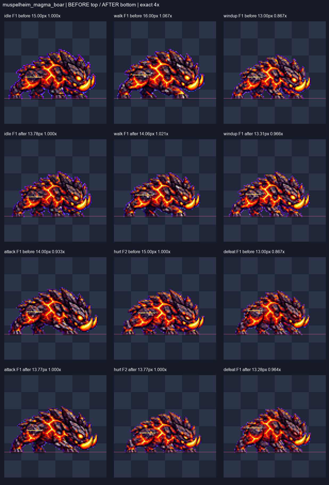
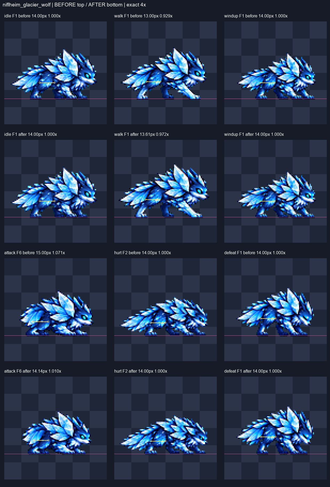
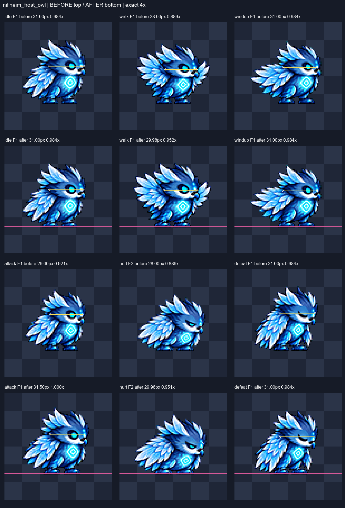
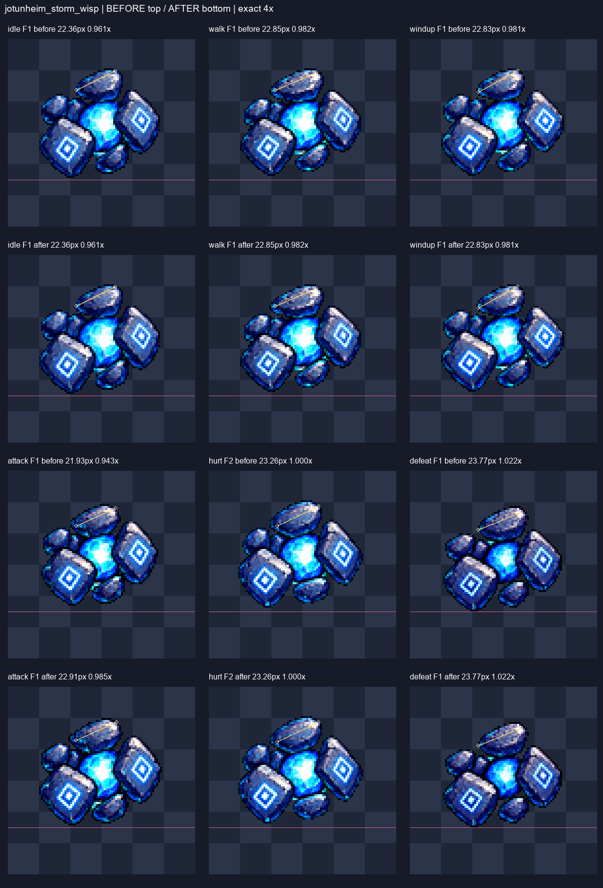
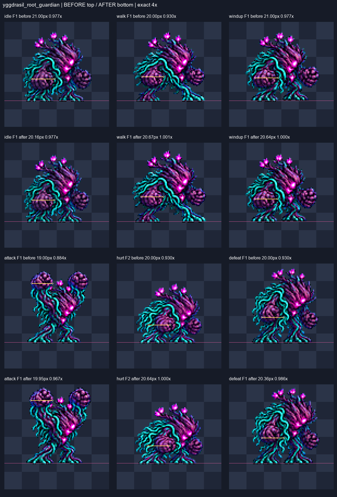
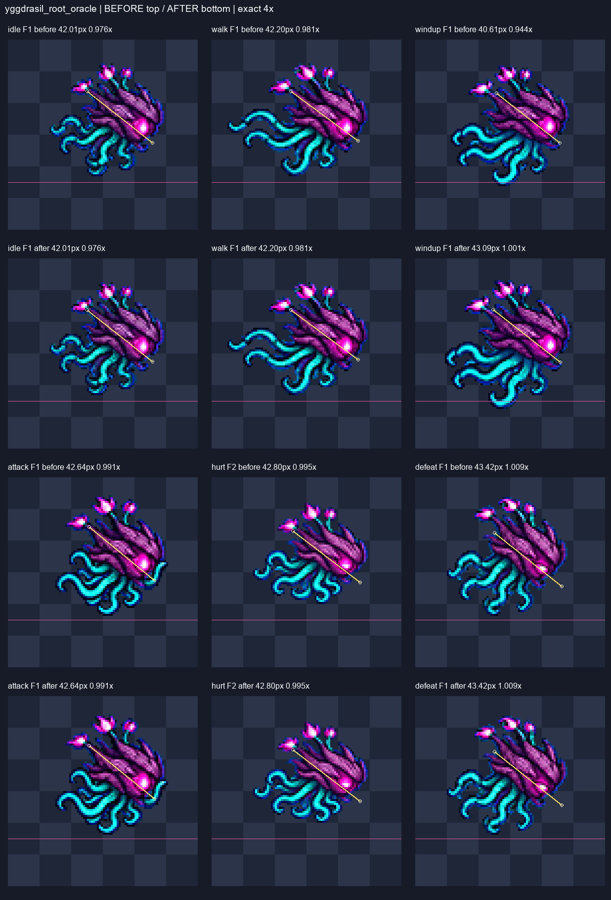
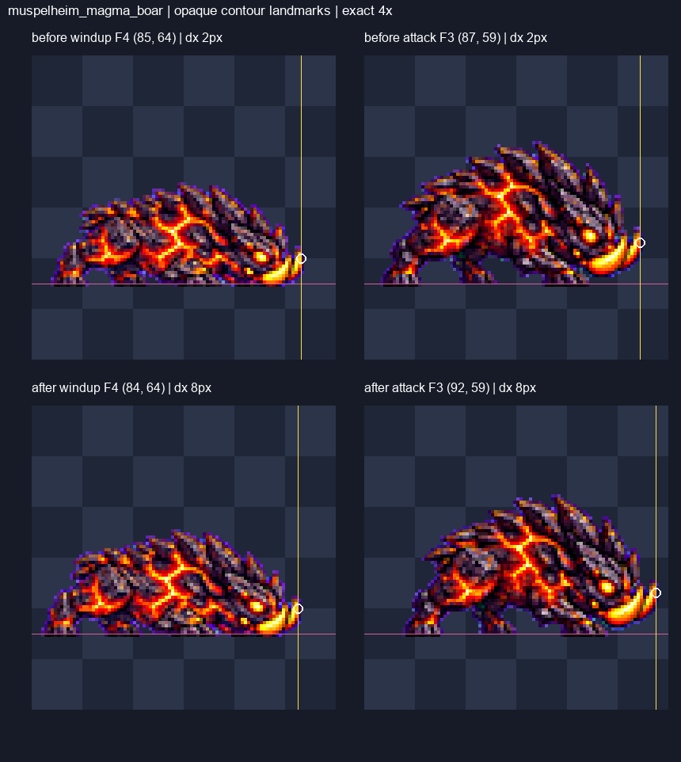
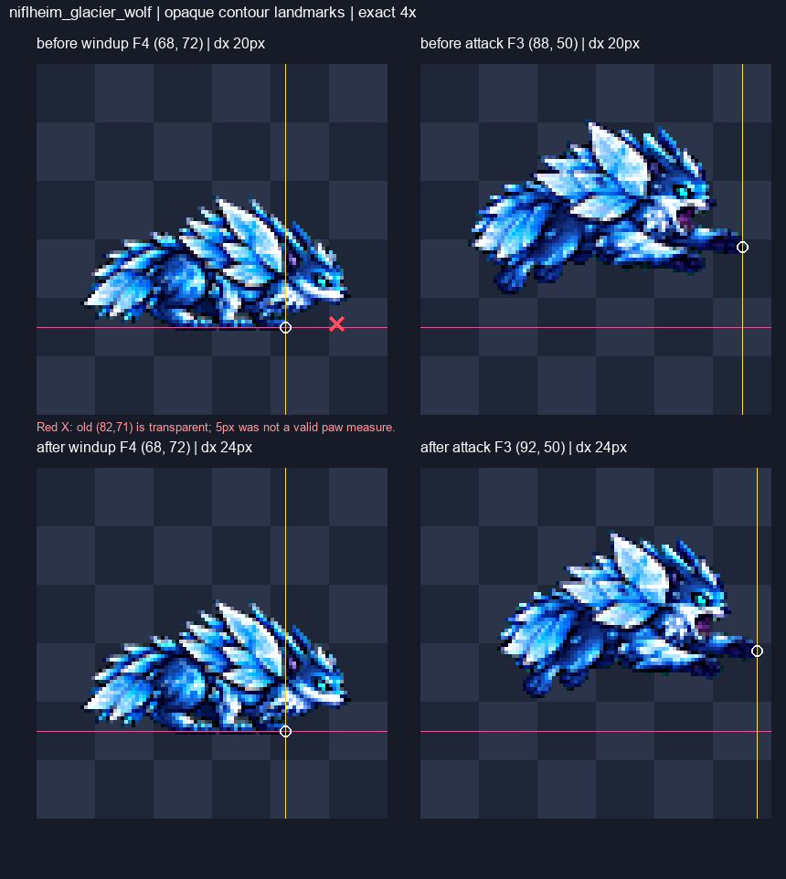

# CODEX-ART-76 fix-1 — batch 3 행별 크기 재정리

## 작업 결과

**완료:** 6종 중 19행(92프레임)의 PNG/JSON과 조립 시트 6장을 갱신했다. raw에서 행 공통 factor 하나로 재구축했으며, ART-74와 같은 대표 부위 기준으로 36행 모두 idle 대비 명목 ±5% 안이다. 미착수 행·누락 raw는 없다. 후보 단계이며 게임 적용은 하지 않았다.

**현재 상태:** 168프레임 규격 검사 실패 0, 디테일 85 미만 0. 변경한 19행의 모든 그림을 정확한 최근접 4배로 직접 열어 확인했다. 프레임별 배율·몸 조각 교체·색 보정은 하지 않았다.

**남은 작업:** 대표 부위의 행별 명목 크기를 맞춘 결과다. 회전·가림·프레임 안의 그림 변형까지 전부 ±5%가 된 것은 아니다. 아래 별도 표에 남은 첫/끝 투영 편차를 공개한다.

## 측정 방법과 배율 선택

- 비교 부위는 ART-76의 수동 4배 눈금을 재사용했다. 보통 F1, 피격은 반동이 덜한 F2, 늑대 공격은 공중 자세 대신 착지 F6을 대표로 삼았다(ART-74와 같은 비교 조건 선택). idle 기준은 이전 보고와 동일한 첫/마지막 그림 길이 평균이다.
- **전 크기**는 기존 수동 눈금의 투영 길이, **후 크기**는 그 동일 눈금을 raw 공통 배율과 프레임 전체 이동으로 추적한 명목 길이다. 독립적인 해부학적 재측정값으로 주장하지 않는다. 최종 4배 그림에서 부위·외곽·접지를 대조했다. 끝점 오차 약 ±1px, 길이 약 ±2px이므로 소수점 표시는 재현용 계산 정밀도다.
- 멧돼지 idle .19→.1745(−8.16%), 수호자 idle .15→.144(−4%)로 기준을 줄였다. 큰 준비/내리침을 96px 칸, 3px 여백, 발 y72와 함께 유지하려는 선택이다. 올빼미 이동·피격은 첫/끝 두개부 편차를 덜 키우도록 중간 배율로 절충했다.
- 수정된 행은 원본을 LANCZOS, 선명화60, despill auto, palette none으로 재축소했다. 256px 작업 캔버스에서 만든 모든 불투명 픽셀을 보존하고 전체 그림만 96px 칸으로 평행 이동했다. 결과 PNG가 같은 raw 재구축과 픽셀 단위로 일치함을 검증했다.

## 크기 표 — 측정/추적값

### 마그마 멧돼지 — `muspelheim_magma_boar`

비교 부위: 가까운 뒤 넓적다리의 둥근 갑각판 가로폭. idle 평균 15.00 → 13.78px.

| 행(대표 F) | 변경 | 전 크기 px | 후 추적 px | 전/idle → 후/idle | factor 전 → 후 |
|---|---|---:|---:|---|---|
| idle(1) | 수정 | 15.00 | 13.78 | 1.000 → 1.000 | 0.19 → 0.1745 |
| walk(1) | 수정 | 16.00 | 14.06 | 1.067 → 1.021 | 0.19 → 0.167 |
| windup(1) | 수정 | 13.00 | 13.31 | 0.867 → 0.966 | 0.14 → 0.1433 |
| attack(1) | 수정 | 14.00 | 13.77 | 0.933 → 1.000 | 0.18 → 0.1771 |
| hurt(2) | 수정 | 15.00 | 13.77 | 1.000 → 1.000 | 0.11 → 0.101 |
| defeat(1) | 수정 | 13.00 | 13.28 | 0.867 → 0.964 | 0.16 → 0.1635 |

각 3칸 묶음에서 위는 수정 전, 아래는 수정 후다. 노란 선은 동일 부위 추적 눈금, 분홍 선은 y72다.

### 빙하 늑대 — `niflheim_glacier_wolf`

비교 부위: 가까운 뒤 넓적다리의 청색 덩어리 가로폭. idle 평균 14.00 → 14.00px.

| 행(대표 F) | 변경 | 전 크기 px | 후 추적 px | 전/idle → 후/idle | factor 전 → 후 |
|---|---|---:|---:|---|---|
| idle(1) | 유지 | 14.00 | 14.00 | 1.000 → 1.000 | 0.175 → 0.175 |
| walk(1) | 수정 | 13.00 | 13.61 | 0.929 → 0.972 | 0.17 → 0.178 |
| windup(1) | 유지 | 14.00 | 14.00 | 1.000 → 1.000 | 0.13 → 0.13 |
| attack(6) | 수정 | 15.00 | 14.14 | 1.071 → 1.010 | 0.21 → 0.198 |
| hurt(2) | 유지 | 14.00 | 14.00 | 1.000 → 1.000 | 0.105 → 0.105 |
| defeat(1) | 유지 | 14.00 | 14.00 | 1.000 → 1.000 | 0.14 → 0.14 |

각 3칸 묶음에서 위는 수정 전, 아래는 수정 후다. 노란 선은 동일 부위 추적 눈금, 분홍 선은 y72다.

### 서리 올빼미 — `niflheim_frost_owl`

비교 부위: 깃 장식 제외, 뒤통수에서 얼굴 앞까지 두개부 축. idle 평균 31.50 → 31.50px.

| 행(대표 F) | 변경 | 전 크기 px | 후 추적 px | 전/idle → 후/idle | factor 전 → 후 |
|---|---|---:|---:|---|---|
| idle(1) | 유지 | 31.00 | 31.00 | 0.984 → 0.984 | 0.17 → 0.17 |
| walk(1) | 수정 | 28.00 | 29.98 | 0.889 → 0.952 | 0.17 → 0.182 |
| windup(1) | 유지 | 31.00 | 31.00 | 0.984 → 0.984 | 0.16 → 0.16 |
| attack(1) | 수정 | 29.00 | 31.50 | 0.921 → 1.000 | 0.2 → 0.21724 |
| hurt(2) | 수정 | 28.00 | 29.96 | 0.889 → 0.951 | 0.11 → 0.1177 |
| defeat(1) | 유지 | 31.00 | 31.00 | 0.984 → 0.984 | 0.15 → 0.15 |

각 3칸 묶음에서 위는 수정 전, 아래는 수정 후다. 노란 선은 동일 부위 추적 눈금, 분홍 선은 y72다.

### 폭풍 위습 — `jotunheim_storm_wisp`

비교 부위: 맨 위 타원형 돌의 보이는 장축. idle 평균 23.26 → 23.26px.

| 행(대표 F) | 변경 | 전 크기 px | 후 추적 px | 전/idle → 후/idle | factor 전 → 후 |
|---|---|---:|---:|---|---|
| idle(1) | 유지 | 22.36 | 22.36 | 0.961 → 0.961 | 0.18 → 0.18 |
| walk(1) | 유지 | 22.85 | 22.85 | 0.982 → 0.982 | 0.175 → 0.175 |
| windup(1) | 유지 | 22.83 | 22.83 | 0.981 → 0.981 | 0.14 → 0.14 |
| attack(1) | 수정 | 21.93 | 22.91 | 0.943 → 0.985 | 0.18 → 0.188 |
| hurt(2) | 유지 | 23.26 | 23.26 | 1.000 → 1.000 | 0.11 → 0.11 |
| defeat(1) | 유지 | 23.77 | 23.77 | 1.022 → 1.022 | 0.15 → 0.15 |

각 3칸 묶음에서 위는 수정 전, 아래는 수정 후다. 노란 선은 동일 부위 추적 눈금, 분홍 선은 y72다.

### 뿌리 수호자 — `yggdrasil_root_guardian`

비교 부위: 가까운 뿌리 주먹의 투영 가로폭; 회전·가림의 영향을 받음. idle 평균 21.50 → 20.64px.

| 행(대표 F) | 변경 | 전 크기 px | 후 추적 px | 전/idle → 후/idle | factor 전 → 후 |
|---|---|---:|---:|---|---|
| idle(1) | 수정 | 21.00 | 20.16 | 0.977 → 0.977 | 0.15 → 0.144 |
| walk(1) | 수정 | 20.00 | 20.67 | 0.930 → 1.001 | 0.15 → 0.155 |
| windup(1) | 수정 | 21.00 | 20.64 | 0.977 → 1.000 | 0.185 → 0.1818 |
| attack(1) | 수정 | 19.00 | 19.95 | 0.884 → 0.967 | 0.17 → 0.1785 |
| hurt(2) | 수정 | 20.00 | 20.64 | 0.930 → 1.000 | 0.1 → 0.1032 |
| defeat(1) | 수정 | 20.00 | 20.36 | 0.930 → 0.986 | 0.14 → 0.1425 |

각 3칸 묶음에서 위는 수정 전, 아래는 수정 후다. 노란 선은 동일 부위 추적 눈금, 분홍 선은 y72다.

### 뿌리 예언자 — `yggdrasil_root_oracle`

비교 부위: 꽃봉오리·촉수 제외, 나무 두개부의 뒤끝→턱끝 축. idle 평균 43.03 → 43.03px.

| 행(대표 F) | 변경 | 전 크기 px | 후 추적 px | 전/idle → 후/idle | factor 전 → 후 |
|---|---|---:|---:|---|---|
| idle(1) | 유지 | 42.01 | 42.01 | 0.976 → 0.976 | 0.19 → 0.19 |
| walk(1) | 유지 | 42.20 | 42.20 | 0.981 → 0.981 | 0.175 → 0.175 |
| windup(1) | 수정 | 40.61 | 43.09 | 0.944 → 1.001 | 0.18 → 0.191 |
| attack(1) | 유지 | 42.64 | 42.64 | 0.991 → 0.991 | 0.2 → 0.2 |
| hurt(2) | 유지 | 42.80 | 42.80 | 0.995 → 0.995 | 0.095 → 0.095 |
| defeat(1) | 유지 | 43.42 | 43.42 | 1.009 → 1.009 | 0.16 → 0.16 |

각 3칸 묶음에서 위는 수정 전, 아래는 수정 후다. 노란 선은 동일 부위 추적 눈금, 분홍 선은 y72다.

## 카드 3번 — 디테일과 공격 전진

| 항목 | 기존 보고 | 동일 부위 재측정/수정 후 | 해석 |
|---|---|---|---|
| 멧돼지 idle 디테일 | F2 84.03 / F5 84.74 / F6 84.40 | **6장 모두 85.07 이상** | raw 공통 factor .1745로 개선. 별도 선명화 변경 없음 |
| 멧돼지 엄니 전진 | 3px | 기존 불투명 외곽 **2px → 8px** | 준비 전체 그림을 뒤로, F3을 앞으로 이동. 오차 약 ±2px인 경계값 |
| 늑대 앞발 전진 | 5px | 기존 **20px → 24px** | 기존 준비점 (82,71)은 알파0: 앞발 지점이 아니었음. 원래부터 목표8px 충족 |

새 전진 측정은 실제 불투명 외곽을 다시 지정했다. 멧돼지: 준비/공격 (85,64)→(87,59)가 수정 후 (84,64)→(92,59). 늑대: (68,72)→(88,50)가 수정 후 (68,72)→(92,50). 지정점 8개 모두 알파255인지 검사했다. 그림의 가로 차이이며 게임 이동량·공격 판정 사거리가 아니다.

위는 원래 후보의 2px, 아래는 재구축 후보의 8px이다. 흰 원은 실제 불투명 엄니 외곽이고 노란 세로선은 각 x 좌표다.

빨간 X는 기존 보고의 잘못된 투명 좌표다. 흰 원으로 같은 앞발 끝을 비교하면 원래20px, 수정 후24px이다. 5→24px 개선으로 보고하지 않는다.

## 시각 판단 — 숫자와 별개

- 멧돼지: y72와 디테일은 유지했지만 보폭·다리 분리·땅 긁기가 약하다. 8px은 위치 이동으로 만든 전진이며 새 공격 자세를 그린 결과가 아니다.
- 늑대: 72/67/62/53/72/72 도약 하단을 보존했다. F4의 늦은 정점과 F5의 빠른 착지가 남는다.
- 올빼미: 발이 고정된 날갯짓, 손짓에 가까운 공격은 그대로다. 두개부 원근 차이가 남는다.
- 위습: 핵 색 영역은 크기 기준으로 쓰지 않았다. 공격 F3의 과한 발광 면적과 대기/이동/피격 구분이 약한 점은 남는다.
- 수호자: 두 주먹은 유지되지만 준비와 쓰러짐의 회전/가림 때문에 주먹 투영 폭이 크게 줄어든다. 가지·봉오리 배치 흔들림도 남는다.
- 예언자: 촉수 개수·굵기 변화, 꽃봉오리처럼 보이는 시전 끝이 남는다. 눈 기준 정렬이며 뿌리 하단을 지지발로 보지 않았다.

### 대표 프레임 이외에 남은 투영 편차

다음 값은 기존 첫/끝 눈금을 동일 factor로 추적했을 때 ±5% 밖이다. 자세가 다르면 투영 길이가 달라진다는 한계와 실제 그림 흔들림이 섞여 있다. 이 목록을 숨기고 전 프레임 크기 일치라고 주장하지 않는다. 행 공통 factor만 바꿔서는 모두 동시에 맞출 수 없는 경우가 있다.

| 몬스터 | 행/프레임 | 전/idle → 후/idle |
|---|---|---|
| 마그마 멧돼지 | defeat F4 | 1.000 → 1.113 |
| 빙하 늑대 | attack F1 | 0.929 → 0.876 |
| 서리 올빼미 | walk F6 | 0.984 → 1.054 |
| 서리 올빼미 | hurt F1 | 0.984 → 1.053 |
| 폭풍 위습 | windup F4 | 0.898 → 0.898 |
| 폭풍 위습 | defeat F4 | 0.947 → 0.947 |
| 뿌리 수호자 | windup F4 | 0.791 → 0.809 |
| 뿌리 수호자 | defeat F4 | 0.651 → 0.690 |
| 뿌리 예언자 | hurt F1 | 0.944 → 0.944 |
| 뿌리 예언자 | defeat F4 | 0.933 → 0.933 |

## 4배 전 프레임 검수 기록

| 몬스터 | 변경 행 | 직접 본 그림 | 판단 |
|---|---|---|---|
| 마그마 멧돼지 | idle | [F1–F6, 4배](muspelheim_magma_boar-idle-all-frames-4x.png) | 6장 모두 확인. 갑각과 용암 선은 남지만, 8.16% 축소로 더 촘촘해 보임. |
| 마그마 멧돼지 | walk | [F1–F6, 4배](muspelheim_magma_boar-walk-all-frames-4x.png) | 6장 모두 확인. 발 교대와 y72는 유지. 보폭과 다리 분리가 약함. |
| 마그마 멧돼지 | windup | [F1–F4, 4배](muspelheim_magma_boar-windup-all-frames-4x.png) | 4장 모두 확인. 머리 낮춤·뒤로 당김은 보이나 땅 긁기가 약함. |
| 마그마 멧돼지 | attack | [F1–F6, 4배](muspelheim_magma_boar-attack-all-frames-4x.png) | 6장 모두 확인. F3 전체 그림을 앞으로 옮겼음. 엄니 리치는 늘었으나 돌진 보폭 자체는 그대로임. |
| 마그마 멧돼지 | hurt | [F1–F2, 4배](muspelheim_magma_boar-hurt-all-frames-4x.png) | 2장 모두 확인. 위로 젖힘과 복귀가 보이고 접지 유지. |
| 마그마 멧돼지 | defeat | [F1–F4, 4배](muspelheim_magma_boar-defeat-all-frames-4x.png) | 4장 모두 확인. 몸을 낮추는 순서는 유지. 마지막 넓적다리 투영 폭은 첫 그림보다 큼. |
| 빙하 늑대 | walk | [F1–F6, 4배](niflheim_glacier_wolf-walk-all-frames-4x.png) | 6장 모두 확인. 다리 교대와 접지 유지. |
| 빙하 늑대 | attack | [F1–F6, 4배](niflheim_glacier_wolf-attack-all-frames-4x.png) | 6장 모두 확인. F3 전진이 커짐. F4가 가장 높고 다음 F5에서 급히 착지하는 기존 호는 남음. |
| 서리 올빼미 | walk | [F1–F6, 4배](niflheim_frost_owl-walk-all-frames-4x.png) | 6장 모두 확인. 처음/끝 두개부 폭의 차이를 줄이는 절충 배율. 발 고정 날갯짓은 그대로. |
| 서리 올빼미 | attack | [F1–F6, 4배](niflheim_frost_owl-attack-all-frames-4x.png) | 6장 모두 확인. 머리가 idle에 가까워짐. 내려치기보다 앞으로 손짓하는 동작에 가까움. |
| 서리 올빼미 | hurt | [F1–F2, 4배](niflheim_frost_owl-hurt-all-frames-4x.png) | 2장 모두 확인. 반동과 복귀가 보임. 첫/둘째 그림의 두개부 투영 차이는 남음. |
| 폭풍 위습 | attack | [F1–F6, 4배](jotunheim_storm_wisp-attack-all-frames-4x.png) | 6장 모두 확인. 돌의 명목 크기는 개선. F3 핵 발광 영역이 커지는 변화는 그대로. |
| 뿌리 수호자 | idle | [F1–F6, 4배](yggdrasil_root_guardian-idle-all-frames-4x.png) | 6장 모두 확인. 긴 자세를 y72 안에 넣으려고 기준을 4% 축소. 가지와 주먹 두 개 유지. |
| 뿌리 수호자 | walk | [F1–F6, 4배](yggdrasil_root_guardian-walk-all-frames-4x.png) | 6장 모두 확인. 주먹과 몸 크기가 기준에 가까워짐. 먼 다리 가림은 남음. |
| 뿌리 수호자 | windup | [F1–F4, 4배](yggdrasil_root_guardian-windup-all-frames-4x.png) | 4장 모두 확인. 두 주먹만 있음. 머리 위로 든 주먹의 투영 폭 감소는 배율로 해결 안 됨. |
| 뿌리 수호자 | attack | [F1–F6, 4배](yggdrasil_root_guardian-attack-all-frames-4x.png) | 6장 모두 확인. F1 상단 3px와 발 y72 모두 확보. 두 주먹 내리침은 유지. |
| 뿌리 수호자 | hurt | [F1–F2, 4배](yggdrasil_root_guardian-hurt-all-frames-4x.png) | 2장 모두 확인. 반동과 접지는 유지. 가지/봉오리 수·배치의 변화는 남음. |
| 뿌리 수호자 | defeat | [F1–F4, 4배](yggdrasil_root_guardian-defeat-all-frames-4x.png) | 4장 모두 확인. F1 상단 여백과 y72 유지. 마지막 주먹이 작아지는 가림/회전은 남음. |
| 뿌리 예언자 | windup | [F1–F4, 4배](yggdrasil_root_oracle-windup-all-frames-4x.png) | 4장 모두 확인. 눈 기준으로 전체 이동. 머리는 커졌고 발광 눈 정렬 유지. 촉수 끝이 꽃봉오리처럼 보임. |

## 확인 및 테스트

- `verify.py`: 6종·36행·168프레임, 실패0. 최소 여백3px, 알파0/255, 초록 번짐0, 빈 칸 투명, 동일 행 중복 프레임0, 조립 시트와 행 PNG 픽셀 일치.
- 수정한 19행·92프레임: raw 공통 factor 재구축과 최종 PNG 픽셀 일치. 전체 그림 이동 전후 불투명 픽셀 수 보존. 지상형 y72와 늑대 도약 하단 보존.
- 디테일: 168프레임 모두85 이상. 내부 명암 라플라시안 지표이며 시각 완성도 인증은 아니다.
- 제품/도구 추적 파일 1,787개와 raw56장의 SHA-256, git index 해시가 작업 전과 같다. 추가 생성·설치·다운로드·Godot·뷰어 빌드·외부 게시는 실행하지 않았다.
- `commit.ps1`은 작성만 했고 실행·스테이징·커밋하지 않았다. 기존 `run.log` 등 미추적 파일은 보존하고 납품 목록에서는 제외했다.

## 재현과 다음 권장 단계

지정 Python에 `-B`를 붙여 이 폴더의 `rebuild.py` → `verify.py` → `finish_report.py` 순서로 실행한다. 첫 후보는 `before/`에 보존되며 재실행해도 덮어쓰지 않는다. `config.json`은 행별 단일 배율과 전체 이동량이다.

**다음 권장 단계:** 리드/QA-22가 새 후보를 재생해 전환 크기와 전진감을 확인한다. 모든 자세의 부위 폭까지 엄격히 같아야 한다면, 표에 남긴 수호자 주먹 등의 원본 재작화가 필요하다. 이 카드에서는 공통 배율과 위치 조정까지만 수행했다.

근거: [크기 원자료](sizes.json), [재구축 이동량](rebuild-metrics.json), [카드3번 측정](point-3.json), [검증 결과](verification.json), [4배 육안 기록](visual-review.json), [납품 목록](delivery-files.txt), [실행하지 않은 커밋 스크립트](commit.ps1).
