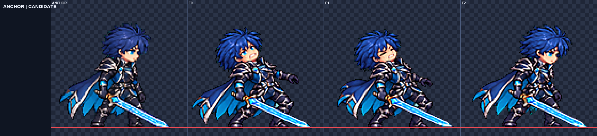
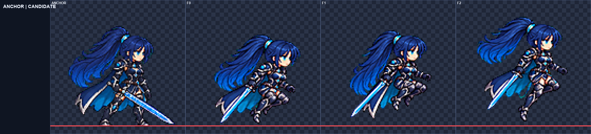

# ART-77 리오 남·여 모션 3차 묶음

**완료:** 9/10행, 26프레임을 후보로 저장했다. 남성 → 여성, 각 폼에서 jump → fall → hurt → land → victory 순으로 작업했다. 내장 ImageGen 16회와 ART-72에서 복사·수정한 정규화·얼굴 검사·검증 스크립트를 사용했다.

**현재 상태:** `art/bakeoff/rio/`의 새 PNG·JSON 후보이며 게임 채택은 아니다. `smash-nine-prototype/`과 `tools/`는 바꾸지 않았고 Godot도 실행하지 않았다. 원본과 실제 사용한 idle 4배 참조는 `art/raw/motions-77/`에 있으며 커밋 대상에서 제외했다.

## 남성 리오

| 행 | 프레임·fps | 공통 배율 | 얼굴 폭 비율 (측정 F) | 최소 여백 | 디테일 | 전달 |
|---|---:|---:|---|---:|---:|---|
| [jump](rio_male-jump.png) | 3 · 10 | 0.254 | 1.000 (F1,2,3) | 7px | 125.42–130.41 | 후보 전달 |
| [fall](rio_male-fall.png) | 2 · 8 | 0.176 | 1.000 (F1,2) | 6px | 128.88–135.07 | 후보 전달 |
| [hurt](rio_male-hurt.png) | 3 · 12 | 0.17 | 1.000 (F3) | 4px | 135.92–138.44 | 후보 전달 |
| [land](rio_male-land.png) | 2 · 12 | 0.14 | 1.000 (F1,2) | 4px | 126.64–131.47 | 후보 전달 |
| [victory](rio_male-victory.png) | 6 · 8 | 0.28 | 1.000 (F1,2,3,4,5,6) | 35px | 122.36–130.81 | 후보 전달 |

## 여성 리오

| 행 | 프레임·fps | 공통 배율 | 얼굴 폭 비율 (측정 F) | 최소 여백 | 디테일 | 전달 |
|---|---:|---:|---|---:|---:|---|
| [jump](rio_female-jump.png) | 3 · 10 | 0.178 | 0.958–1.042 (F1,2,3) | 10px | 112.98–117.22 | 후보 전달 |
| [fall](rio_female-fall.png) | 2 · 8 | 0.166 | 1.000–1.042 (F1,2) | 8px | 109.14–111.08 | 후보 전달 |
| [hurt](rio_female-hurt.png) | 3 · 12 | 0.1735 | 1.000 (F3) | 4px | 117.30–120.52 | 후보 전달 |
| [land](rio_female-land.png) | 2 · 12 | 0.15 | 1.000 (F1,2) | 7px | 108.59–118.13 | 후보 전달 |
| [victory](rio_female-victory.png) | 6 · 8 | 0.325 | 1.000–1.083 (F1,2,3,4,5,6) | 38px | 111.40–114.86 | 미전달 |

## 측정과 육안 판단의 구분

- **자동 측정:** 기존 `normalize.py`를 읽기·실행만 했다. LANCZOS, 선명화 60, despill auto, palette none, 초록 배경이다. 행마다 배율 하나이며 머리·팔·다리를 코드로 그리거나 붙이지 않았다. 공통 x 이동·lift-scale은 `summary.json`에 기록했다. `head-scale.json`은 기존 `head_scale.py`의 결과다.
- **단일 프레임 수정:** 여성 피격 F1의 재생성은 1254px 초록 캔버스 전체를 원래 724px 셀 좌표계로 LANCZOS 정합한 뒤 조립했다. 몸·머리 경계를 따로 맞춘 것이 아니다. F2·3은 원본과 픽셀 일치하며 최종 캐릭터 배율은 행 전체 0.1735 하나다(`frame-retry.json`).
- **얼굴 측정:** 4배 최근접 확대판에서 머리카락을 제외한 눈 아래 경계의 노출 얼굴 폭을 표식으로 쟀다(ART-72 eye-lower-edge 방법). 남성 기준 15px, 여성 기준 12px. 각 행의 `face-measured.json/png`에 좌표와 비율을 남겼다. 자동 얼굴 제안 표식은 그대로 수락하지 않았다.
- **측정 한계:** 기준 idle부터 반대쪽 눈이 앞머리에 가려져 **눈 사이 거리는 모든 행에서 측정 불가**다. 임의의 머리카락 표식을 눈으로 취급하지 않았다. 얼굴 폭은 픽셀 경계 판단으로 약 1px 오차가 가능하며, 소수점 표시는 측정 오차가 작다는 뜻이 아니다. 표의 얼굴 비율은 폭만 뜻하고 두 눈 검증 통과를 뜻하지 않는다.
- **육안 판단:** 얼굴 1개, 손·부츠·검·의상, 동작 의미와 연결을 전 프레임 4배 판에서 직접 확인했다. 기울거나 감긴 얼굴은 수치에서 제외하고 제외 F를 남겼다. 실제 재생·게임 체감 검사는 하지 않았다.
- **전달 기준:** 측정 가능한 얼굴 폭이 전부 0.95–1.06 안이고 여백·번짐·디테일·외형 검사를 통과한 행을 후보로 냈다. 목표 0.96–1.04를 벗어난 행은 측정 비율을 후보 JSON `note`에 명시했다. 가려진 눈의 검증 한계도 모든 `note`에 적었다.
- `selection.json`의 기존 ART-72 필드 `face_verified`는 여기서는 노출 얼굴 폭 표식의 검수·허용 범위 판정이다. 두 눈 사이 거리 검증을 뜻하지 않는다.

## ART-72 교훈 확인

- 피격: 첫 프레임의 머리·몸통 뒤꺾임과 반동 → 회복을 확인했다. 표정만 바꾼 idle이 아니다.
- 승리: 같은 검과 손을 유지하며 마지막이 유지 자세다. 남성은 검을 내려 꽂은 뒤 다시 들지 않는다. 여성은 검을 옆으로 든 끝 자세와 포니테일 정착을 확인한다.
- 점프: 상승의 접힌 무릎과 정점의 뻗기 시작하는 다리를 구분했다.
- 얼굴: 전체 크기 오차는 공통 배율로만 조정했다. 프레임별 크기 조정은 없다.
- 망토·검: 전달 후보의 최소 여백은 모두 4px 이상이다. 원본 셀 경계에 닿은 남성 jump 1차·victory 1차, 여성 victory 2차는 제외하고 다시 생성했다.

## 행별 판단과 아직 잘못된 점

- **rio_male jump:** 도약·무릎 접은 상승·다리 펼치는 정점이 구분됨. 공통 lift-scale 0.3으로 높이 호를 압축. 반대 눈 가림으로 눈 간 거리는 측정 불가, 얼굴 폭 F1–3 확인.
- **rio_male fall:** 위로 날리는 머리·망토와 아래로 뻗는 다리의 반복. 행 전체 x +3px, lift-scale 0.3. 반대 눈 가림으로 눈 간 거리는 측정 불가, 얼굴 폭 F1–2 확인.
- **rio_male hurt:** 머리·몸통 뒤꺾임, 반동, 회복. 검이 길어 행 전체 x −6px. 얼굴 폭은 직립 F3만 측정; F1 기울기와 F2 감은 눈은 4배 육안 확인.
- **rio_male land:** 착지 웅크림에서 일어나 대기로 복귀. 양발 접지. 검끝 여백을 위해 공통 x −9px. 반대 눈 가림으로 눈 간 거리 측정 불가, 얼굴 폭 F1–2 확인.
- **rio_male victory:** 오른손으로 몸 옆에서 검을 돌린 뒤 앞에 내려 꽂고 양손을 얹음. F4–6 검을 다시 올리지 않음. F6 미소와 정착한 망토가 최종 유지 자세. F2의 검은 원근 때문에 짧게 보이고 F3→4 회전 간격은 다소 큼. 얼굴 폭 F1–6 측정, 눈 간 거리 측정 불가.
- **rio_female jump:** 도약·상승·정점에서 무릎과 포니테일 방향 변화. 공통 lift-scale 0.3. 얼굴 폭 F1 1.042, F2·3 0.958로 목표 밖이나 후보 허용 0.95–1.06 안. 눈 간 거리 측정 불가.
- **rio_female fall:** 다리를 아래로 뻗고 포니테일·망토가 위로 후행하는 반복. 공통 lift-scale 0.5. 얼굴 폭 F1 1.042, F2 1.000, F1은 목표 밖이나 후보 허용 범위 안. 눈 간 거리 측정 불가.
- **rio_female hurt:** 머리·몸통 후방 반동, 최대 반동, 회복. F1의 잘못된 보라 머리끝은 3회째 단일 프레임 생성으로 수정. F2·3 원본 픽셀은 그대로. 공통 x −7px. 얼굴 폭은 직립 F3만 측정; F1 기울기·F2 감은 눈은 4배 육안 확인. 눈 간 거리 측정 불가.
- **rio_female land:** 깊은 착지 웅크림에서 대기로 일어남. 양발 접지, 포니테일·망토가 정착. 공통 x −7px. 얼굴 폭 F1·2 측정. 눈 간 거리 측정 불가.
- **rio_female victory:** 미전달. 생성 3회 종료. 1차는 검 손 바뀜, 2차는 F3 검끝 원본 셀 침범. 최선 3차는 같은 앞쪽 손 유지·한 방향 돌리기·최종 들기 자세·여백을 통과했으나, 배율 0.325에서 얼굴 폭 F1–5 1.000, F6 1.083으로 후보 상한 1.06 초과. 자동 머리 중앙값 1.000보다 얼굴 측정을 우선. F3 검은 원근 때문에 짧게 보임. 눈 간 거리 측정 불가.

## 시각적 확인

왼쪽은 현재 idle, 오른쪽은 타격 반동과 회복이다. 모든 행의 `<폼>-<행>.png`는 기준과 전체 프레임 판이며 `qa4x/`는 최대 2048px 폭으로 나눈 실제 4배 검수 페이지다.

접힌 상승 다리에서 정점의 뻗는 다리로 달라진다. 얼굴 폭 목표 밖의 소폭 편차는 위 표와 JSON 설명에 남겼다.

## 확인 및 다음 단계

최종 파일 검증은 `audit.json`을 확인한다. 이진 알파, 셀·발선·프레임·fps, 빈 패딩, 정규화 출력과 후보 바이트 일치, 4px 여백, spill 0, detail ≥79, 측정 가능한 얼굴 폭, 원본 보존·생성 상한, 커밋 파일 범위를 검사한다. `commit.ps1`은 구문만 확인하며 실행하지 않는다. `run.log`, raw, 캐시, 다른 작업 파일은 추가하지 않는다.

**남은 작업:** 여성 victory는 미전달이다. F6 얼굴 폭 1.083을 바로잡는 재작업이 필요하며, 이번 카드의 생성 3회 상한을 사용했으므로 추가 생성하지 않았다. 최선 시도는 `best/rio_female/victory/`와 4배 판에 보존했다.

**다음 권장 단계:** 전달된 9행은 사용자가 모션 뷰어에서 실제 재생과 얼굴 크기 편차를 보고 채택 여부를 고른다. 여성 victory는 새 작업에서 F6을 다른 다섯 프레임과 기준 idle에 맞춰 다시 그린다. 특히 가려진 두 눈의 거리 검증은 수행하지 못했다. 제품 연결·뷰어 배포·Godot 검증은 이번 카드에서 하지 않았다.

**최종 검증:** `verify.py` 파일 검사 673항목 통과. 후보 9행, 검수 10행, 생성 16회. 커밋 스크립트는 파서 구문만 검사했고 실행하지 않았다.
