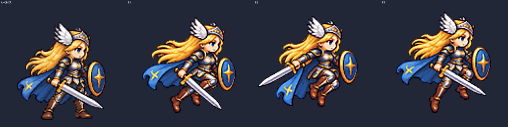
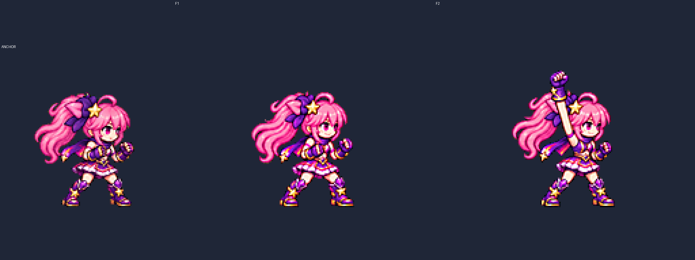

# ART-78 보류 캐릭터 동작 재시도

## 작업 결과

후보 전달 **2/7행, 5프레임**. 카드에서 지정한 Frey 도약과 Brave Luna 낙하는 ART-72 최선본을 그대로 전달했다. 새로 그린 다섯 행은 각각 3회, 총 15회 내장 ImageGen 생성을 사용했고 얼굴 허용 범위를 넘어서 최선본만 보고서에 남겼다. 미착수 행은 없다.

## 행별 결과

얼굴은 **눈 사이 거리 / 머리카락을 제외한 눈높이 얼굴 폭**의 앵커 대비 비율이다. F는 1부터 센다. 앞의 두 행은 ART-72 측정을 재사용했고 나머지는 복사·수정한 `face_check.py`의 4배 표식을 대조했다. 수치의 소수 셋째 자리는 계산 표시 정밀도이며 실제 경계 판독 오차가 그만큼 작다는 뜻이 아니다.

| 폼 · 행 | 프레임 / fps | 공통 배율 | 얼굴 눈 / 폭 (측정 프레임) | 최소 여백 | 디테일 | 전달 |
|---|---:|---:|---|---:|---:|---|
| [frey · jump](frey-jump.png) | 3 / 10 | 0.17 | 0.992–1.045 / 1.000–1.000 (F1,2,3) | 4px | 107.140–108.570 | 전달 |
| [luna_brave · fall](luna_brave-fall.png) | 2 / 8 | 0.13525 | 0.955–0.985 / 1.000–1.000 (F1,2) | 15px | 124.400–131.990 | 전달 |
| [frey · victory](frey-victory.png) | 6 / 8 | 0.32 | 0.989–1.100 / 0.914–1.057 (F1,2,3,4,5,6) | 23px | 86.480–103.520 | 미전달 |
| [luna · victory](luna-victory.png) | 6 / 8 | 0.21 | 0.966–1.005 / 0.929–1.000 (F1,2,3,4,5) | 39px | 111.930–117.140 | 미전달 |
| [luna_brave · victory](luna_brave-victory.png) | 6 / 8 | 0.23 | 0.968–0.994 / 1.000–1.071 (F1,2,3,4,5,6) | 39px | 114.240–124.750 | 미전달 |
| [luna_brave · hurt](luna_brave-hurt.png) | 3 / 12 | 0.156 | 1.001–1.064 / 0.929–1.071 (F1,2,3) | 7px | 125.470–130.640 | 미전달 |
| [luna_brave · jump](luna_brave-jump.png) | 3 / 10 | 0.168 | 0.971–1.066 / 1.000–1.000 (F1,2,3) | 14px | 121.730–127.010 | 미전달 |

## 측정과 육안 판단

- **측정:** ART-72의 `process.py`, `face_check.py`, `package.py`, `verify.py`를 복사해 수정했다. 기존 도구를 읽기 전용으로 호출했고 LANCZOS·선명화 60·despill auto·팔레트 없음·초록 배경을 유지했다. 한 행에 공통 배율 하나만 적용했다.
- **얼굴 표식:** 자동 피부 중심이 다리·손을 잡은 곳은 얼굴을 온전히 포함하는 검색 영역으로 제한했다. 웅크린 피격 F2의 낮은 얼굴까지 남도록 영역을 조정했다. 자동 머리 검사 원본은 `head-scale.json`에 별도로 보존했다. 수치를 통과시키려고 표식을 수동으로 옮기거나 반올림하지 않았다.
- **육안 판단:** 최선본 7행의 모든 29프레임을 앵커 옆의 최근접 4배 판에서 확인했다. 얼굴 하나, 손·발·장비·의상, 셀 경계와 동작 의미를 확인했다. 피부 중심·얼굴 경계 표식의 오차 가능성과 실제 외형 판단은 별개다.
- **원본과 재시도:** 사용한 idle 원본·4배 참조·15회 생성 원본·조립본을 `art/raw/motions-78/`에 보존했다. 특정 프레임을 재시도할 때는 생성된 **셀 전체**만 교체하고 다른 셀의 픽셀을 유지했다. 머리 붙이기·얼굴 특징 코드 그리기·프레임별 크기 보정은 하지 않았다. 재현 정보는 `generation-ledger.json`, 실제 프롬프트는 `prompts.txt`에 있다.
- **전달 기준:** 목표 0.96–1.04, 허용 0.95–1.06. 허용 밖 행은 후보 폴더에 넣지 않았다. 0.96–1.04를 벗어나는 두 전달 행은 JSON note에 실제 비율을 적었다. Luna 승리 F6는 윙크라 얼굴 두 지표의 요약에서 제외했고 그 사실을 기록했다.

## 아직 잘못된 점 / 남은 작업

- **frey jump:** ART-72 최선 3차를 그대로 전달. 눈 비율 0.992–1.045(F1–3), 폭 1.000으로 ART-78 허용 범위 안이며 F2 1.045와 F3 1.042는 목표 상한 1.04 밖이다. 도약·상승·정점과 검·방패를 4배 판에서 재확인.
- **luna_brave fall:** ART-72 최선 3차를 그대로 전달. 눈 비율 0.955–0.985(F1–2), 폭 1.000으로 ART-78 허용 범위 안이며 F1 0.955는 목표 하한 0.96 밖이다. 낙하 자세·장갑·의상을 4배 판에서 재확인.
- **frey victory:** 검이 낮은 위치에서 수평·대각선·머리 위로 한 번만 올라가고 F4–6에 계속 높이 유지된다. 방패 전진·망토·미소를 확인. 얼굴 눈 0.989–1.100, 폭 0.914–1.057(F1–6)으로 허용 범위 밖. 1·3차는 원본 셀 경계 실패. 3회 상한으로 미전달.
- **luna victory:** 지팡이는 전 프레임 같은 손에 있고 F5 별 자세·F6 윙크로 끝난다. F5만 재생성해 교체한 2차가 최선. 눈 0.966–1.005, 폭 0.929–1.000(F1–5), F2 폭 0.929로 미전달. F6는 윙크로 눈 간격 측정에서 제외했으며 통과로 간주하지 않았다. 3회 상한.
- **luna_brave victory:** F2–3 주먹을 머리 위로 크게 들어 올리고 F4부터 내려 F6 전투 자세와 미소로 끝난다. 눈 0.968–0.994(F1–6)는 허용 범위지만 F1 폭 1.071이 상한 1.06 밖이므로 미전달. 나머지 폭은 1.000. 3회 상한.
- **luna_brave hurt:** F1 상체·머리가 뒤로 젖혀지고 F2 낮게 반동한 뒤 F3 가드로 복귀한다. 얼굴만 바뀌던 이전 행과 동작이 구분됨. 눈 1.001–1.064, 폭 0.929–1.071(F1–3)로 허용 범위 밖이라 미전달. F1 눈 1.064, F2 폭 0.929, F3 폭 1.071. 3회 상한.
- **luna_brave jump:** 도약·무릎 접은 상승·정점의 세 자세를 다시 그림. 최선 2차 눈 0.971–1.066(F1–3), 폭 1.000. F3 눈 1.066이 상한 1.06을 넘는다. F3만 재시도한 3차는 0.924로 작아져 2차를 보존하고 미전달. 3회 상한.

## 파일과 확인

- **육안으로 남은 연결 문제:** Luna 지팡이는 같은 손으로 위→옆→아래→위로 움직이지만 F3→F4의 각도 변화가 크다. 부드러운 한 바퀴 회전으로 읽히는지는 추가 확인이 필요하다.
- **전체 확대 검토 범위:** 최종 배율로 저장된 새 정규화 결과 57프레임과 재사용 5프레임, 원본 셀 경계에서 탈락한 15프레임을 4배 판으로 확인했다. 기록은 `visual-review.json`에 있다. 원본 탈락 판은 로컬 raw 폴더에만 보존한다.
- 전달 후보: `art/bakeoff/frey/frey-jump-v2.png/.json`, `art/bakeoff/luna/luna_brave-fall-v3.png/.json`.
- 미전달 최선본: `best/<폼>/<행>/best-attempt.png`, 측정 JSON과 얼굴 표식. `<폼>-<행>.png`는 앵커와 전 프레임 4배 판이며 `qa4x/`는 최대 2048px 폭으로 나눈 동일 배율 판이다.
- 원본 셀 경계 실패: Frey 승리 1·3차와 Brave 피격 1차. 해당 `source-check-*.txt`에 남겼다. 배율로 실패를 숨기지 않았다.
- `smash-nine-prototype/`와 `tools/`는 변경하지 않았고 Godot은 실행하지 않았다. 다른 클론을 접근하지 않았다.
- `commit.ps1`은 명시한 파일만 추가한다. raw·캐시·run.log를 제외하며 실행하지 않았다. 후보는 모션 뷰어에서 사용자가 선택한 뒤 별도 작업으로 게임에 연결해야 한다.

`verify.py`: **610개 검증 통과**. 전달 PNG와 ART-72 최선본의 바이트 일치, 최선본 7행의 알파·여백·접지/공중·번짐·디테일, JSON·프레임·fps, 생성 상한·보존·셀 교체, 커밋 범위와 PowerShell 구문을 확인했다. 커밋 스크립트는 실행하지 않았다.

## 시각적 확인

왼쪽은 idle 앵커이며 오른쪽 세 장은 ART-72 최선본을 그대로 전달한 도약·상승·정점이다.

F2에서 주먹이 머리 위로 크게 올라간다. 이 행은 동작 개선본이며 F1 얼굴 폭 때문에 후보 전달은 보류했다.
