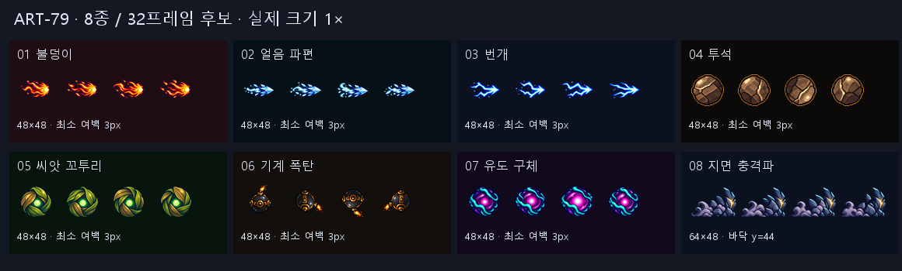

# ART-79 — 몬스터 투사체·지면 충격파 후보

## 완료

2026-10-23 KST, `codex/art-79` / 기준 커밋 `721b918`에서 제작했다. **7종 투사체와 공용 충격파, 총 8개 스트립·32프레임**을 후보로 납품한다. PNG와 한국어 설명을 포함한 JSON 8쌍이며, 게임에는 연결하지 않았다.

내장 ImageGen으로 종류별 원본을 생성하고 Pillow로 분리·축소·알파 정리·스트립 조립·검수판 합성을 했다. 생성 10회: 씨앗과 충격파 각 2회, 나머지 각 1회. 종류별 최대 3회를 넘지 않았다.



각 칸은 실제 1배 크기이며, 모든 프레임은 투명 배경이다. 충격파만 가로 64px이고 나머지는 48px다.

## 납품 목록

후보 파일은 모두 `art/bakeoff/monsters/`에 있으며, 같은 이름의 `.json`이 붙는다. 여백은 알파가 0이 아닌 모든 픽셀을 기준으로 측정한 4프레임 전체 최솟값이다. fps는 이번 후보의 제안값이다.

| ID | 프레임 | 셀 | aim | 최소 여백 | fps | 선택한 생성 | 상태 |
|---|---:|---|---|---:|---:|---:|---|
| `ember_imp` | 4 | 48×48 | right | 3px | 12 | 1 | 납품 |
| `niflheim_frost_owl` | 4 | 48×48 | right | 3px | 12 | 1 | 납품 |
| `jotunheim_storm_wisp` | 4 | 48×48 | right | 3px | 12 | 1 | 납품 |
| `midgard_rooftop_slinger` | 4 | 48×48 | none | 3px | 10 | 1 | 납품 |
| `vanaheim_seed_sprite` | 4 | 48×48 | none | 3px | 10 | 2 | 납품 |
| `svartalfheim_cog_drone` | 4 | 48×48 | none | 3px | 12 | 1 | 납품 |
| `yggdrasil_root_oracle` | 4 | 48×48 | none | 3px | 8 | 1 | 납품 |
| `slam_shockwave` | 4 | 64×48 | right | 3px | 12 | 2 | 납품 |

일반 파일명은 `<id>-projectile-v1.png/.json`, 충격파는 `slam_shockwave-v1.png/.json`이다. 일반 스트립은 **192×48**, 충격파는 **256×48**이다. JSON의 일반 `cell`은 48, 충격파는 `[64, 48]`이며 충격파에 `floor: 44`를 넣었다. 각 JSON에는 원본 위치·실제 분리 상자·공통 축소 배율도 기록했다.

## 확인한 코드·참조 그림

- `design/DECISIONS.md`, `design/ROADMAP.md`, `FINAL_GAME_GOAL.md`, 두 컨셉 그림을 확인했다. D32/D35의 칸 안 수용·디테일 보존·후보 채택 절차를 따른다.
- `RealmMonster.gd:584–630`: 직사·곡사·유도·폭탄의 그림 선택, 36px 기준 폭, 충격파의 Line2D를 확인했다. `MonsterProjectile.gd`의 유도·곡사·폭탄·바닥 검사와 `Projectile.gd`의 `set_art`, `ArtSettings.aimed_sprite`의 오른쪽 기준 회전을 읽었다.
- 이 코드에서는 `art_scale_multiplier = WORLD(1.5)`이므로 일반 투사체 **셀의 표시 폭은 36×1.5=54px**다. 보드 위쪽은 카드의 36px 가독성을, 아래 모형은 54px 셀과 96px 몬스터를 비교한다. 일반 48px 후보를 연결할 때 셀 배율은 54/48=1.125가 기준이다. 투명 여백 때문에 실제 유색 실루엣은 셀보다 작다.
- 충격파 원형은 `(-16,12), (-8,-10), (0,-22), (8,-10), (16,12)`, 폭 5의 황색 선이다. 보드의 이전 그림은 이 점들을 Pillow로 재현한 **설명용 모형**이며 기존 PNG가 아니다.
- 각 몬스터의 현재 시트를 색상 기준으로 사용했다. 이 클론에서 해당 신규 공격 후보가 있던 Ember Imp는 그 공격 행도 참조·모형에 사용했다. 나머지는 현재 시트의 공격 3번 프레임을 썼다. 다른 클론은 읽지 않았다.

## 측정 결과

전체 프레임별 수치는 [measurements.json](measurements.json)에 있다. `build.py`는 아래 조건이 어긋나면 실패한다.

최종 저장 PNG/JSON을 다시 여는 별도 검사도 통과했다(8쌍·32프레임·전체 최소 여백 3px·LF 텍스트·커밋 허용 파일 33개). 자동 JSON 저장의 CRLF를 발견해 LF로 수정한 뒤 재검사했다. PowerShell은 `commit.ps1`을 **파싱만** 하여 문법 오류 0을 확인했다. `git diff --check` 통과, 추적 파일 변경 0, 스테이징 0이다.

| 항목 | 실제 측정 |
|---|---|
| 셀·장수·투명도 | 8스트립 / 32개 RGBA 프레임, 투명·완전 불투명 픽셀 모두 존재 |
| 최소 여백 | 32/32프레임에서 3px 이상 — 요구 2px 충족 |
| 2px 여백 침범 | 전부 0픽셀 |
| 완전 투명 픽셀의 잔여 RGB | 전부 0 |
| 동일 프레임 | 종류별 네 장의 RGBA 해시가 모두 다름 |
| 충격파 바닥 | 네 장 모두 bbox 하단 44(배타 경계), 실제 최하단 y=43 |
| 충격파 실루엣 | 폭 57–58px, 높이 38px |
| 키색 유사 픽셀 | 전부 0 — alpha≥24, R≤40/G≥215/B≤40 기준 |

**spill 수치를 구분한다.** 녹색 배경 없이 처음부터 투명 원본을 사용했다. 여백으로 번진 픽셀과 위 키색 유사 픽셀은 0이다. 다만 공통 도구의 단순 녹색 우세 검사(`G>max(R,B)+20`)와 같은 조건으로 세면 씨앗 **1,170픽셀**, 유도 구체 **226픽셀**이 검출된다. 이는 요청된 녹색·청록색 본체 팔레트이므로 지우지 않았다. 나머지 여섯 종류는 이 검사도 0이다. 이 두 팔레트까지 포함한 범용 녹색 우세 검사가 0이라고 주장하지 않는다.

## 직접 본 결과와 약한 부분 — 육안 판단

종류별 검수 보드 8장을 모두 열어 **32프레임의 1×와 4×**, 밝고 어두운 바탕, 36px 축소 및 맥락 모형을 직접 봤다. 수정한 씨앗과 충격파는 마지막 출력 보드를 다시 열었다. 배경색이 남은 테두리나 잘린 프레임은 관찰하지 못했다. 아래는 자동 검사가 아닌 제작자의 판단이다.

| 종류 | 육안 판단 | 아직 약한 부분 |
|---|---|---|
| 불덩이 | 밝은 오른쪽 핵과 왼쪽 불꼬리가 작은 크기에서도 구별된다. | 36px에서는 가는 꼬리 내부 선이 합쳐진다. |
| 얼음 파편 | 단단한 촉과 부드러운 서리 꼬리를 구별할 수 있다. | 3번의 서리 말림이 다른 칸보다 커서 꼬리 변화가 강하다. |
| 번개 | 기존 둥근 빛보다 전기탄임이 명확하다. | 화살표처럼 정돈된 실루엣이며 자연스러운 불규칙성은 약하다. |
| 투석 | 둥근 돌·큰 균열·광맥의 회전이 읽힌다. | 광원이 표면과 함께 돌아가는 느낌이 남는다. |
| 씨앗 | 2차 생성에서 네 칸 모두 중앙 핵이 보이고 껍질이 돈다. | 팽이 같은 규칙적인 회전이며, 세 발이 모이면 시각적으로 빽빽할 수 있다. |
| 폭탄 | 철구·황동·도화선이 남고 회전 방향을 알 수 있다. | 도화선 여백 때문에 본체가 다른 둥근 후보보다 작고, 90도씩 도는 동작이 거칠 수 있다. |
| 유도 구체 | 보라·청록색 띠와 분홍 핵이 몬스터 팔레트에 맞는다. | 맥동이 과하지 않은 대신 36px에서 변화 폭이 작다. |
| 충격파 | 2차 생성은 높은 앞마루·낮은 뒷먼지·바닥 정렬이 명확하다. | 앞쪽 바위는 비교적 고정돼 있고 먼지 변화가 동작 대부분을 담당한다. |

이전 그림 대비 실제 유색 면적이 커지는 후보(특히 돌·씨앗·유도 구체)가 있다. 후보 연결 뒤 혼전 화면에서 크기를 판단할 필요가 있다. 정적 보드만으로 시간상 연결의 부드러움을 검증했다고 말하지 않는다.

## 검수 자료

- [전체 비교판](overview.png): 8종 1×, 첫 프레임 3×, 36px 네 프레임.
- 개별 보드: [불덩이](ember_imp.png), [얼음](niflheim_frost_owl.png), [번개](jotunheim_storm_wisp.png), [돌](midgard_rooftop_slinger.png), [씨앗](vanaheim_seed_sprite.png), [폭탄](svartalfheim_cog_drone.png), [유도 구체](yggdrasil_root_oracle.png), [충격파](slam_shockwave.png).
- [공용 충격파 모형](slam_shared_context.png): 골렘·뿌리 수호자, 양쪽 진행과 같은 바닥선.
- [전체 프롬프트](prompts.txt), [원본 출처 목록](sources.json), [후처리·보드 생성](build.py), [커밋 스크립트](commit.ps1).

## 제작·보관

참조 시트·기존 투사체·사용한 신규 공격 행·생성 원본 10장은 `art/raw/projectiles-79/`에 복사했다. 이 경로는 git ignore 상태이며 커밋 목록에서 뺐다. 원본 보관 덕분에 이 클론에서는 재현할 수 있지만 git 결과물만 받으면 원본을 별도로 받아야 재생성할 수 있다.

후처리는 알파 32 미만 원본 잔여물 제거 → 알파 실루엣의 실제 간격으로 4프레임 분리 → **스트립당 한 배율**의 LANCZOS 축소 → 선명화 60 → 알파 24 미만 잔여물·고립 1px 부스러기 정리 → 배치 순이다. 팔레트 수를 줄이지 않았다. 폭탄은 구체 중심에 맞춰 추가로 정확한 90도 회전만 적용했다. 녹색·청록색이 의도된 두 종류를 제외하고 녹색 우세 잔여물을 제거했다. 충격파 1차는 너무 낮아서, 씨앗 1차는 3번에서 핵이 숨기 때문에 채택하지 않았다.

재생성 명령(저장소 루트, 지정 Python·Pillow/numpy만 사용):

```powershell
$env:PYTHONDONTWRITEBYTECODE = '1'
& 'C:/Users/TH/.cache/codex-runtimes/codex-primary-runtime/dependencies/python/python.exe' reports/codex-art-79/build.py
```

## 현재 상태·남은 작업·다음 권장 단계

**후보 납품은 8/8 완료**, 미납 종류는 없다. `smash-nine-prototype/`와 `tools/`에는 쓰지 않았고, Godot·설치·다운로드·병렬 무거운 처리는 실행하지 않았다. `commit.ps1`은 허용한 파일만 명시하고 원본·`run.log`·`__pycache__`를 제외했으며 **실행하지 않았다**. 다른 작업에서 남은 파일도 건드리지 않았다.

남은 작업은 후보 채택과 이후 카드의 스트립 재생·충격파 연결이다. 첫 칸은 정지 그림으로 볼 수 있지만, **현재 코드에 스트립 전체를 단일 이미지로 넣으면 안 된다**. 채택 후 첫 셀 추출 또는 프레임 분할을 구현하고, 방향 회전·왼쪽 반전·월드 배율·바닥 y=44 및 혼전 가독성을 실제 게임에서 확인하는 순서를 권장한다. 게임 실행이나 애니메이션의 시간상 검증은 이번 작업 범위에서 하지 않았다.
