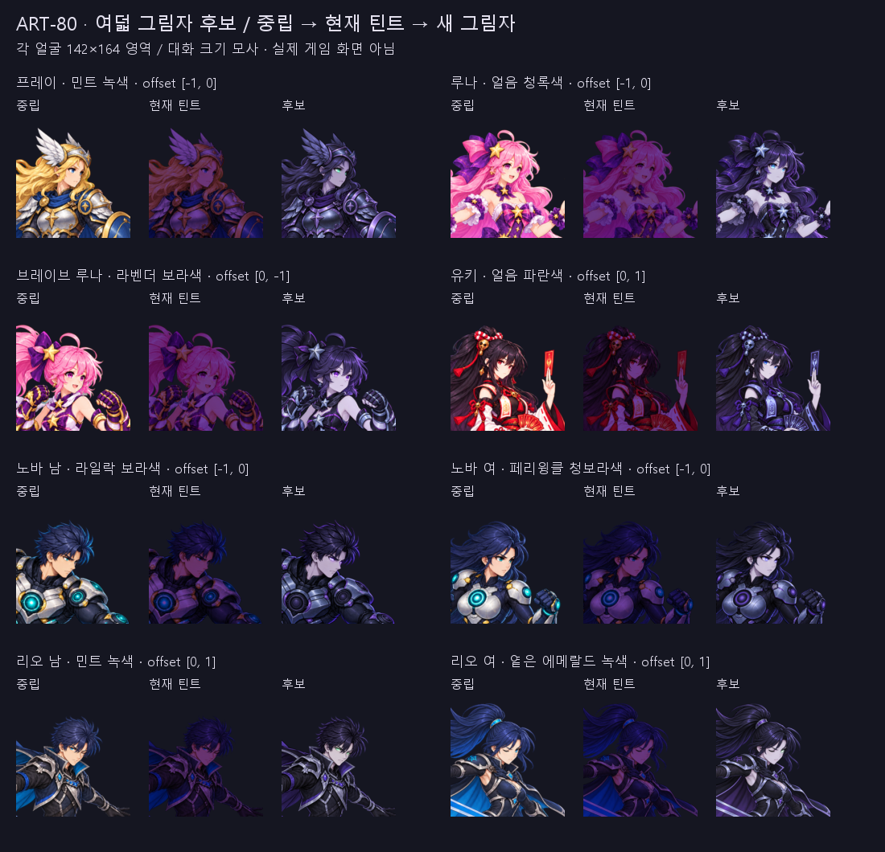

# ART-80 — 스토리 그림자 보스 초상화 후보 8폼

**완료:** 중립 얼굴을 Image 1로 직접 편집한 그림자 후보 PNG+JSON 8쌍을 납품한다. 프레이·노바 남은 2차, 나머지는 1차를 선택했다. 내장 이미지 도구 호출은 총 10회다. 전부 `candidate`, `delivered: true`이며 게임 채택·연결은 하지 않았다.

**현재 상태:** 저장된 후보 8장 모두 256×256 RGBA이고 중립 원본과 알파가 완전히 일치한다. 1배·142×164·50% 겹침·밝은 배경·대화 모사를 직접 확인했다. Godot, 설치, 다운로드, 스테이징, 커밋은 실행하지 않았다. 브랜치는 `codex/art-80`이다.

## 폼별 납품

offset은 256px 좌표에서 생성 편집본을 옮긴 값이다. +x는 오른쪽, +y는 아래다. 눈 색은 육안으로 읽은 색이며 RGB 측색 결과가 아니다.

| 폼 | 시도 / 선택 | 눈 색 | offset (dx,dy) px | 납품 | 비교 보드 |
|---|---|---|---|---|---|
| 프레이 | 2 / 2차 | 민트 녹색 | (-1, 0) | 후보 납품 | [보드](frey-shadow.png) |
| 루나 | 1 / 1차 | 얼음 청록색 | (-1, 0) | 후보 납품 | [보드](luna-shadow.png) |
| 브레이브 루나 | 1 / 1차 | 라벤더 보라색 | (0, -1) | 후보 납품 | [보드](luna_brave-shadow.png) |
| 유키 | 1 / 1차 | 얼음 파란색 | (0, +1) | 후보 납품 | [보드](yuki-shadow.png) |
| 노바 남 | 2 / 2차 | 라일락 보라색 | (-1, 0) | 후보 납품 | [보드](nova_male-shadow.png) |
| 노바 여 | 1 / 1차 | 페리윙클 청보라색 | (-1, 0) | 후보 납품 | [보드](nova_female-shadow.png) |
| 리오 남 | 1 / 1차 | 민트 녹색 | (0, +1) | 후보 납품 | [보드](rio_male-shadow.png) |
| 리오 여 | 1 / 1차 | 옅은 에메랄드 녹색 | (0, +1) | 후보 납품 | [보드](rio_female-shadow.png) |

후보 경로는 `art/bakeoff/{frey,luna,yuki,nova,rio}/<stem>_face-shadow-v1.png` 및 같은 이름의 `.json`이다. [전체 비교 보드](overview.png), [프레이 1·2차](frey-attempts.png), [노바 남 1·2차](nova_male-attempts.png)에서 선택 근거를 확인할 수 있다.

## 시각적 확인

각 묶음은 왼쪽부터 중립 원본, RGB에 `(0.42,0.24,0.62)`를 곱한 현재 틴트, 새 후보다. 얼굴마다 142×164 영역에 142×142로 등비 축소하고 위아래 11px을 비웠다. **Pillow로 만든 비교 보드이며 실제 Godot 화면이 아니다.** 폼별 보드는 256px 1배, 대화 크기, 50% 겹침과 주인공 왼쪽·그림자 오른쪽 대화 모사도 포함한다. 후보에는 추가 틴트를 곱하지 않았다.

## 편집·후처리 방법

1. 중립 원본 8장을 `art/raw/faces-80/*-neutral.png`로 복사하고 해시를 기록했다. 이미지 도구의 모든 시도는 이 중립을 **유일한 Image 1 편집 대상**으로 사용했다. 그림자 설정은 `design/STORY.md`의 심장이 베낀 소울·자기 자신과의 대결·차갑고 짧은 말투를 따랐다.
2. 내장 이미지 도구가 어두운 보라·청회색 색조, 원래 눈과 다른 발광 눈, 무표정을 그렸다. 생성본 10장도 `art/raw/faces-80/`에 복사했다. [프롬프트](prompts.txt)와 [호출 기록](generation-log.json)을 보관했다. 프레이 1차는 머리가 너무 밝아 2차로, 노바 남 1차는 코어 발광이 눈과 경쟁하여 코어를 끈 2차로 바꿨다. 카드를 나열된 순서로 한 번 진행한 뒤 노바 남만 재검토했다.
3. ART-73의 중립 직접 편집·정수 정렬 방식을 적용했다. 이번에는 불투명 인물 전체의 색을 바꿔야 하므로 눈·입만 국소 합성하지 않았다. 256×256 LANCZOS 축소 후 dx,dy 각각 -4…+4의 81개 이동을 비교했다. ART-73의 턱·뺨·앞머리 ROI에서 표정 영역을 제외하고, **정규화한 휘도 기울기 상관**과 전체 알파 차이를 합쳐 최소 점수를 선택했다. 색 변경이 목적이어서 RGB 원색 차이를 정렬 점수로 쓰지 않았다. 회전·인물 변형은 하지 않았다. ROI는 `*-alignment-roi.png`, 전 점수는 `alignment-scores.json`에 있다.
4. 원본 알파를 그대로 사용했다. 생성 알파 경계가 조금 안쪽인 곳은 주변 **생성 RGB**만 연장했고 완전 투명 픽셀의 RGB는 0으로 정리했다. 그림자 색·표정·눈을 코드로 그리거나 전체 색 보정하지 않았다. 코드가 그린 것은 보드와 문자뿐이다.
5. 원본 알파가 남아 생성본과 떨어진 곳도 보존했다. 루나 오른쪽 가장자리 7픽셀(x=253/255, y=120…126, 원본 alpha=1…113)은 생성 실루엣에서 떨어져 RGB 연장 최대 28px가 필요했다. 다른 폼은 최대 2…4px다. 이는 새 안개나 장식을 그린 것이 아니며 원본 알파 잔점 보존이다. 처음 24px 제한에서 이 7픽셀 때문에 후처리기가 중단했고, 원본 알파를 보존하도록 연장 범위를 늘린 뒤 다시 처리했다.

## 측정과 육안 판단

**측정:** [measurements.json](measurements.json), 각 후보 JSON. 정렬 상관값은 기하 정렬 참고치이며 인물 동일성·미적 품질을 자동 합격시키는 기준이 아니다.

| 검사 | 결과 |
|---|---:|
| 256×256 RGBA | 8/8 |
| 원본 알파 완전 일치 | 8/8 |
| 원본의 완전 투명 영역에 불투명 픽셀 추가 | 전부 0px |
| 완전 투명 픽셀에 남은 RGB | 전부 0px |
| 중립 원본과 복사본 SHA-256 일치 | 8/8 |
| 저장 PNG를 생성본·offset·알파 정리로 재현 | 8/8 |
| 후보 JSON 상태·출처·시도·정렬·해시 확인 | 8/8 |

`verify_candidates.py` exit 0, **8폼 × 13개 검사 통과**. [verification.json](verification.json)에 개별 결과가 있다. `git diff --name-only -- smash-nine-prototype tools` 출력은 비어 있었다. `art/raw/faces-80/`는 git ignore 대상임을 확인했다.

**육안 판단:** [visual-review.json](visual-review.json)에 폼별로 기록했다. 최종 여덟 보드와 탈락 시도 두 장을 모두 1배와 대화 크기로 직접 보았다. 헤어 실루엣·턱·장비 형태는 같은 인물로 읽혔고, 뚜렷한 흰 후광·체크무늬·큰 이중 윤곽은 관찰하지 않았다. 정렬 이후에도 원본과 모든 내부 선이 픽셀 단위로 동일한 것은 아니다.

## 아직 약한 부분

- 피부와 금속 하이라이트가 밝아, 전체적으로 완전한 검은 실루엣보다는 차가운 복제체로 읽힌다. 어두운 머리·의상과 발광 눈으로 구분했다.
- 브레이브 루나의 보라 눈은 보라 팔레트와 가까워 강조가 약하다. 유키는 부적·옷 무늬도 밝아 눈과 경쟁한다.
- 리오 두 폼은 원래 얼굴이 작다. 특히 여성형은 한쪽 눈이 감겨 있어 142px에서 발광 눈 면적이 작다. 원본의 표정과 구도를 지키기 위해 눈을 크게 그리지 않았다.
- 노바 남은 코어를 끈 2차로 개선했지만 날카로운 눈썹 때문에 냉정한 적의로도 읽힌다. 남녀 노바의 눈 색 차이는 작은 크기에서 크지 않다.

## 커밋 인계·남은 작업

`commit.ps1`과 `commit-files.txt`는 이번 후보와 보고서만 명시한다. 기존 `run.log`, `art/raw/`, `__pycache__`, 다른 카드 파일은 제외했다. PowerShell 구문과 경로 목록을 검증했으며 **스크립트는 실행하지 않았다**. 다른 스테이징 파일을 포함하지 않도록 `git commit --only`를 사용한다.

**남은 작업:** 이 카드의 미납 폼은 없다. 게임 적용·기존 그림자 틴트 처리·대사별 연결·실제 Godot 화면 확인은 리드의 별도 카드 범위다. **다음 권장 단계:** 리드가 비교 보드에서 눈 가독성과 그림자 명암 강도를 검토한 뒤 채택 여부를 결정한다.

작업 시작: 2026-10-23 05:11:39 KST. 최종 검증: 05:30:08 KST (약 19분). 120분 하드 스톱 전에 후보·검증·인계를 마쳤다.
