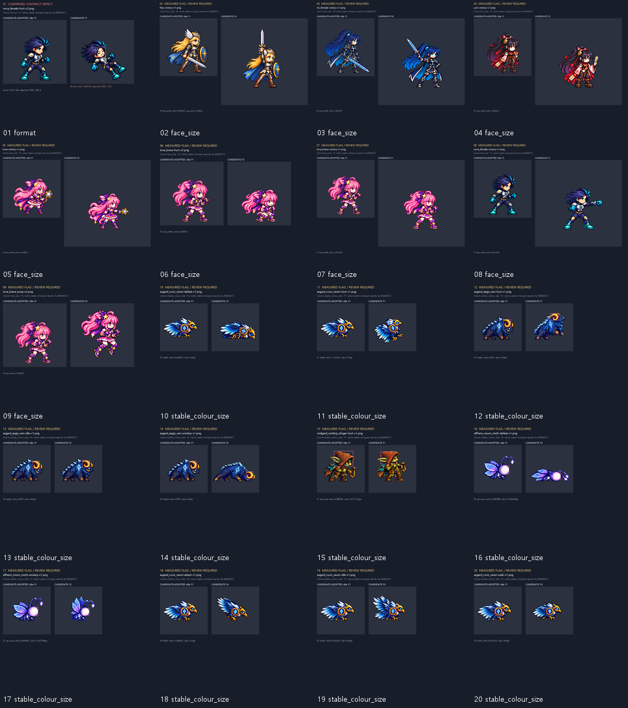

# ART-81 기술 감사 — 측정 전용

완료: 미채택 후보 **219개**를 현재 PNG/JSON에서 다시 읽어 검사했다. 아트·게임·도구 파일을 바꾸지 않았고 Godot을 실행하지 않았다. 아래 `통과`는 명시한 자동 검사에서 미해결 검토·측정불가 항목이 없는 경우다. `검토`는 결함 확정이 아니며, `측정불가`를 통과로 세지 않는다.

## 종류별 결과

| 종류 | 파일 | 모든 적용 검사 통과 | 확정 실패 없음 | 실패 / 검토 / 측정불가 |
|---|---:|---:|---:|---|
| 캐릭터 동작 | 53 | 0 | 52 | 1 / 39 / 13 |
| 몬스터 행 | 108 | 5 | 108 | 0 / 103 / 0 |
| 몬스터 조립본 | 18 | 0 | 18 | 0 / 18 / 0 |
| 투사체·충격파 | 8 | 5 | 8 | 0 / 3 / 0 |
| 대화 얼굴 | 32 | 32 | 32 | 0 / 0 / 0 |

**조립 일치만 보면 18/18 통과**다. 조립본 전체 통과 수에는 원본 6행의 크기·접지·중복 검사도 포함한다. 따라서 조립 오류가 없어도 원본 행에 검토 항목이 있으면 전체 통과로 세지 않는다.

## 결함 및 검토 목록 — 우선순위 순

수치는 측정 결과이고, 우선순위·심각도·가능한 수정은 감사자의 판단이다. 자동 정합·색 분포만으로 해부학적 크기나 미적 품질을 확정하지 않는다. 전체 목록과 모든 프레임 수치는 `issues.json`, `audit.json`에 있다. 아래는 파일별 최상위 항목 20개다.

| 우선 | 파일 / 검사 | 측정값 | 기준 | 가능한 수정 |
|---|---|---|---|---|
| 상·확정 | [nova_female-hurt-v2.png](boards/01-nova_female-hurt-v2-format-4x.png) / format | actual [128, 128], expected [768, 128]; [] | 카드의 셀 크기 × 6열, RGBA, 사용 셀 수 일치 | v3와 중복된 구형 1칸 후보는 리드가 retired 처리하거나 6칸으로 패딩. 현재 파일은 그대로 보존. |
| 중·검토 | [frey-victory-v1.png](boards/02-frey-victory-v1-face_size-4x.png) / face_size | F4 face_width_ratio=0.942857, eye_ratio=1.099621 | 이전 검수 좌표 재계산; 허용 0.95–1.06 | 표식 경계부터 재확인. 행 내 편차면 프레임 재시도; 일괄 배율로 가리지 않음. |
| 중·검토 | [rio_female-victory-v1.png](boards/03-rio_female-victory-v1-face_size-4x.png) / face_size | F6 face_width_ratio=1.083333 | 이전 검수 좌표 재계산; 허용 0.95–1.06 | 표식 경계부터 재확인. 행 내 편차면 프레임 재시도; 일괄 배율로 가리지 않음. |
| 중·검토 | [yuki-victory-v1.png](boards/04-yuki-victory-v1-face_size-4x.png) / face_size | F2 face_width_ratio=1.083333 | 이전 검수 좌표 재계산; 허용 0.95–1.06 | 표식 경계부터 재확인. 행 내 편차면 프레임 재시도; 일괄 배율로 가리지 않음. |
| 중·검토 | [luna-victory-v1.png](boards/05-luna-victory-v1-face_size-4x.png) / face_size | F2 face_width_ratio=0.928571 | 이전 검수 좌표 재계산; 허용 0.95–1.06 | 표식 경계부터 재확인. 행 내 편차면 프레임 재시도; 일괄 배율로 가리지 않음. |
| 중·검토 | [luna_brave-hurt-v2.png](boards/06-luna_brave-hurt-v2-face_size-4x.png) / face_size | F2 face_width_ratio=0.928571 | 이전 검수 좌표 재계산; 허용 0.95–1.06 | 표식 경계부터 재확인. 행 내 편차면 프레임 재시도; 일괄 배율로 가리지 않음. |
| 중·검토 | [luna_brave-victory-v1.png](boards/07-luna_brave-victory-v1-face_size-4x.png) / face_size | F1 face_width_ratio=1.071429 | 이전 검수 좌표 재계산; 허용 0.95–1.06 | 표식 경계부터 재확인. 행 내 편차면 프레임 재시도; 일괄 배율로 가리지 않음. |
| 중·검토 | [nova_female-victory-v1.png](boards/08-nova_female-victory-v1-face_size-4x.png) / face_size | F1 face_width_ratio=0.931034 | 이전 검수 좌표 재계산; 허용 0.95–1.06 | 표식 경계부터 재확인. 행 내 편차면 프레임 재시도; 일괄 배율로 가리지 않음. |
| 중·검토 | [luna_brave-jump-v2.png](boards/09-luna_brave-jump-v2-face_size-4x.png) / face_size | F3 eye_ratio=1.065627 | 이전 검수 좌표 재계산; 허용 0.95–1.06 | 표식 경계부터 재확인. 행 내 편차면 프레임 재시도; 일괄 배율로 가리지 않음. |
| 중·검토 | [asgard_runic_raven-defeat-v1.png](boards/10-asgard_runic_raven-defeat-v1-stable_colour_size-4x.png) / stable_colour_size | F3 width ratio=0.666667, size=10.0px | 같은 색 성분 크기 / idle: 0.95–1.05 | 연결 영역이 실제 부위 전체인지 먼저 재측정. 회전·가림·조명·분리된 색 영역은 실제 축소와 다르므로 이 수치만으로 배율 변경하지 않음. |
| 중·검토 | [asgard_runic_raven-hurt-v1.png](boards/11-asgard_runic_raven-hurt-v1-stable_colour_size-4x.png) / stable_colour_size | F1 width ratio=1.133333, size=17.0px | 같은 색 성분 크기 / idle: 0.95–1.05 | 연결 영역이 실제 부위 전체인지 먼저 재측정. 회전·가림·조명·분리된 색 영역은 실제 축소와 다르므로 이 수치만으로 배율 변경하지 않음. |
| 중·검토 | [asgard_aegis_ram-hurt-v1.png](boards/12-asgard_aegis_ram-hurt-v1-stable_colour_size-4x.png) / stable_colour_size | F1 height ratio=0.875, size=14.0px | 같은 색 성분 크기 / idle: 0.95–1.05 | 연결 영역이 실제 부위 전체인지 먼저 재측정. 회전·가림·조명·분리된 색 영역은 실제 축소와 다르므로 이 수치만으로 배율 변경하지 않음. |
| 중·검토 | [asgard_aegis_ram-idle-v1.png](boards/13-asgard_aegis_ram-idle-v1-stable_colour_size-4x.png) / stable_colour_size | F2 height ratio=0.875, size=14.0px | 같은 색 성분 크기 / idle: 0.95–1.05 | 연결 영역이 실제 부위 전체인지 먼저 재측정. 회전·가림·조명·분리된 색 영역은 실제 축소와 다르므로 이 수치만으로 배율 변경하지 않음. |
| 중·검토 | [asgard_aegis_ram-windup-v1.png](boards/14-asgard_aegis_ram-windup-v1-stable_colour_size-4x.png) / stable_colour_size | F2 height ratio=0.875, size=14.0px | 같은 색 성분 크기 / idle: 0.95–1.05 | 연결 영역이 실제 부위 전체인지 먼저 재측정. 회전·가림·조명·분리된 색 영역은 실제 축소와 다르므로 이 수치만으로 배율 변경하지 않음. |
| 중·검토 | [midgard_rooftop_slinger-hurt-v1.png](boards/15-midgard_rooftop_slinger-hurt-v1-stable_colour_size-4x.png) / stable_colour_size | F1 sqrt_area ratio=0.880581, size=19.131126px | 같은 색 성분 크기 / idle: 0.95–1.05 | 연결 영역이 실제 부위 전체인지 먼저 재측정. 회전·가림·조명·분리된 색 영역은 실제 축소와 다르므로 이 수치만으로 배율 변경하지 않음. |
| 중·검토 | [alfheim_moon_moth-defeat-v1.png](boards/16-alfheim_moon_moth-defeat-v1-stable_colour_size-4x.png) / stable_colour_size | F3 sqrt_area ratio=0.890988, size=13.453624px | 같은 색 성분 크기 / idle: 0.95–1.05 | 연결 영역이 실제 부위 전체인지 먼저 재측정. 회전·가림·조명·분리된 색 영역은 실제 축소와 다르므로 이 수치만으로 배율 변경하지 않음. |
| 중·검토 | [alfheim_moon_moth-windup-v1.png](boards/17-alfheim_moon_moth-windup-v1-stable_colour_size-4x.png) / stable_colour_size | F2 sqrt_area ratio=0.895897, size=13.527749px | 같은 색 성분 크기 / idle: 0.95–1.05 | 연결 영역이 실제 부위 전체인지 먼저 재측정. 회전·가림·조명·분리된 색 영역은 실제 축소와 다르므로 이 수치만으로 배율 변경하지 않음. |
| 중·검토 | [asgard_runic_raven-attack-v1.png](boards/18-asgard_runic_raven-attack-v1-stable_colour_size-4x.png) / stable_colour_size | F4 width ratio=1.066667, size=16.0px | 같은 색 성분 크기 / idle: 0.95–1.05 | 연결 영역이 실제 부위 전체인지 먼저 재측정. 회전·가림·조명·분리된 색 영역은 실제 축소와 다르므로 이 수치만으로 배율 변경하지 않음. |
| 중·검토 | [asgard_runic_raven-idle-v1.png](boards/19-asgard_runic_raven-idle-v1-stable_colour_size-4x.png) / stable_colour_size | F3 width ratio=0.933333, size=14.0px | 같은 색 성분 크기 / idle: 0.95–1.05 | 연결 영역이 실제 부위 전체인지 먼저 재측정. 회전·가림·조명·분리된 색 영역은 실제 축소와 다르므로 이 수치만으로 배율 변경하지 않음. |
| 중·검토 | [asgard_runic_raven-walk-v1.png](boards/20-asgard_runic_raven-walk-v1-stable_colour_size-4x.png) / stable_colour_size | F3 width ratio=0.933333, size=14.0px | 같은 색 성분 크기 / idle: 0.95–1.05 | 연결 영역이 실제 부위 전체인지 먼저 재측정. 회전·가림·조명·분리된 색 영역은 실제 축소와 다르므로 이 수치만으로 배율 변경하지 않음. |

## 시각적 확인



위 그림은 찾아보기용 축소 목차다. 각 항목 링크는 실제 원본 픽셀을 최근접 **정확히 4배**로 확대한 보드다. 왼쪽은 기준, 오른쪽은 후보의 해당 프레임이다. 분홍 상자는 선택된 색 연결 영역 또는 템플릿 정합 위치이며, 청록 십자와 노란 선은 이전 검수 얼굴 표식이다. `MEASURED FLAG / REVIEW REQUIRED`는 확정 결함과 구분한 검토 표시다. 실제 게임 화면이 아니다.

## 측정 방법과 모든 임계값

- **coordinates**: `zero-based pixels; bbox right/bottom exclusive; feet inclusive; floor exclusive`
- **fighter_cell_exceptions**: `ART-69 defeat:192/feet152; ART-68 rio_female low_sweep and dimension_slash:192/feet152, as well as victory. Others128/feet120. Six padded columns required by ART-81; legacy 1-cell Nova hurt is explicitly flagged.`
- **foreground**: `alpha > 0; solid alpha >= 128`
- **margin_px**: `{"fighter": 4, "monster": 3, "projectile": 3}`
- **ground_tolerance_px**: `1`
- **binary_alpha**: `fighter/monster/sheet: semi-transparent count must equal zero; faces/projectiles allow antialias`
- **key_green**: `alpha>=24, R<=40, G>=215, B<=40; any => review, not automatic proof of spill`
- **halo**: `4-connected outer edge; light min(RGB)>=220 and max-min<=30; dark max(RGB)<=20. Review if >=20 pixels, >20% edge AND fraction exceeds identity idle/neutral by >.15. Black outlines already in anchor are not halos. Shadow darkening intentional.`
- **checker**: `8x8 fully opaque neutral tile; RGB range<=8; parity blocks 1/2/4 px contrast>=20; residual std<=5; >=4 tiles => review`
- **repeated**: `premultiplied RGBA; exact changed-visible pixels=0 => fail; near if union-mask MAE<=2/255 AND changed>8-channel fraction<=0.03 => review; loop seam listed separately`
- **fighter_head**: `original head_scale.py: scale 0.60..1.60 step .02, score>=.60; desired .96..1.04, accepted .95..1.06; template-only deviations => review`
- **head_skin_locator**: `original unmodified mask: A>0, R>200, G>150, B>120, R>G>B, 40<R-B<110; largest 4-connected skin region. Template offsets (-18,-22,+12,+8); translation window +/-8 pixels. Wrong/occluded skin components are not reliable anatomy.`
- **fresh_face_proposals**: `ART-72/75/77 fixed feature boxes; nearest-neighbour 4x; patch search +/-6 enlarged pixels (.25 native pixel step). No automated pass threshold: proposals require landmark validation. Nova/Rio eye distances omitted because the anchor far eye is occluded.`
- **monster_stable_part**: `idle F1 crop, masked RGB NCC; scale .60..1.60 step .02, score>=.75, accepted .95..1.05; uncertain matches => review, no anatomy claim`
- **stable_colour_masks**: `A>0: moth R>190,G>170,B>210; ram/raven R>110,G>65,R>1.6B,G>1.4B; slinger R>70,R>1.35G,R>1.8B,y<48. Largest 4-connected component; ram restrict bbox y0<55,x1>50; raven choose component centre nearest (49,50), defeat (60,48). Moth/slinger sqrt(area), ram height, raven width; ratio .95..1.05.`
- **stable_colour_validity**: `Selected component area must be >=8 pixels; slinger component touching imposed y=48 cut is truncated and unusable. Raw sizes/ratios retained, but invalid selections are not scored as anatomical size defects.`
- **semantic_feet_roi**: `Only SHA-256-bound manually identified ROIs in semantic-rois.json may replace lowest-alpha proxy. Measure A>0 bottom, tolerance +/-1px and stated boundary uncertainty +/-1px.`
- **bbox_size**: `width/height/area relative to idle F1; ratios outside .75..1.25 are a screening observation, not failure (pose changes)`
- **palette**: `alpha>=128, RGB max>=40, HSV saturation>=.20; twelve 30-degree hue bins; TV > .25 AND dominant circular hue shift>=30deg => review; full luminance/channel stats also reported`
- **face_preservation**: `expressions: exact RGBA outside actual saved mask must have 0 changed pixels; all faces alpha difference=0`
- **shadow_offset**: `integer gradient NCC on ART-80 ROI, search +/-4; residual abs(dx)>1 or abs(dy)>1 or NCC<.60 => review; copied alpha cannot establish internal alignment`
- **metadata**: `frames/fps required for strips; frames positive integer and matches occupied prefix, fps finite >0, loop bool when present; missing cell/feet/loop => review (viewer may infer); sheet/portrait animation metadata NA`
- **all_checks_pass**: `all applicable check statuses pass or na; review/unmeasured excluded. Sheet content checks are propagated from per-row checks; direct pixel-assembly pass is separate.`

## 해석 시 주의할 실제 사례

- `nova_female-hurt-v2.png`: 128×128의 이전 1프레임 후보다. 카드의 6칸 패딩 규격과 어긋나므로 규격 실패로 기록한다. JSON frames=1과 실제 1장은 일치한다. v3도 별도 존재하며, 이 결과가 현재 게임의 피격 재생 오류를 뜻하지는 않는다.
- 씨앗 요정 공격 F2·F3: 전체 알파 하단은 y74지만, 실제 4배 판에서 지지발 영역을 선택해 다시 잰 하단은 모두 y72다. `semantic-rois.json`에 정확한 파일 해시·영역·±1px 오차를 기록하고 접지 통과로 분리했다. [지지발/잎끝 비교](support/seed-feet-4x.png).
- 셀 규격 예외: ART-69의 defeat 8행과 ART-68의 Rio 여성 low_sweep/dimension_slash 2행도 192px/발 y152다. 제작 카드·보고서의 명시 규격을 적용했으며 이를 128px 오류로 만들지 않았다.
- 하운드·씨앗의 팔레트 보정 이력은 확인했다. 이번 색상 수치는 현재 게임 시트와 후보의 색 면적 분포 차이다. 녹색 픽셀을 크로마키 잔여물로 간주하지 않으며, TV/대표 hue 변화만으로 녹색→노랑 복귀라고 주장하지 않는다.
- 나방 공격 F2–F5의 축소·반짝임은 의도된 순간이동이다. 공중/비행 프레임도 접지 실패로 세지 않는다.
- 까마귀 defeat F3의 금색 연결 영역 폭은 10/15=0.6667이지만, 4배 확인에서 원판이 회전하고 금색 테두리가 분리된 부분만 잡힌다. 원판 전체가 33% 작아졌다는 증거가 아니다. 양의 뿔·투석병의 주황 후드도 투영·가림·색 면적 변화가 섞인다. `visual-review.json`에 20개 보드별 판단과 한계를 기록했다.
- 검은 외곽선이 원래 있는 Frey/Nova 등은 절대 검정 픽셀 수만으로 후광 실패를 만들지 않는다. 기준 idle 대비 경계 비율 증가를 별도 비교한다.
- ART-72 방식의 새 4배 얼굴 표식 제안도 프레임마다 남겼다. 자동 제안을 실제 눈/얼굴 경계 실측으로 승인하지 않았다. 이전 수동 표식은 현재 PNG와 픽셀 동일성을 확인한 경우에만 좌표 거리를 재계산했다.

## 측정하지 못한 것

- 가려진 눈(노바·리오), 감은 눈, 크게 기울거나 누운 얼굴의 실제 눈 간격·해부학적 머리 크기. 신뢰도 낮은 정합 결과는 그대로 공개하며, 대체 얼굴/표식을 만들어 통과시키지 않았다.
- 몬스터의 모든 자세에서 동일한 실제 해부학 부위 길이. bbox와 색 연결 성분/템플릿은 측정했지만 회전·가림·조명이 만든 변화와 체형 오류를 자동으로 분리할 수 없다. 기존 대표 프레임 명목 값은 출처를 붙여 참고값으로만 기록했다.
- 무기·옷자락·잎을 제외한 모든 프레임의 실제 체중 지지점. 자동값은 알파 최하단이며 지지발 검증과 같지 않다.
- PNG에서 실제 fps·loop를 측정할 수는 없다. JSON 타입·값·장수·빈 패딩은 검증했으며 일부 누락은 소비자의 기본값 검토 대상으로 남겼다.
- 모든 가능한 불투명 후광·체커보드·키색 잔여물의 완전한 부재, 동작의 자연스러움, 실제 게임 혼전 가독성. 색/주기 검사와 정적 보드에 한정된다.
- Godot import, 게임 연결, 실시간 재생, ART-82의 다른 클론 변경은 검사하지 않았다.

## 재현 및 인계

```powershell
$env:PYTHONDONTWRITEBYTECODE='1'
$env:PYTHONIOENCODING='utf-8'
$python81='C:/Users/TH/.cache/codex-runtimes/codex-primary-runtime/dependencies/python/python.exe'
& $python81 -B reports/codex-art-81/audit.py
& $python81 -B reports/codex-art-81/report.py
& $python81 -B reports/codex-art-81/verify.py
```

`measurement-cache.json`는 후보·앵커 SHA-256과 템플릿 정의에 묶인 정합 캐시다. 새 버전은 다른 해시이므로 다시 측정한다. 최종 사용 입력 해시와 읽기 전후 무변경 검사도 `audit.json`에 남겼다.

**남은 작업:** 검토 표시의 표식/색/외곽선 확인과 후보 채택 결정. **다음 권장 단계:** 리드가 상위 보드와 메타데이터 누락을 검토하고 필요한 항목만 별도 수정 카드로 전달한다. `commit.ps1`은 작성·구문 검사만 하며 실행하지 않는다.

**확인 및 테스트:** 감사 알고리즘·대상 누락·입력 무변경·얼굴 보존·조립 일치·제출 범위 검사 73개 통과, 0개 실패 (`verification.json`). Godot 테스트가 아니다. 상위 20개 개별 4배 보드와 지지발·팔레트 보드를 직접 확인했다. 전체 219개를 모두 육안 검수했다는 뜻은 아니다.
