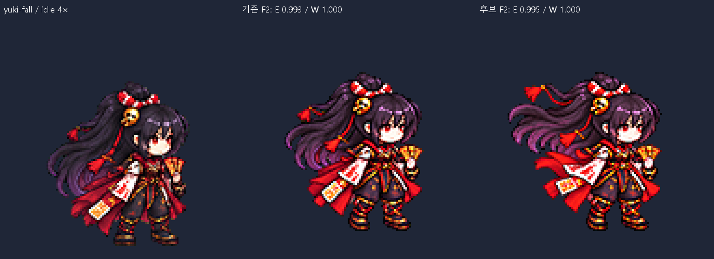

# CODEX-ART-82 결과

새 후보 **7/13행**, 총 35프레임(실제 새로 교체한 프레임 9장). 4행은 요청한 수정 완료, 3행은 부분 개선 후보다. 미전달 6행은 best/와 비교판에만 보존했다. 내장 ImageGen 34회, 각 행 최대 3회. 게임 연결·Godot 실행·뷰어 배포·커밋 실행은 하지 않았다.

## 행별 결과

E=눈 간격 / W=눈 아래 노출 얼굴 폭, 해당 폼 idle=1.000. 범위는 측정 가능한 프레임만 집계. “전달”은 새 후보 파일을 작성했다는 뜻이며 사용자 채택이 아니다.

| 행 | 다시 그린 F | 배율 | 전 E / W → 후 E / W | 최소 여백 | detail | 전달 |
|---|---|---:|---|---:|---:|---|
| [frey-victory](frey-victory.png) | 1,2,3,4,5,6 | 0.32 | 0.989–1.100 / 0.914–1.057 → 0.983–1.095 / 0.914–1.057 | 22px | 84.85–98.40 | 미전달 |
| [luna-victory](luna-victory.png) | 2 | 0.21 | 0.966–1.005 / 0.929–1.000 → 0.969–1.005 / 1.000 | 39px | 112.19–117.14 | 부분 전달 |
| [luna_brave-victory](luna_brave-victory.png) | 1 | 0.23 | 0.968–0.994 / 1.000–1.071 → 0.975–0.994 / 1.000 | 39px | 114.24–124.75 | 전달 |
| [luna_brave-hurt](luna_brave-hurt.png) | 1,2,3 | 0.156 | 1.001–1.064 / 0.929–1.071 → 0.907–0.997 / 1.000–1.071 | 7px | 127.81–133.28 | 미전달 |
| [luna_brave-jump](luna_brave-jump.png) | 3 | 0.168 | 0.971–1.066 / 1.000 → 0.922–0.976 / 1.000 | 9px | 121.73–129.69 | 미전달 |
| [luna_brave-fall](luna_brave-fall.png) | 1 | 0.13525 | 0.955–0.985 / 1.000 → 0.957–0.985 / 1.000 | 15px | 124.40–131.81 | 미전달 |
| [frey-jump](frey-jump.png) | 2,3 | 0.17 | 0.992–1.045 / 1.000 → 0.992–1.036 / 1.000 | 12px | 106.86–107.89 | 미전달 |
| [yuki-victory](yuki-victory.png) | 2,3,4,5,6 | 0.209 | 1.001–1.053 / 1.000–1.083 → 0.999–1.101 / 1.000–1.083 | 39px | 97.93–104.78 | 미전달 |
| [nova_female-victory](nova_female-victory.png) | 1,3,6 | 0.217 | — / 0.931–1.069 → — / 1.000 | 39px | 104.96–110.27 | 부분 전달 |
| [rio_female-victory](rio_female-victory.png) | 6 | 0.325 | — / 1.000–1.083 → — / 1.000 | 38px | 111.40–116.02 | 전달 |
| [luna-jump](luna-jump.png) | 3 | 0.15 | 0.982–1.023 / 1.000 → 0.982–1.023 / 1.000 | 18px | 109.73–114.48 | 전달 |
| [yuki-fall](yuki-fall.png) | 2 | 0.137 | 0.991–0.993 / 1.000 → 0.991–0.995 / 1.000 | 15px | 108.30–108.41 | 전달 |
| [rio_male-victory](rio_male-victory.png) | 2 | 0.28 | — / 1.000 → — / 1.000 | 34px | 115.82–130.81 | 부분 전달 |

## 현재 상태와 남은 작업

- **frey victory**: 검 올리기 흐름은 유지했으나 F2~6 얼굴 기준 미달. 3차는 F2 검이 내려가 동작까지 손상되어 2차를 최선본으로 보존. **남은 작업:** 얼굴 F2~6 재수정.
- **luna victory**: F2 얼굴 폭 수정. F1~5 측정 통과, F6 윙크는 카드와 기존 검수처럼 수치 제외. 지팡이 손과 의상 유지. **남은 작업:** F3→F4 지팡이 회전 간격은 미수정. 얼굴 재시도로 3회 상한 사용.
- **luna_brave victory**: F1 얼굴 폭 수정. 주먹을 올리고 전투 자세로 돌아오는 흐름과 장갑·부츠 유지. **남은 작업:** 실제 모션 뷰어 재생·채택 검토.
- **luna_brave hurt**: 반동·웅크림·복귀 자세 유지. F2·3은 통과했지만 F1 눈 0.907, 폭 1.071로 실패. **남은 작업:** F1 얼굴을 수정하되 반동 자세 유지.
- **luna_brave jump**: F1·2 원본 유지. F3 재시도 눈 비율 0.922로 너무 좁음. 3차는 0.916으로 더 나빠져 2차 보존. **남은 작업:** F3 눈 간격 재수정.
- **luna_brave fall**: 자세와 전체 높이 91px 유지. F1 눈 0.957로 하한 0.96 미달. 1·2차는 배율 시험, 3·4·5차는 생성 1·2·3회이며 4차가 최선. **남은 작업:** F1 눈 간격 재수정. 0.957을 반올림 통과시키지 않음.
- **frey jump**: 얼굴 수치 통과했으나 F2 검 방향·무릎 자세가 F3와 비슷하게 변함. 얼굴 통과와 동작 실패를 분리하여 기록. **남은 작업:** 원래 상승 F2 자세를 유지하면서 얼굴 수정.
- **yuki victory**: 부채 펼치기와 부적 든 손 유지. F2~4 얼굴 개선, F5 눈 1.101·F6 폭 1.083 실패. 2회째 생성은 두 칸만 나와 배치 오류로 폐기. **남은 작업:** F5 눈 간격과 F6 얼굴 폭 재수정.
- **nova_female victory**: F1·3·6 얼굴 폭 수정. 3회 생성 중 통과한 전체 셀만 조합. F2 교대 팔 재시도는 같은 팔로 남고 얼굴 폭도 실패하여 기존 F2 유지. 기준부터 반대 눈 가려짐: 폭만 검증. **남은 작업:** F1→F2 교대 잽 미해결.
- **rio_female victory**: F6 얼굴 폭 수정. F1~5는 기존 후보와 픽셀 동일. 기준부터 반대 눈 가려짐: ART-77 수동 경계로 폭만 검증. **남은 작업:** 기존 F3 검의 원근상 짧아 보임은 유지. 실제 재생·채택 검토.
- **luna jump**: F3 무릎을 더 접고 발을 뒤로 모아 정점 실루엣을 구분. F1·2 보존. 얼굴·의상·지팡이와 여백 확인. **남은 작업:** 실제 모션 뷰어 재생·채택 검토.
- **yuki fall**: F2 머리끝·술·소매·붉은 천을 위로 흩날리게 변경. 3차에서 얼굴 폭도 복구. F1 보존, 두 프레임 전체 높이 86px 유지. **남은 작업:** 두 프레임 반복의 실제 재생·채택 검토.
- **rio_male victory**: F2 팔을 몸 가까이 접고 검 전체 길이를 보이게 수정. F3 새 그림은 검끝 아래로 발선이 떠 보여 제외, 기존 F3 유지. 자동 눈 값은 가려진 머리카락을 잡으므로 폐기, ART-77 수동 폭 사용. **남은 작업:** F3→F4 검 내려놓기 연결 미해결. F2에서 두 손으로 잡는 중간 자세로 바뀜.

## 측정과 육안 판단

- **측정:** ART-72/78의 정규화·얼굴 패치 매칭을 복사해 사용했다. Yuki/Nova와 Rio는 ART-75/77의 같은 계열 스크립트를 복사했다. 공통 배율, LANCZOS, sharpen 60, despill auto, palette none. 기존 도구는 읽기·실행만 했다.
- **육안:** 최종 선택 13행의 58프레임을 idle 옆 최근접 4배 판에서 직접 확인했다. 얼굴 하나, 의상, 손·무기, 동작과 발선을 확인했다. 이후 기존/수정 비교판도 검토했다. 수치가 통과해도 동작이 무너진 Frey jump는 전달하지 않았다.
- **얼굴 제외:** Luna victory F6는 카드가 지정한 윙크 제외를 유지했다. Nova female 및 Rio 양폼은 기준부터 반대 눈이 머리카락에 가려져 눈 간 거리 검증 불가다. 이를 통과값으로 만들지 않고 —로 표시했다.
- **Rio 측정:** ART-77처럼 눈 아래 노출 얼굴의 수동 경계를 사용했다. 미변경 프레임은 기존 후보와 픽셀 동일함을 검사하고 기존 표식을 유지했다. 새 male F2와 female F6은 격자에서 경계를 확인했다. 자동 제안 원본도 보존했으며 가려진 눈을 잡은 자동 E 값은 폐기했다.
- **한계:** 1× 얼굴 폭이 약 12~18px라 경계 1px 차이가 크다. 좌표의 소수점은 출력 정밀도이며 측정 정확도 보증이 아니다. 허용 범위 0.96~1.04를 완화하지 않았다. head_scale은 보조 검사이며 얼굴 판정이 우선이다.
- **원본:** 사용한 기준 이미지·생성 원본·전체 셀 조립본을 art/raw/motions-82/에 보존했다. 단일 프레임 재시도는 셀 전체를 교체했다. 생성 해상도가 다르면 전체 캔버스를 원본 셀 좌표계로 등록한 뒤 행 공통 배율을 적용했다. 머리 붙이기, 특징 코드 그리기, 프레임별 신체 크기 보정은 하지 않았다.
- **탈락 시도:** Frey victory 1차와 Rio male victory 1차는 원본 셀 침범으로 정규화 중단. Yuki victory 생성 2회째는 6칸 대신 2칸이라 사용하지 않았다. Frey victory 3차와 jump 3차는 자세 손상, Rio male victory 3차 F3은 발 접지 문제로 제외했다.
- **시도 번호:** 정규화 배율 시험이나 기존 생성 셀 조합은 새 이미지 생성이 아니다. Brave fall attempt-4는 생성 2회째, Nova female victory attempt-4와 Rio male victory attempt-4는 3회 생성 중 통과한 셀을 조합한 결과다. generation-ledger.json에 34회 프롬프트와 출력 위치를 보존했다.

## 시각적 확인

왼쪽은 idle, 가운데는 기존 F2, 오른쪽은 새 F2다. 머리끝·술·소매가 위로 흩날리는 변화와 유지된 얼굴 비율을 보여준다. 모든 행의 루트 PNG는 같은 방식의 전 프레임 비교판이다.

## 파일과 검증

- results.json: 행별 선택 결과·수치·후보 경로·미변경 프레임 동일성. best/: 선택한 결과와 측정 원본. comparisons/: 프레임별 기존/수정 4배 판.
- 후보는 새 버전에만 썼고 기존 파일·제품 소스·tools/를 변경하지 않았다. commit.ps1은 명시한 파일만 stage하도록 만들었으며 실행하지 않았다. raw·__pycache__·run.log는 제외한다.
- audit.json에서 파일 구조·알파·여백·spill·detail·얼굴·원본 보존·커밋 범위 검증 결과를 확인할 수 있다. 실제 게임 재생은 이번 카드의 금지 사항이므로 검증하지 않았다.

## 다음 권장 단계

사용자가 모션 뷰어에서 7개 후보의 실제 재생을 확인하고 채택 여부를 정한다. 다음 작업에서는 미전달 6행의 얼굴/자세, Luna victory 회전 연결, Nova female 교대 잽, Rio male F3→F4 연결을 수정한다. 이 작업에서 자동 후속 실행은 예약하지 않았다.
