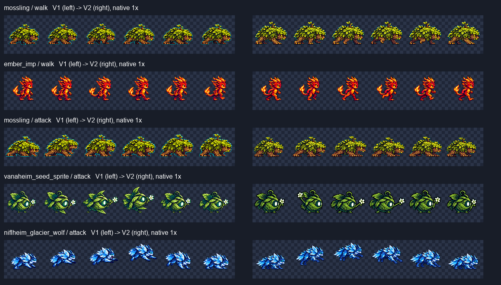

# ART-83 — 몬스터 행 수리 후보

완료: **15행, 76프레임, 조립 시트 8장**을 새 `-v2` 파일로 제공한다. 기존 v1·게임 파일·tools는 바꾸지 않았다. 사용자가 선택하기 전의 후보이며 게임 적용, Godot 실행, 모션 뷰어 빌드/게시, 커밋은 하지 않았다.

## 행별 결과

수치는 실제 파일에서 측정했다. 보행 교대의 가독성 및 피격감은 별도 육안 판단이다. `detail`은 ART-71 `interior_detail`의 대비/질감 지표이며 미술 품질 점수가 아니다. 아래 덩굴 사냥개의 `점 대비`는 잎 마스크에서 주변 8픽셀 중앙값과 밝기가 35 이상 다른 픽셀 수로, 실제 결함의 개수는 아니다.

| 몬스터 · 행 | 수정 전 → 후 | 제공 | 남은 약점 |
|---|---|---|---|
| mossling · walk | 1× 발 교대 불명확 → 밝은 앞다리 F1 전방 / F3 후방 / F6 전방 식별 **(육안)** | v2 | F4–5에서 잎이 다리 연결부를 가림 |
| ember_imp · walk | 1× 교대 불명확 → 밝고 어두운 다리의 전후 순서 반전 식별 **(육안)** | v2 | 대표 머리 폭은 idle 대비 1.05로 허용 상한 |
| ember_imp · idle | detail **72.40–76.21 → 96.58–100.55** | v2 | 기존보다 강한 명암 |
| asgard_aegis_ram · idle | detail **74.75–80.76 → 92.44–97.10** | v2 | 털 질감의 대비가 기존보다 강함 |
| mossling · attack | 몸통 위 줄기 부착부 F1→F3 전진 **−2 → +16px** | v2 | 몸이 길게 뻗는 느낌; 실제 반복 재생 미검증 |
| vanaheim_seed_sprite · attack | idle F1→attack F3 손/가지 접점 전진 **5 → 10px** | v2 | F2에서 꽃을 뒤로 당겼다가 뻗는 전환 확인 필요 |
| vanaheim_vine_hound · idle | 잎 점 대비 **1,182 → 582** | v2 | 미세 질감 남음; detail **93.10–95.50 → 73.02–74.08**로 부드러워짐 |
| vanaheim_vine_hound · walk | 잎 점 대비 **1,856 → 1,187** | v2 | 잔점 남음 |
| vanaheim_vine_hound · windup | 잎 점 대비 **927 → 536** | v2 | 잔점 남음 |
| vanaheim_vine_hound · attack | 잎 점 대비 **1,742 → 1,040** | v2 | 잔점 남음 |
| vanaheim_vine_hound · hurt | 잎 점 대비 **638 → 345** | v2 | 잔점 남음 |
| vanaheim_vine_hound · defeat | 잎 점 대비 **930 → 556** | v2 | 잔점 남음 |
| alfheim_moon_moth · windup | F2 머리 / idle 크기 **0.896 → 1.020** | v2 | F4는 0.951로 하한에 가까움; 두 번째 더듬이 끝은 여전히 약함 |
| jotunheim_storm_wisp · hurt | F1 상단 돌–핵 중심 수평 차이 **5 → 16px**; 군집이 한쪽으로 기울어짐 **(육안)** | v2 | 두 프레임 연결의 타격감은 재생 검수 필요 |
| niflheim_glacier_wolf · attack | 도약 정점 **F4 → F3**; 발끝 y **72,67,62,53,72,72 → 72,62,52,59,67,72** | v2 | 착지에서 idle로 이어지는 전환 미검증 |

덩굴 사냥개는 점상 대비를 줄인 **개선 후보**다. 모든 점이 없어졌다는 판정은 하지 않는다. 미제공 행은 없으며, 이 여섯 행의 미세 잔점과 실제 재생 검수가 남는다.

## 시각적 확인

왼쪽이 v1, 오른쪽이 v2다. 원본 1× 크기의 보행 교대, 전방 뻗기, 도약 정점 변화를 비교한다. 실행 화면이 아니라 후보 PNG의 정지 프레임 비교다.

모든 사용 프레임을 1×와 nearest-neighbour 4×에서 직접 확인했다. 한 프레임당 한 개체, 잘린 부위/문자/별도 공격 이펙트가 없는지 육안으로 확인했다. 각 행의 현재 게임 참조·v1·v2 비교판:

| 몬스터 | 비교판 |
|---|---|
| mossling | [walk](mossling-walk.png), [attack](mossling-attack.png) |
| ember_imp | [walk](ember_imp-walk.png), [idle](ember_imp-idle.png) |
| asgard_aegis_ram | [idle](asgard_aegis_ram-idle.png) |
| vanaheim_seed_sprite | [attack](vanaheim_seed_sprite-attack.png) |
| vanaheim_vine_hound | [idle](vanaheim_vine_hound-idle.png), [walk](vanaheim_vine_hound-walk.png), [windup](vanaheim_vine_hound-windup-with-current.png), [attack](vanaheim_vine_hound-attack.png), [hurt](vanaheim_vine_hound-hurt.png), [defeat](vanaheim_vine_hound-defeat-with-current.png) |
| alfheim_moon_moth | [windup](alfheim_moon_moth-windup-with-current.png) |
| jotunheim_storm_wisp | [hurt](jotunheim_storm_wisp-hurt.png) |
| niflheim_glacier_wolf | [attack](niflheim_glacier_wolf-attack.png) |

현재 게임 시트는 4행(576×384)이라 windup/defeat가 없다. 해당 세 행은 `*-with-current.png`에 현재 게임 idle을 **정체성 참조**로 명시해서 함께 보여준다. 원래 이름의 비교판도 보존했다.

## 크기 맞춤과 측정 근거

ART-71/74/76 fix-1과 같은 부위로 idle에 맞췄다. 행마다 공통 배율 하나를 적용했고 프레임별 확대/축소는 하지 않았다. 수동 경계는 ±1px, 장축 두 끝의 합산 불확실성은 ±2px이다. 아래 ±5% 통과는 **대표 부위의 명목 측정값**이며 전체 해부 구조를 정밀 보장한다는 뜻이 아니다.

| 행 | 부위 / 표본 | idle → v2 | 비율 |
|---|---|---|---|
| mossling walk | 윗얼굴 폭 F1 | 22 → 22px | 1.000 |
| ember_imp walk | 두개골 폭 F1 | 20 → 21px | 1.050 |
| ember_imp idle | 두개골 폭 F1 | 20 → 20px | 1.000 |
| ram idle | 금색 주뿔 연결색 높이 전 6장 | 16 → 모두 16px | 모두 1.000 |
| mossling attack | 윗얼굴 폭 F1 | 22 → 22px | 1.000 |
| seed attack | 잎/팔 제외 씨앗 몸통 폭 F6 | 45 → 44px | 0.978 |
| vine hound 6행 | fix-1 얼굴 폭 / 원래 대표 프레임 | 27 → 26–27px | 0.963–1.000 |
| moth windup | 밝은 머리 연결색 √면적 전 4장 | 15.10 → 14.35–15.65px | 0.951–1.037 |
| wisp hurt | 상단 타원석 장축 F2 / idle 6장 평균 | 23.263 → 23.259px | 1.000 |
| wolf attack | 가까운 뒷다리 청색 허벅지 폭 F6 | 14 → 14px | 1.000 |

수동 표식은 [크기 기록](measure-final/sizes-final.json)과 `measure-final/*-final-size.png`에서 확인할 수 있다. 덩굴 사냥개는 전 프레임 알파가 v1과 같아 기존 fix-1의 크기·위치를 그대로 유지했다.

[공격/피격 측정 최종 기록](measure-final/movement-reviewed.json): mossling은 14× 좌표 확대에서 **갈색 줄기와 등 몸통의 부착부 중심**을 다시 지정했다. 최종 표식은 `(58,36)→(56,31)` / `(45,35)→(61,34)`다. [전진 표식](measure-final/mossling-forward-reviewed.png), [v1 확대](measure-final/moss-root-before-detail.png), [v2 확대](measure-final/moss-root-detail.png)를 함께 보라. 이전 임시 표식의 수치는 최종 보고에 사용하지 않았다. seed는 ART-74의 동일한 idle→attack F3 손/가지 접점을 비교했다. 이 수치는 **그림 안의 이동**이며 게임 이동·공격 판정과 다르다.

## 처리 방식과 입력

- 카드 순서대로 생성·검토했다. 내장 이미지 도구 16회. 각 생성에 해당 몬스터의 현재 게임 시트와 v1 idle을 참조했다. 덩굴 사냥개는 재생성 없이 기존 ART-74 원본/정규화 입력으로 RGB 매핑만 바꿨다.
- 입력과 사용 참조는 `art/raw/monsters-83/`에 복사했다. [원본/참조 해시](source-manifest.json), [전체 프롬프트](prompts.txt). raw는 git 대상에서 제외한다.
- `process71.py`, `fix74.py`, `process76.py`, `reuse71/review.py`는 이전 스크립트의 바이트 동일 복사본이다. 복사본의 이전 작업용 main/쓰기 함수를 실행하지 않았다. ART-71의 normalizer 로딩과 프레임 처리, fix-1의 측정 함수, ART-74의 참조 색 추출 함수를 재사용했다.
- `tools/sprite_pipeline/normalize.py`는 읽어서 호출만 했다. LANCZOS + unsharp 60 + despill auto, palette none, 행 공통 배율, 256px 작업 캔버스에서 전체 프레임을 96px 셀로 이동하는 방식이다. 개별 부위 붙이기/재설계, 프레임별 배율, 공간 블러는 하지 않았다.
- 덩굴 사냥개는 ART-74의 5색 참조 구간을 유지하고, 재질 색 경계 보간과 잎 하이라이트 밝기 확대를 완화했다. 전 6행 동일 RGB→RGB 함수, 알파 불변. 씨앗은 기존 방식의 녹색·흰 꽃 복원이며 공간별 칠하기는 하지 않았다.
- 접지 행 발끝 y=72. 나방은 구형 머리 중심 `(62,50)`에 정렬. 폭풍 정령은 부유 자세, 늑대는 도약 구간이라 발끝이 72보다 위에 있다.
- `selection.json`이 최종 trial을 지정한다. `repair.py`, `colour83.py`, `colour83b.py`, `align83.py`, `deliver83.py`는 새 경로만 만든다. **이미 납품된 파일에 그대로 재실행하면 덮어쓰기 방지로 중단된다.** 로컬의 나머지 trial/임시 측정은 미선정 과정 기록이며 커밋 목록에서 제외했다.

## 확인 및 테스트

[verification.json](verification.json): 정적 파일 검증 **PASS**.

- 15 strip: 576×96, 셀 96, 76 사용 프레임. alpha 0/255, 최소 여백 3px, 테두리/미사용 셀 비어 있음, 각 행 내 완전 중복 프레임 없음.
- 메타데이터의 기존 frames/fps/loop 유지. feet=72, 행 공통 factor, v1 파일명을 담은 replaces, 한국어 note 확인.
- 8장의 576×576 조립 시트: 고친 행은 v2, 나머지 행은 v1과 픽셀 단위로 일치.
- 두 idle 행은 모든 프레임 detail ≥85. 같은 부위 크기의 명목 비율 ±5%, 두 공격의 전진 ≥8px, 늑대 정점 F3 확인.
- 기존 v1 PNG/JSON **30개가 git HEAD와 바이트 동일**. 추적 파일 변경 없음, index 비어 있음. 복사한 이전 스크립트 바이트 동일, `__pycache__` 없음.
- **녹색 검사:** 색 복원 전 spill=0. 녹색 7행은 공통 RGB 함수와 모든 출력 픽셀이 일치하고 알파 불변, 순수 키색 `#00ff00` 0을 확인했다. 기존 `G > max(R,B)+20` 판정은 정상 잎/눈도 세므로 ART-74와 동일하게 `legacy_green_dominance_count`로 공개했다. 후처리 후에도 이 구식 수치가 0이라고 주장하지 않는다.
- 생성/파일 검사 외 Godot, 실제 애니메이션 재생, 게임 플레이 테스트는 하지 않았다. 설치/다운로드도 하지 않았다.

카드에 지정된 `reports/codex-art-81/README.md`는 이 클론에 없었다. `last.md`의 요약, 카드의 지적, ART-71/74/76 fix-1 기록과 실제 v1 파일을 기준으로 재측정했다. ram idle의 실제 현행 범위는 카드의 71–76이 아닌 **74.75–80.76**이었다.

## 인계 / 남은 작업

후보 선택과 게임 연결은 lead/user의 다음 단계다. 우선 보행 반복, 공격→idle 연결, 나방 더듬이, 덩굴 사냥개의 부드러워진 질감과 잔점을 모션 뷰어에서 확인하는 것을 권장한다.

[commit.ps1](commit.ps1)은 **작성만 했고 실행하지 않았다**. 명시적인 [delivery-files.txt](delivery-files.txt) 목록만 stage하며 카드와 prompt를 포함한다. raw, 임시 trial, run.log, __pycache__, ART-81 및 다른 유닛 파일은 제외한다. `git add -f`를 쓰지 않고 commit 메시지 마지막은 요구된 Codex 공동 작성자 줄이다. 기존 파일을 덮어쓰거나 삭제하지 않았다.
