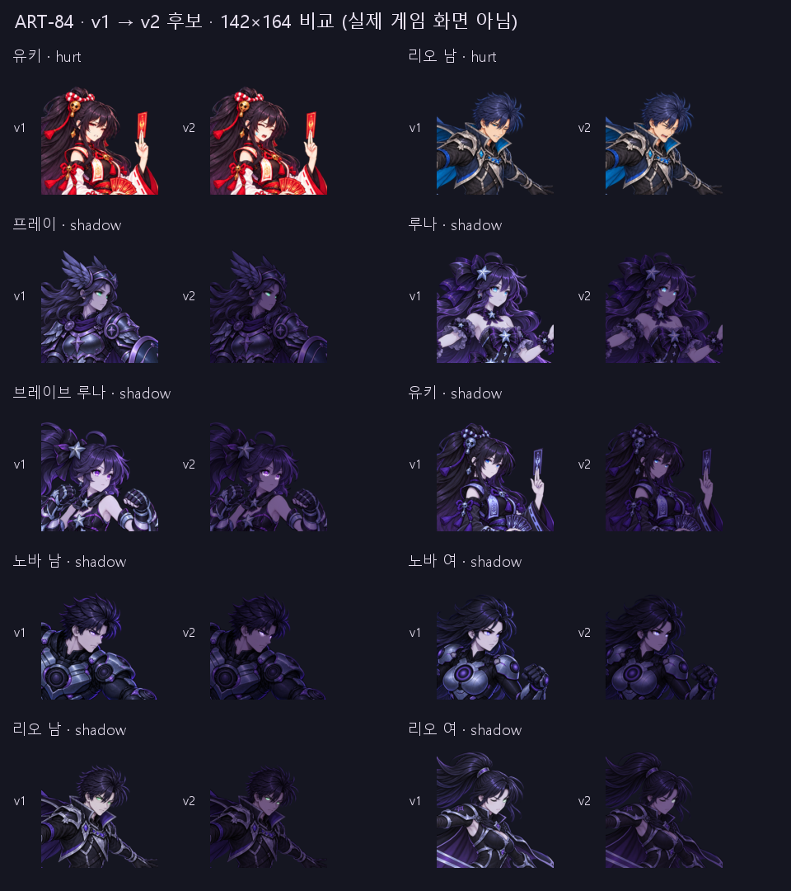

# ART-84 — 대화 초상화 v2 후보 10장

완료: hurt 2장과 shadow 8장의 **새 PNG+JSON 후보 10쌍**을 납품한다. 기존 파일은 덮어쓰지 않았다. 모두 256×256 RGBA, `candidate`, `delivered: true`이며 게임에는 연결하지 않았다.

현재 상태: 저장 파일 검증 **228항목 통과**, 원본 및 복사 입력 해시 일치. 모든 결과를 1배·142×164·대화 목업에서 직접 보았고, hurt 합성 경계와 shadow 눈 영역은 4배에서도 확인했다. Godot·설치·다운로드·스테이징·커밋은 실행하지 않았다.

## 파일별 결과

각 파일명 링크는 PNG다. 같은 이름의 JSON을 함께 납품한다. `offset`은 생성 편집본을 중립 좌표로 옮기는 `(dx,dy)`이며 +x 오른쪽, +y 아래다. 그림자는 ART-80의 offset을 상속하고 이번 추가 이동은 모두 `(0,0)`이다.

| 파일 | 변경 | offset px | 측정 | 납품 |
|---|---|---:|---|---|
| [yuki_face-hurt-v2](../../art/bakeoff/yuki/yuki_face-hurt-v2.png) | 감긴 눈·열린 입·더 선명한 땀방울 | (0,0) | 마스크 밖 0px, 경계 MAE 17.12 | 후보 |
| [rio_male_face-hurt-v2](../../art/bakeoff/rio/rio_male_face-hurt-v2.png) | 피곤한 찡그림에서 감긴 눈·통증으로 벌어진 입 | (0,0) | 마스크 밖 0px, 경계 MAE 21.56 | 후보 |
| [frey_face-shadow-v2](../../art/bakeoff/frey/frey_face-shadow-v2.png) | 피부·금속 암화, 민트 눈 보존 | (-1,0) | 눈/얼굴 1.12 → 2.27 | 후보 |
| [luna_face-shadow-v2](../../art/bakeoff/luna/luna_face-shadow-v2.png) | 피부·별 장식 암화, 청록 눈 보강 | (-1,0) | 0.79 → 1.76 | 후보 |
| [luna_brave_face-shadow-v2](../../art/bakeoff/luna/luna_brave_face-shadow-v2.png) | 피부·장갑 암화, 보라 눈 보강 | (0,-1) | 0.76 → 1.74 | 후보 |
| [yuki_face-shadow-v2](../../art/bakeoff/yuki/yuki_face-shadow-v2.png) | 피부·부적 암화, 파란 눈 보강 | (0,1) | 0.62 → 1.58; 부적 평균 밝기 100.49 → 50.38 | 후보 |
| [nova_male_face-shadow-v2](../../art/bakeoff/nova/nova_male_face-shadow-v2.png) | 피부·갑옷 암화, 눈 대비 보강 | (-1,0) | 0.98 → 2.09 | 후보 |
| [nova_female_face-shadow-v2](../../art/bakeoff/nova/nova_female_face-shadow-v2.png) | 피부·갑옷 암화, 눈 대비 보강 | (-1,0) | 0.83 → 1.80 | 후보 |
| [rio_male_face-shadow-v2](../../art/bakeoff/rio/rio_male_face-shadow-v2.png) | 피부·은색 장비 암화, 민트 눈 보존 | (0,1) | 0.96 → 2.01 | 후보 |
| [rio_female_face-shadow-v2](../../art/bakeoff/rio/rio_female_face-shadow-v2.png) | 암화, 기존 한쪽 눈의 노출 보강 | (0,1) | 0.91 → 2.09 | 후보 |

## 시각적 확인



각 묶음은 v1 왼쪽, v2 오른쪽이다. 실제 Godot 화면이 아니라 Pillow 비교 보드이며, 142×164 영역에 142×142로 등비 축소하고 위아래 11px을 비웠다. 후보에는 추가 게임 틴트를 곱하지 않았다.

| 폼 | hurt 전후·목업 | shadow 전후·목업 |
|---|---|---|
| 프레이 | — | [보드](frey-shadow.png) |
| 루나 | — | [보드](luna-shadow.png) |
| 브레이브 루나 | — | [보드](luna_brave-shadow.png) |
| 유키 | [보드](yuki-hurt.png) · [4배 경계](yuki-hurt-seam.png) | [보드](yuki-shadow.png) |
| 노바 남 | — | [보드](nova_male-shadow.png) |
| 노바 여 | — | [보드](nova_female-shadow.png) |
| 리오 남 | [보드](rio_male-hurt.png) · [4배 경계](rio_male-hurt-seam.png) | [보드](rio_male-shadow.png) |
| 리오 여 | — | [보드](rio_female-shadow.png) |

폼별 shadow-detail 보드는 v1·v2 얼굴 4배와 측정 영역을 보여 준다. 노랑은 얼굴 샘플, 녹색은 눈 샘플이다. 그림에 표시한 색은 후보 PNG에 없다. 판단 기록은 [visual-review.json](visual-review.json)에 있으며 측정과 구분한다.

## 제작과 측정 정의

**Part 1 먼저:** 내장 이미지 도구로 중립 원본만 직접 편집했다. 유키는 땀방울이 작았던 1차 대신 2차, 리오 남은 1차를 선택했다. 이번 호출 총 3회. 프롬프트는 [prompts.txt](prompts.txt)와 [추가 프롬프트](prompts-supplement.txt)에 있다. 사용한 중립·v1·생성본을 `art/raw/faces-84/`에 복사했다.

- ART-73과 같은 256px LANCZOS 정규화, dx·dy -4…+4 정수 정렬, 실제 특징 마스크의 안쪽 4px smoothstep 페더를 사용했다. 유키 땀방울은 윤곽이 페더에 잘리지 않도록 피부 여백을 넓혔다. 최종 마스크·설정·81개 정렬 점수를 보고서에 보관했다.
- **경계 MAE:** `0<mask<255` 띠에서 정렬된 생성본과 중립 원본 사이 RGB 절대 차이 평균(0…255). 최종 합성본과의 차이는 유키 10.00, 리오 남 11.30으로 별도 기록했다. 이 값으로 이음매의 미적 합격을 자동 판정하지 않는다.
- 두 장 모두 실제 마스크 값이 0인 모든 위치에서 RGBA 변경 0px, 전체 알파 변경 0px. 4배 확대에서 뚜렷한 붙인 테두리·이중 입술은 관찰하지 않았다(육안 판단).

**Part 2:** 중립을 직접 편집했던 ART-80 v1을 입력으로 승인된 톤 곡선만 적용했다. 추가 생성·회전·이동·리샘플링·이미지 흐림·선화 다시 그리기는 없다. 각 RGB 채널의 기본 곡선은 `255 × gain × (channel/255)^0.90`, gain은 `(0.52,0.43,0.60)`이다. 게임 틴트 `(0.42,0.24,0.62)`의 보라 방향을 참고하되 세부가 읽히도록 별도 계수를 택했다.

- 기존 눈 색 픽셀을 눈 영역 안에서 보호하고 일부 폼의 기존 픽셀에만 밝기 곡선을 적용했다. 리오 여는 감긴 눈을 새로 그리거나 발광 형태를 늘리지 않았다. 보라 눈의 1차 마스크는 주변 피부까지 밝게 남겨, 최종본에서는 색 분리 조건과 작은 조각 제거로 좁혔다. 흐린 처리는 마스크에만 적용했다.
- **눈/얼굴 밝기비:** sRGB 코드값에서 `Y=0.2126R+0.7152G+0.0722B`, 고정 눈 샘플의 평균 Y / 고정 뺨 샘플의 평균 Y. 물리 휘도나 WCAG 대비비가 아니다. 샘플은 v1에서 한 번 정해 전후 모두 동일하게 사용했다. 눈과 피부의 절대 평균값·샘플 수는 [measurements.json](measurements.json)에 있다.
- 142px에서도 같은 샘플을 면적 가중 축소해 측정했다. 전후 비율은 프레이 1.06→2.02, 루나 0.79→1.61, 브레이브 0.73→1.50, 유키 0.60→1.29, 노바 남 0.94→1.85, 노바 여 0.80→1.60, 리오 남 0.85→1.58, 리오 여 0.90→1.58이다. **상대 대비 향상이지 축소된 모든 눈 픽셀의 절대 밝기 증가를 뜻하지 않는다.**
- 선 보존의 보조 검사: 알파≥240·눈 보호 바깥에서 원래 인접 RGB 최대 채널 차≥12였던 가로·세로 픽셀 쌍이 전후 모두 차≥3을 유지했다. 8장 총 282,279쌍, 100%. 공간 변형은 없지만 8비트 어두운색 반올림으로 1레벨 색 차이가 합쳐질 수 있으므로 모든 미세 색 단계를 수학적으로 무손실 보존했다고 주장하지 않는다. 얼굴·장비 선은 육안으로 별도 확인했다.

## 검증과 범위

`verify_candidates.py` exit 0: **10장, 228항목 통과**. [verification.json](verification.json)에 파일별 결과가 있다. PNG 크기·모드·알파·출처 해시·JSON 상태·hurt 마스크 밖 보존·합성 재현·경계 MAE 재계산·shadow 재현·밝기비 개선·offset 상속·선 보존을 확인했다.

`git diff --name-only -- smash-nine-prototype tools`와 tracked-only 상태 출력은 비어 있었다. raw는 git-ignore 대상이다. 기존 `qa23/`, ART-82·ART-86 보고서와 ART-84 `run.log`는 작업 시작 전부터 있었으며 건드리거나 커밋 목록에 넣지 않았다.

재검증은 기존 결과를 덮지 않도록 새 결과 이름을 지정한다:

```powershell
$env:PYTHONDONTWRITEBYTECODE='1'
& 'C:/Users/TH/.cache/codex-runtimes/codex-primary-runtime/dependencies/python/python.exe' reports/codex-art-84/verify_candidates.py verification-review-2.json
```

모든 생성·발행 스크립트는 이미 출력이 있으면 중단한다. hurt 재현에는 이 클론의 ignored 생성 원본이 필요하다. shadow는 저장소의 v1에서 재현할 수 있다. `build_shadows_final.py` → `build_shadows_selected.py` → `build_shadows.py` 순으로 최종 마스크·색조 함수를 구성하며, 초기 시도 덤프는 raw에만 있다.

## 약점과 인계

- 유키 hurt의 눈썹은 앞머리에 가려지고, 땀방울은 작은 표시에서 보조 신호다. 리오 hurt는 작은 얼굴에서 입 모양이 주된 통증 신호다.
- 유키 shadow의 작은 파란 눈은 142px에서 여전히 가장 약하다. 브레이브의 보라 눈은 전체 팔레트와 가까워 색상 대비가 낮다. 리오 여는 한쪽 작은 발광 눈이라는 구조를 유지했다.
- 어두운 배경에서는 그림자의 머리·의상 중 가장 어두운 부분의 가독성이 줄어든다. 실제 게임의 배경·추가 틴트와 함께 확인하지 않았다.

**남은 작업:** 후보 미납 없음. 채택·게임 연결·실제 Godot 화면 확인은 리드 범위다. **다음 권장 단계:** 리드가 보드에서 표정 강도와 그림자 명암을 확인한 뒤 채택한다.

`commit.ps1`은 `commit-files.txt`만 `git add --pathspec-from-file`로 스테이징하고 `git commit --only --pathspec-from-file`로 다른 스테이징 파일을 제외하도록 작성했다. 카드와 사용자 프롬프트를 포함하며 raw·시도별 덤프·캐시·run.log는 제외한다. **실행하지 않았다.** 구문·목록 검증은 `commit-validation.json`에 남긴다.

작업 시작 2026-10-25 19:41 KST, 후보 검증 19:54 KST. 120분 한도 내 완료.
