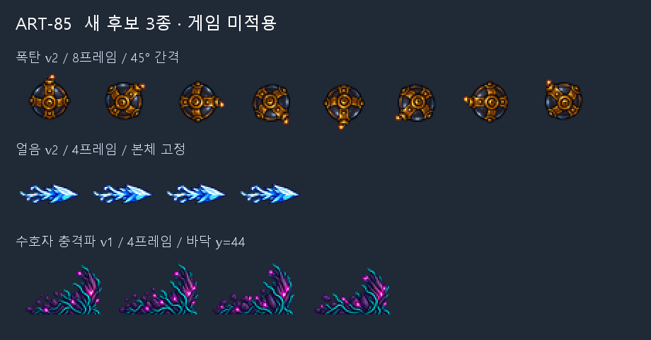

# ART-85 — 투사체 수선·수호자 충격파 후보

**완료:** 새 PNG/JSON 3쌍, 16프레임. 기존 다섯 투사체는 재검수 후 그대로 유지했다. 모두 사용자 선택용 후보이며 게임에는 적용하지 않았다. `codex/art-85` 클론에서만 작업했고, 기존 파일을 덮어쓰지 않았다.



위쪽부터 45도 간격 폭탄, 본체를 고정한 얼음, 수호자 색상의 뿌리 충격파다. 이 그림은 후보 PNG를 합성한 비교 자료이며 실제 게임 화면이 아니다.

## 파일별 결과

후보 위치: `art/bakeoff/monsters/`. 새 PNG마다 같은 이름의 JSON이 있다. 새 파일 모두 **12fps**이며, 일반 투사체 재생 속도는 SYS-07의 공통 12fps를 따른다.

| 파일 | 프레임 | 셀 | aim | 변경 내용 | 납품 |
|---|---:|---|---|---|---|
| `svartalfheim_cog_drone-projectile-v2.png` | 8 | 48×48 | none | 같은 원화를 몸 중심에서 0–315°, 45° 간격으로 회전. 짧은 도화선·불꽃 밝기 변화 | PNG+JSON 완료 |
| `niflheim_frost_owl-projectile-v2.png` | 4 | 48×48 | right | 파편 본체·알파 실루엣 고정, 왼쪽 꼬리 RGB만 약하게 반짝임 | PNG+JSON 완료 |
| `yggdrasil_root_guardian-shockwave-v1.png` | 4 | 64×48 | right | 보라 껍질·청록 뿌리·자홍빛의 뿌리/흙 마루, 바닥 경계 y=44 | PNG+JSON 완료 |
| `ember_imp-projectile-v1.png` | 4 | 48×48 | right | 불덩이의 잘림·배경 테두리·위치 튐을 관찰하지 못함 | 기존 유지, v2 미생성 |
| `jotunheim_storm_wisp-projectile-v1.png` | 4 | 48×48 | right | 전기탄의 중심과 외곽선이 안정적으로 읽힘 | 기존 유지, v2 미생성 |
| `midgard_rooftop_slinger-projectile-v1.png` | 4 | 48×48 | none | 돌의 외곽선과 회전하는 균열 유지 | 기존 유지, v2 미생성 |
| `vanaheim_seed_sprite-projectile-v1.png` | 4 | 48×48 | none | 네 칸 모두 중앙 핵이 보이고 외곽이 끊기지 않음 | 기존 유지, v2 미생성 |
| `yggdrasil_root_oracle-projectile-v1.png` | 4 | 48×48 | none | 자홍 핵과 청록 띠가 분리되어 읽힘 | 기존 유지, v2 미생성 |

## 제작과 출처

- 내장 ImageGen **4회**: 폭탄 2회, 얼음 1회, 수호자 충격파 1회. 폭탄 1안은 긴 도화선 때문에 회전 범위에 맞춰 줄이면 몸이 너무 작아져 제외했다. 2안을 선택했다.
- 몬스터의 현재 시트와 ART-79 투사체를 생성 참조로 사용했다. 수호자는 ART-76 공격 행도 함께 전달했다. 사용·검수한 원본 22개와 생성 원본 4개는 git-ignored `art/raw/projectiles-85/`에 보존했다. [sources.json](sources.json)에 원래 경로와 SHA-256을 기록했다.
- 실제 프롬프트: [prompts.txt](prompts.txt), 구조화한 사본: [generation-prompts.json](generation-prompts.json). ImageGen 원본을 Pillow/numpy로만 후처리했다. 다운로드·패키지 설치 없음.
- 공통: 원본 alpha<64 정리 → 실제 알파 경계로 분리 → LANCZOS 축소·선명화 60 → 최종 alpha<24 정리. 팔레트를 줄이지 않았다. 투명 픽셀 RGB는 0으로 했다.
- 폭탄: 원본의 몸 중심을 육안으로 지정하고, 회전 전체를 수용하는 단일 배율을 구했다. 4배 중간 해상도에서 **매번 같은 원화**를 회전한 뒤 48px로 축소했다. 이전 프레임을 연속 회전하지 않아 누적 열화를 피했다. 불꽃 영역만 RGB 밝기를 변경했다. `processing.json`에 중심·배율·각도·불꽃 마스크 기준을 기록했다.
- 얼음: 한 원화에서 x≥23 영역은 RGBA 그대로 복사했다. x<23 중 꼬리의 청백색 픽셀에만 밝기 계수 0.96/1.03/1.06/0.99를 적용했다. 꼬리 위치와 알파도 고정했다.
- 충격파: 네 원화를 **한 배율**로 축소하고 앞쪽 경계 x=61, 바닥 경계 y=44에 맞췄다. 프레임별 크기 보정이나 몸 조각 붙이기는 하지 않았다.

## 측정 결과 — 자동 검사

완성 PNG/JSON을 다시 읽는 [verify.py](verify.py)를 실행해 통과했다. 전체 수치는 [measurements.json](measurements.json), 생성·후처리 값은 [processing.json](processing.json)에 있다.

| 항목 | 측정값 |
|---|---|
| 새 파일 규격 | 폭탄 384×48 / 얼음 192×48 / 충격파 256×48, RGBA |
| 최소 투명 여백 | 폭탄 4px / 얼음 3px / 충격파 3px |
| 2px 여백 침범 | 16프레임 모두 0픽셀 |
| alpha=0의 잔여 RGB | 모두 0 |
| 키색 유사 픽셀 | 모두 0 — alpha≥24, R≤40, G≥215, B≤40 |
| 프레임 고유성 | 폭탄 8/8, 얼음 4/4, 충격파 4/4 서로 다름 |
| 얼음 본체 차이 | x≥23 RGBA 차이 0픽셀, 전 셀 알파 차이 0픽셀 |
| 폭탄 회전 | 0/45/90/135/180/225/270/315°, 마지막→처음도 45° |
| 충격파 바닥 | 네 칸 bbox 하단 44, 실제 최하단 y=43 |
| 충격파 실루엣 | 폭 54/56/58/54px, 높이 35/36/36/33px |
| 원본 보존 | 참조 파일 22개가 작업 전 복사본과 SHA-256 일치 |

**spill과 의도한 색을 구분한다.** 여백 침범과 위 키색 검사 결과는 0이다. 단순 녹색 우세 검사 `G>max(R,B)+20`에서는 새 수호자 충격파의 청록 뿌리 **55픽셀**이 검출된다. 기존 씨앗 1,170픽셀·유도 구체 226픽셀도 해당한다. 의도한 녹색/청록 팔레트이므로 제거하지 않았으며, 이 범용 색 검사까지 0이라고 주장하지 않는다. 투명 원본에서 작업했으며 녹색 배경은 사용하지 않았다.

## 직접 본 결과 — 육안 판단

기존 8스트립 32프레임과 새 3스트립 16프레임을 모두 **1배·36px 폭·4배**에서 직접 열어 봤다. 각 비교판에는 밝고 어두운 바탕과 좌우 방향 합성 모형도 있다. 잘린 가장자리나 잔류 배경 테두리는 관찰하지 못했다. 정적 비교판 검수이며 실제 12fps 재생이나 게임 실행 검증은 아니다.

- **폭탄:** 중간 45도 자세가 들어가 회전 단계가 명확하다. 금속 띠와 불씨가 36px에서도 구별된다. 36px에서 불꽃은 매우 작고, 원화에 그려진 하이라이트가 몸과 함께 회전한다. 8프레임 한 바퀴는 12fps에서 약 0.667초로, 이전 4프레임의 약 0.333초보다 느리다.
- **얼음:** 기존 3번의 큰 서리 말림이 없어지고 촉·몸의 위치가 일정하다. 36px에서는 꼬리 반짝임이 매우 약하다. 이는 형태 변화보다 작은 shimmer를 요청한 방향에 맞는 것으로 판단했다.
- **충격파:** 기존 골렘 바위보다 가는 뿌리와 보라 껍질로 읽히며 수호자와 색상이 이어진다. 네 번째 마루가 3px 낮고, 36px에서는 가는 뿌리 일부가 합쳐진다. 바닥은 고정되어 있다. 이 높이 변화는 측정값이며 자연스러운 휘어짐이라는 평가는 제작자의 판단이다.
- **기존 다섯 종류:** 수정할 만한 잘림·테두리·프레임 위치 튐을 발견하지 못해 유지했다. 불덩이/전기탄의 꼬리 변형, 돌의 광원 회전, 씨앗의 규칙적인 회전, 유도 구체의 약한 맥동은 기존 특징으로 남는다. 정적 검수만으로 시간상 동작 결함이 없다고 보장하지 않는다.

비교판: [폭탄](svartalfheim_cog_drone.png) · [얼음](niflheim_frost_owl.png) · [수호자 충격파](yggdrasil_root_guardian.png) · [불덩이](ember_imp.png) · [전기탄](jotunheim_storm_wisp.png) · [돌](midgard_rooftop_slinger.png) · [씨앗](vanaheim_seed_sprite.png) · [유도 구체](yggdrasil_root_oracle.png).

각 보드 아래는 **합성 모형**이다. 일반 셀은 화면 폭 36×WORLD(1.5)=54px, 충격파는 54×약41px로 표시했다. 몬스터 셀은 96px이며 수호자는 ART-76 공격 프레임을 썼다. 보드의 초록 바닥선은 정렬 확인용이고 후보 PNG에 포함되지 않는다.

## 현재 상태·남은 작업

**완료:** 요청한 세 후보와 다섯 기존 투사체 재검수. 게임·도구 파일 수정, Godot 실행, 스테이징·커밋 없음. 카드와 기존 프롬프트도 수정하지 않고 커밋 목록에 포함했다. 기존 `run.log`와 다른 작업 파일은 그대로 보존했다.

**남은 작업:** 사용자의 후보 선택, 리드의 채택·연결, 실제 게임에서 12fps와 혼전 가독성 확인. 일반 투사체는 기존 SYS-07 스트립 로더를 사용할 수 있다. **현재 게임은 수호자 전용 충격파 선택을 지원하지 않는다.** 수호자 후보의 `replaces`는 수호자 사용분에 한하며, 공용 `slam_shockwave`를 전역 교체하면 골렘까지 뿌리 색으로 바뀌므로 몬스터별 연결이 필요하다.

**커밋 준비:** [commit.ps1](commit.ps1)은 작성만 하고 실행하지 않았다. [delivery-files.txt](delivery-files.txt)의 명시 목록을 `git add --pathspec-from-file`로 스테이징하도록 작성했다. raw·캐시·run.log·다른 작업은 목록에서 제외했고 `git add -f`는 사용하지 않는다. 커밋 메시지 마지막 줄은 요청된 Co-Authored-By다.

재검사(읽기 전용):

```powershell
$env:PYTHONDONTWRITEBYTECODE = '1'
& 'C:/Users/TH/.cache/codex-runtimes/codex-primary-runtime/dependencies/python/python.exe' reports/codex-art-85/verify.py
```

후처리 재현: 같은 Python으로 `build.py --draft fresh-name` 실행. 새 raw 하위 폴더만 만들며 기존 경로가 있으면 중단한다. `package.py`도 덮어쓰기를 거부하므로 이미 납품된 상태에서는 재실행하지 않는다.
