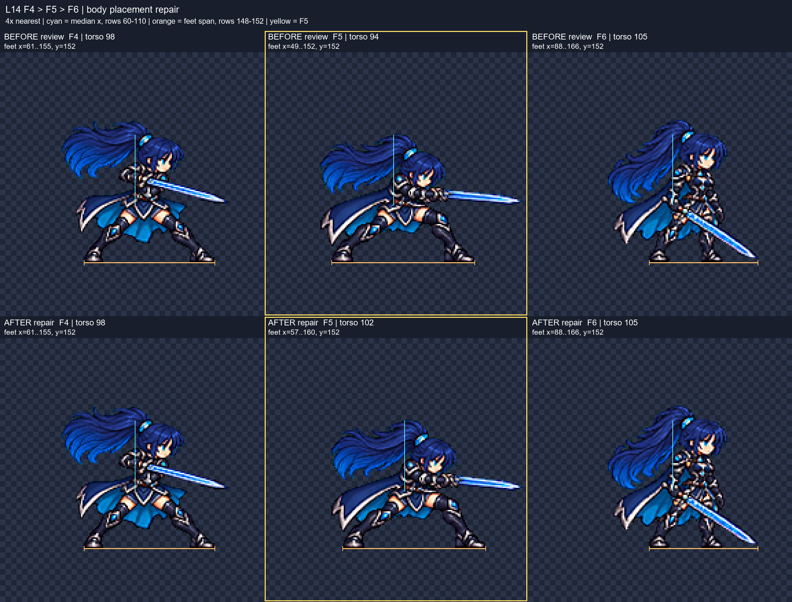

# CODEX-ART-86 — QA-23 전투원 시트 수정 후보

새 PNG/JSON 6쌍을 만들었다. 5개 행은 해당 결함의 수정 후보이며, L34는 발선 이동 자체는 완료했지만 기존 얼굴 수치가 기준 밖이어서 **채택 보류**로 표시했다. 게임 파일·기존 후보·tools는 변경하지 않았고 Godot, git add, commit은 실행하지 않았다. 작업 브랜치는 `codex/art-86`이다.

**리드 후속 검토(2026-10-25): 여섯 수정을 수락했으며 L14 F5 위치만 재수정 요청. 아래 최초 검사의 L34 보류와 다른 행의 약점은 당시 측정 기록이다. 이번에는 L14 F5만 수정했고, 다른 후보는 그대로 유지했다.**

## ID별 결과

| QA-23 | 결과 | 파일 / 확인 내용 |
|---|---|---|
| L14 | 후속 수정 완료 | [rio_female-mana_combo-v2](../../art/bakeoff/rio/rio_female-mana_combo-v2.png): F5 몸 +8px 복원, 칼날 부분만 56→48px로 줄여 뾰족한 끝 보존. 몸통 98→102→105px로 후퇴 없음. F1~F4 및 직전 v2 F6 동일. |
| L09 | 완료 | [nova_male-walk-v3](../../art/bakeoff/nova/nova_male-walk-v3.png): F3 팔·정강이 장갑을 주변 프레임에 맞춤. 다른 7프레임 동일. |
| L10 | 완료 | [rio_female-walk-v4](../../art/bakeoff/rio/rio_female-walk-v4.png): F4 검 방향을 앞·아래로 수정. 다른 7프레임 동일. |
| L11 | 완료, 동작 약점 있음 | [rio_male-walk-v2](../../art/bakeoff/rio/rio_male-walk-v2.png): 8프레임 몸·검·망토 크기 재구성. 앞뒤 다리의 교대 표현은 여전히 약하다. |
| L34 | **미완료 / 채택 보류** | [nova_female-gravity_brake-v2](../../art/bakeoff/nova/nova_female-gravity_brake-v2.png): F4~F6을 정확히 4px 내려 y148→152. 얼굴 내용을 그대로 보존했으며 기존 얼굴 검사 미통과 때문에 전체 규칙 완료로 판정하지 않음. |
| L37 | 완료, 얼굴 경계 재검토 권장 | [frey-attack-v5](../../art/bakeoff/frey/frey-attack-v5.png): 실제 게임 **128셀 예비 attack**의 F3~F5 재추출, F6 재생성. F1~F2 동일. F3 볼 일부가 팔에 가림. |
| L35 | 기존 후보로 해결 | `rio_female-attack-v2` 6프레임을 4배로 확인. F5 검끝 온전, F6 분리 검 조각 없음. v3 만들지 않음. |
| L38 | 기존 후보로 해결 | 같은 여성 attack-v2의 머리 템플릿 배율 1.00~1.02 재확인. 추가 얼굴 대응점 검사에는 기준 밖 수치가 있어 아래에 별도 기록. |
| L36 | 기존 후보로 해결 | `rio_male-attack-v2` 머리 배율 1.00~1.02, 검 전체 확인. 추가 얼굴 검사와 머리 크기 판정은 구분함. |
| L28 | 기존 후보로 해결 | `nova_female-hurt-v2` 1프레임, v3의 실제 사용 3프레임 모두 바닥 y120. v3 나머지 3칸은 빈 패딩이며 검사 대상에서 제외. |

## 실제 수정 화면



위쪽은 리드가 검토한 수정 전 v2, 아래쪽은 이번 위치 수정 후 v2다. 각 줄에 F4·F5·F6을 나란히 놓았다. 청록선은 y60~110 불투명 픽셀의 x 중앙값, 주황선은 y148~152 발 픽셀 범위이며, 노란 테두리가 F5다. 모든 표시 프레임은 4배 nearest 확대다.

### L14 F5 위치 재수정 — 전 → 후

| 프레임 | 몸통 중심 x | 발 범위 x | 발선 y |
|---|---:|---|---:|
| F4 | 98 → 98 | 61–155 → 61–155 | 152 → 152 |
| F5 | 94 → 102 | 49–152 → 57–160 | 152 → 152 |
| F6 | 105 → 105 | 88–166 → 88–166 | 152 → 152 |

좌표는 192px 셀 내부, 양끝 포함이다. F5의 몸·머리·발은 직전 v2 픽셀을 **오른쪽으로 8px 평행 이동**했으며 크기는 바꾸지 않았다. 발 범위는 v1의 57–160과 일치한다. 몸통 중앙값 102는 v1의 101에서 1px 차이이며, 이 측정은 머리·팔·칼도 포함하는 행 영역의 중앙값이다. F4→F5→F6 중앙값 증가량은 **-4/+11 → +4/+3px**로 바뀌었다.

원본에서 복원했던 칼날만 `(132,95)-(188,113)`으로 분리하고, 가로 56→48px·세로 18px 유지로 재샘플하여 `(140,95)`에 배치했다. 전체 프레임이나 몸은 리샘플하지 않았다. 칼끝은 **(187,108) 한 픽셀**, 오른쪽 여백 **4px**, F5 전체의 4방향 연결 요소 **1개**로 잘림·분리 조각이 없다. 얼굴 영역은 이동 후 RGBA 동일하며 ART-72 눈 간격/폭 재검사도 기존 수치와 같다. 육안으로 칼날 연결과 뾰족한 끝을 4배 확인했다.

재현/검사: `l14_position_review.py`, 수치 근거: [L14-position-review.json](L14-position-review.json). JSON note, 행 비교/원본 비교/얼굴 보드, 재현 기록과 커밋 명시 목록도 갱신했다. Godot과 `commit.ps1`은 실행하지 않았다.

전체 행 비교: [L14](rio_female-mana_combo.png), [L09](nova_male-walk.png), [L10](rio_female-walk.png), [L11](rio_male-walk.png), [L34](nova_female-gravity_brake-delivery.png), [L37](frey-attack-delivery.png). 노란 테두리가 수정한 프레임이다. 실제 게임 실행 화면은 만들지 않았다.

## 측정과 판단

**측정:** `face_audit_v3.py`는 ART-72의 `align_head`, `match`, `refine_eyes` 함수를 그대로 불러오고, 각 폼의 idle-v2에 고정 대응점을 지정한다. 해당 폼들이 청색 눈이므로 Frey의 청색 가중치를 사용했다. 눈 간격과 눈높이 볼 폭은 idle 대비 비율이다. 머리 전체 템플릿 배율과는 다른 값이다. 자동 대응점은 제안이며 가림·각도·앞머리 경계가 있으면 수치만으로 확정하지 않는다.

| 변경 프레임 | 눈 간격 비율 | 얼굴 폭 비율 | 판단 |
|---|---:|---:|---|
| L14 F5/F6 | 0.963 / 1.034 | 1.000 / 1.000 | 수치 범위 안. F5 기울어진 머리 템플릿 점수 0.589라 4배 얼굴도 직접 확인. |
| L09 F3 | 0.966 | 1.000 | 범위 안. 큰 청록 장갑 판넬이 사라지고 주변의 검은 슈트·작은 장갑과 맞음. |
| L10 F4 | 0.982 | 1.000 | 범위 안. 온전한 검이 앞·아래를 향함. |
| L11 F1~F8 | 0.965~1.013 | 1.000 | 모두 범위 안. 다리 교대의 겹침 표현은 육안상 약함. |
| L34 F4/F5/F6 | 1.179 / 1.225 / 1.056 | 1.000 / 1.143 / 1.000 | **기존 얼굴 검사 미통과.** 이동만 했으므로 새로운 얼굴 왜곡은 만들지 않았지만 완료 판정에서 제외. |
| L37 F3~F6 | 0.975 / 1.035 / 0.986 / 0.981 | 1.000 / 1.000 / 0.986 / 1.000 | 수치 범위 안. F3 왼쪽 볼 대응점 점수 0.405로 낮고 팔에 가려져 있어 수치 확신이 낮음. |

각 행의 `*-delivery-landmarks.png`와 `*-delivery-face.json`에 근거를 남겼다. L34는 `L34-final-*`이다. 보드의 F1부터 시작하는 번호는 **검사 부분 행 내부 번호**이며 실제 행 번호는 위 표와 후보 JSON의 `changed_frames`를 따른다.

**기존 ART-68 후보 확인:** 두 attack-v2 모두 머리 템플릿 1.00~1.02, 칼·방패가 아닌 한 자루 검·양쪽 부츠를 4배 보드에서 확인했다. 여성 눈 간격 제안값은 0.949~1.081, 남성은 0.789~1.008이라 이번 추가 검사를 전부 통과했다고 말할 수 없다. 여성 앞머리·각도와 남성의 어두운 먼쪽 눈 경계에 민감하다. ART-68의 수동 측정 통과 기록과 이번 자동 대응점 결과를 합쳐서 하나의 확정값으로 취급하지 않았다. 기존 후보를 다시 그릴 수 있는 조건은 여성 칼이 여전히 잘렸을 때였고, 칼은 온전했다.

## 원본과 처리 방법

- L14: `art/raw/rio-61b/mana_combo/source.png`를 복사해 사용. 통합 crop은 **(515,515)-(1533,1021)**. F5 검이 F6 쪽 격자선을 넘지만 원본에서는 온전하다. x1020:1028의 격자는 y776:802의 칼 부분을 보존하고 제거했다. 큰 연결 요소 2개를 각각 추출해 **공통 factor 0.260**으로 정규화했다. 후속 검토에서는 이 결과의 F5 몸을 +8px 복원하고 **칼날만** 가로 56→48px로 줄였다. `rebuild.py`의 `l14_restore_position`에 재현 설정을 고정했다. [원본 옆 결과](L14-raw-result.png).
- L09/L10: 잘못된 장갑·검 방향은 원본 재슬라이스로 바꿀 수 없어 해당 프레임만 내장 ImageGen으로 다시 그렸다. 폼의 idle와 해당 행을 참조했다. L09 F3는 전체 상체 1px, L10 F4는 3px 상승 보정했다. ART-57 `walk_bob.raise_`의 하단 다리 이음선만 사용했고 얼굴을 붙이지 않았다. 발 하단 픽셀은 그대로다.
- L11: 기존 raw도 몸·검·망토가 작고 머리만 이미 idle에 가까워, 전체 확대만 하면 얼굴이 커진다. 회색 포즈 가이드, idle, 고정 채택 F1을 참조해 8프레임을 생성했다. 각 생성물에 하나의 배율을 사용했다. 마지막 정규화 스트립에 bob을 한 번 적용했으며 이동은 **-3~+2px**, 발 하단 불변이다. 픽셀 외곽 높이는 기존 **90~95 → 94~102px**이다. 이것은 신체 부위별 18% 복구를 직접 증명하는 수치가 아니라 전체 실루엣 높이 측정이다.
- L34: F4~F6 전체 RGBA를 아래로 4px 옮겼다. 잘림 없음, 내용 불변을 배열 비교로 확인했다. 얼굴을 고치는 작업까지 확대하지 않았다.
- L37: `art/raw/frey-37/attack/raw.png`의 F3 **(1024,0)-(1536,512)**, F4 **(0,512)-(512,1024)**, F5 **(512,512)-(1024,1024)**를 공통 factor **0.253**으로 처리했다. F6는 얼굴을 맞추면 원본 실루엣이 4px 여백에 들어오지 않아 내장 ImageGen으로 좁은 웅크린 찌르기를 생성했다. [원본 옆 결과](L37-raw-result.png).

Frey의 현재 `art/bakeoff/frey/frey-attack-v4.png`는 **192셀 attack_chain**이다. 게임 `frey_sheet.png`의 R6, y640:768에 있는 128셀 예비 attack이 ART-37의 원래 정규화 PNG와 바이트 단위로 같음을 확인하고 그 행을 기준으로 삼았다. 새 v5 JSON의 `actual_replaces`에 이 충돌을 명시했다. J의 attack_chain 교체용이 아니다.

모든 축소는 ART-61 LANCZOS + unsharp 60 + despill auto + 이진 알파, 팔레트 제한 없음이다. 작은 얼굴의 픽셀 정렬을 보존하려고 원본 전체의 소수 픽셀 샘플 위치를 탐색했다. 얼굴·머리만 따로 늘리거나 특징을 코드로 그리지 않았다. 최종 배율과 샘플 위치는 `rebuild.py`에 고정했다. 생성·입력 원본은 모두 `art/raw/fighters-86/`에 있으며 커밋하지 않는다. 초기 생성 프롬프트 일부는 전문이 아닌 지시 요약이며 `prompts.txt`에 명시했다.

## 확인 및 테스트

- 변경 **19프레임**을 각각 4배로 직접 확인했다. 미변경 **23프레임**은 RGBA 바이트가 동일하다.
- 변경 프레임 모두 테두리 비어 있음, 최소 4px 여백, 녹색 번짐 0, 이진 알파, 지정 발선 검사 통과.
- 얼굴 수치 제안값 **16/19 범위 안**, L34의 보존된 기존 3프레임은 범위 밖. Frey F3의 가림은 별도 약점이다.
- L09 F3 착지 중간값 오차 1.5px, L10에서 기존 F3와 새 F4를 연결한 오차 5.75px. L11 F3/F7은 0.5/0.25px이다. `walk_feet.py`는 Rio 남성의 낮은 검끝도 발로 잡으므로 x≥100의 검끝 검출을 4배로 확인해 발 집계에서 제외했다. 전후 겹침 보드도 직접 확인했다. 개별 발의 2D 궤적 전체를 자동 추적한 검사는 아니다.
- 원본과 고정 처리 설정으로 **PNG 6개를 재생성한 결과 전부 RGBA 일치**: `reproduction-check.json`.
- `verify_delivery.py` 실행 성공: `verification-final.json`. 첫 검사 스크립트는 JSON 저장 후 콘솔 cp949 출력에서만 오류가 났고, ASCII 요약을 출력하는 최종 스크립트로 다시 검사했다.
- `git diff` 및 staged diff 비어 있음. `.git`에 쓰지 않았음. `commit.ps1`은 PowerShell 구문 검사 통과, **실행하지 않음**.

재검사 예시(출력 경로는 반드시 아직 없는 이름 사용):

```powershell
$env:PYTHONDONTWRITEBYTECODE='1'
$py='C:/Users/TH/.cache/codex-runtimes/codex-primary-runtime/dependencies/python/python.exe'
& $py reports/codex-art-86/rebuild.py --out art/raw/fighters-86/reproduced-lead --report reports/codex-art-86/reproduction-lead.json
& $py reports/codex-art-86/verify_delivery.py --report reports/codex-art-86/verification-lead.json
```

## 남은 작업과 인계

리드는 최초 여섯 수정을 수락했고, 유일한 후속 요청인 L14 F5 위치 수정도 완료했다. 위 L34 얼굴 수치, Rio 남성 다리 교대, Frey F3 가림/F6 실루엣은 최초 검사의 관찰 기록으로 남긴다. 게임 연결·hitbox/VFX 합성·실제 플레이는 이 작업에서 검증하지 않았다. 다음 단계는 리드의 F4~F6 연속 재생 검토와 채택이다.

`commit.ps1`은 `commit-paths.txt`의 명시 목록만 `git add --pathspec-from-file`로 stage하고 커밋한다. 카드와 프롬프트를 포함한다. `qa23/`, `art/raw/`, 다른 보고서, `run.log`, `__pycache__`, 시도별 중간 프레임은 목록에 없다. 관련 없는 staged 파일이 있으면 중단한다. 이 파일의 실행과 후보 채택·게임 연결은 리드의 다음 단계다.
