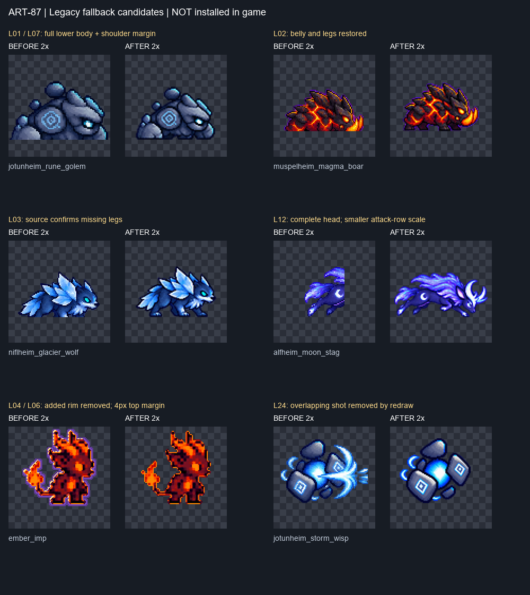
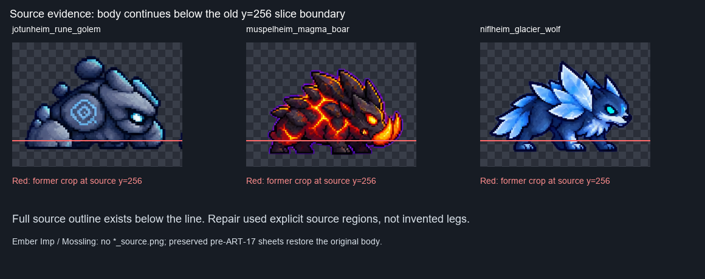

# ART-87 — 구형 몬스터 시트 복구 후보

2026-10-25, `codex/art-87`. **15종, 76프레임의 fallback 후보 제작 완료. 게임 미적용.** 실제 게임 시트, 제품 코드, 도구, `qa23/`는 수정하지 않았다. Godot은 실행하지 않았다. 커밋 스크립트는 작성만 했으며 실행하지 않았다.



왼쪽은 게임 원본, 오른쪽은 후보의 2배 확대다. 하체·머리 절단, 추가 테두리, 몸과 겹친 발사 효과의 변경을 보여 준다. 모든 변경 프레임의 **1×/4×** 비교는 아래 종별 보드에 있다.

## QA-23 항목별 결과

‘완료’는 해당 결함의 후보 수정을 뜻한다. 채택·게임 동작 검증 완료라는 뜻은 아니다.

| QA ID | 판정 | 처리 및 남은 제한 |
|---|---|---|
| L01 | 완료 | 골렘 idle 1–4 원본의 온전한 하체 재추출 |
| L02 | 완료 | 멧돼지 idle 1–4 배·다리 재추출 |
| L03 | 완료 | 늑대 원본에 다리 존재 확인, idle 1–4 복구. 웅크림으로 판정하지 않음 |
| L04 | 완료 | 임프 15칸의 ART-17 추가 보라·밝은 림 제거 |
| L05 | 완료 | 모슬링 15칸의 ART-17 추가 청록·밝은 림 제거 |
| L06 | 원본 대조 후 추가 조정 불필요 | L04 처리 후 대상 11칸의 최상단 y=4. 추가 축소·이동 없음 |
| L07 | 완료 | 골렘 전체를 동일 배율로 배치하여 최소 5px 여백 확보. 덩치는 작아짐 |
| L08 | 완료 | 골렘 walk 6·attack 4·hurt 1의 온전한 원본 하단 복구 |
| L12 | 완료, 제한 있음 | 사슴 공격 머리·앞몸 복구. 원본은 3자세뿐이어서 F4=F1 복귀 자세, 공격행 축소 |
| L13 | 완료 | 수호자 공격 1–4 얼굴·주먹 재추출 |
| L15 | 완료 | 까마귀 공격3 몸/부리 재추출, 앞의 독립 발사체 제외 |
| L16 | 완료 | 슬링어 공격3 새총 끝 복구 |
| L17 | 완료 | 멧돼지 공격2–3 코·엄니 복구, F3은 발굽 기준 1px 하향 |
| L18 | 완료 | 늑대 공격2 코·앞몸 복구 |
| L19 | 완료 | 드론 공격2 포구 재추출 |
| L20 | 완료 | 딱정벌레 공격2–3 드릴 복구, 파편 분리 보존 |
| L21 | 완료 | 나방 공격2 빛 구슬 제거, 몸 코어·더듬이 보존 |
| L22 | 완료 | 양 공격3 위·아래·뒤 궤적 제거, 룬·다리 보존 |
| L23 | 완료 | 임프 공격2는 손을 가린 불덩이 때문에 재작화, 공격4는 픽셀 제거. 꼬리 불꽃 보존 |
| L24 | 완료 | 위습 공격4 발사 호가 돌을 가려 재작화. 작은 몸 궤도·코어 유지 |
| L25 | 완료 | 드론 공격4 섬광 아래 포구 재작화. 청록 추진 불꽃 유지 |
| L26 | 완료 | 오라클 공격2 구슬 아래 얼굴 윤곽 재작화. 얼굴 코어·뿌리 유지 |
| L27 | 완료 | 사슴 hurt 뿔 재추출 |
| L29 | 완료 | 모슬링 hurt 별 제거, 잎 보존 |
| L30 | 완료 | 멧돼지 hurt 별 제거, 등 가시 보존 |

미착수 QA ID는 없다. L12의 네 번째 고유 자세와 체격 일치까지 해결한 것은 아니다.

## 출처와 처리



빨간 선은 이전 고정 256px 원본 셀의 아래 경계다. 골렘·멧돼지·늑대의 몸이 선 아래로 이어져 있어, 새 다리를 생성하지 않고 원본에서 재추출했다. 골렘의 납작한 바위 발은 원본 디자인으로 남겼다.

- 사용한 게임 시트·원본·참조·생성 결과는 `art/raw/monsters-87/`에 복사했다. raw는 커밋 대상에서 제외했다.
- 원본이 존재하는 재추출 작업은 `<id>_source.png`의 정확한 영역을 사용했다. 후보 JSON의 `source_region`은 `[left, top, right, bottom)`이며 원본 픽셀 좌표다. `alpha_bbox_in_region`, `scale`, `placement`, 후처리도 기록했다.
- 원본의 희미한 배경 알파는 41 미만 제거, 작은 고립 성분 제거 후 LANCZOS 축소 및 RGB unsharp(1,60,3), 최종 알파 32 미만 제거. 골렘 전체 같은 배율, 사슴 공격 전체 같은 배율을 사용했다. 새 팔레트나 일괄 색 변경은 하지 않았다.
- 임프·모슬링에는 `<id>_source.png`가 없다. `reports/codex-art-17/before/`의 보존 시트를 원본으로 썼다. 해당 시트의 alpha>30 몸 픽셀이 현재 게임 시트와 정확히 같음을 검증했으므로, 몸을 색으로 추정해 깎지 않고 추가 림만 되돌릴 수 있었다. 이후 명시한 발사·피격 효과만 제거했다.
- 원본에서도 발사 효과가 몸을 가린 **4칸**만 내장 이미지 도구로 다시 그렸다. 위습 attack4, 임프 attack2, 드론 attack4, 오라클 attack2다. 이 네 칸 전체는 새 그림이며 원래 몸 픽셀과 동일하다고 주장하지 않는다. 프롬프트는 [prompts.txt](prompts.txt), 참조·출력 경로는 후보 JSON에 있다.
- 분리한 효과 픽셀은 [effects/](effects/README.md)에 보존했다. 겹친 몸 픽셀을 포함할 수 있는 **검수용 보존본**이며 게임용 VFX 완제품은 아니다.
- 발 기준은 기본 y=72 경계(마지막 픽셀 y=71). 골렘은 현재 코드의 개별 기준 y=80을 유지한다. 임프·모슬링은 보존된 몸의 y=73 경계를 그대로 유지한다. 멧돼지 attack3은 발굽 y=72, 엄니 궤적만 y=73다.
- 미수정 프레임의 ‘byte-identical’은 PNG 컨테이너 압축 바이트가 아니라 **해당 96×96 셀 전체 RGBA 바이트의 완전 일치**다. 투명 픽셀의 RGB도 포함한다.

## 측정과 육안 판단

**측정:** [measurements.json](measurements.json), 실행 스크립트 [verify.py](verify.py).

- 15개 모두 RGBA 576×384, 96px 셀, 행별 4/6/4/1 유지.
- 변경 76프레임. 미수정 284셀(사용 149 + 빈 칸 135)은 게임 원본과 RGBA 완전 일치.
- 변경 76프레임 모두 바깥 4px 영역의 불투명/부분 알파 픽셀 0. 최소 여백 4px.
- JSON의 SHA-256, 변경 칸 목록, 영역·출처 파일, 기록된 발 경계 검증.
- 복사한 입력과 현재 게임 입력의 파일 해시 일치. 임프·모슬링 원래 몸 픽셀 일치 검증.
- Python 정적 구문과 `commit.ps1` PowerShell 구문 검사. Godot, 애니메이션 재생, 충돌 판정, 실제 투사체 중복은 검증하지 않음.

**육안 판단:** [inspection.json](inspection.json). 변경한 76프레임을 작은 원본 크기와 nearest-neighbour 4배 확대에서 직접 확인했다. 절단된 하체/얼굴/무기 끝의 닫힌 윤곽, 효과 제거 후 몸 구멍 여부, 꼬리·코어 보존을 확인했다. 이 관찰은 자동 점수나 실행 시험 결과가 아니다.

| 종 | 변경 프레임 | 1×/4× 보드 |
|---|---:|---|
| 골렘 | 15 | [보드](jotunheim_rune_golem.png) |
| 멧돼지 | 7 | [보드](muspelheim_magma_boar.png) |
| 사슴 | 5 | [보드](alfheim_moon_stag.png) |
| 수호자 | 4 | [보드](yggdrasil_root_guardian.png) |
| 늑대 | 5 | [보드](niflheim_glacier_wolf.png) |
| 까마귀 | 1 | [보드](asgard_runic_raven.png) |
| 슬링어 | 1 | [보드](midgard_rooftop_slinger.png) |
| 드론 | 2 | [보드](svartalfheim_cog_drone.png) |
| 딱정벌레 | 2 | [보드](svartalfheim_gear_beetle.png) |
| 임프 | 15 | [보드](ember_imp.png) |
| 모슬링 | 15 | [보드](mossling.png) |
| 나방 | 1 | [보드](alfheim_moon_moth.png) |
| 양 | 1 | [보드](asgard_aegis_ram.png) |
| 오라클 | 1 | [보드](yggdrasil_root_oracle.png) |
| 위습 | 1 | [보드](jotunheim_storm_wisp.png) |

각 보드 위에는 전체 게임/후보 시트와 노란 변경 칸 표시, 아래에는 프레임별 1× 및 4× 비교가 있다.

## 약한 부분과 다음 권장 단계

1. **사슴:** 원본 공격 포즈가 3개다. 네 번째 독립 포즈를 만들지 않고 F1을 회수 자세로 사용했다. 가장 넓은 공격을 88px 안에 넣기 위해 공격행은 0.25배, 온전한 대기/피격의 약 0.294배보다 약 15% 작은 몸·머리다. 절단은 해결했지만 움직임의 체격 일치는 미해결이다.
2. **골렘:** 어깨를 보존하면서 같은 배율로 전체를 줄였다. idle1 가로폭은 기존 94px에서 75px로 작아져 체감 덩치가 줄었다. 자세에 따른 높이 차이는 원본을 따른다.
3. **재작화 4칸:** 색·명암·선명도와 미세 윤곽이 이웃 프레임과 조금 다르다. 정지 보드에서 닫힌 몸을 확인했으며, 실제 재생 중 튐은 확인하지 않았다.
4. **다음 단계:** 리드가 이 후보와 신형 6행 후보 중 채택본을 정하고, 채택 시 실제 게임에서 크기·발 위치·공격 연결·효과 중복을 검증해야 한다. 이 작업에서는 게임을 연결하거나 실행하지 않았다.

## 재현 및 커밋 인계

Python은 지정 런타임만 사용하며 환경변수 `PYTHONDONTWRITEBYTECODE=1`을 설정한다. 패키지 설치·다운로드는 하지 않았다.

```powershell
$env:PYTHONDONTWRITEBYTECODE='1'
$py='C:/Users/TH/.cache/codex-runtimes/codex-primary-runtime/dependencies/python/python.exe'
& $py reports/codex-art-87/repair.py build
& $py reports/codex-art-87/package.py
& $py reports/codex-art-87/verify.py
```

`repair.py`는 로컬 raw가 필요하다. 기존 저장소 입력은 없으면 복사하지만, 커밋에서 제외한 이미지 생성 원본 4개가 다른 클론에는 없으므로 해당 raw를 따로 인계해야 동일하게 재생성할 수 있다. 최종 PNG·JSON·보드·검증 결과는 커밋 목록에 포함된다. `package.py`는 실제 검수가 끝난 이 후보의 검수 기록을 묶는 스크립트이며 자동 시각 검수기가 아니다.

[commit.ps1](commit.ps1)은 **작성만 했고 실행하지 않았다**. [files-to-stage.txt](files-to-stage.txt)의 명시 목록으로 `git add --pathspec-from-file`을 실행하며 카드·프롬프트를 포함한다. raw, qa23, 시도별 중간 프레임, `__pycache__`, `run.log`, 다른 작업 보고서는 제외한다. 다른 staged 파일이 있으면 중단한다. 커밋 메시지는 필수 Codex 공동 작성자 줄로 끝난다.
