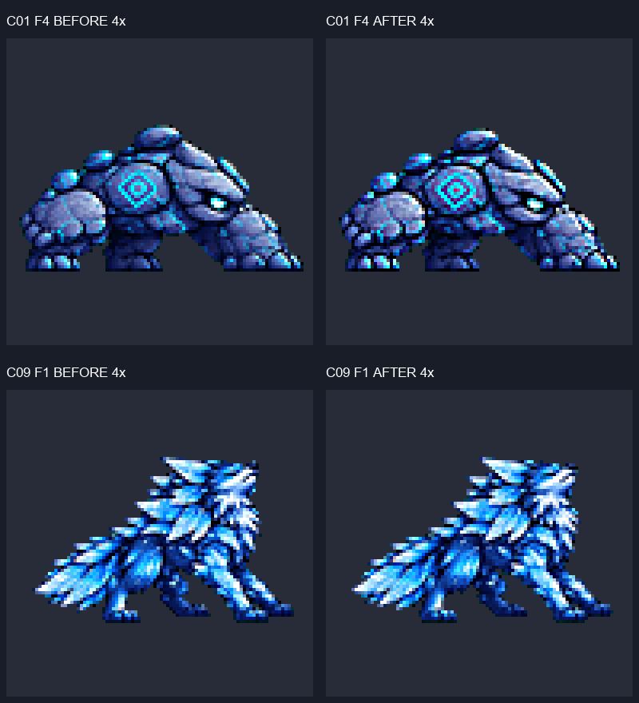

# ART-88 — 몬스터 후보 여백·늑대 피격·JSON 보완

**완료:** 후보 21행·39프레임 수정, JSON 43개 누락 필드 보완, 576×576 시트 14장 재조립. QA-23 23건 중 수정 20건, 최신 v2에서 수정 불필요 1건, 부분 수정 1건, 미수정 1건이다.
**현재 상태:** 정적 검사 1,419개에서 예상 밖 실패 0. **C08 F1 / C22 F1의 3px 상단 여백은 미해결**로 제외·공개했으며 모든 항목 통과라는 뜻이 아니다. 후보만 수정했고 게임 적용·Godot·뷰어 빌드·이미지 생성·설치·다운로드·git stage/commit은 하지 않았다.

## QA-23 ID별 결과

측정: QA-23과 동일하게 alpha≥128, 셀 외곽 1px 접촉과 안쪽 4px 경계 픽셀 수를 각각 센다. alpha>0도 함께 측정했으며 이번 그림은 alpha 0/255라 같다. 원래 목록의 `F3=3px`는 **경계 안 픽셀 수**이며 여백 거리 3px라는 뜻이 아니다. 아래 수치는 최신 입력(v2 우선)의 **최소 여백 거리**다. bbox는 오른쪽/아래 제외 좌표, 발 y72는 포함 좌표다.

| QA | 몬스터 / 행 | 판정 | 측정·수정 | 4배 직접 확인 |
|---|---|---|---|---|
| C01 | `jotunheim_rune_golem` / walk | 수정 | F3, F4, F6 여백 3→4px; 행 공통 factor 0.188→0.185744. | [1](C01-changed-4x-1.png) · [2](C01-changed-4x-2.png) |
| C02 | `jotunheim_rune_golem` / attack | 수정 | F2, F3, F4 여백 3→4px; 전체 그림 1px 이동. | [1](C02-changed-4x-1.png) |
| C03 | `jotunheim_storm_wisp` / attack | 수정 | F3 여백 3→4px; 전체 그림 1px 이동. | [1](C03-changed-4x-1.png) |
| C04 | `midgard_rooftop_slinger` / attack | 수정 | F3 여백 3→4px; 전체 그림 1px 이동. | [1](C04-changed-4x-1.png) |
| C05 | `muspelheim_magma_boar` / attack | 수정 | F3 여백 3→4px; 전체 그림 1px 이동. | [1](C05-changed-4x-1.png) |
| C06 | `niflheim_glacier_wolf` / attack | 수정 불필요(최신 v2) | F3 5px, F4 9px; v2 전 6장 경계 픽셀 0. v1은 각 3px. | [1](C06-already-fixed-4x-1.png) |
| C07 | `vanaheim_seed_sprite` / attack | 수정 | F3, F4 여백 3→4px; 행 공통 factor 0.24→0.2352. 최신 v2 F4 추가 확인. | [1](C07-changed-4x-1.png) · [2](C07-changed-4x-2.png) |
| C08 | `yggdrasil_root_guardian` / attack | 미수정 | F1 상단 3px·하단 y72 유지; 높이 70px. | [1](C08-unresolved-4x-1.png) |
| C09 | `niflheim_glacier_wolf` / hurt | 수정 | F1 원본 전체 재슬라이스. 상단 직선 8→5px, 여백 6→6px, 발 y72. F2 그대로. | [1](C09-changed-4x-1.png) |
| C10 | `jotunheim_rune_golem` / hurt | 수정 | F1 여백 3→4px; 전체 그림 1px 이동. | [1](C10-changed-4x-1.png) |
| C11 | `alfheim_moon_moth` / defeat | 수정 | F4 여백 3→4px; 전체 그림 1px 이동. | [1](C11-changed-4x-1.png) |
| C12 | `asgard_aegis_ram` / windup | 수정 | F2 여백 3→4px; 전체 그림 1px 이동. | [1](C12-changed-4x-1.png) |
| C13 | `asgard_runic_raven` / windup | 수정 | F2 여백 3→4px; 전체 그림 1px 이동. | [1](C13-changed-4x-1.png) |
| C14 | `jotunheim_rune_golem` / defeat | 수정 | F3, F4 여백 3→4px; 행 공통 factor 0.16→0.1568. | [1](C14-changed-4x-1.png) · [2](C14-changed-4x-2.png) |
| C15 | `midgard_rooftop_slinger` / defeat | 수정 | F4 여백 3→4px; 행 공통 factor 0.167→0.165. | [1](C15-changed-4x-1.png) |
| C16 | `muspelheim_magma_boar` / windup | 수정 | F4 여백 3→4px; 전체 그림 1px 이동. | [1](C16-changed-4x-1.png) |
| C17 | `muspelheim_magma_boar` / defeat | 수정 | F4 여백 3→4px; 전체 그림 1px 이동. | [1](C17-changed-4x-1.png) |
| C18 | `niflheim_frost_owl` / defeat | 수정 | F4 여백 3→4px; 전체 그림 1px 이동. | [1](C18-changed-4x-1.png) |
| C19 | `svartalfheim_cog_drone` / defeat | 수정 | F3, F4 여백 3→4px; 전체 그림 1px 이동. | [1](C19-changed-4x-1.png) |
| C20 | `vanaheim_seed_sprite` / defeat | 수정 | F3 여백 3→4px; 전체 그림 1px 이동. | [1](C20-changed-4x-1.png) |
| C21 | `vanaheim_vine_hound` / defeat | 수정 | F4 여백 3→4px; 전체 그림 1px 이동. | [1](C21-changed-4x-1.png) |
| C22 | `yggdrasil_root_guardian` / defeat | 부분 수정 | F4 여백 3→4px; F1 상단 3px 미해결. | [1](C22-changed-4x-1.png) · [2](C22-unresolved-4x-1.png) |
| C23 | `yggdrasil_root_oracle` / windup | 수정 | F2 여백 3→4px; 전체 그림 1px 이동. | [1](C23-changed-4x-1.png) |

### 미해결 이유와 부수 변화

- **C08 / C22 F1:** 접지 그림 높이 70px, top=3, bottom=72다. top≥4와 bottom=72를 동시에 만족할 수 있는 높이는 69px다. 전신을 1px 내리면 발 y73이 된다. 두 행의 최대 폭은 각각 74px·84px로 88px 이하이므로 카드의 “폭 88px 초과 때만 행 배율 축소” 조건에 따라 줄이거나 일부를 잘라내지 않았다. C08 행은 만들지 않았고 C22 v2에는 F4 이동만 반영했다.
- **멧돼지 C05+C16:** 이전 ART-76 fix-1의 동일 엄니 표식 `(84,64)→(92,59)`가 `(85,64)→(91,59)`로 이동해 전진 간격 **8→6px**가 됐다(끝점 불확실성 약 ±1px, 간격 ±2px). 모두 실제 불투명 픽셀임을 확인했다. 이 간격은 게임 이동량/공격 판정이 아니다. 여백 수리는 완료했지만 종전 전진 목표 8px는 다시 충족하지 못하므로 리드 검토 대상이다.

## 시각적 확인

왼쪽은 작업 전, 오른쪽은 작업 후다. 위는 골렘의 양쪽 여백 확보, 아래는 늑대 원본 재슬라이스 결과다. 실제 게임 화면이 아닌 후보 PNG 비교다. 개별 보드는 위=전/아래=후이며 회색 사각형이 4px 안전선, 분홍 선은 y72 픽셀 아래쪽 경계다. 변경된 39프레임을 모두 원본 크기의 4배 보드로 직접 봤다. 미해결 F1 두 장과 C06 최신 v2도 별도 확인했다.

### 늑대 원본 판단

[원본 전체 칸과 머리 확대](C09-raw-evidence.png)에서 머리·얼음 가시의 외곽은 닫혀 있고 원본 경계와 떨어져 있다. 원본 절단은 관찰하지 않아 이미지 도구는 사용하지 않았다. 두 칸 1774×887 원본에서 첫 887×887 칸의 **전신**을 다시 읽었다. 기존 tight bbox 축소 대신 투명 주변 40px를 포함하고 같은 factor 0.105, LANCZOS + unsharp 60 + despill auto, alpha 0/255로 재구축했다. F2는 픽셀 동일하다.

측정상 top y21·최소 여백 6px는 같고 최상단 연속 길이는 8→5px다. 육안상 긴 수평 마감은 완화됐지만 원본 얼음 가시의 낮은 기울기 자체는 남는다. 이 결과를 새 머리/귀를 그려 복원한 것으로 설명하지 않는다.

## 배율과 같은 부위 크기

C01·C07·C14는 기존 최신 전체 그림에 행 공통 축소를 적용했고, C15는 최종 고해상도 원본에서 한 번 축소했다. 모두 폭이 88px를 넘은 행뿐이다. 다른 행은 전신 평행이동이며 투명 bbox 내부 RGBA가 이동 전후 그대로임을 검증했다.

| QA | 같은 부위 / 대표 프레임 | 기준 idle → 수정 전 → 후 | 후/idle | 근거 |
|---|---|---|---|---|
| C01 | 어깨 룬 원판 외곽 가로폭 / F1 | 26.000 → 26.000 → 25.000 | 0.9615 | [4배 눈금](C01-size-4x.png) |
| C07 | 잎/팔 제외 씨앗 몸통 폭 / F6 | 45.000 → 44.000 → 43.000 | 0.9556 | [4배 눈금](C07-size-4x.png) |
| C14 | 어깨 룬 원판 외곽 가로폭 / F1 | 26.000 → 26.000 → 26.000 | 1.0000 | [4배 눈금](C14-size-4x.png) |
| C15 | 후드 주황 면의 sqrt(area), y<48; 최대 4연결 성분 / F1 | 21.726 → 21.119 → 20.833 | 0.9589 | [4배 눈금](C15-size-4x.png) |

명목 비율은 ±5% 안이다. C01/C07/C14는 ART-74 fix-1 또는 ART-83의 수동 경계를 전체 변환으로 추적해 픽셀 경계로 반올림했다(경계 ±1px). C15는 같은 후드 색 마스크의 최대 연결 영역 √면적을 다시 쟀고, y48 자르기 선에 닿지 않았다. 대표 부위의 투영/색 면적 지표이며 전 프레임 해부학 크기 인증은 아니다. [크기 원자료](sizes.json).

## JSON 43개 — 누락 필드만 추가

원래 키·값·note는 모두 동일하다. Frey/Luna 계열 8개에 cell=128·feet=120을, 나머지 35개에는 loop를 추가했다. fall의 누락 loop만 true, 나머지 누락 loop는 false다. 이미 있는 cell=192·feet=152 등은 유지했다. ART-68/69/72/75/77 규격 및 ART-81 예외 목록과 대조했다. Nova female hurt-v2의 기존 1칸 PNG 규격 문제는 이번 JSON 보완과 별개이며 이미지 변경 대상이 아니다.

| JSON 경로 | 추가한 필드 |
|---|---|
| [art/bakeoff/frey/frey-defeat-v1.json](../../art/bakeoff/frey/frey-defeat-v1.json) | `{"loop": false}` |
| [art/bakeoff/frey/frey-fall-v2.json](../../art/bakeoff/frey/frey-fall-v2.json) | `{"cell": 128, "feet": 120}` |
| [art/bakeoff/frey/frey-hurt-v2.json](../../art/bakeoff/frey/frey-hurt-v2.json) | `{"cell": 128, "feet": 120}` |
| [art/bakeoff/frey/frey-land-v1.json](../../art/bakeoff/frey/frey-land-v1.json) | `{"cell": 128, "feet": 120}` |
| [art/bakeoff/luna/luna-defeat-v1.json](../../art/bakeoff/luna/luna-defeat-v1.json) | `{"loop": false}` |
| [art/bakeoff/luna/luna-fall-v3.json](../../art/bakeoff/luna/luna-fall-v3.json) | `{"cell": 128, "feet": 120}` |
| [art/bakeoff/luna/luna-hurt-v2.json](../../art/bakeoff/luna/luna-hurt-v2.json) | `{"cell": 128, "feet": 120}` |
| [art/bakeoff/luna/luna-jump-v3.json](../../art/bakeoff/luna/luna-jump-v3.json) | `{"cell": 128, "feet": 120}` |
| [art/bakeoff/luna/luna-land-v1.json](../../art/bakeoff/luna/luna-land-v1.json) | `{"cell": 128, "feet": 120}` |
| [art/bakeoff/luna/luna_brave-defeat-v1.json](../../art/bakeoff/luna/luna_brave-defeat-v1.json) | `{"loop": false}` |
| [art/bakeoff/luna/luna_brave-land-v1.json](../../art/bakeoff/luna/luna_brave-land-v1.json) | `{"cell": 128, "feet": 120}` |
| [art/bakeoff/nova/nova_female-defeat-v1.json](../../art/bakeoff/nova/nova_female-defeat-v1.json) | `{"loop": false}` |
| [art/bakeoff/nova/nova_female-fall-v2.json](../../art/bakeoff/nova/nova_female-fall-v2.json) | `{"loop": true}` |
| [art/bakeoff/nova/nova_female-hurt-v2.json](../../art/bakeoff/nova/nova_female-hurt-v2.json) | `{"loop": false}` |
| [art/bakeoff/nova/nova_female-hurt-v3.json](../../art/bakeoff/nova/nova_female-hurt-v3.json) | `{"loop": false}` |
| [art/bakeoff/nova/nova_female-jump-v2.json](../../art/bakeoff/nova/nova_female-jump-v2.json) | `{"loop": false}` |
| [art/bakeoff/nova/nova_female-land-v1.json](../../art/bakeoff/nova/nova_female-land-v1.json) | `{"loop": false}` |
| [art/bakeoff/nova/nova_male-defeat-v1.json](../../art/bakeoff/nova/nova_male-defeat-v1.json) | `{"loop": false}` |
| [art/bakeoff/nova/nova_male-fall-v2.json](../../art/bakeoff/nova/nova_male-fall-v2.json) | `{"loop": true}` |
| [art/bakeoff/nova/nova_male-hurt-v2.json](../../art/bakeoff/nova/nova_male-hurt-v2.json) | `{"loop": false}` |
| [art/bakeoff/nova/nova_male-jump-v2.json](../../art/bakeoff/nova/nova_male-jump-v2.json) | `{"loop": false}` |
| [art/bakeoff/nova/nova_male-land-v1.json](../../art/bakeoff/nova/nova_male-land-v1.json) | `{"loop": false}` |
| [art/bakeoff/nova/nova_male-victory-v1.json](../../art/bakeoff/nova/nova_male-victory-v1.json) | `{"loop": false}` |
| [art/bakeoff/rio/rio_female-attack-v2.json](../../art/bakeoff/rio/rio_female-attack-v2.json) | `{"loop": false}` |
| [art/bakeoff/rio/rio_female-defeat-v1.json](../../art/bakeoff/rio/rio_female-defeat-v1.json) | `{"loop": false}` |
| [art/bakeoff/rio/rio_female-dimension_slash-v2.json](../../art/bakeoff/rio/rio_female-dimension_slash-v2.json) | `{"loop": false}` |
| [art/bakeoff/rio/rio_female-fall-v2.json](../../art/bakeoff/rio/rio_female-fall-v2.json) | `{"loop": true}` |
| [art/bakeoff/rio/rio_female-hurt-v2.json](../../art/bakeoff/rio/rio_female-hurt-v2.json) | `{"loop": false}` |
| [art/bakeoff/rio/rio_female-jump-v2.json](../../art/bakeoff/rio/rio_female-jump-v2.json) | `{"loop": false}` |
| [art/bakeoff/rio/rio_female-land-v1.json](../../art/bakeoff/rio/rio_female-land-v1.json) | `{"loop": false}` |
| [art/bakeoff/rio/rio_female-low_sweep-v2.json](../../art/bakeoff/rio/rio_female-low_sweep-v2.json) | `{"loop": false}` |
| [art/bakeoff/rio/rio_male-attack-v2.json](../../art/bakeoff/rio/rio_male-attack-v2.json) | `{"loop": false}` |
| [art/bakeoff/rio/rio_male-defeat-v1.json](../../art/bakeoff/rio/rio_male-defeat-v1.json) | `{"loop": false}` |
| [art/bakeoff/rio/rio_male-fall-v2.json](../../art/bakeoff/rio/rio_male-fall-v2.json) | `{"loop": true}` |
| [art/bakeoff/rio/rio_male-hurt-v2.json](../../art/bakeoff/rio/rio_male-hurt-v2.json) | `{"loop": false}` |
| [art/bakeoff/rio/rio_male-jump-v2.json](../../art/bakeoff/rio/rio_male-jump-v2.json) | `{"loop": false}` |
| [art/bakeoff/rio/rio_male-land-v1.json](../../art/bakeoff/rio/rio_male-land-v1.json) | `{"loop": false}` |
| [art/bakeoff/rio/rio_male-victory-v1.json](../../art/bakeoff/rio/rio_male-victory-v1.json) | `{"loop": false}` |
| [art/bakeoff/yuki/yuki-defeat-v1.json](../../art/bakeoff/yuki/yuki-defeat-v1.json) | `{"loop": false}` |
| [art/bakeoff/yuki/yuki-fall-v2.json](../../art/bakeoff/yuki/yuki-fall-v2.json) | `{"loop": true}` |
| [art/bakeoff/yuki/yuki-hurt-v2.json](../../art/bakeoff/yuki/yuki-hurt-v2.json) | `{"loop": false}` |
| [art/bakeoff/yuki/yuki-jump-v2.json](../../art/bakeoff/yuki/yuki-jump-v2.json) | `{"loop": false}` |
| [art/bakeoff/yuki/yuki-land-v1.json](../../art/bakeoff/yuki/yuki-land-v1.json) | `{"loop": false}` |

## 재조립한 시트 14장

모두 `art/bakeoff/monsters/`의 576×576 PNG다. 행 순서 idle/walk/windup/attack/hurt/defeat, 최신 v2가 있으면 v2·없으면 v1을 사용했다. 14×6=84행 모두 원본 행과 픽셀 동일하다. 수호자 시트에는 위에서 공개한 상단 여백 두 건이 남아 있다.

| 시트 | 이번에 바뀐 행 |
|---|---|
| [alfheim_moon_moth_sheet-v2.png](../../art/bakeoff/monsters/alfheim_moon_moth_sheet-v2.png) | defeat |
| [asgard_aegis_ram_sheet-v2.png](../../art/bakeoff/monsters/asgard_aegis_ram_sheet-v2.png) | windup |
| [asgard_runic_raven_sheet-v2.png](../../art/bakeoff/monsters/asgard_runic_raven_sheet-v2.png) | windup |
| [jotunheim_rune_golem_sheet-v2.png](../../art/bakeoff/monsters/jotunheim_rune_golem_sheet-v2.png) | walk, attack, hurt, defeat |
| [jotunheim_storm_wisp_sheet-v2.png](../../art/bakeoff/monsters/jotunheim_storm_wisp_sheet-v2.png) | attack |
| [midgard_rooftop_slinger_sheet-v2.png](../../art/bakeoff/monsters/midgard_rooftop_slinger_sheet-v2.png) | attack, defeat |
| [muspelheim_magma_boar_sheet-v2.png](../../art/bakeoff/monsters/muspelheim_magma_boar_sheet-v2.png) | attack, windup, defeat |
| [niflheim_frost_owl_sheet-v2.png](../../art/bakeoff/monsters/niflheim_frost_owl_sheet-v2.png) | defeat |
| [niflheim_glacier_wolf_sheet-v2.png](../../art/bakeoff/monsters/niflheim_glacier_wolf_sheet-v2.png) | hurt |
| [svartalfheim_cog_drone_sheet-v2.png](../../art/bakeoff/monsters/svartalfheim_cog_drone_sheet-v2.png) | defeat |
| [vanaheim_seed_sprite_sheet-v2.png](../../art/bakeoff/monsters/vanaheim_seed_sprite_sheet-v2.png) | attack, defeat |
| [vanaheim_vine_hound_sheet-v2.png](../../art/bakeoff/monsters/vanaheim_vine_hound_sheet-v2.png) | defeat |
| [yggdrasil_root_guardian_sheet-v2.png](../../art/bakeoff/monsters/yggdrasil_root_guardian_sheet-v2.png) | defeat |
| [yggdrasil_root_oracle_sheet-v2.png](../../art/bakeoff/monsters/yggdrasil_root_oracle_sheet-v2.png) | windup |

## 확인 및 인계

- [verification.json](verification.json): 정적 검사 1,419개, 예상 밖 실패 0. 공개 미해결 2프레임을 통과로 세지 않았다. 변경 행의 RGBA 규격, 이진 알파, 빈 패딩, 4px 경계(미해결 두 장 제외), 발/하단 유지(비행 까마귀 1px 하강 제외), 시트 84행 조립 일치를 검사했다.
- 원래 PNG/읽기 전용 QA·감사 파일 중 변경 대상이 아닌 479개 SHA-256 일치. 모든 v1 PNG 보존. 원본 raw 두 장 해시 일치. `smash-nine-prototype/`·`tools/` 추적 파일 변경 없음. git index 비어 있음.
- [visual-review.json](visual-review.json): 변경한 모든 프레임의 직접 4배 관찰 기록. 정지 PNG 검수이며 Godot·실제 애니메이션 재생·플레이 테스트는 하지 않았다.
- [commit.ps1](commit.ps1)은 **작성과 구문 검사만**, 실행하지 않았다. [delivery-files.txt](delivery-files.txt)에 적힌 파일만 대상으로 하며 카드·프롬프트를 포함한다. `qa23/`, `ref81/`, 다른 유닛 보고서, raw, 중간 검토용 review-rows, run.log, __pycache__는 제외한다.
- 재검증: 지정 Python에 `-B`로 `verify.py` 실행. `repair.py`는 보존한 입력 `before/`에서 report의 검토 PNG/보드만 재생성하며 제품 후보에는 쓰지 않는다. `sizes.py`는 크기 자료를 재생성한다. `audit.py`와 `deliver.py`는 기존 baseline/delivery가 있으면 덮어쓰기 방지로 중단한다.

**남은 작업 / 다음 권장 단계:** 리드가 C08·C22 F1에서 높이 때문에 필요한 행 축소도 허용할지 결정하고, 멧돼지의 전진 간격 감소와 후보 연결을 모션 뷰어에서 검토한다. 사용자의 후보 선택·게임 연결은 수행하지 않았다.
