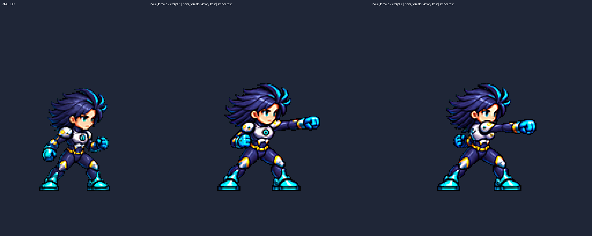
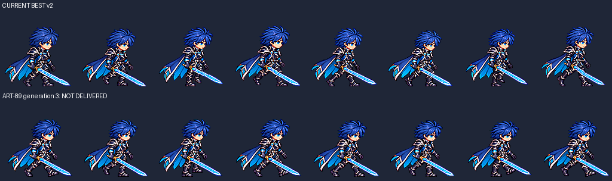

# CODEX-ART-89 — 전체 모션 행 재생성 결과

**완료:** 10개 행을 카드 순서대로 재생성·검토했고, **5개 행 / 24프레임**을 새 후보 PNG/JSON으로 전달한다. 내장 ImageGen **24회**, 행당 최대 3회. 최종 선택 10개 행의 **49프레임을 각각 최근접 4배로 직접 확인**했다. 후보는 사용자 채택 전이며 게임에는 연결하지 않았다.

## 행별 결과

E=눈 간격, W=눈 아래 노출 얼굴 폭, 해당 폼 idle=1.000. 측정 가능한 값의 허용 범위는 **0.96–1.04**다. —는 측정 불가이며 통과 수치로 바꾸지 않았다. 동작 O는 정적 프레임 연결의 육안 판단이고 실제 재생 검증은 아니다.

| 행 / 4배 비교판 | 생성 | 공통 배율 | E | W | 동작 목표 | 전달 |
|---|---:|---:|---|---|---|---|
| [Frey victory](frey-victory.png) | 3 | 0.345 | 1.025–1.081 | 0.857–1.000¹ | O | 미납품: 얼굴 |
| [Frey jump](frey-jump.png) | 2 | 0.1815 | 0.971–1.016 | 1.000 | O | [v3](../../art/bakeoff/frey/frey-jump-v3.png) |
| [Brave Luna hurt](luna_brave-hurt.png) | 2 | 0.170 | 1.034² | 1.000² | O | [v3](../../art/bakeoff/luna/luna_brave-hurt-v3.png) |
| [Brave Luna jump](luna_brave-jump.png) | 3 | 0.169 | 0.950–0.990 | 1.000 | O | 미납품: F1 E |
| [Brave Luna fall](luna_brave-fall.png) | 3 | 0.141 | 0.961–0.984 | 1.000–1.071 | O | 미납품: F1 W |
| [Yuki victory](yuki-victory.png) | 1 | 0.235 | 0.966–0.985 | 1.000 | O | [v2](../../art/bakeoff/yuki/yuki-victory-v2.png) |
| [Luna victory](luna-victory.png) | 2 | 0.253 | 0.971–1.003³ | 1.000³ | O | [v3](../../art/bakeoff/luna/luna-victory-v3.png) |
| [Nova female victory](nova_female-victory.png) | 2 | 0.264 | —⁴ | 1.000 | O | [v3](../../art/bakeoff/nova/nova_female-victory-v3.png) |
| [Rio male victory](rio_male-victory.png) | 3 | 0.295 | —⁴ | 1.000–1.067⁵ | O | 미납품: F5 W |
| [Rio male walk](rio_male-walk.png) | 3 | 0.270 | —⁴ | 1.000–1.100⁵ | X | 미납품: 얼굴·다리 교대 |

1. Frey victory F4–6의 폭 표식은 올린 팔/머리카락 영향을 받아 신뢰도가 낮다. 눈 간격 초과만으로도 실패한다.
2. Brave hurt F1·F2는 감은 눈과 기울어진 얼굴로 수치 제외. F3만 E/W를 판정했다. 제외된 자동 제안도 원본 JSON에 남겼다.
3. Luna victory F6 윙크는 프레임 얼굴 수치 제외. F1–5만 집계했다.
4. Nova/Rio는 기준 idle부터 먼 눈이 머리카락에 가려 E를 측정할 수 없다. 머리카락을 잡는 자동 E는 폐기했다. Nova F6의 W 자동 표식 점수가 낮아 4배 얼굴 경계도 확인했다.
5. Rio W는 대응점 제안값 범위로 확정 통과 판정에 쓰지 않았다. 승리 F5의 노출 폭은 격자로 **기준 68–83=15px, 새 100–116=16px**, 1.067을 확인했다. 걷기는 폭 초과 외에 동작도 실패한다.

## 무엇이 달라졌는가 — 육안 판단

- **Frey jump:** 도약의 뻗은 뒷다리 → 상승의 양무릎 접기 → 정점의 다리 풀기와 수평 망토를 구분했다. 검·방패 손은 유지했다.
- **Brave hurt:** F1 머리와 상체가 뒤로 젖혀짐 → F2 낮게 웅크림 → F3 가드 복귀. 닫힌 눈 두 장을 수치 통과처럼 취급하지 않았다.
- **Yuki victory:** 부적 손목 튕김 → 반대 손의 부채를 들어 반개방 → 완전 개방 → 턱 앞 유지. 눈높이 얼굴 경계가 부채 위에 남으며 소품 손이 유지된다. 마지막 미소는 작다.
- **Luna victory:** 위 → 오른쪽 → 아래 → 몸 앞 왼쪽 → 위로 한 방향 회전한다. F4에서 지팡이 팔이 몸 앞을 가로지르며 같은 손을 유지한다. F5 별 자세, F6 윙크로 끝난다. F3→4의 회전 간격은 여전히 비교적 크므로 뷰어 재생으로 최종 확인할 부분이다.
- **Nova female victory:** F1은 먼쪽 팔을 뻗어 가슴이 보이고, F2는 가까운 어깨와 팔이 가슴 앞으로 나오며 반대 손이 뒤로 물러난다. 가드 → 주먹 올림 → 유지 → 윙크가 이어진다.
- **미납품:** Frey victory의 한 번 검 올리기, Brave jump의 세 자세, Brave fall의 머리·스카프·다리 흔들림은 구분되지만 얼굴 조건을 충족하지 못했다. Rio victory F3의 기울인 검 → F4 수직으로 내려놓기는 개선됐으나 F3 칼날이 약간 짧아 보이며 얼굴 폭도 실패했다.
- **Rio walk:** F3·F7에서 든 발이 앞쪽으로 이동했으나 F1·F5 접지 자세와 지지 다리의 겹침이 반복된다. 1배에서 좌우 교대가 충분히 읽히지 않는다. 원래 ART-86 크기 범위는 유지했지만 수리 완료로 보지 않는다.

## 시각적 확인

왼쪽은 idle, 가운데는 먼쪽 팔 잽, 오른쪽은 가까운 어깨가 가슴 앞을 가리는 반대 팔 잽이다. 실제 후보의 픽셀을 최근접 4배로 표시했다.

위는 현재 v2, 아래는 이번 3차 최선 시도다. 확대하지 않은 원래 크기에서 접지 자세와 지지 다리의 교대가 충분히 달라지지 않아 미납품했다. 루트의 행별 PNG는 **idle + 기존 전체 행 + 새 전체 행** 4배 비교판이며, `qa4x/`는 전 프레임을 나눠 보기 위한 판이다. 실행 화면은 만들지 않았다.

## 측정과 처리

| 행 | 최소 여백 | detail 범위 | 최저 알파 y |
|---|---:|---|---|
| Frey victory | 21px | 91.77–98.52 | 전부 152 |
| Frey jump | 10px | 105.69–110.37 | 117, 113, 117 |
| Brave hurt | 7px | 126.65–131.20 | 전부 120 |
| Brave jump | 10px | 123.74–128.75 | 117, 114, 115 |
| Brave fall | 9px | 127.16–127.47 | 118, 117 |
| Yuki victory | 39px | 101.78–105.88 | 전부 152 |
| Luna victory | 36px | 104.60–109.81 | 전부 152 |
| Nova female victory | 39px | 97.69–102.35 | 전부 152 |
| Rio male victory | 27px | 120.50–130.72 | 전부 152 |
| Rio male walk | 4px | 140.43–145.56 | 전부 120 |

모든 최선 스트립의 정규화 기록은 이진 알파, 빈 테두리, spill 0, detail ≥79를 보인다. 최저 알파 위치만으로 부츠 접지를 단정하지 않고 4배 판에서 발과 소품을 구분했다. Rio walk 전체 실루엣 높이는 **94–97px**, 기존 v2는 **94–102px**다. 머리 템플릿 배율은 보조 지표로 보존했고 얼굴 판정 대신 사용하지 않았다.

ART-72/82의 `process.py`, `face_check.py` 및 ART-75/77 파생본을 이 보고서 폴더로 복사해 사용했다. 매 생성은 **Image 1=해당 폼 idle, Image 2=카드의 현재 행**이며 참고 이미지와 생성 원본은 `art/raw/motions-89/`에 복사했다. 행 전체를 한 번에 생성하고 하나의 공통 배율로 정규화했다. 프레임 교체 조합·부위별 변형·머리 붙이기·특징 코드 그리기는 하지 않았다.

설정은 LANCZOS + unsharp 60 + despill auto + palette none + 녹색 배경 제거다. 공중 행에는 공통 lift-scale 0.3을 사용했고, 걷기는 행 전체 x=-4 이동을 사용했다. 걷기의 8프레임 지원은 기존 normalizer를 읽기 import한 뒤 **출력 열 수만 8로 지정**하는 보고서 내부 어댑터다. `tools/`는 수정하지 않았다. 원본 재생성 횟수와 배율 시험 횟수는 다르며, 배율 시험을 생성으로 세지 않았다.

`best/<행>/face-proposed.json`과 대응점 그림은 자동 제안 원본이고, `face-measured.json`은 제외 프레임·판단을 덧붙인 기록이다. 1배 얼굴 폭은 약 12–18px라 1px 경계 차이가 크며, 소수점 표기는 측정 정확도 보증이 아니다. 허용 범위를 완화하지 않았다.

## 파일 및 검증

- `results.json`: 10개 선택 결과, 기존 파일과 idle SHA-256, 후보 경로, 측정 요약.
- `best/`: 행별 최선 스트립과 측정. 실패 5개는 이곳과 비교판에만 있고 `art/bakeoff/`에 새 후보를 만들지 않았다.
- `generation-ledger.json`, `prompts.txt`: 전체 24회 프롬프트 전문, 참조 순서, 원본 경로.
- `verify_delivery.py`, `audit.json`: PNG에서 알파·여백·spill·detail을 다시 계산하고 메타데이터·얼굴 대응점 수치·기존 파일 보존·커밋 목록 범위를 검사한다. 최종 실행 결과는 audit.json에 기록한다.
- `commit.ps1`, `commit-paths.txt`: 명시 목록을 `git add --pathspec-from-file`로 stage하도록 준비. **실행하지 않았다.** 카드와 프롬프트를 포함하고 raw, ref82, 다른 작업, per-attempt 디렉터리, `__pycache__`, `run.log`는 제외한다. `git add -f`를 쓰지 않는다.
- 기존 추적 파일의 `git diff`는 비어 있다. 제품 소스·도구·기존 후보는 변경하지 않았다. Godot, 실제 뷰어 재생·배포, git add/commit은 실행하지 않았다.

## 처리 실수 기록

초기 `run_variant.py`의 출력 경로 치환이 실패해, **이번 ART-89에서 새로 만든 Frey victory 3차 중간 정규화(.37)를 .345 배율 시험이 한 번 덮어썼다.** 덮어쓰기 금지 위반이다. 생성 원본과 작업 전 존재하던 자산은 그대로다. 해당 디렉터리는 strip과 얼굴 JSON의 배율이 불일치하므로 전부 납품 목록에서 제외했다.

이후 `run_variant_v2.py`에서 출력 경로를 정확히 치환하고 출력 디렉터리 부재를 먼저 검사하게 했다. 최종 Frey victory는 별도 새 경로 `attempts/frey-victory/g3-s345`에서 정규화와 얼굴 측정을 함께 다시 실행한 결과다. `package_results.py`는 모든 파일을 배타적 생성 모드로 기록한다. 상세 원문은 [processing-incident.txt](processing-incident.txt)에 남겼다.

## 현재 상태·남은 작업

**현재 상태:** 5개 후보를 사용자 모션 뷰어 검토에 넘길 수 있다. 실제 재생 품질과 사용자 채택은 미확인이다.

**남은 작업:** Frey victory 얼굴, Brave jump F1 눈 간격, Brave fall F1 얼굴 폭, Rio victory F5 얼굴 폭과 검 길이 연결, Rio walk의 좌우 다리 교대·얼굴 폭. 전부 3회 생성 상한에 도달했다.

**다음 권장 단계:** 리드가 후보 5행을 모션 뷰어에서 재생해 손·무기 연결과 타이밍을 확인한 뒤 사용자가 채택한다. 미납품 5행은 다음 카드에서 별도 처리한다. 자동 후속 작업은 예약하지 않았다.
