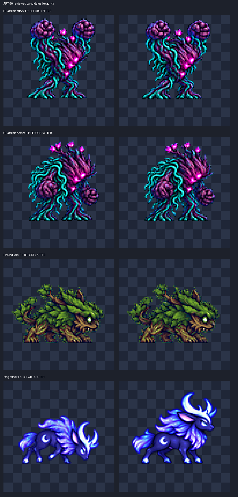

# ART-90 — 마지막 몬스터 수리 후보와 머리 재검사

완료: 수호자 2프레임, 사냥개 28프레임, 구형 사슴 4프레임을 수정했다. 수호자·사냥개 6행 합본도 재조립했다. 모두 **후보**이며 게임 적용·Godot 실행·git stage/commit은 하지 않았다.

| 항목 | 판정 | 실제 결과 |
|---|---|---|
| 수호자 attack F1 / defeat F1 | 완료 | 원본 재슬라이싱으로 상단 **3→4px**, 높이 **70→69px**, 발 **y72**. 주먹 크기/idle **0.995 / 1.003**(기존 수동 표식 환산, ±1px). attack-v2 신규, defeat-v2 갱신. 다른 프레임 동일. |
| 덩굴 사냥개 6행 | 완료 | **28프레임**, 잎 내부 대비 이상점 **1636→183**, RGB **3100px**만 보정. 알파·눈 보호 영역·위치·배율 동일. |
| 구형 달 사슴 attack | 완료 | F1/F2 원본 배율 **0.25→0.294**, F3/F4 전신 재작화. **4장 모두 고유**, 폭 **82/87/84/74px**, 최소 여백 **4px**. 공격 외 **20셀** 동일. |
| Luna fall-v3 머리 | 수정 불필요 | 수동 눈 간격 비율 **0.995–1.000**, 얼굴 폭 **1.000**. 자동 머리 중앙값 0.94와 구분. v3 그대로. |
| Nova 여성/남성 meteor_kick 머리 | 재검사 완료 · 수리 여부 미확정 | 여성 눈 **0.940–1.002**, 폭 **1.000–1.067**; 남성 눈 **0.998–1.125**, 폭 **1.031–1.062**. 가려진 눈/경계의 0.5–1px 표식 오차와 각도 차이를 분리하지 못했다. **허용 범위 통과로 인증하지 않음.** 확정 이탈 때만 수정하라는 카드에 따라 채택본 보존, 새 후보 없음. |

## 시각적 확인

왼쪽은 작업 전, 오른쪽은 최종 후보의 정확한 4배 확대다. 위부터 수호자 공격·패배 F1, 사냥개 대기 F1, 사슴 공격 F4다. 게임 화면이 아닌 실제 PNG 비교다.

수호자: [공격 1x](guardian-attack-1x.png) / [4x](guardian-attack-4x.png), [패배 1x](guardian-defeat-1x.png) / [4x](guardian-defeat-4x.png). 사냥개: [28장 전체 1x](hound-all-1x.png), `hound-<행>-4x-<부분>.png` 전 11장. 사슴: [F1–2 4x](stag-attack-4x-1.png), [F3–4 4x](stag-attack-4x-2.png), 같은 이름의 1x 판. **변경한 34프레임 전부 1x/4x 직접 확인**했다.

## 측정과 육안 판단

수호자는 원본이 온전했다. tight bbox 대신 투명 주변 4 원본px를 포함해 동일 배율 attack=0.1785 / defeat=0.1425로 다시 줄였다. 반올림·샘플링 위치 차이로 1px를 확보했으며, 상단을 지우거나 팔을 붙이거나 전신을 따로 줄이지 않았다. [주먹 크기 근거](guardian-size.json)는 ART-76 fix-1의 수동 주먹 표식을 실제 x 샘플링 비율로 환산한 값이다. 같은 부위의 투영 지표이며 전신 해부 비율 정밀 인증은 아니다.

사냥개는 기존 v2를 입력으로 잎 RGB 영역(G>1.08R, G>1.08B) 중 주변 8개에서 잎이 6개 이상인 픽셀만 검사했다. 주변 RGB 중앙값과 평균 밝기가 25 넘게 다르면 80%만 중앙값 쪽으로 보정한다. 밝은 눈 코어(R>150,G>180,B>100)와 주변 3px는 제외한다. 공간 전체 블러·팔레트 변경·알파 변경은 없다. 아래 이상점은 **수정 전 고정 마스크**에서 주변 밝기 중앙값과 차이>35인 픽셀 수로, ART-83의 원본 hue 마스크와 다르므로 그 숫자와 직접 이어 비교하지 않는다. 결함 개수나 미술 품질 점수도 아니다.

| 행 | 프레임 | 대비 이상점 전→후 | RGB 변경 | detail 후 |
|---|---:|---:|---:|---:|
| idle | 6 | 286 → 25 | 644 | 68.89–70.71 |
| walk | 6 | 416 → 33 | 756 | 88.84–92.78 |
| windup | 4 | 213 → 19 | 409 | 75.13–78.51 |
| attack | 6 | 320 → 72 | 540 | 92.04–96.32 |
| hurt | 2 | 177 → 15 | 339 | 79.68–80.62 |
| defeat | 4 | 224 → 19 | 412 | 78.65–80.93 |

잎 겹침·몸통·눈은 육안상 유지되고 잔점 대비가 줄었다. 미세 자연 질감은 남는다. ART-76의 detail≥85 목표는 일부 행에서 여전히 미달이다. 저대비화는 이번 점 정리의 부수 효과이며 이를 디테일 증가로 보고하지 않는다.

사슴 원본에는 3개 공격 자세만 있다. F1/F2는 JSON에 적은 원본 영역을 다시 잘랐다. F3는 0.294배에서 폭 약104px가 되어 88px 가용 폭을 넘으므로 뒷다리를 모은 전신을 재작화했다. F4는 F1 복제 대신 착지 후 회복을 그렸다. 이미지 도구 **2회**, 각 대상과 같은 행의 이웃 프레임을 참조했다. 고해상도 단일 출력은 F3=0.065, F4=0.075로 전신 축소했다. 이는 생성 원본 해상도가 다른 단일 포즈의 배율이다. 머리·다리 붙이기 없음. F1/F2의 원본 배율 일치와 F3/F4의 체격·윤곽은 4배에서 확인했지만, 재작화 질감 차이와 실제 재생 연결감은 남은 검토 대상이다. 기존 구형 시트의 발 경계 y72(마지막 불투명 픽셀 y71)를 유지했다.

## 얼굴 재검사 — 자동 점수와 구분

[수동 측정 JSON](head-rechecks.json), [Luna 표식](luna-manual-landmarks-4x.png), [Nova 여성 표식](nova_female-manual-landmarks-4x.png), [Nova 남성 표식](nova_male-manual-landmarks-4x.png). 청록=눈 중심, 노랑=머리카락 제외 얼굴 폭 끝점. 두 Nova 채택 스트립이 현재 게임 기술 시트 5행과 RGBA 동일함도 확인했다.

4배에서 수동으로 표식을 잡고 픽셀 좌표 확대에서 기록했다. 눈/경계 끝점은 최소 ±0.5px, 가려진 반대쪽 눈은 약 ±1px 불확실성이 있다. 약8px 눈 간격에서 허용 4%는 0.32px여서 표식의 작은 변화가 판정을 바꾼다. **Nova의 일부 명목값이 범위 밖인 사실을 숨기지 않으며, 그 행을 통과·수정 불필요로 확정하지 않는다.** 머리 전체 정합을 얼굴보다 우선해 억지로 맞추지도 않았다. 추가 local-patch 정합도 머리카락/가려진 눈으로 이동하여 판정 근거에서 제외했다.

`head_scale.py` 실제 실행 결과: Luna 0.94, Nova 여성 1.02, 남성 1.04(중앙값). 개별 프레임은 JSON에 있다. 이 값만으로 Nova 수동 표식의 불확실성을 해소할 수 없다. **남은 작업은 Nova 얼굴의 대응 표식을 리드와 재확정하는 것**이다. 확정 전에는 채택된 v1을 건드리지 않았다.

## 정적 검사와 인계

[verification.json](verification.json): 정적 검사 **173/173 통과**, 변경 고유 프레임 **34**, 비대상 파일 **2,230개 SHA-256 동일**. 이는 PNG/메타데이터/변경 범위 검사 결과이며 Nova 얼굴이나 실제 재생의 합격 판정이 아니다.

- 수호자 F1 외 사용 8프레임 동일, 빈 셀 동일. 최소 여백4·발y72·이진알파·spill0.
- 사냥개 28프레임 알파·밝은 눈+3px 동일, 변경 RGB가 명시된 함수와 일치. 정상 잎 녹색을 spill로 오판하지 않으며 순수 #00ff00은 0.
- 6행 합본 2장 모든 행이 최종 스트립과 동일. 구형 사슴 4개 공격 셀 외 20셀 동일, PNG 576×384 유지.
- checkpoint v1·채택 캐릭터·제품 코드·tools·qa23 보존. ART-89 행 미변경. 패키지 설치/다운로드 없음. Godot·게임·모션 뷰어 실행 없음.

[commit.ps1](commit.ps1)은 **작성/구문 검사만 하며 실행하지 않는다**. [files-to-stage.txt](files-to-stage.txt)의 명시 목록만 `git add --pathspec-from-file`로 stage한다. 카드·프롬프트를 포함하고 raw/qa23/다른 유닛/시도별 덤프/run.log/캐시를 제외한다. `git add -f` 없음, 커밋 끝은 지정 공동 작성자 줄이다.

재검증: 지정 Python + `PYTHONDONTWRITEBYTECODE=1`로 `reports/codex-art-90/verify.py`. 로컬 입력 사본과 baseline이 필요하다. 배포 후 동일 상태 재현은 base commit과 [출처 해시](source-manifest.json), 최종 후보 및 [measurements.json](measurements.json)을 기준으로 한다. 사용 입력·생성 원본은 모두 `art/raw/art-90/`에 복사했고 git 대상에서는 제외했다.

다음 권장 단계: 리드가 수호자·사냥개·구형 사슴 후보를 모션 뷰어에서 검토하고, Nova 눈/얼굴 대응점의 가림 문제를 먼저 확정한다. 게임 채택/연결은 이 작업에 포함되지 않았다.
