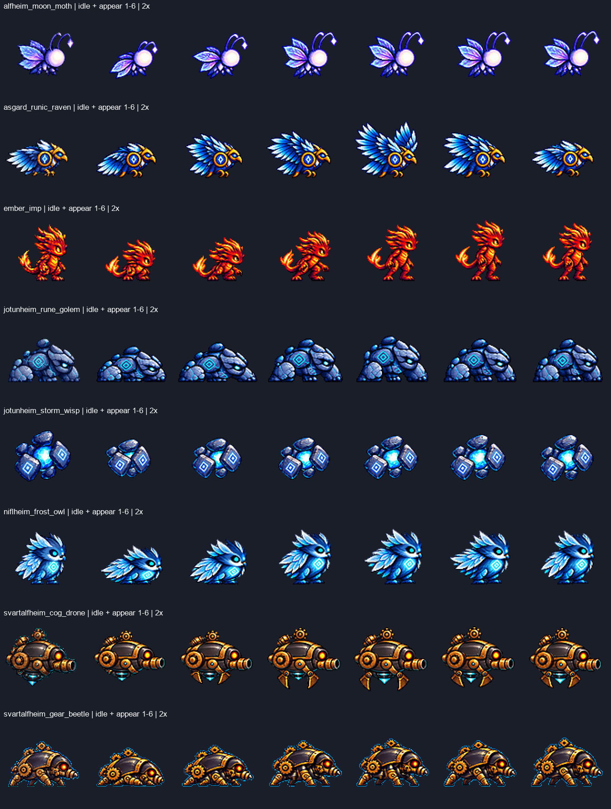

# ART-91 작업 결과

작성: 2026-10-28T15:51:29.950496+09:00 · `codex/art-91`

**완료:** Part 1 목록은 14:46 KST에 저장(15:05 이전). Part 2는 `appear` **8행·48프레임**을 행별로 전달했다. 최종 실패/보류는 **2행**, 미착수 appear는 **8종**이다. 모든 appear를 끝내지 못했으므로 `rage`·`sleep`·`flee`는 시작하지 않았다.

**현재 상태:** 전부 나중에 선택할 후보이며 게임 연결·Godot 실행·뷰어 게시·설치·다운로드·스테이징·커밋은 하지 않았다. 마지막 새 행은 딱정벌레로 15:40:53 시각 확인 후 시작했고, 15:45 이후 새 행 생성은 없었다.

## 목록과 담당 경계
[한국어 모션 목록](inventory.md) · [기계 판독 목록](inventory.json) · [행별 진행 기록](progress.md)
- 전투원 8형태·몬스터 18종, 기존 bakeoff PNG 554개 전수 조사. 후보 버전·adopted 표시·현재 게임 행을 분리했다.
- 몬스터 현행 게임은 모두 4행(idle/walk/attack/hurt); 6행 후보 존재와 실제 게임 반영을 구별했다.
- 일반 모션 제안: 몬스터 appear 우선 1, rage 우선 2; 전투원 run_stop·air_recovery 등. ART-92의 dodge_roll/taunt/stun/crouch/run_start와 기술 세션 소유 행은 제작에서 제외했다.

## 시각적 확인

각 줄의 첫 칸은 기존 idle, 이어지는 6칸이 새 appear다. 위 그림은 2배 정지 비교판이며 각 행 링크는 원본 픽셀을 nearest로 4배 확대한 비교판이다. 게임 실행 화면은 아니다.

## 전달 행
|몬스터|행·파일|프레임|최소 여백|idle 대비 크기 지표|확인|
|---|---|---:|---:|---|---|
|alfheim_moon_moth|[appear PNG](../../art/bakeoff/monsters/alfheim_moon_moth-appear-v1.png) · [4배 비교](alfheim_moon_moth-appear.png)|6|12px|0.998~1.013|PASS · spill 0|
|asgard_runic_raven|[appear PNG](../../art/bakeoff/monsters/asgard_runic_raven-appear-v1.png) · [4배 비교](asgard_runic_raven-appear.png)|6|5px|0.986~1.040|PASS · spill 0|
|ember_imp|[appear PNG](../../art/bakeoff/monsters/ember_imp-appear-v1.png) · [4배 비교](ember_imp-appear.png)|6|6px|0.969~1.039|PASS · spill 0|
|jotunheim_rune_golem|[appear PNG](../../art/bakeoff/monsters/jotunheim_rune_golem-appear-v1.png) · [4배 비교](jotunheim_rune_golem-appear.png)|6|4px|0.989~1.011|PASS · spill 0|
|jotunheim_storm_wisp|[appear PNG](../../art/bakeoff/monsters/jotunheim_storm_wisp-appear-v1.png) · [4배 비교](jotunheim_storm_wisp-appear.png)|6|15px|0.985~1.026|PASS · spill 0|
|niflheim_frost_owl|[appear PNG](../../art/bakeoff/monsters/niflheim_frost_owl-appear-v1.png) · [4배 비교](niflheim_frost_owl-appear.png)|6|12px|0.990~1.021|PASS · spill 0|
|svartalfheim_cog_drone|[appear PNG](../../art/bakeoff/monsters/svartalfheim_cog_drone-appear-v1.png) · [4배 비교](svartalfheim_cog_drone-appear.png)|6|5px|0.954~1.026|PASS · spill 0|
|svartalfheim_gear_beetle|[appear PNG](../../art/bakeoff/monsters/svartalfheim_gear_beetle-appear-v1.png) · [4배 비교](svartalfheim_gear_beetle-appear.png)|6|8px|0.988~1.019|PASS · spill 0|

## 측정 사실과 육안 판단
- 실제 PNG 검사: 576×96, 고정 96px 분할, 6개 서로 다른 프레임, 셀 여백 ≥4px, 이진 알파, spill=0. 지상형 발 하단 y72; 부유형은 몸 표식을 기준 높이에 맞췄다.
- **크기 열은 대표 부위의 명목 지표**다. 나방은 밝은 머리 연결 영역, 까마귀는 문양 전체 고리의 반경 중앙값; 나머지는 얼굴·두개부·돌 장축·외피의 수동 표식이다. 수동 원본 끝점 약 ±3px, idle 끝점 약 ±1px의 불확실성이 있고 전체 해부 구조의 정밀 계측은 아니다. 각 `*-checks.json`에 원본 좌표·방법·공통 배율·판정 한계를 남겼다.
- 같은 외형·색조, 등장 동작의 읽힘, 별도 효과가 없는지는 비교판 육안 판단이다. 자동 수치가 미술 품질을 증명하지 않는다.
- 모든 행에 행 공통 배율 하나를 사용했다. LANCZOS + unsharp 60, palette none. 필요한 행은 표준 despill auto를 적용했고, 부유 정렬은 프레임 전체 평행 이동만 사용했다.
- 나방·위습의 후반 정착 변화는 작다. 드론은 마지막 집게가 idle보다 조금 열려 있고, 까마귀/드론은 여백을 위해 가로 정렬이 기준보다 약 2~2.5px 오른쪽이다. 실제 재생 연결감은 아직 확인하지 않았다.

## 실패·수정 이력
|대상|최종 상태|이유|
|---|---|---|
|alfheim_moon_stag / appear|실패·미전달 (2회 생성)|뿔이 가는 열린 초승달형에서 두꺼운 왕관형으로 변함. 정체성 기준 탈락(육안).|
|asgard_aegis_ram / appear|보류·미전달 (1회 생성)|축소 후 뿔 색 영역이 끊겨 전 프레임 크기 ±5%를 신뢰성 있게 확인하지 못함. 실제 해부 크기 불량으로 확정한 것은 아님.|
|ember_imp / appear|수정 후 최종 전달|초기 검사에서 순수 키색만 세어 번짐 판정 8픽셀을 놓쳤다. 첫 전달을 회수·raw 보존한 뒤 표준 despill auto와 전체 교차 검사로 spill0 확인 후 새 최종 파일을 제공했다.|
|jotunheim_rune_golem / appear|2안 최종 전달|첫 원본 F5가 고정 셀 오른쪽 경계에 접촉. 재생성으로 해결.|
|jotunheim_storm_wisp / appear|2안 최종 전달|첫 안은 idle과 차이가 작았다. 두 번째 안은 룬판을 접었다 펴 핵이 드러나는 동작으로 변경.|

[전체 실패 이력](failed-rows.md). 실패 종의 후보 파일은 bakeoff에 없고 원본은 `art/raw/monsters-91/`에만 있다. 이번 작업 중 만든 임프 중간 전달본은 회수 보관했으며, 작업 시작 전에 존재하던 파일을 교체하지 않았다.

## 최종 검증
[정적 검사 결과](verification.json): **8행·48프레임 PASS**, 기존 목록에 있던 **554개 PNG 해시 동일**. `git diff --name-only`와 `git diff --cached --name-only`는 빈 출력이었다. Godot 테스트나 실제 게임 재생을 했다는 뜻은 아니다.
- 내장 ImageGen 13회(행당 최대 2회). [전체 프롬프트](prompts.json). 원본·버린 시도·눈금판은 raw에 보존하고 커밋에서 제외했다.

## 남은 작업·다음 권장 단계
- 미착수 appear 8종: midgard_rooftop_slinger, mossling, muspelheim_magma_boar, niflheim_glacier_wolf, vanaheim_seed_sprite, vanaheim_vine_hound, yggdrasil_root_guardian, yggdrasil_root_oracle.
- rage 18종, sleep/flee 전부 미착수. 다음 작업은 남은 appear와 두 보류 행을 마친 뒤 rage 순서다.
- 리드/사용자가 8개 후보를 모션 뷰어에서 재생해 전환과 약한 후반 동작을 검토하고 채택 여부를 결정한다.

## 인계
[commit-paths.txt](commit-paths.txt)에는 최종 행·비교판·검사 근거·보고서만 있다. [commit.ps1](commit.ps1)은 이 목록 + inventory.md/json + ART-91 카드/prompt를 `git add --pathspec-from-file`로 스테이징하도록 준비했다. **실행하지 않았으며 커밋 명령도 넣지 않았다.** raw, 시도 덤프, run.log, __pycache__, 다른 작업 파일은 제외한다.
