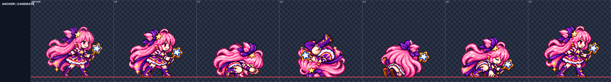

# CODEX-ART-92 결과

작성: 2026-10-28T15:52:26+09:00. 브랜치 `codex/art-92`.

**완료:** 11행을 시도하여 **4행 / 24프레임**을 납품했다. 내장 ImageGen 19회. 통과 즉시 PNG/JSON·4배 비교판·progress.md·commit-paths.txt에 행별 반영했다. 후보이며 게임에는 연결하지 않았다.

## 납품한 행

폼 | 행 | 파일 | 프레임 | 검사
---|---|---|---|---
luna | dodge_roll | [PNG](../../art/bakeoff/luna/luna-dodge_roll-v1.png) / [4배 판](luna-dodge_roll.png) | 6 | W 1.000–1.000; E 1.002–1.031; 여백≥7; detail≥85.90; spill 0
nova_male | dodge_roll | [PNG](../../art/bakeoff/nova/nova_male-dodge_roll-v1.png) / [4배 판](nova_male-dodge_roll.png) | 6 | W 1.000–1.000; E 측정 불가; 여백≥7; detail≥99.40; spill 0
nova_female | dodge_roll | [PNG](../../art/bakeoff/nova/nova_female-dodge_roll-v1.png) / [4배 판](nova_female-dodge_roll.png) | 6 | W 1.000–1.000; E 측정 불가; 여백≥7; detail≥86.36; spill 0
rio_female | dodge_roll | [PNG](../../art/bakeoff/rio/rio_female-dodge_roll-v1.png) / [4배 판](rio_female-dodge_roll.png) | 6 | W 1.000–1.000; E 측정 불가; 여백≥7; detail≥96.64; spill 0

## 미납품한 행

폼 | 행 | 이유
---|---|---
frey | dodge_roll | 1차 F5 E=1.443/W=0.829 자동 대응점은 자세 영향으로 신뢰 낮음; F6 W=1.043 기준 초과. 2차 원본 F2 오른쪽 경계 접촉으로 고정 분할 실패. 2회 상한.
luna_brave | dodge_roll | 2회 생성. 2차 배율0.280: F1 E0.971/W1.000, F6 E0.985/W1.071. 0.2765로 낮추면 F6 W1.000이나 E0.913. 검토한 공통 배율에서 얼굴 두 조건 동시 충족 못함.
rio_male | dodge_roll | 1차 원본 F1 검이 고정 분할 경계 초과. 2차 배율0.320 F1 W0.967/F6 W1.000이나 F2 얼굴 W0.817, 팔·검과 가림으로 자동 대응 신뢰도도 낮아 전체 얼굴 조건 통과를 확정하지 못함. 2회 상한.
yuki | dodge_roll | 1차 F2 원본 경계 접촉. 2차 배율0.32 detail 최저71.02, E0.850/0.868. 배율0.36 E0.980/0.962이나 W1.083이고 detail 최저67.43<79. 2회 상한.
frey | taunt | 1차 원본 분할 경계 접촉. 2차 공통배율0.325에서 F3 E1.050, F5/F6 W1.057로 얼굴 조건 실패. 다른 픽셀 검사 통과하지만 미납품. 2회 상한.
luna | taunt | 1차 원본 F1 별 지팡이 경계 초과 및 손 전환 의심. 2차 3x2 재생성: 배율0.255에서 F1/F2 W0.929, F4 E1.071로 얼굴 조건 실패. 배율0.245도 W0.929. 2회 상한.
luna_brave | taunt | 2회 생성. 2차 배율0.250에서 F2 E0.947/W1.071, F5 E0.954, F6 E0.956/W1.071. 0.235에서는 얼굴이 작음. 전 프레임 얼굴 조건 미충족. 픽셀 검사 통과지만 미납품.

## 측정과 육안 판단의 구분

측정 사실: 고정 셀 가로 6칸, 이진 알파, 최소 4px 여백, spill 0, detail≥79, 전 프레임 서로 다른 픽셀, 접촉선 y=120(구르기)/152(도발)를 검사했다. 얼굴은 ART-89의 4배 대응점 방식으로 눈 간격 E와 눈 아래 노출 얼굴 폭 W를 idle 대비 측정했다. 보이는 얼굴의 유효 측정값은 0.96–1.04만 통과시켰다.

회전·등짐·가림·감은 눈은 사유와 null을 기록했다. Nova/Rio는 idle부터 먼 눈이 머리카락에 가려 E를 판정에서 제외하고 W로 비교했다. 자동 대응점과 머리 템플릿은 제안이며, 팔/다리를 잡는 경우 실제 얼굴 ROI로 재측정했다. 제외값을 정상 수치로 치환하지 않았다. 소수점 표시는 측정 정확도 보증이 아니다.

육안 판단: 원래 의상·소품·손 연결·동작 단계와 바닥 접촉을 정적 4배 판에서 검토했다. 픽셀 최저 위치만으로 부츠 접지를 단정하지 않았다. 구르기 중간에는 어깨/등/머리·망토가 바닥에 닿는다. 실제 애니메이션 재생과 게임 내 체감은 검증하지 않았다. 각 후보 JSON note에 약점을 남겼다.

## 처리 방법

매 생성마다 idle 앵커와 같은 폼의 tumble 또는 victory를 참조하고 전체 6프레임을 한 이미지로 생성했다. LANCZOS + unsharp 60 + despill auto + palette none, 행 전체 공통 배율만 사용했다. 프레임별 크기 변경·부위 그리기·머리 붙이기·프레임 혼합은 하지 않았다. 도발의 일부는 ART-89 victory와 같은 3×2 원본 배치로 생성했고, 출력은 6×1 고정 셀 스트립이다. 원본에서 경계를 넘은 시도는 재생성하거나 탈락시켰다.

이전 스크립트를 보고서 경로로 복사한 뒤 어댑터로 호출했다. 기존 product/tools/자산 파일은 수정하지 않았다. 중간 시도와 실패 원본은 git-ignored `art/raw/motions-92/`에 보존했다. 결과·중간 파일은 배타적 생성, progress/manifest는 카드 지시에 따라 append했다. Windows UTF-8 읽기 오류와 CLI JSON 인용 오류는 출력 생성 전 중단됐고, UTF-8 환경과 올바른 인용으로 다시 실행했다.

## 시각적 확인

왼쪽은 원래 idle, 오른쪽 여섯 칸은 실제 납품 후보의 최근접 4배 픽셀이다. 다른 행 비교판은 위 표에서 열 수 있다.

## 현재 상태·남은 작업

자동 검증 결과는 [audit.json](audit.json), 원본 프롬프트와 참조 순서는 [generation-ledger.json](generation-ledger.json), 실패 측정은 [failed-checks.json](failed-checks.json)에 있다. `commit.ps1`은 명시된 목록만 `git add --pathspec-from-file`로 스테이징하도록 준비했으며 실행하지 않았다. `git add`, commit, Godot, 설치, 다운로드, 배포를 하지 않았다.

미착수 항목:
- `taunt`: nova_male, nova_female, rio_male, rio_female, yuki
- `stun`: frey, luna, luna_brave, nova_male, nova_female, rio_male, rio_female, yuki
- `crouch`: frey, luna, luna_brave, nova_male, nova_female, rio_male, rio_female, yuki
- `run_start`: frey, luna, luna_brave, nova_male, nova_female, rio_male, rio_female, yuki (앞선 4동작 완료 후의 선택 작업)

다음 권장 단계: 리드가 납품 후보를 모션 뷰어에서 재생해 검/손 연결과 타이밍을 확인하고 사용자 채택을 받는다. 미납품·미착수 행은 별도 후속 카드로 진행한다. 후속 작업은 예약하지 않았다.
