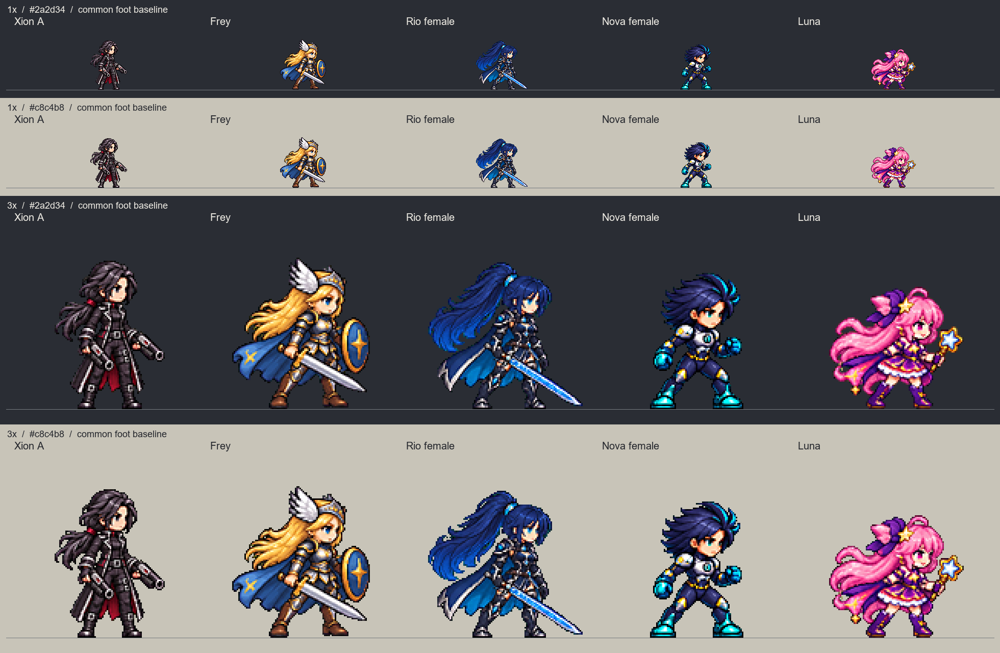

# CODEX-ART-94A — Xion 「긴 코트」

검정 롱코트의 은색 테두리와 진홍 안감, 낮은 포니테일로 A안을 만들었다.
두 손에는 같은 모델의 짧은 펌프식 산탄총을 들며, 굵은 총구·은색 몸체판·작은 진홍 장식으로 구분한다.
전신·얼굴·대기 앵커와 검수 자료를 납품한다. **외형 비교용 후보이며, 대기 발 고정은 미달**이다. 게임에는 적용하지 않았다.

## 측정한 결과

| 파일/항목 | 측정 | 상태 |
| --- | --- | --- |
| `xion_illustration-a.png` | 1024×1536 RGBA, 인물 높이 1352px(88.02%), 여백 10/92/11/92px, 테두리 침범 0 | 납품 |
| `xion_face-a.png` | 256×256 RGBA, 512px 정사각형 원본에서 LANCZOS, 눈 높이 40.04% | 납품 |
| 일러스트·얼굴 알파 | 투명 RGB 잔류 0, 녹색 잔류 0, 불투명 실루엣 2px 밖 약한 알파 잔류 0 | 통과 |
| `xion-idle-a.png` | 768×128, 6프레임, 공통 배율 0.22234892, 높이 97/98/100/99/97/97px | 납품·재검토 |
| 머리 자동 측정 | F1 대비 여섯 프레임 모두 1.00, 점수 0.92–1.00, 중앙값 1.00 | 통과 |
| 내부 디테일 | 평균 113.54 / Rio 여성 현재 대기 95.55 = 118.83% | 통과 |
| 스프라이트 경계 | 1px 테두리 비움, 최소 여백 7px, 초록 번짐 0, 이진 알파 | 통과 |
| 발 고정 | y=120 유지, 왼쪽 발 가로 위치 폭 1px·오른쪽 발 2px | **완전 고정 미달** |
| `lineup.png` | 1960×1280, Xion/Frey/Rio 여성/Nova 여성/Luna, 1×·3×, 두 배경, 같은 발선 | 납품 |
| `idle-4x.gif` | 512×512, 6프레임 무한 반복, 한 바퀴 950ms | 납품 |

GIF는 10ms 단위라 약 6.316fps로 기록된다. 후보 JSON은 정확히 6.3fps다. `compare.png`는 정규화 도구가 만든 3774×1094, 4배 최근접 비교판이다.

수동 랜드마크 측정은 자동 검출과 구분한다. 전신은 정수리–턱 186px로 약 7.14등신이다. 스프라이트 F1 주 머리 높이는 약 29px, Rio 여성은 약 28px(각 ±1px 육안 지정)으로 비슷하다. Xion의 엄밀한 비율은 약 3.3등신으로, 정확한 3.0은 아니다.

## 직접 본 것

- 최종 일러스트를 1024×1536 원본 크기로 보고, 양팔의 어깨–팔꿈치–손목 연결, 손잡이에 감긴 손가락·바깥 엄지·방아쇠울 안 검지, 두 부츠 전체를 확인했다. 손과 부츠는 `anatomy-2x.png`에서도 확인했다.
- 두 총은 굵은 열린 총구, 아래 펌프 손잡이, 은색 측판과 작은 진홍 장식이 같은 모델로 읽힌다. 뒤쪽 총은 원근으로 짧게 보인다. 손가락 일부는 손잡이에 가려진다.
- 얼굴을 2배로, 최종 대기 여섯 장을 각각 4배로 확인했다. 한 얼굴, 두 손·두 총·두 부츠가 유지되고 얼굴 앞을 막는 부품이나 이펙트는 없다. 스프라이트 손가락과 방아쇠는 해상도상 낱개 판독이 어렵다.
- 코트·머리의 지연은 작고 F3에서 가장 높아진다. F5와 F1 높이는 같아 프롬프트의 가장 낮은 호흡 차이는 약하다. 넓은 머리카락 덩어리는 Rio와 비슷하지만 실루엣은 더 좁고 검정·진홍으로 분리된다.
- GIF는 저장 후 다시 열어 프레임·시간·반복 값을 검사했다. **실시간 재생 및 게임 안 실행 검증은 하지 않았다.**

위 그림은 발선을 맞춘 실제 후보와 현재 게임 스프라이트다. 위 두 줄은 1배, 아래 두 줄은 3배다.

## 생성과 남은 작업

내장 이미지 도구로 일러스트 1회, 대기 3회를 생성했다. 대기 1차는 발 4px 흔들림과 약한 호흡, 2차는 약 1px 흔들림이 남았다. 3차는 호흡과 디테일·머리 일관성이 좋아 선택했지만 발 최대 2px 차이가 남았다. 허용된 재생성 2회를 모두 써서 추가 생성하지 않았다. 프레임별 크기 변경이나 머리·발 붙여넣기는 하지 않았다.

최종 프롬프트는 `prompt-illustration.txt`, `prompt-idle.txt`이며 대기 1–3차도 별도 보존했다. 실제 생성 원본과 참조는 `art/raw/xion-94a/`에 보존했다(커밋 제외). 약한 알파 잔여만 정리했고 전신 비율은 한 배율로 유지했다.

**다음 권장 단계:** 리드가 시안 월드컵에서 외형을 비교한다. A가 선택되면 발 고정, 약 3.3등신 비율과 F5 호흡을 판단한 뒤 다음 동작의 앵커로 확정해야 한다. 다른 동작·이펙트·게임 적용은 이번 카드 범위 밖이다.

`commit.ps1`을 작성했으며 실행하지 않았다. A 허용 경로만 작성했고 B 폴더는 열지 않았다. `smash-nine-prototype/` 변경과 staged 변경은 없다.

