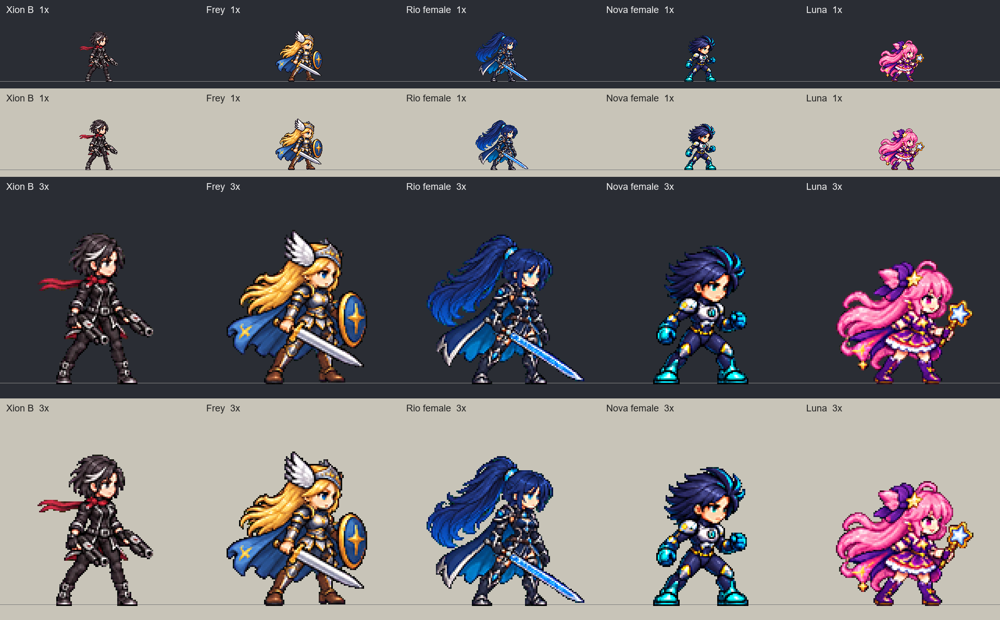

# Xion B — 짧은 코트

검은 상부 허벅지 길이 재킷과 은색 선, 진홍 스카프로 실루엣을 정했다.
짧은 검은 단발과 은색 한 줄로 얼굴을 드러내고, 바지와 부츠로 두 다리를 구분했다.
굵은 빈 총구·하부 탄창 튜브·펌프 손잡이가 있는 동일 모델의 짧은 산탄총을 양손에 든다.

## 완료 · 현재 상태

ART-94 B의 전신, 얼굴, 대기 6프레임과 검수 자료를 후보로 제출한다. 전신 1회, 대기 2회 모두 내장 이미지 도구로 생성했다. 실제 원본은 `art/raw/xion-94b/`에 보존했다. 다른 방향은 열지 않았으며 제품 파일은 바꾸지 않았다. `commit.ps1`은 작성만 하고 실행하지 않았다.

| 파일 | 규격 | 측정 | 제출 |
| --- | --- | --- | --- |
| `art/bakeoff/xion/b/xion_illustration-b.png` | 1024×1536 RGBA | 높이 1352px(88.02%), 여백 좌/상/우/하 62/92/63/92px, 외곽 침범 0 | 완료 |
| `art/bakeoff/xion/b/xion_face-b.png` | 256×256 RGBA | 전신의 512×512 영역을 LANCZOS 축소, 수동 눈 기준 높이 40.33% | 완료 |
| `art/bakeoff/xion/b/xion-idle-b.png` | 768×128, 6칸 | 높이 97/97/98/97/96/97px, 머리 중앙값 0.98, 디테일 Rio 대비 115.48% | 완료 |
| `xion-idle-b.json` | UTF-8 JSON | 6프레임, 6.3fps, 반복 | 완료 |
| `lineup.png` | 1920×1192 | Xion/Frey/Rio 여성/Nova 여성/Luna, 1×·3×, 두 배경, 발선 정렬 | 완료 |
| `idle-4x.gif` | 512×512, 6프레임 | 160/160/160/160/160/150ms, 한 바퀴 950ms | 완료 |
| `compare.png`, `metrics.json`, 프롬프트·검수 코드 | 4× 비교 / UTF-8 | 정규화 결과와 추가 측정·수동 판정을 분리 기록 | 완료 |

## 수치로 확인한 것

- 대기 전체에 공통 배율 **0.22196796** 하나만 적용했다. LANCZOS, 선명화 60, despill auto, 팔레트 없음, 발 y=120 고정. 프레임별 확대·축소, 부위 붙이기, 수동 위치 이동은 하지 않았다.
- 6칸 모두 1px 테두리 비움, 최소 여백 7px, 초록 번짐 0, 이진 알파. 내부 디테일 109.69–111.33, 평균은 현재 Rio 여성의 115.48%다.
- `head_scale.py`는 6/6칸을 사용했다(점수 0.911–1.000). 배율 1.00/0.96/0.96/0.96/1.00/1.00, 중앙값 **0.98**. 저신뢰 대체 판정은 필요하지 않았다.
- 전신·얼굴 알파 범위 0–255, 투명 픽셀의 RGB 잔류 0, 초록 우세 색 프린지 0. 직접 투명 생성의 낮은 알파 가장자리에 축소 후 생긴 RGB 편차를 정리했다(전신 51px, 얼굴 8px). 부드러운 알파는 유지했다. 프린지 수치는 `metrics.json`에 정의한 색 검사이며, 모든 종류의 광륜을 자동 판별한다는 뜻은 아니다.
- 전신 등신은 **수동으로 정수리 y=92, 턱 y=288을 찍어 계산한 약 6.90등신**이다. 자동 해부학 측정값이 아니다. 얼굴 눈 위치도 수동 기준점이다.
- GIF는 10ms 단위 제약 때문에 평균 약 **6.316fps**다. 게임용 JSON의 정확한 설정은 6.3fps다.

## 눈으로 확인한 것

전신을 밝은/어두운 배경에서 각각 원본 1024×1536으로 확인했다. 양팔의 어깨–팔꿈치–손목 연결, 손잡이를 감싼 손가락과 방아쇠울 부근 검지, 두 총의 굵은 총구·펌프·탄창 튜브·동일한 은색 패널, 두 부츠 전체를 확인했다. 움켜쥔 손은 가려진 손가락 끝까지 다섯 개를 낱개로 세는 구도가 아니다. 추가 팔·끊긴 총·잘린 발은 보이지 않는다.

얼굴은 `face-2x.png`에서 2배로, 대기는 `idle-review-1.png`~`3.png`에서 모든 칸을 각각 4배로 확인했다. 한 얼굴, 양손과 두 산탄총, 낮게 앞으로 향하는 총구, 두 발, 가려지지 않은 얼굴을 확인했다. Rio와 나란히 보면 주머리 크기는 비슷하되 Xion 단발의 옆 볼륨은 더 넓다. 검정·은·진홍은 기존 로스터의 청록/파랑/금/분홍과 구분된다. 이 판단은 육안 판정이다.

위 비교판은 실제 게임의 대기 1번 칸과 이번 후보를 같은 배율·발선에서 나란히 둔 것이다. 위 두 줄은 1배, 아래 두 줄은 3배이며, 배경 밝기에 따른 색 구분도 확인할 수 있다.

## 남은 문제 · 다음 단계

- 첫 생성은 스카프가 몸통 기준선을 통과하면서 정규화된 F3·F4가 약 7px 옆으로 밀려 제외했다(`idle-v1-contact.png`, `idle-v1-metrics.json`). 두 번째 생성에서 스카프를 어깨 뒤에 모아 큰 밀림을 없앴다.
- 현재도 아래 5줄의 발 윤곽 중심은 뒤쪽 발 **1.5px**, 앞쪽 발 **1px** 범위에서 변한다. 완벽하게 픽셀 고정된 발은 아니다.
- 스프라이트 스카프는 전신보다 짧고 수평이다. 호흡·천의 지연은 작게 읽히며, 실시간 루프 재생과 게임 적용 테스트는 하지 않았다. 정지 6프레임·GIF 프레임 수와 시간만 검증했다.
- 다음 권장 단계는 리드의 시안 월드컵 비교와 외형 선택이다. ART-95의 나머지 동작, 게임 연결, 커밋은 수행하지 않았다.

재현: 지정 Python에서 `PYTHONDONTWRITEBYTECODE=1`을 설정하고 `process_illustration.py`, 카드의 `normalize.py` 명령(`idle-v2.png`, 높이 97, `--ground-all`), `head_scale.py`, `package_review.py`, `verify_delivery.py` 순으로 실행한다. `prepare_review.py`는 첫 시도 보존용이므로 다시 실행하지 않는다.
