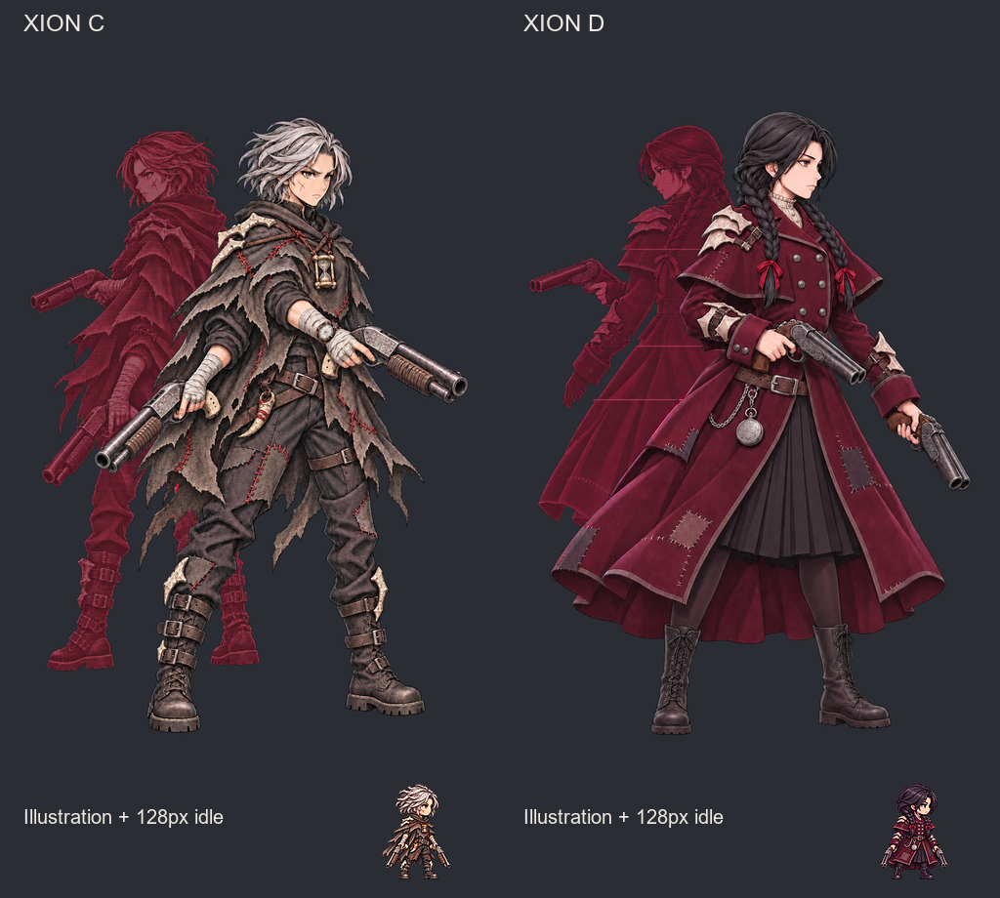

# Xion C·D — 이야기에서 확장한 외형 후보

**C — 시간에 바랜 생존자:** A·B의 재단된 검정 코트에서 벗어나 잿빛 머리와 괴물 가죽 판초로 만들었다.  
진홍 꿰맨 자국·모래시계·붕대·손목시계·뿔 조각, 뼈 손잡이 펌프식 쌍산탄총으로 백 년의 생존을 드러냈다.  
D의 단정한 옛 복장과 달리, 찢어진 비대칭 실루엣과 거친 재료가 중심이다.

**D — 백 년 전의 소녀:** A·B의 현대 검정 코트 대신 버건디 더블브레스티드 울 코트와 넓은 케이프 칼라를 입혔다.  
땋은 머리·진홍 리본·주름치마·타이츠·끈 부츠·은색 회중시계에 수선 패치와 괴물 뼈 보강을 더했다.  
C의 거친 생존복과 달리 옛 시대의 실루엣을 지키며, 중절식 쌍열 산탄총을 든다.

## 완료 · 현재 상태

두 안의 투명 전신 원화와 128×128 대기 한 프레임, JSON, 비교판, 프롬프트, 측정 자료를 납품한다. 내장 이미지 도구로 생성했고 실제 생성 원본은 `art/raw/xion-95a/`에 보관했다. 외형 선택용 후보이며 게임에 적용하지 않았다. `commit.ps1`은 작성만 했고 실행하지 않았다.

| 파일 | 규격 | 측정한 결과 | 납품 |
| --- | --- | --- | --- |
| `art/bakeoff/xion/c/xion_illustration-c.png` | 1024×1536 RGBA | 실루엣 높이 1265px, 여백 좌/상/우/하 60/158/63/113px, 알파 0–255 | 완료 |
| `art/bakeoff/xion/d/xion_illustration-d.png` | 1024×1536 RGBA | 실루엣 높이 1280px, 여백 59/148/59/108px, 알파 0–255 | 완료 |
| `art/bakeoff/xion/c/xion-idle-c.png` | 128×128, 1프레임 | 공통 배율 0.09683794, 높이 98px, 내부 디테일 134.66 / Rio 평균 대비 140.93% | 완료 |
| `art/bakeoff/xion/d/xion-idle-d.png` | 128×128, 1프레임 | 공통 배율 0.09626719, 높이 98px, 내부 디테일 91.84 / Rio 평균 대비 96.12% | 완료 |
| 두 `xion-idle-*.json` | UTF-8 | 한국어 설명, `frames: 1` | 완료 |
| `lineup.png` | 2360×1280 | C·D·Frey·Rio 여성·Nova 여성·Luna, 1×/3×, 두 배경 | 완료 |
| `metrics.json`, 프롬프트, 검수판, 재현 스크립트 | UTF-8 / PNG | 수치와 수동 평가 구분 | 완료 |

## 수치로 확인한 것

- 두 스프라이트 모두 발 y=120, 최소 여백 7px, 1px 테두리 침범 0, 초록 번짐 0, 이진 알파다. LANCZOS·선명화 60·despill auto·팔레트 없음으로 처리했다. 한 프레임에 배율 하나만 적용했고 부위 붙여넣기는 하지 않았다.
- 정규화 도구는 입력 `--grid 1x1`에서도 6열을 출력한다. 최종 파일은 첫 128×128 셀을 픽셀 변경 없이 추출했고 비어 있는 다섯 셀만 제외했다.
- 디테일은 도구의 내부 명암 변화량 지표이며 그림 품질 점수가 아니다. Rio 대기 6프레임 평균 95.55 대비 위 표의 비율이며, **Rio 첫 프레임 97.64만 기준으로 해도 C 137.91%, D 94.06%**다.
- 원화 모두 외곽 테두리 침범 0, 투명 픽셀 RGB 잔류 0, 정의한 녹색 우세 픽셀 0이다. 이 검사는 모든 색의 프린지를 자동 보증하지 않는다. 밝고 어두운 배경에서도 직접 확인했다.
- 생성된 투명 원화에 넓은 광륜이 남아 내장 도구로 단색 초록 배경을 만들었다. `process_illustrations.py`로 배경을 추출·디스필하고 큰 진홍 영역을 홀로그램으로 분리했다. 홀로그램 내부 알파는 **140/255(54.9%)**, 가장자리는 부드러운 알파다. 두 군데의 3px 띠를 ±4px 이동한 뒤 전체를 동일하게 0.9배로 줄였다. 인물 부위의 재조합은 없다. 앞 인물 얼굴·코트 표본 알파는 255다.

## 수동 기준점과 직접 본 것

- 원화 C는 정수리 y=160, 턱 y=337, 발끝 y=1422로 **약 7.13등신**이다. D는 y=150/324/1427로 **약 7.34등신**이다. 사람이 고른 기준점이며 오차는 약 ±3px다. D의 첫 원화는 약 7.7등신이라 내장 도구로 머리·목 비율을 다시 그렸다.
- 스프라이트의 정수리–턱은 C 약 33px, D 약 32px, Rio 여성 약 28px다(±1px, Rio의 포니테일 제외). 몸 높이 98px를 나누면 C 약 2.97등신, D 약 3.06등신이다. **주 머리는 Rio보다 각각 약 18%, 14% 크다.** `heads-4x.png`와 `sprite-landmarks-4x.png`에 같은 배율로 비교했다.
- 두 최종 원화를 각각 원본 1024×1536 크기로, 밝은 배경과 어두운 배경에서 열었다. 어깨–팔꿈치–손목 연결, 손잡이에 감긴 손가락과 엄지, 방아쇠울 부근 검지, 완전한 두 부츠를 확인했다. 쥔 손의 가려진 손가락까지 다섯 개를 모두 셀 수 있는 구도는 아니다. `anatomy-c.png`, `anatomy-d.png`에서 손과 발을 2배로 추가 확인했다.
- C의 두 총은 굵은 총구·하부 튜브·펌프·새긴 은색 몸체·뼈 손잡이가, D의 두 총은 쌍열 총구·중절식 몸체·나무 손잡이가 각각 같은 모델로 읽힌다. 앞 인물은 두 총이 완전하게 보인다.
- 홀로그램은 진홍 단색·스캔라인·가로 어긋남으로 읽히고 앞 인물 뒤에 있으며 얼굴과 머리를 가리지 않는다. D의 분신 하반신은 앞 코트에 크게 가려진다. 뒤쪽 인물은 별도 전신 자산으로 납품한 것이 아니다.
- 최종 C·D 스프라이트를 각각 4배 최근접 확대하여 한 얼굴, 양손, 분리된 두 총, 양발, 옷·머리 실루엣을 확인했다. C의 첫 대기 생성은 몸이 길고 머리가 작아 탈락했으며, 그 결과도 98px로 정규화해 4배에서 확인했다(`rejected-c/closeup.png`).

위 그림은 최종 투명 원화를 어두운 배경에 놓고 실제 128px 대기를 붙인 요약이다. 실제 크기·색 비교는 `lineup.png`에서 확인한다.

## 남은 문제 · 다음 권장 단계

- C의 손목시계와 두 안의 손가락·방아쇠 세부는 128px에서 낱개 판독이 약하다. C의 높은 디테일 수치는 질감 대비가 강하다는 뜻도 포함한다.
- 머리가 Rio보다 약 14–18% 크므로 채택할 때 3등신 느낌과 로스터 통일감을 함께 판단해야 한다. 자동 머리 일치 검사는 1프레임끼리의 자명한 비교라 실행하지 않았다.
- 대기 한 장만 요청된 카드다. 애니메이션 재생·나머지 동작·게임 안 적용 검증은 수행하지 않았다. 다음 단계는 리드의 A–F 시안 비교와 외형 선택이다.
- C 원화 3장, D 원화 3장, C 대기 2장, D 대기 1장을 생성했다. 대기 요청 1회는 도구가 폭력 항목으로 거절했고, 사격 없는 정지 자세를 명확히 한 요청으로 생성했다. 이 거절에는 출력 이미지가 없다.
- 작업은 `codex/xion-95a`의 C·D/raw/보고 경로에만 기록했다. E·F와 `art-b`의 작업 폴더를 열지 않았고, `smash-nine-prototype/`는 수정하지 않았다.

재현: 지정 Python에 `PYTHONDONTWRITEBYTECODE=1`을 설정한 뒤 `rebuild.ps1`을 실행한다. 검증은 `verify_delivery.py`. `commit.ps1`은 리드가 별도로 검토·실행할 파일이다.
