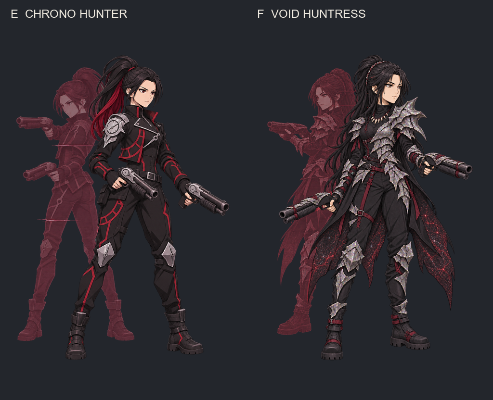
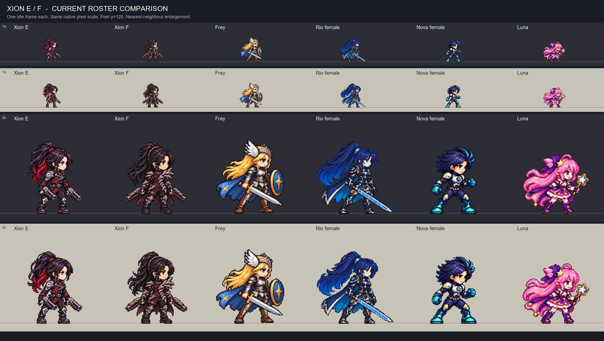

# Xion E · F — 스토리 외형 후보

**E · 크로노 헌터:** 허리 길이 비대칭 재킷, 시계바늘 은장과 평면 진홍 시간 문양의 현대 전술복.
A의 긴 코트와 B의 단발·스카프에서 벗어나, 진홍 속머리의 높은 포니테일과 시계형 산탄총으로 구분했다.
F의 거친 갑각·망토와 달리, 짧고 정돈된 기계 장식과 드러나는 두 다리로 정확하고 냉정한 사냥꾼을 표현했다.

**F · 공허 사냥꾼:** 사냥한 괴물의 진주회색 갑각, 이빨 목걸이, 별무늬 안감의 갈라진 망토.
A·B의 코트 대신 비대칭 유기질 갑옷을 입고, 긴 반묶음 머리와 두꺼운 부츠를 사용했다.
E의 현대 장치와 대비되도록 갑각을 덧댄 산탄총과 불규칙한 어깨·무릎 실루엣을 만들었다.

외형 비교용 후보 2종을 완료했다. 각각 일러스트 1장과 대기 **1프레임**이며, 게임 적용·실행과 커밋은 하지 않았다. `codex/xion-95b`에서 E/F 허용 경로만 썼고 C/D 폴더는 열지 않았다. 저장 파일 검증과 `commit.ps1`의 PowerShell 구문 검사가 통과했다(`verification.json`); 스크립트 자체는 실행하지 않았다. 이번 작업의 원본·후보·보고서 합계는 약 30MiB다.

| 파일 | 규격 | 자동 측정 | 납품 |
|---|---|---|---|
| `art/bakeoff/xion/e/xion_illustration-e.png` | 1024×1536 RGBA | 알파 0–255, 본체 표본 255 / 분신 표본 140, 경계·녹색 프린지·잔여 알파 0 | 완료 |
| `art/bakeoff/xion/f/xion_illustration-f.png` | 1024×1536 RGBA | 같은 검사 통과, 분신 표본 약 55% | 완료 |
| `art/bakeoff/xion/e/xion-idle-e.png` | 128×128 RGBA | 높이 96px, 발 y=120, 배율 0.10180276, 내부 대비 Rio 평균의 117.66% | 완료 |
| `art/bakeoff/xion/f/xion-idle-f.png` | 128×128 RGBA | 높이 96px, 발 y=120, 배율 0.09736308, 내부 대비 Rio 평균의 107.49% | 완료 |
| 두 `xion-idle-*.json` | UTF-8 JSON | 한국어 note, frames=1 | 완료 |
| `lineup.png` | 2400×1360 | E/F·Frey·Rio 여성·Nova 여성·Luna, 1×/3×, 두 배경, 동일 발선 | 완료 |
| 프롬프트·`metrics.json`·검수판·`commit.ps1` | UTF-8 / PNG | 선택 원본·측정 정의·재현 코드 포함; 커밋 스크립트 미실행 | 완료 |

두 스프라이트는 이진 알파, 1px 테두리 비움, 최소 여백 7px, 초록 번짐 0이다. Rio **첫 프레임만** 기준이면 내부 대비 E 115.14%, F 105.19%다. 이 값은 픽셀 내부 대비 지표이며 장식의 의미나 그림 품질을 자동 평가한 점수가 아니다.

## 수동 측정과 직접 검수

- 전신은 밝은/어두운 배경에서 각각 **1024×1536 원본 크기**로 보았다. 두 어깨–팔꿈치–손목의 연결, 손잡이를 감싼 손가락, 방아쇠울 부근 검지, 두 부츠 전체를 확인했다. 손잡이에 가려진 손가락 끝까지 모두 낱개로 셀 수 있는 구도는 아니다.
- 본체의 두 총은 각 안에서 같은 모델로 읽힌다. 굵은 열린 총구, 아래 탄창 튜브와 펌프가 있어 짧은 산탄총 형태이며, 손·총·발의 잘림이나 추가 팔다리는 보이지 않는다.
- 분신은 본체 뒤에 있고 본체 얼굴을 가리지 않는다. E는 두 총과 두 수평 글리치가 뚜렷하다. F는 스캔라인과 머리 옆 얇은 글리치가 보이지만, **두 번째 총은 읽히지 않는 자세**다. 본체는 두 총이 모두 보인다.
- 두 최종 대기를 각각 **4× 최근접 확대**로 확인했다(`idle-review-4x.png`). 한 얼굴, 두 손·총·발, 얼굴 앞의 빈 공간을 확인했다. 스프라이트에서 개별 손가락·방아쇠까지 낱개 판독했다고 주장하지 않는다.
- 정수리와 턱을 눈으로 지정한 추정: 일러스트 E 약 **7.35등신**, F 약 **6.87등신**. 대기는 E 약 **2.97등신**, F 약 **2.90등신**이다. 포니테일 끝은 해부학적 정수리에서 제외했다. 자동 인체 검출값이 아니다.
- 대기 주 머리 높이는 E 약 29px, F 약 30px, Rio 약 28px로 잡았다(각 ±2px, `heads-grid-8x.png`). 두 안이 Rio보다 조금 크게 보인다. 단일 프레임이므로 프레임 간 머리 변화 검사는 적용하지 않았다.

위 그림은 납품 일러스트를 나란히 축소한 검토판이다. 왼쪽 E의 기계 장식과 오른쪽 F의 갑각·망토 차이를 보여준다.

위 비교판은 현재 게임의 대기 첫 칸과 후보를 같은 픽셀 배율·발선에 놓았다. 위 두 줄은 1×, 아래 두 줄은 3×다.

## 처리와 검증

내장 이미지 도구로 일러스트 E/F 각 2회, 대기 E 3회·F 2회를 생성했다. E 첫 전신의 여백을 고쳤고 F는 작은 머리를 다시 그렸다. 대기 초기본은 약 3.4등신으로 길어 보였고, 최종은 몸통·다리를 짧게 **다시 생성**했다. 머리나 팔다리 붙여넣기·부위별 코드 변형은 하지 않았다.

일러스트의 생성 알파는 본체·분신 모두 거의 불투명했다. 수동으로 지정한 범위와 진홍 색 분류로 분신 알파를 55%로 보정하고, 본체 알파와 가장자리를 정리했다(`process_art.py`). 최종 표본의 알파는 본체 255, 분신 140이다. 이는 기록된 표본 검사이며 모든 겹침 픽셀을 해부학적으로 분류했다는 뜻은 아니다. 약한 알파 잔여 E 24px/F 13px와 녹색 가장자리 편차 E 16px/F 21px를 정리했다. 검사의 정의는 `metrics.json`에 있다.

대기는 카드 지정 `normalize.py --cell 128 --grid 1x1 --resample lanczos --sharpen 60 --despill auto --palette none --bg '#00ff00' --scale-by height:96 --feet-y 120`으로 처리했다. 도구는 기본 6열 시트를 만들므로, 도구가 별도로 저장한 첫 **128px 프레임 파일을 픽셀 변경 없이** 후보로 복사했다. 최종 파일과 그 프레임의 일치를 검사했다.

원본·실제 참조는 `art/raw/xion-95b/`에 보존했다(커밋 제외). 생성 이력과 해시는 `provenance.json`, 최종 프롬프트는 `prompt-e-idle.txt`, `prompt-f-idle.txt` 및 일러스트 기본/보정 프롬프트다. F 대기는 머리 비율 보정 전 일러스트를 참조했으며 의상·무기 디자인은 유지된다.

재현 순서: 지정 Python과 `PYTHONDONTWRITEBYTECODE=1`로 `normalize.py`(E `e-idle-v3.png`, F `f-idle-v2.png`) → `process_art.py` → `package_review.py` → `verify_delivery.py`. 새 패키지는 설치하지 않았다. 제품 파일의 tracked diff와 staged 변경은 비어 있다.

## 남은 문제 · 다음 단계

- 대기 머리는 Rio보다 조금 크고, F의 망토는 일러스트보다 짧다. 1×에서는 F의 별무늬·이빨 목걸이와 E의 작은 시계 눈금이 약하게 읽힌다.
- F 분신의 두 번째 총은 확인되지 않고 수평 글리치도 E보다 약하다. 갑각의 옅은 진주빛 색 변화가 남아 있다.
- 다음은 리드의 시안 월드컵 비교와 사용자 선택이다. 나머지 동작·게임 연결은 선택 이후 별도 카드 범위다. `commit.ps1`은 작성만 했으며 실행하지 않았다.
