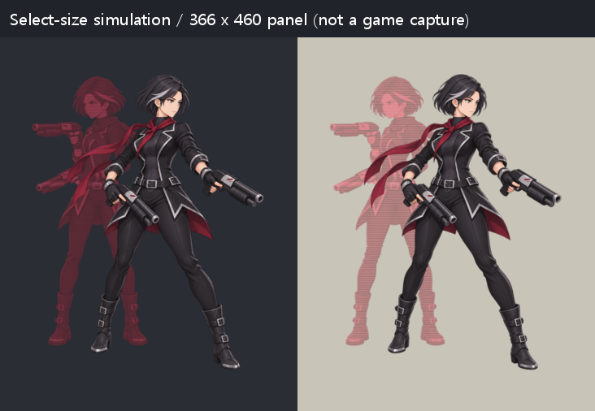

# ART-96a · Xion B 일러스트 v2와 홀로그램 분신

완료: 선택된 B 본체를 다시 그리지 않고, 왼쪽 뒤에서 협력하는 분신을 추가했다. 본체 전체를 90%로 축소하고 (120, 68)에 배치했으며, 얼굴·팔·손·무기·복장·비율을 따로 수정하지 않았다. 기존 얼굴 파일도 그대로다. 후보 납품이며 게임 적용·Godot 실행·커밋은 하지 않았다.

| 파일 | 크기 | 측정한 확인 사항 | 납품 |
| --- | --- | --- | --- |
| `art/bakeoff/xion/b/xion_illustration-b2.png` | 1024×1536 RGBA, 882,756 bytes | 알파 0–255, 여백 좌/상/우/하 35/150/38/168px, 경계·정의한 녹색 프린지·투명 RGB 잔류 0 | 완료 |
| `art/bakeoff/xion/b/xion_double-b2-colour.png` | 1024×1536 RGBA, 704,176 bytes | 홀로그램 전 정상 색상, 알파 0–255, 여백 175/120/170/81px, 같은 오류 검사 0 | 완료 |
| `compare.png` | 1024×1600 | v1/v2 각각 정확히 50%, 두 배경 | 완료 |
| `full-size-checks.png` | 2048×1576 | 최종 일러스트를 원본 크기로 두 배경에 배치 | 완료 |
| `hologram.py`, 측정 JSON, 검수판, 프롬프트 | UTF-8 / PNG | 처리 재현 및 수치·육안 판단 분리 | 완료 |
| `commit.ps1` | UTF-8 | 경로를 문자열 배열로 명시, raw 제외, 실행 안 함 | 완료 |

## 수치로 확인한 것

- 원본 B 일러스트, 얼굴, idle, `XionDouble.gd`의 SHA-256이 시작 시점과 같다. `smash-nine-prototype/`의 추적 파일 차이 및 스테이징은 비어 있다. 기존에 있던 다른 작업의 미추적 파일은 건드리지 않았다.
- 본체 층은 원본의 90% 축소 결과와 **픽셀 불일치 0**이다. 최종 합성에서도 분신과 겹치지 않는 본체 **232,953px**, 넉넉히 지정한 머리 영역 안의 본체 **31,015px**가 본체 층과 완전히 같다. 얼굴·머리 위로 분신이 올라오지 않는다. 겹치는 몸통 가장자리는 정상적인 알파 합성 결과이므로 원본 RGB와 같다고 주장하지 않는다.
- 본체 원본 내부 알파는 대부분 253이다. 이를 불투명하게 다시 칠하지 않고 원본 알파까지 유지했다. 축소에는 부동소수점·알파 선곱 방식의 bilinear를 사용했다. 8비트 LANCZOS 축소에서 생긴 낮은 알파의 녹색 양자화 편차를 본체 리터칭 없이 피하기 위한 선택이다.
- 분신은 정상 색상 원본 전체를 0.83배, (-110, 60)에 배치했다. 음수 x는 원본의 빈 여백만 지나며 실제 그림은 잘리지 않는다. 완성 홀로그램 층의 경계상자는 (35,159)–(599,1268)이다.
- 색: `tint=(0.96,0.24,0.34)`, `lum=0.299R+0.587G+0.114B`, `tint*(0.42+0.85*lum)`. 정규화된 PNG RGB에 카드의 공식을 적용하며 저장 시 0–1로 제한한다.
- 스캔라인은 최종 해상도에서 **6px 주기, 4px를 알파 0.55배, 2px를 원래 알파**로 둔다. 전체 알파는 **0.62**다. 불투명 원본의 실제 저장 표본은 **87/87/87/87/158/158**이다.
- 밝은 띠는 **y=602**, 반폭 15px의 부드러운 띠 하나이며 중앙 밝기 **1.6배**다. 표본 (269,602)의 계산값·저장값 RGB는 모두 (187,47,66)으로 오차 0이다. 가로 글리치는 **y=306–308을 -5px**, **y=857–859를 +5px** 이동했다.
- 분신 원본의 알파 1–4인 20,713px를 제거하고 알파에 255/253을 곱해 정상 색상 층의 내부를 불투명하게 정리했다. 색 보정 픽셀은 0이다. 완전 투명 픽셀의 RGB는 0으로 정리했다. 본체에는 이 정리를 적용하지 않았다.
- 프린지 수치는 `G > max(R,B)+20`이고 `G>80`인 가시 픽셀 수다. 모든 색의 광륜을 자동 보증하는 검사는 아니다. 두 지정 배경의 원본 크기 검수를 함께 수행했다.

## 눈으로 확인한 것

내장 이미지 도구로 분신만 2회 생성했다. 첫 그림은 팔을 길게 뻗어 본체와 합성할 때 얼굴을 많이 가렸으므로, 두 번째에서 팔을 접은 자세로 바꿨다. 두 원본과 사용한 B 참조는 `art/raw/xion-96a/`에 보관했고 커밋에서 제외했다. 실제 프롬프트는 `prompt-double.txt`, `prompt-double-v2.txt`, 생성 이력은 `provenance.json`에 있다.

정상 색상 분신과 최종 합성을 각각 **1024×1536 원본 크기**, #2a2d34와 #c8c4b8에서 확인했다. 본체의 원래 양팔·두 손·두 총·두 부츠를 확인했고, 분신도 두 손, 두 발, 굵은 열린 총구·하부 튜브·펌프·진홍 표식이 있는 동일 모델의 두 산탄총을 확인했다. `anatomy-checks.png`에서 손·손잡이·방아쇠울 부근을 2배로 추가 확인했다. 분신의 먼 쪽 위팔은 몸통 뒤에 일부 가려지는 접힌 자세이며, 가려진 손가락 끝까지 모두 낱개로 세었다고 주장하지 않는다. 추가 팔이나 잘린 총·발은 보이지 않는다.

분신의 정수리 y=122, 턱 y=328, 발끝 y=1454를 사람이 지정하면 약 **6.47등신(약 6.5등신)**이다. 각 기준점은 약 ±3px 오차가 있는 육안 추정이며 자동 인체 측정이 아니다. 본체는 기존 약 6.90등신을 그대로 유지한다.

위 그림은 현재 `FrontendMenu.gd`의 366×460 선택 영역에 맞춰 축소한 검수판이다. 실제 게임 캡처는 아니다. 본체와 진홍 분신이 분리되고, 두 얼굴과 분신의 두 총구가 읽힌다. 6px 원본 스캔라인은 이 크기에서 약 1.8px 주기로 보인다.

## 현재 상태 · 남은 문제

- 분신의 아래쪽 팔·손잡이 일부는 본체의 긴 스카프 뒤에 가려진다. 정상 색상 분신 파일에서는 두 손과 총 전체를 확인할 수 있다.
- 선택 크기로 줄이면 분신의 손가락·5px 글리치 같은 미세 요소는 약하게 읽힌다. 얼굴·실루엣·총구·스캔라인 구분은 남는다.
- 게임의 움직이는 스윕·무작위 깜빡임은 정지 일러스트용 띠 하나와 가로 슬라이스로 표현했다. 실제 Godot 선택 화면 적용 검증은 수행하지 않았다.
- `art-b`의 idle v2는 이 작업 범위가 아니며 만들거나 수정하지 않았다. 다음 단계는 리드의 검수와 후보 연결이다.

## 재현과 검증

지정 Python에서 `PYTHONDONTWRITEBYTECODE=1`을 설정한 뒤 `reports/codex-art-96a/hologram.py`를 실행하면 **납품한 정상 색상 분신과 원본 B만으로** 합성·홀로그램·비교판을 재생성한다. `--from-raw`는 이 clone의 생성 원본에서 정상 색상 파일까지 다시 만들 때만 사용한다. `package_review.py`는 추가 검수판과 원본 이력을 작성하며 raw가 필요하다. `verify_delivery.py`는 저장된 파일·알파·색 표본·원본 해시·이 clone의 범위를 검사한다. 범위 검사용 `baseline-status.txt`는 로컬 참고 파일로 커밋에서 제외했다.

`verification.json`의 파일 검증은 통과했다. 커밋 스크립트는 PowerShell 구문 분석만 수행했다(오류 0, 명시한 23개 경로 모두 존재). 스크립트 자체는 실행하지 않았다. 신규 패키지는 설치하지 않았고, 이번 raw·후보·보고서 합계는 약 12MiB다.
