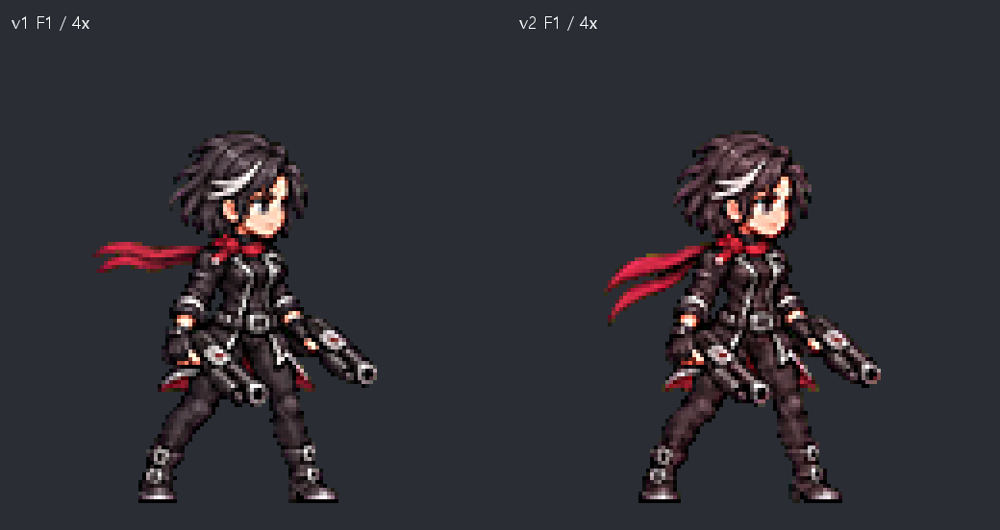

# Xion B idle v2 — 긴 스카프 후보

**완료:** 6프레임 후보·JSON·4배 비교·GIF·측정·재현 자료를 납품한다. **현재 상태는 검토 보류**다. 목 뒤–끝의 직선거리 비율은 목표 범위지만, 수평 도달거리와 엄밀한 3등신·발 고정에는 아래 제한이 남는다. ART-97의 확정 앵커로 자동 채택하지 않는다.

내장 이미지 도구로 총 3회 생성했고 원본과 실제 참조는 `art/raw/xion-96b/`에 복사했다. 지정 Python·Pillow·numpy만 사용했으며 패키지는 설치하지 않았다. `codex/xion-96b`의 카드 허용 경로만 썼고 제품 파일·v1·얼굴·일러스트는 수정하지 않았다. `commit.ps1`은 작성만 했으며 실행하지 않았다.

| 파일 | 규격 | 측정한 결과 | 납품 |
|---|---|---|---|
| `art/bakeoff/xion/b/xion-idle-b2.png` | 768×128 RGBA, 6프레임 | 높이 모두 97px, 발 y=120, 최소 여백 7px, 경계 침범·초록 번짐 0 | 후보 납품 / 채택 보류 |
| `xion-idle-b2.json` | UTF-8 JSON | 6프레임·6.3fps·반복 | 완료 |
| `compare.png`, `review-1.png`~`6.png` | 3072×1104 / 각 1040×552 | v1과 v2 전 프레임을 4× 최근접 비교 | 완료 |
| `idle-4x.gif` | 512×512, 6프레임 | 160/160/160/160/160/150ms, 한 바퀴 950ms | 완료 |
| `scarf.json`, `metrics.json`, `heads-4x.png` | UTF-8 / PNG | 아래 측정 정의와 미충족 항목 포함 | 완료 |
| `commit.ps1` | PowerShell | 명시적 경로 배열, raw 제외, 실행 안 함 | 작성 완료 |

## 수치로 확인한 것

- 공통 배율 **0.22273249** 하나, LANCZOS·선명화 60·despill auto·팔레트 없음으로 정규화했다. 프레임별 크기 보정, 머리·팔다리 붙이기, 스카프 코드 변형은 하지 않았다.
- 기존 정규화의 몸통 외곽선 기준은 긴 스카프를 몸통으로 포함했다. 원본 기준점이 270.5–288px로 흔들려 발 중심이 최대 4.5px 이동했다. `normalize_idle.py`는 **v1 원본의 몸통 기준점 중앙값 x=286.125 하나를 모든 원본 셀에 공통 적용**한다. 공용 도구 파일은 바꾸지 않고 같은 정규화 함수를 호출했다. `default-anchor-metrics.json`과 `default-anchor.png`는 기본 기준의 결과다. 재생성 없이 실행된 위치 정리는 이 공통 기준 적용뿐이다.
- 최종 머리 비교: 자기 F1 대비 중앙값 **1.00**, 6/6 유효, 각 배율 1.00/1.00/1.00/0.96/1.00/1.00(점수 0.891–1.000). v1 F1 대비는 6/6 모두 **1.00**(0.922–0.972).
- Rio 여성 F1을 앵커로 한 자동 검사도 실행했다. 최적 배율은 1.00–1.02이나 점수 **0.460–0.479**, 유효 0/6으로 **신뢰 가능한 중앙값은 없다**. 이 결과를 자동 통과로 처리하지 않았다. `heads-4x.png`를 별도로 직접 비교했다.
- 내부 디테일 지표 평균 107.50: Rio 대기 6장 평균의 **112.51%**, Rio F1만 기준으로 **110.10%**. 이는 내부 명암 변화량이며 해부학·미술 완성도 점수가 아니다.
- 초록 번짐 0은 공용 도구 정의인 `G > max(R,B)+20` 기준이다. 더 엄격한 +16 검사에서는 F1 손 부근 어두운 틈에 2px, F3에 1px가 잡힌다. 이 세 픽셀까지 색 편차가 전혀 없다고 주장하지 않는다.
- 발 밑 5줄의 외곽 중점 변동은 뒤 발 **1.0px**, 앞 발 **0.5px**다. 발선 자체는 전 프레임 y=120이다.
- GIF는 10ms 시간 단위라 평균 약 6.316fps다. 게임용 JSON은 정확히 6.3fps다.

## 스카프 측정 — 직선거리와 수평거리를 구분

일러스트를 1024×1536 원본 크기로 열고 기준점을 직접 지정했다. 키 1352px, 목 뒤 (441,321), 위 꼬리 끝 (63,600), 아래 끝 (95,698)이다. **목 뒤에서 끝까지의 직선거리 / 키**는 위 **34.75%**, 아래 **37.85%**다. 수평 투영만 재면 **27.96% / 25.59%**다. 곡선을 따라 잰 천의 실제 길이는 아니다.

스프라이트는 각 목 뒤와 끝 부근을 눈으로 정한 뒤, 끝 부근 5×5 창에서 목 뒤로부터 가장 먼 불투명 픽셀을 끝으로 사용했다. 검은 외곽선도 포함하며 처음 지정한 점도 JSON에 남겼다. 목 뒤 지정 오차는 약 ±1px, 일러스트 기준점은 약 ±3px다. 자동 해부학 검출이라고 주장하지 않는다.

| 기준 | 위 꼬리 | 아래 꼬리 | 판정 |
|---|---|---|---|
| 최종 직선거리 | 31.62–32.70px | 33.62–35.81px | 원화 비율 대비 −6.18~−3.00% / −8.44~−2.47%, ±10% 안 |
| 중앙값 대비 프레임 편차 | 최대 0.88px | 최대 1.33px | ±2px 안 |
| 수평 도달거리 | 원화 비율 대비 +10.62% | +16.82% | **±10% 밖** |

따라서 길이 조건 전체를 무조건 통과했다고 보고하지 않는다. 원화보다 꼬리가 수평으로 펼쳐지는 각도가 남아 있다. `scarf-landmarks.png`는 실제 끝점과 목 뒤를 표시한다.

## 직접 본 것

선택한 일러스트를 원본 크기로, 생성 3장의 모든 스프라이트를 정규화 후 4배로 확인했다. 최종 6장은 각각 v1과 나란히 다시 확인했다. 한 얼굴, 얼굴 아래의 스카프, 두 팔–손–총의 연결, 동일 모델의 두 굵은 총구·펌프·은색 패널, 두 부츠가 보인다. 개별 손가락 전부를 낱개로 셀 수 있는 해상도는 아니다. 부위 소실이나 추가 얼굴은 보이지 않는다.

스카프 두 꼬리가 뒤로 늘어났고 F3에서 들려 F4에서 가장 높게 보인다. **머리카락의 독립적인 한 프레임 지연과 가슴 호흡은 뚜렷하지 않다.** 정지 프레임과 GIF 파일 구조를 검수했으며 실시간 게임 재생 테스트는 하지 않았다.

Rio와 비교하면 주 머리 크기는 비슷하다. 수동으로 잡은 주 머리 높이는 Xion 28px(정수리 y24–턱 y51), Rio 약 27px(높은 포니테일 장식 제외)다. 이 정의로 Xion은 **약 3.46등신**으로, 정확한 3등신이 아니다. v1의 머리·자세 유지와 별도로 기록할 제한이다.

왼쪽 v1의 짧은 수평 스카프가 오른쪽 v2에서 두 갈래로 아래까지 길어졌다. 두 그림 모두 실제 파일의 4배 확대이며, 전체 프레임 비교는 `compare.png`에 있다.

## 남은 작업 · 다음 권장 단계

- 수평 도달거리 기준으로도 ±10%가 되도록 꼬리 각도를 더 아래로 기울이는 재작업이 필요하다. 생성 횟수 상한 3회에 도달해 추가 생성은 하지 않았다.
- 완전한 발 픽셀 고정, 뚜렷한 머리카락 지연, 정확한 3등신 조건은 미충족이다. 머리 크기·실루엣은 v1을 유지한 후보로 리드가 먼저 판단해야 한다.
- 리드의 검수·채택 뒤 ART-97로 이어져야 한다. 이번에 게임 연결·ART-97·일러스트 v2·커밋은 수행하지 않았다. 사용자에게 새 할 일 위젯 항목을 만들지는 않았다.

## 생성 이력과 재현

1차는 머리가 v1의 0.91로 작고 스카프가 길어 제외했다. 2차는 v1 원본 전체를 편집 참조해 외형을 복원했으나 스카프가 여전히 길고 기본 중심 계산에서 F4가 밀렸다. 3차는 꼬리만 짧게 다시 생성했으며 이 후보를 납품한다. 프롬프트 3개와 실제 원본 해시는 `provenance.json`에 있다.

`rebuild.ps1`은 지정 Python과 `PYTHONDONTWRITEBYTECODE=1`로 공통 기준 정규화 → 머리 검사 3종 → 비교판·측정·GIF → 파일 검증을 실행한다. 새 이미지 생성이나 커밋은 하지 않는다. raw는 git 제외이므로 이 클론에서 재현 가능하다.

실제로 재현 스크립트를 끝까지 실행했고 실행 전후 후보 PNG의 SHA-256이 같았다. 파일 규격 검증은 통과했고 미술 채택 판정은 `HOLD`다. 두 PowerShell 스크립트의 구문 검사를 통과했으며 `commit.ps1`은 실행하지 않았다.

이번 작업 자료는 약 **12MiB**다. 전체 기존 클론 `C:\Users\TH\Documents\AI\GameProject\SmashNine-units\art-b\SmashNine`은 약 **4.12GiB**이며 대부분 이전 작업 자료다(`workspace-size.json`).
