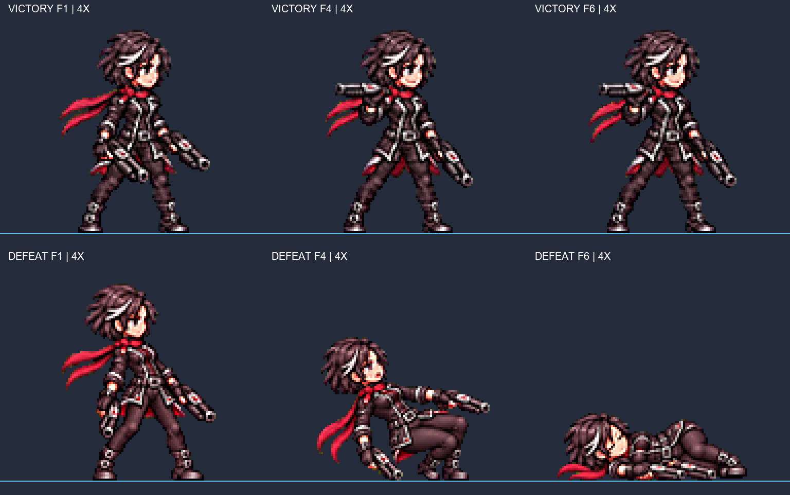

# ART-97A fix · 승리 발 고정 / 패배 6프레임

**완료:** 승리의 가로 튐을 고쳤고, 패배 6프레임 후보를 새로 제출한다. **현재 상태:** 두 행 모두 PNG/JSON 규격과 수치 검사를 통과했다. 게임 연결·Godot 실행·실시간 재생·사용자 채택·커밋은 하지 않았다. **남은 작업:** 리드의 동작 검수와 채택 여부 판단.

| 행 | 프레임 / fps | 공통 factor | 머리 배율 | 발 이동 | 전달 |
|---|---:|---:|---|---|---|
| victory | 6 / 8 | 0.230 | 중앙값 1.00, 6/6 유효 | 인접 최대 **13 → 0.5px** | `xion-victory-b2.png/.json` 덮어쓰기 완료 |
| defeat | 6 / 10 | 0.205 | 중앙값 0.96, F1–F3 유효 | F1–F3 최대 18.5px, 의도된 뒤로 비틀거림 | `xion-defeat-b2.png/.json` 신규 완료 |

두 행은 1152×192, 192px 셀 6개, `loop:false`다. 후보 경로는 `art/bakeoff/xion/b/`이며, 마지막 프레임 유지용이다. 작업 브랜치는 `codex/xion-97a-fix`다. 지정한 Python·numpy·Pillow만 사용하고 `PYTHONDONTWRITEBYTECODE=1`로 실행했다. 패키지는 설치하지 않았다.

## 승리: 위치만 바뀌었음

원본 `art/raw/xion-97a/victory-2.png`를 그대로 사용했다. 원본 셀 너비는 362px이며, 각 셀 아래 22줄에서 두 부츠 중점을 구한 뒤 **6프레임 중점의 중앙값 x=178.5 하나**를 행 전체의 기준으로 골랐다. `reports/codex-art-96b/normalize_idle.py`처럼 공용 정규화 모듈의 기준점 함수를 이 실행 안에서만 고정했다. 공용 도구 파일은 고치지 않았다.

`factor=0.230`, `--cell 192`, `--feet-y 152`, `--ground-all`, LANCZOS·선명화 60·자동 despill·팔레트 없음은 그대로다. 프레임별 가로 오프셋, 축척, 부품 붙이기, 재생성은 없다.

- `feet.json`: 출력 부츠의 y148–152 구간을 재고 왼쪽·오른쪽 부츠를 각각 대응시켰다. 총·스카프는 이 구간에 없다. 수정 전 최대 13px, 수정 후 최대 0.5px다.
- 문제였던 F4→F5는 왼발 −0.5px, 오른발 0px다. 마지막 F5→F6도 왼발 +0.5px, 오른발 0px다.
- **6프레임 모두 불투명 피사체 경계상자 안의 RGBA 배열이 수정 전후 완전히 동일**하다. 머리·의상·스카프 길이·디테일은 원래 그림 그대로이고 배치만 바뀌었다.
- 자동 머리 검사는 중앙값 1.00이다. F5만 1.06으로 측정되지만 피사체 픽셀은 위 비교에서 동일하다. 이 값의 차이는 이동에 민감한 템플릿 매칭 결과이며 머리를 확대했다는 뜻이 아니다.

## 패배: 3포즈씩 두 장

내장 `image_gen.imagegen`을 총 **3회** 호출했다. 1회차 F1–F3는 칸 분리는 성공했지만 몸이 길고 얼굴 매칭이 낮아 제외했다. 2회차 F4–F6는 유지하고, 마지막 3회차로 F1–F3만 다시 그렸다. 사용한 원본과 참조는 모두 `art/raw/xion-97a/`에 있다. `provenance.json`에 파일·해시·선택 이력을 기록했다.

최종 원본은 `defeat-fix-123-r2.png`와 `defeat-fix-456.png`, 각각 1536×1024다. 두 장을 **동일한 512px 너비의 균등 3칸**으로만 분할했다. 임의 간격 크롭이나 프레임별 리사이즈는 하지 않았다. 6칸 전부 같은 원본 기준 x=256, 같은 factor 0.205로 정리했다. 원본 칸 경계 접촉은 0이다.

머리 검사 점수는 F1/F2/F3 = 0.748/0.795/0.769, 배율은 모두 0.96이다. F4–F6는 기울거나 누워 얼굴 매칭 점수가 0.6 미만이므로 중앙값에서 제외하고 4배 판에서 직접 비교했다. 처음 시도의 0.215와 최종 0.205는 **서로 다른 시도**이며, 최종 행 내부에서 배율을 섞지 않았다.

F1–F3은 부츠가 y=152에 닿는다. F4는 무릎을 접으며 뒤로 기울고, F5/F6은 몸을 옆으로 눕혀 팔·손과 두 총이 같은 바닥에 놓인다. 모든 셀의 최저 불투명 픽셀은 y=152다. F5/F6의 바닥 알파 구간은 손·총·스카프·겹친 부츠가 연결되므로, 그것을 발 이동 수치로 잘못 세지 않았다.

## 수치로 확인한 것

| 검사 | victory | defeat |
|---|---:|---:|
| 디테일 범위 | 112.65–116.63 | 111.09–119.12 |
| 디테일 평균 / 앵커 평균 107.50 | 106.54% | 106.96% |
| 최소 여백 | 39px | 39px |
| 경계 침범 / 초록 번짐 | 0 / 0 | 0 / 0 |
| 알파 | 0 또는 255 | 0 또는 255 |
| 전체 높이 | 99px | 33–96px |

디테일은 공용 도구의 내부 명암 변화량이며 미술 완성도 점수가 아니다. 모든 프레임이 앵커 평균의 90% 이상이다. 패배의 낮은 높이는 누운 자세 때문이며 높이로 프레임별 축척을 맞춘 것이 아니다.

## 직접 본 것과 아직 약한 점

각 생성 결과를 정규화한 전 프레임, 최종 두 행의 12프레임을 앵커 옆에서 최근접 **4배**로 직접 열었다. 코트 은색 선, 검은 머리의 은색 가닥, 장갑, 부츠, 스카프 두 꼬리와 두 총을 확인했다. 한 얼굴이고 머리에 총이나 스카프가 겹치지 않으며 이펙트가 없다. 최종 작은 픽셀에서 손가락 개수까지 확정한 것은 아니다.

- 승리: 기존 원본의 포즈를 유지하면서 발 고정이 개선됐다. 추가 작화 문제는 발견하지 못했다.
- 패배: 반동→비틀거림→무릎 꺾임→넘어짐→충돌→정지 순서는 읽힌다. **F1 반동이 작고 F4는 낮게 주저앉으며 뒤로 기우는 자세**다. 큰 회전이나 강한 충격 표현은 아니다. F5/F6의 충돌→정지 차이는 작다.
- 양 눈 거리와 눈높이 전체 얼굴 너비는 한쪽 눈·윤곽이 앞머리에 가려 독립 정밀 측정이 어렵다. 이를 통과했다고 주장하지 않는다. 자동 머리 검사와 4배 판을 근거로 했다.
- 패배 F5/F6 스카프는 접혀 일부가 머리·팔 뒤에 가려진다. 두 꼬리와 의상 연속성은 보지만, 숨은 천을 포함한 길이 ±10%를 수치로 보증하지 않는다.

## 시각적 확인

위는 실제 납품 픽셀의 동일 영역을 4배 확대한 것이다. 위쪽은 승리, 아래쪽은 패배의 F1·F4·F6이며 파란 선 바로 위가 y=152다. 모든 프레임을 담은 4배 판은 [승리](victory.png), [패배](defeat.png), 개별 앵커 비교판은 `victory-4x/`, `defeat-4x/`다. `victory-before-after-F4.png`와 `victory-before-after-F5.png`는 같은 좌표에서 본 전후 비교다.

## 검증과 인계

- `verify.py` / `validation.json`: 실제 PNG/JSON, 알파·경계·여백·번짐·디테일·머리 기준·승리 부츠 이동·피사체 보존·원본 칸 경계·UTF-8·변경 경로를 검사한다. 형식/수치 통과는 위의 미술상 약점을 없애지 않는다.
- `rebuild.ps1`: 원본 → 같은 정규화 → 머리 검사 → 판·메트릭 → 후보 저장 → 검증. 생성이나 커밋을 하지 않는다. 원본은 git 제외이므로 이 클론에서 재현할 수 있다. 실제 재현 결과는 `reproducibility.json`에 기록한다.
- `prompts.txt`: 이번 3회 호출의 전체 프롬프트. `provenance.json`: 실제 사용 파일과 SHA-256.
- `commit.ps1`: 파일 경로를 리터럴 문자열 배열로 고정했다. 이 카드와 이 작업 파일만 담으며 raw·기존 다른 작업·게임 파일을 포함하지 않는다. **구문만 검사하며 실행하지 않는다.**
- 기존 공격·방어 및 art-b 파일은 변경하지 않았다. `smash-nine-prototype/` 변경도 없다.

**다음 권장 단계:** 리드가 8fps/10fps로 후보를 재생해 패배의 약한 반동과 중간 자세를 판단하고, 채택하면 연결한다. 이 유닛은 다음 실행이나 추가 생성을 예약하지 않았다. 리드에 인계하는 후보 검수이므로 새 할 일 위젯 항목은 만들지 않았다.

작업 폴더·클론 디스크 사용량은 `workspace-size.json`에 기록한다. 큰 중간 렌더는 만들지 않았고, 최초 여유 공간은 약 23.2GiB였다. 이번에는 PNG 스프라이트와 비교판 수십 MiB 이내를 예상하고 작업했다.
