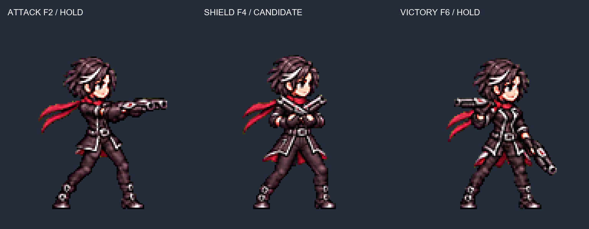

# ART-97A · Xion B 공격·방어·승리·패배

**완료:** 방어 후보, 공격·승리의 보류 후보, 각 4배 비교판·측정·프롬프트·재현 자료를 제출한다. **현재 상태:** 방어는 검토 가능한 후보이며 공격과 승리는 아래 문제가 남아 채택 보류다. 패배는 두 원본 모두 칸 경계 검사에서 실패하여 게임 규격 파일을 납품하지 않는다.

`codex/xion-97a`의 카드 허용 경로만 사용했다. 내장 ImageGen 원본과 실제 참조는 `art/raw/xion-97a/`에 복사했다. 지정 Python, Pillow, numpy만 사용했고 패키지를 설치하지 않았다. `smash-nine-prototype/`, 앵커, 다른 유닛 파일은 수정하지 않았다. 게임 연결·Godot 실행·커밋은 수행하지 않았다.

| 행 | 프레임 / fps | 셀 | 공통 factor | 머리 중앙값 | 디테일 범위 / 앵커 대비 평균 | 전달 상태 |
|---|---:|---:|---:|---:|---:|---|
| attack | 6 / 35.25 | 128 | 0.250 | 1.00, 6/6 유효 | 101.44–116.00 / 100.91% | 파일 제출, **보류** |
| shield | 6 / 12 | 128 | 0.225 | 0.96, 6/6 유효 | 108.52–115.62 / 103.14% | 후보 완료 |
| victory | 6 / 8 | 192 | 0.230 | 1.00, 6/6 유효 | 112.65–116.63 / 106.54% | 파일 제출, **보류** |
| defeat | 목표 6 / 10 | 192 | — | — | — | **미납품** |

세 PNG와 UTF-8 JSON은 `art/bakeoff/xion/b/xion-{attack,shield,victory}-b2.*`에 있다. JSON은 모두 `loop:false`; 승리는 마지막 프레임을 유지할 용도다. 공격·승리 JSON의 한국어 `note`에 채택 보류 사유를 명시했다. 패배의 factor·머리·디테일은 정규화 이전에 거부되어 측정값이 없다. 0.27/0.30은 실패한 명령의 시도값일 뿐 납품 배율이 아니다.

## 수치로 확인한 것

- `normalize.py`에 한 행당 배율 하나, `--resample lanczos --sharpen 60 --despill auto --palette none --bg #00ff00`를 적용했다. 세 동작은 지상 자세여서 `--ground-all`로 발선 120/152를 맞췄다. 공용 도구 수정, 프레임별 축척·위치 보정, 머리나 팔다리 붙이기는 하지 않았다.
- 최종 18프레임은 이진 알파, 경계 침범 0, 초록 번짐 0이다. 최소 여백은 공격·방어 7px, 승리 39px다. 번짐은 공용 도구의 `G > max(R,B)+20` 정의다.
- 디테일은 **내부 명암 변화량**이다. 기준은 앵커 6프레임 평균 107.50이며, 최저 프레임도 기준의 90% 이상이다. 손의 구조나 미술 완성도를 자동으로 평가한 점수가 아니다.
- 머리 검사 점수 ≥0.6인 프레임은 모두 6개다. 공격은 모든 프레임 1.00, 방어는 0.96/0.96/0.96/0.96/0.96/1.00, 최종 승리는 모두 1.00이다. 승리 1차의 F2는 1.06이어서 공통 배율을 0.235→0.230으로 낮춰 확인했고, 최종은 2차 원본을 0.230으로 정리했다.
- 전체 높이: 공격 100px, 방어 101–103px, 승리 99px. 앵커는 97px다. **머리 기준 배율을 우선했으므로 96–98px 및 정확한 3등신을 달성했다고 주장하지 않는다.** 앵커 자체의 등신 제한은 ART-96B 보고서에 있다.
- `feet.json`은 발선 아래쪽 5줄의 불투명 구간 중점을 잰다. 인접 프레임 최대 가로 이동은 공격 6px, 방어 4px, 승리 13px다. 해부학적 발 추적기는 아니다. 승리 F4→F5에서 두 발 중점이 각각 12.5/13px 이동하며, 기본 몸통 기준점이 총과 스카프 외곽의 영향을 받는다. 원본에서 발을 고정해 달라고 재생성했지만 해결되지 않았다.
- `scarf.json`은 사람 지정 목 뒤와 두 꼬리 끝의 **직선거리**다. ±1~2px 지정 오차가 있고, 굽은 천의 실제 길이가 아니다. 앵커 F1의 32.70/35.81px 대비 공격 −11.09~−1.18%, 방어 −9.63~+2.69%, 승리 −1.51~+7.81%다. 공격 F3 위 꼬리는 지정값상 ±10% 밖이다. 방어·승리 수치는 지정값 기준으로 범위 안이며, 정밀한 천 길이 보증은 아니다.

## 직접 본 것

사용한 세 행의 모든 프레임을 앵커와 나란히 **최근접 4배**로 열어 확인했다. 재생성에서 제외한 원본들도 전 포즈를 원본 4배 크롭으로 직접 보았다. 코트의 은색 선, 짧은 검은 머리의 은색 가닥, 장갑, 검은 바지·버클 부츠, 두 손과 두 총이 보인다. 얼굴 위로 총이나 스카프가 지나가지 않으며 섬광·연기·잔상은 없다. 출력 크기에서 모든 손가락 수까지 확정한 것은 아니다.

- 공격 1차: 두 총 전방 조준→발사 자세→반동→낮추기→준비가 읽힌다. **F4의 펌프는 명확하지 않다.** 2차에서는 펌프 슬라이드를 드러냈지만 첫 칸 경계를 넘었고 F3 총 손잡이가 턱에 가까워 제외했다.
- 방어: F2에서 총을 들고 F3–F6에 가슴 앞 X자 가드를 유지한다. 끝부분 포즈 변화는 작고 스카프가 내려간다. 발 픽셀 완전 고정은 아니다.
- 승리 2차: 총을 돌린 뒤 어깨에 한 자루, 아래에 한 자루를 드는 마무리가 읽힌다. 같은 머리 배율과 99px 높이는 개선됐으나 **가로 튐이 남아 보류**다. 마지막 두 프레임 발 중점 차이는 0–0.5px다.
- 패배: 반동→비틀거림→무릎 꺾임→넘어짐→바닥 충돌→눕기의 6포즈는 두 번 모두 그려졌다. 그러나 균등 6칸 배치에 실패했다. 1차는 칸 `0,0` 오른쪽, 2차는 칸 `2,0` 오른쪽에 그림이 닿았다. 2차 F5/F6 총이 몸보다 아래까지 내려와 바닥 접촉도 확정하지 못했다. 원본을 임의 간격으로 잘라 다시 조립하거나 조각을 지우지 않았다.

실시간 게임 및 애니메이션 재생은 검증하지 않았다. 검사 결과를 재생 품질 통과로 표현하지 않는다. 승리의 양 눈 간 거리는 앵커의 한쪽 눈이 머리카락에 가려져 신뢰할 수 있게 비교하지 못했다. `head_scale.py`와 전체 4배 비교를 사용했으며 별도 눈 간 거리 통과를 주장하지 않는다.

## 시각적 확인

왼쪽부터 공격 F2, 방어 F4, 승리 F6의 실제 후보 픽셀을 4배로 확대한 것이다. HOLD는 채택 보류다. 전체 판은 [공격](attack.png), [방어](shield.png), [승리](victory.png)에 있다.

패배의 [원본 경계 표시](defeat.png)에서 붉은 선은 균등 칸 경계다. `defeat-rejected-1/`, `defeat-rejected-2/`, `attack-rejected-2/`의 4배 크롭은 **관찰용 원본**이며 수정된 후보가 아니다. 승리 1차는 비교판 한 장 `victory-first-board.png`로 남겼다.

## 확인 및 재현

실제로 `rebuild.ps1`을 끝까지 실행한 뒤 세 후보 PNG의 SHA-256이 재현 전과 모두 같음을 확인했다. 파일·경로·예상 실패 게이트 검사 **33개가 통과**했고, `commit.ps1`과 `rebuild.ps1`의 PowerShell 구문 검사도 통과했다. 이 결과는 공격·승리의 미술 보류나 패배 미납품 판정을 바꾸지 않는다.

- `rebuild.ps1`: 선택한 원본으로 정규화→머리 검사→4배 판→스카프·발 측정→납품 파일을 재작성한다. 새 생성·패키지 설치·커밋은 하지 않는다. 원본은 git 제외이므로 이 클론에서 재현할 수 있다.
- `verify.py`, `validation.json`: PNG/JSON 규격, UTF-8, 알파·경계·여백·번짐·디테일·머리 기준, 원본 실패 게이트, 변경 경로를 검증한다. **형식 검증과 미술 보류 판정은 별개**다.
- `prompts.txt`, `provenance.json`: 내장 도구의 모든 프롬프트, 원본 파일·해시, 선택 이력이다. 생성 횟수는 공격 2, 방어 1, 승리 2, 패배 2회다.
- `commit.ps1`: 실제 파일을 나열한 리터럴 문자열 배열, 이 카드와 이 작업 파일만 포함한다. raw와 기존 다른 작업은 제외했다. **작성만 했고 실행하지 않았다.**

## 남은 작업 · 다음 권장 단계

리드가 방어 후보를 검토하고, 공격의 펌프·스카프와 승리의 가로 위치 문제를 먼저 판단해야 한다. 패배는 칸마다 여백을 유지하는 원본부터 다시 그려야 한다. 각 실패 동작의 두 번째 생성까지 사용했으므로 추가 방식·추가 생성으로 우회하지 않았다. 점프·낙하·피격·착지·걷기는 다른 클론의 art-b 담당이며 여기서 제작·변경하지 않았다.

새 할 일 위젯 항목은 만들지 않았다. 유닛의 후속 내용은 이 보고서로 리드에 전달한다. 이번 자료는 report 약 8MiB + raw 약 11MiB다. 기존 자료를 포함한 전체 클론 `C:\Users\TH\Documents\AI\GameProject\SmashNine-units\art-a\SmashNine`은 **약 3.69GiB**다(`workspace-size.json`).
